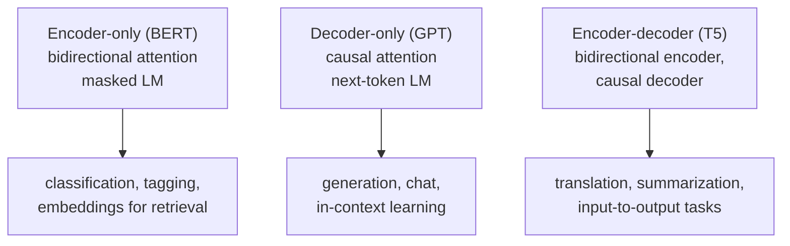

## Learning Objectives

- Explain what self-supervised pretraining is and why it can use orders of magnitude more data than supervised learning.
- Write down the causal (next-token) language modeling objective and explain how a causal attention mask lets one forward pass train every position at once.
- Describe BERT's masked language modeling objective, including the 80/10/10 replacement rule, and why it produces bidirectional representations.
- Choose between a decoder-only, encoder-only, and encoder-decoder model given what the downstream task needs, and explain perplexity as an evaluation metric.

## Context & Motivation

`ai-theory/deep-learning` built the transformer and trained it, implicitly, on some labeled task. Labeled data is the bottleneck: a sentiment dataset might have tens of thousands of examples, while the public web has trillions of words with no labels at all. The previous concept showed a way out for embeddings: invent a prediction task whose answers come from the text itself. Pretraining applies that same trick to an entire transformer.

Two objectives dominate. **Causal language modeling**, used by the GPT family, predicts each token from all the tokens before it. **Masked language modeling**, used by BERT (Devlin and colleagues at Google, 2019), hides some tokens and predicts them from both sides. They look like minor variations of one idea, but they produce models with different abilities, and that difference still shapes which architecture is used for which job.

The resulting recipe, pretrain once on a huge unlabeled corpus and then adapt to many tasks, is what the rest of this track builds on: scaling laws describe how pretraining improves with size, fine-tuning and alignment adapt the pretrained model, and retrieval supplements what it learned.

## Core Theory

### Causal language modeling

By the chain rule of probability, the probability of a sequence factorizes exactly into next-token predictions:

$$P(x_1, \dots, x_T) = \prod_{t=1}^{T} P(x_t \mid x_1, \dots, x_{t-1})$$

A causal language model parameterizes each factor with a transformer and minimizes the negative log-likelihood, the average cross-entropy between its predicted distribution and the actual next token:

$$\mathcal{L} = -\frac{1}{T} \sum_{t=1}^{T} \log P_\theta(x_t \mid x_1, \dots, x_{t-1})$$

The key engineering point is the **causal mask**. Inside self-attention, position `t` is only allowed to attend to positions `1..t`; scores for later positions are set to minus infinity before the softmax. With that mask, a single forward pass over a sequence of length `T` produces `T` valid predictions in parallel, one per position, each seeing only its own past. Training therefore gets `T` supervised examples from every sequence for the price of one pass, which is a large part of why decoder-only models train so efficiently.

At inference, the same model generates by **autoregressive decoding**: predict a distribution for the next token, choose one (greedily, or by sampling with a temperature, or among the top-k or top-p most likely), append it, and repeat. Generation is inherently sequential, one token per forward pass, which is why it is slower than training per token.

### Masked language modeling

BERT instead corrupts the input and asks the model to repair it. It selects 15% of the token positions; of those, 80% are replaced with a special `[MASK]` token, 10% with a random token, and 10% are left unchanged. The model, a transformer encoder with **no** causal mask, must predict the original token at every selected position. The loss is computed only on those positions.

Because there is no mask on attention, every position sees the entire sentence, left and right. The representation of `bank` in "she sat on the river bank" can use `river`, which a left-to-right model processing "she sat on the river" before reaching `bank` also could, but the representation of `river` can also use `bank`, which a causal model cannot. The 80/10/10 rule exists because `[MASK]` never appears at fine-tuning time; if the model only ever had to fix `[MASK]` tokens it could learn to ignore all other positions, so sometimes the token to repair looks normal.

The price is that a masked model is not a generator. It does not define a left-to-right probability for the whole sequence, and it learns from only 15% of positions per pass instead of all of them.

### Three architecture families

Encoder-decoder models such as T5 combine the two: a bidirectional encoder reads the input and a causal decoder generates the output while attending to the encoder. In practice, large decoder-only models turned out to handle most tasks well when the task is phrased as text to continue, which is why they became the default for general assistants, while encoder-only models remain common where a fixed-size representation of a whole input is the goal.

### Perplexity

A causal model is evaluated by **perplexity**, the exponential of the average per-token cross-entropy on held-out text: `PPL = exp(L)`. A perplexity of 20 means the model is, on average, as uncertain as if it were choosing uniformly among 20 tokens at each step. Lower is better, but perplexities are only comparable between models that share a tokenizer, because a different vocabulary changes what "one token" is.

## Worked Examples

### Example 1: how many predictions per sequence

**Problem:** A causal model and a masked model are each trained on the same batch of 1,000 sequences of 512 tokens. How many token predictions contribute to the loss in each case?

**Trace:** The causal model predicts every position from its prefix: 512 predictions per sequence (the first position is predicted from a beginning-of-sequence token), 512,000 in total. The masked model predicts only the 15% of selected positions: about 77 per sequence, roughly 77,000 in total. Per pass over the data, the causal objective extracts about 6.6 times more supervision. This does not make it strictly better (the masked predictions use context from both sides, a harder and richer task), but it explains why masked models need more passes to see the same amount of signal.

### Example 2: picking an architecture

**Problem:** A team needs (a) to classify customer emails into 12 categories, (b) to draft replies to those emails, and (c) to embed every past email so similar ones can be found quickly. Which pretraining family fits each part?

**Resolution:** (a) A classification over the whole input benefits from bidirectional context and needs no generation, so an encoder-only model with a classification head on its pooled output is a natural fit; a decoder-only model prompted with the categories also works, at higher inference cost. (b) Drafting text is generation, so it needs a causal decoder, either decoder-only or encoder-decoder. (c) Similarity search needs one fixed vector per email; encoder-only models fine-tuned for sentence embeddings are the standard choice, and they become the retriever in the retrieval-augmented generation concept later in this track.

## Common Misconceptions & Pitfalls

- **"A causal model cannot use right context at all, so it is useless for understanding."** It cannot look ahead during a single prediction, but a decoder-only model can still read the whole input before producing an answer, because the input is a prefix of what it generates. The restriction is on each position's representation, not on what the model can be asked.
- **"Masked language models can generate text by filling masks one at a time."** They were not trained to define a coherent left-to-right distribution, and iterative mask filling produces noticeably worse text than a causal model of similar size.
- **"Lower perplexity always means a better assistant."** Perplexity measures how well the model predicts held-out text like its training data. Following instructions, refusing harmful requests, and being factually careful are separate properties, addressed later in this track by fine-tuning and preference alignment.

## Summary

Pretraining manufactures supervision from unlabeled text. Causal language modeling predicts each token from its past; a causal attention mask lets one pass train every position, and the resulting model generates autoregressively. Masked language modeling hides 15% of tokens and predicts them from both sides, giving bidirectional representations well suited to classification and embeddings but not to generation. Encoder-only, decoder-only, and encoder-decoder architectures follow from these choices, and perplexity measures how well a causal model predicts held-out text. The next concept asks how that loss improves as models, data, and compute grow.

## Documentation Links

- [Devlin et al.: BERT: Pre-training of Deep Bidirectional Transformers for Language Understanding (NAACL 2019)](https://arxiv.org/abs/1810.04805): doc
- [Radford et al.: Language Models are Unsupervised Multitask Learners (GPT-2, 2019)](https://cdn.openai.com/better-language-models/language_models_are_unsupervised_multitask_learners.pdf): doc
- [Stanford CS224N: Natural Language Processing with Deep Learning](https://web.stanford.edu/class/cs224n/): doc
