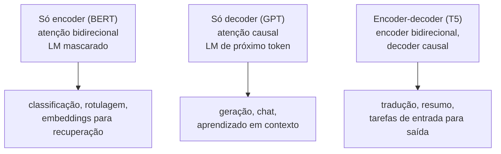

## Objetivos de Aprendizagem

- Explicar o que é pré-treino autossupervisionado e por que ele consegue usar ordens de grandeza mais dados do que o aprendizado supervisionado.
- Escrever o objetivo de modelagem de linguagem causal (próximo token) e explicar como uma máscara de atenção causal permite que uma única passada treine todas as posições ao mesmo tempo.
- Descrever o objetivo de modelagem de linguagem mascarada do BERT, incluindo a regra de substituição 80/10/10, e por que ele produz representações bidirecionais.
- Escolher entre um modelo só decoder, só encoder ou encoder-decoder a partir do que a tarefa final precisa, e explicar perplexidade como métrica de avaliação.

## Contexto e Motivação

`ai-theory/deep-learning` construiu o transformer e o treinou, implicitamente, em alguma tarefa rotulada. Dados rotulados são o gargalo: um dataset de sentimento pode ter dezenas de milhares de exemplos, enquanto a web pública tem trilhões de palavras sem rótulo nenhum. O conceito anterior mostrou uma saída para embeddings: inventar uma tarefa de previsão cujas respostas vêm do próprio texto. O pré-treino aplica esse mesmo truque a um transformer inteiro.

Dois objetivos dominam. A **modelagem de linguagem causal**, usada pela família GPT, prevê cada token a partir de todos os tokens anteriores. A **modelagem de linguagem mascarada**, usada pelo BERT (Devlin e colegas no Google, 2019), esconde alguns tokens e os prevê a partir dos dois lados. Parecem pequenas variações de uma mesma ideia, mas produzem modelos com habilidades diferentes, e essa diferença ainda define qual arquitetura é usada para qual trabalho.

A receita resultante, pré-treinar uma vez num corpus enorme sem rótulos e depois adaptar a muitas tarefas, é a base do resto desta trilha: leis de escala descrevem como o pré-treino melhora com o tamanho, fine-tuning e alinhamento adaptam o modelo pré-treinado, e a recuperação complementa o que ele aprendeu.

## Teoria Central

### Modelagem de linguagem causal

Pela regra da cadeia da probabilidade, a probabilidade de uma sequência se fatora exatamente em previsões de próximo token:

$$P(x_1, \dots, x_T) = \prod_{t=1}^{T} P(x_t \mid x_1, \dots, x_{t-1})$$

Um modelo de linguagem causal parametriza cada fator com um transformer e minimiza a log-verossimilhança negativa, a entropia cruzada média entre a distribuição prevista e o próximo token real:

$$\mathcal{L} = -\frac{1}{T} \sum_{t=1}^{T} \log P_\theta(x_t \mid x_1, \dots, x_{t-1})$$

O ponto de engenharia central é a **máscara causal**. Dentro da self-attention, a posição `t` só pode atender às posições `1..t`; os escores das posições posteriores viram menos infinito antes do softmax. Com essa máscara, uma única passada direta sobre uma sequência de comprimento `T` produz `T` previsões válidas em paralelo, uma por posição, cada uma vendo só o próprio passado. O treino, portanto, tira `T` exemplos supervisionados de cada sequência pelo preço de uma passada, e isso explica boa parte de por que modelos só decoder treinam com tanta eficiência.

Na inferência, o mesmo modelo gera por **decodificação autorregressiva**: prevê uma distribuição para o próximo token, escolhe um (de forma gulosa, ou amostrando com uma temperatura, ou entre os top-k ou top-p mais prováveis), anexa e repete. A geração é inerentemente sequencial, um token por passada, e por isso é mais lenta por token do que o treino.

### Modelagem de linguagem mascarada

O BERT, em vez disso, corrompe a entrada e pede ao modelo que a conserte. Ele seleciona 15% das posições de token; dessas, 80% são trocadas por um token especial `[MASK]`, 10% por um token aleatório e 10% ficam inalteradas. O modelo, um encoder transformer **sem** máscara causal, precisa prever o token original em cada posição selecionada. A perda é calculada só nessas posições.

Como não há máscara na atenção, toda posição vê a frase inteira, à esquerda e à direita. A representação de `banco` em "ela sentou no banco da praça" pode usar `praça`, algo que um modelo da esquerda para a direita não consegue ao processar `banco` antes de chegar em `praça`. A regra 80/10/10 existe porque `[MASK]` nunca aparece no fine-tuning; se o modelo só tivesse que consertar tokens `[MASK]`, poderia aprender a ignorar todas as outras posições, então às vezes o token a consertar parece normal.

O preço é que um modelo mascarado não é um gerador. Ele não define uma probabilidade da esquerda para a direita para a sequência inteira, e aprende com só 15% das posições por passada em vez de todas.

### Três famílias de arquitetura

Modelos encoder-decoder como o T5 combinam os dois: um encoder bidirecional lê a entrada e um decoder causal gera a saída enquanto atende ao encoder. Na prática, modelos grandes só decoder se mostraram bons na maioria das tarefas quando a tarefa é formulada como texto a continuar, e por isso viraram o padrão para assistentes gerais, enquanto modelos só encoder continuam comuns quando o objetivo é uma representação de tamanho fixo de uma entrada inteira.

### Perplexidade

Um modelo causal é avaliado pela **perplexidade**, a exponencial da entropia cruzada média por token em texto separado: `PPL = exp(L)`. Uma perplexidade de 20 significa que o modelo está, em média, tão incerto quanto se escolhesse uniformemente entre 20 tokens a cada passo. Menor é melhor, mas perplexidades só são comparáveis entre modelos que compartilham o tokenizador, porque um vocabulário diferente muda o que é "um token".

## Exemplos Resolvidos

### Exemplo 1: quantas previsões por sequência

**Problema:** Um modelo causal e um modelo mascarado são treinados cada um no mesmo lote de 1.000 sequências de 512 tokens. Quantas previsões de token contribuem para a perda em cada caso?

**Rastreamento:** O modelo causal prevê toda posição a partir do seu prefixo: 512 previsões por sequência (a primeira posição é prevista a partir de um token de início de sequência), 512.000 no total. O modelo mascarado prevê só os 15% de posições selecionadas: cerca de 77 por sequência, aproximadamente 77.000 no total. Por passada nos dados, o objetivo causal extrai cerca de 6,6 vezes mais supervisão. Isso não o torna estritamente melhor (as previsões mascaradas usam contexto dos dois lados, uma tarefa mais difícil e mais rica), mas explica por que modelos mascarados precisam de mais passadas para ver a mesma quantidade de sinal.

### Exemplo 2: escolhendo uma arquitetura

**Problema:** Um time precisa (a) classificar e-mails de clientes em 12 categorias, (b) redigir respostas para esses e-mails e (c) gerar embeddings de todo e-mail antigo para encontrar rapidamente os parecidos. Qual família de pré-treino serve para cada parte?

**Resolução:** (a) Uma classificação sobre a entrada inteira se beneficia de contexto bidirecional e não precisa de geração, então um modelo só encoder com uma cabeça de classificação sobre a saída agregada é um encaixe natural; um modelo só decoder instruído com as categorias também funciona, com custo de inferência maior. (b) Redigir texto é geração, então precisa de um decoder causal, seja só decoder ou encoder-decoder. (c) Busca por similaridade precisa de um vetor fixo por e-mail; modelos só encoder ajustados para embeddings de frase são a escolha padrão, e eles viram o recuperador no conceito de geração aumentada por recuperação, mais adiante nesta trilha.

## Equívocos Comuns e Armadilhas

- **"Um modelo causal não usa contexto à direita de jeito nenhum, então é inútil para compreensão."** Ele não pode olhar à frente durante uma única previsão, mas um modelo só decoder ainda pode ler a entrada inteira antes de produzir uma resposta, porque a entrada é um prefixo do que ele gera. A restrição é sobre a representação de cada posição, não sobre o que se pode perguntar ao modelo.
- **"Modelos de linguagem mascarados geram texto preenchendo máscaras uma de cada vez."** Eles não foram treinados para definir uma distribuição coerente da esquerda para a direita, e o preenchimento iterativo de máscaras produz texto visivelmente pior do que um modelo causal de tamanho parecido.
- **"Perplexidade menor sempre significa um assistente melhor."** A perplexidade mede o quão bem o modelo prevê texto separado parecido com os dados de treino. Seguir instruções, recusar pedidos nocivos e ser cuidadoso com fatos são propriedades separadas, tratadas mais adiante nesta trilha por fine-tuning e alinhamento por preferências.

## Resumo

O pré-treino fabrica supervisão a partir de texto sem rótulo. A modelagem de linguagem causal prevê cada token a partir do seu passado; uma máscara de atenção causal permite que uma passada treine todas as posições, e o modelo resultante gera de forma autorregressiva. A modelagem de linguagem mascarada esconde 15% dos tokens e os prevê a partir dos dois lados, dando representações bidirecionais boas para classificação e embeddings, mas não para geração. As arquiteturas só encoder, só decoder e encoder-decoder decorrem dessas escolhas, e a perplexidade mede o quão bem um modelo causal prevê texto separado. O próximo conceito pergunta como essa perda melhora conforme modelos, dados e computação crescem.

## Documentation Links

- [Devlin et al.: BERT: Pre-training of Deep Bidirectional Transformers for Language Understanding (NAACL 2019)](https://arxiv.org/abs/1810.04805): doc
- [Radford et al.: Language Models are Unsupervised Multitask Learners (GPT-2, 2019)](https://cdn.openai.com/better-language-models/language_models_are_unsupervised_multitask_learners.pdf): doc
- [Stanford CS224N: Natural Language Processing with Deep Learning](https://web.stanford.edu/class/cs224n/): doc
