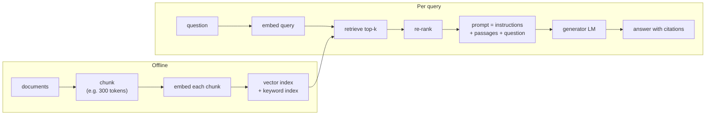

## Learning Objectives

- Explain three limits of knowledge stored only in model weights: staleness, missing private data, and unreliable recall of rare facts.
- Describe the retrieve-then-generate pipeline: chunking, embedding, indexing, retrieval, and conditioning the generator on retrieved text.
- Contrast sparse (BM25) and dense (dual-encoder) retrieval and explain why hybrid retrieval and re-ranking are common.
- Evaluate a RAG system separately at the retrieval stage (recall@k) and at the generation stage (faithfulness to the retrieved sources).

## Context & Motivation

A pretrained model stores what it learned from its corpus in its weights, compressed and blended. That storage has three structural problems. It is **stale**: the model knows nothing after its training cutoff. It is **incomplete**: a company's internal documentation, a user's files, and yesterday's support tickets were never in the training data. And it is **unreliable for rare facts**: a figure mentioned once in the corpus may be recalled vaguely or invented confidently, and the model cannot point to where it came from. The fine-tuning concept noted that teaching new facts through gradient updates is a poor fix.

Retrieval-augmented generation (RAG), named by Lewis and colleagues at Facebook AI Research in 2020, separates the two jobs. A **retriever** finds relevant passages in an external collection at query time; a **generator** writes the answer conditioned on those passages. Updating knowledge means updating the collection, which takes seconds, not a training run, and every claim can be traced to a source. The same paper's dense retriever built on Dense Passage Retrieval (Karpukhin and colleagues, 2020), which showed that learned embeddings, descendants of the word vectors from earlier in this track, can beat classic keyword search for open-domain question answering.

## Core Theory

### The pipeline

**Chunking** splits documents into passages small enough to be specific and large enough to be self-contained, often a few hundred tokens with some overlap. **Indexing** computes an embedding for each chunk and stores it in a structure supporting fast nearest-neighbor search. At query time, the question is embedded, the top-`k` most similar chunks are fetched, and they are placed in the prompt with an instruction to answer using them.

### Sparse retrieval: BM25

The classic method scores a document by the query terms it contains. **BM25** weights each matching term by its inverse document frequency (rare terms count more), saturates repeated occurrences (the tenth mention adds little), and normalizes for document length. It needs no training, is exact on identifiers and rare names, and is easy to explain. Its weakness is vocabulary mismatch: a query about "car" will not match a passage that only says "automobile".

### Dense retrieval: dual encoders

A **dual encoder** uses two transformer encoders (often sharing weights), one for queries and one for passages, each producing a single vector. Relevance is the dot product `score(q, p) = E_Q(q) · E_P(p)`. It is trained contrastively on (question, relevant passage) pairs: the correct passage's score is pushed above the scores of other passages in the same batch, the in-batch negatives, the same idea as negative sampling in word2vec. Because passage vectors do not depend on the query, they are computed once offline. At query time, finding the top-`k` dot products among millions of vectors uses **approximate nearest-neighbor** indexes (graph-based such as HNSW, or clustering plus quantization) that trade a small loss of recall for orders-of-magnitude speedups.

### Hybrid retrieval and re-ranking

Sparse and dense methods fail on different queries, so production systems often run both and merge the ranked lists. A **re-ranker** then re-scores a few dozen candidates with a **cross-encoder**, a model that reads query and passage together, which is far more accurate than comparing two independent vectors but too slow to run over the whole collection. Retrieve broadly and cheaply, then rank narrowly and carefully.

### Evaluating the two stages separately

When a RAG answer is wrong, the cause is either that the right passage was not retrieved, or that it was retrieved and the generator ignored or misread it. Measure them separately. For retrieval, **recall@k**: the fraction of questions for which a passage containing the answer appears among the top `k`. For generation, **faithfulness**: whether every claim in the answer is supported by the retrieved passages, plus answer correctness against a reference. A system with 60% recall@5 cannot exceed about 60% accuracy on questions that need the collection, no matter how good the generator is.

## Worked Examples

### Example 1: diagnosing a failure

**Problem:** An internal assistant answers "What is our parental leave policy?" with an outdated 12-week figure, though the current policy document says 16 weeks. Logs show the top-3 retrieved chunks were from the 2023 handbook. What failed, and what are two fixes?

**Trace:** Retrieval failed, not generation: the generator faithfully used what it was given. The old and new documents are semantically almost identical, so embedding similarity cannot tell them apart. Fixes: attach metadata (effective date, document status) to chunks and filter or boost current documents at retrieval time; and remove or mark superseded documents in the index so they are not candidates. Changing the generator would not help, because the correct passage never reached it.

### Example 2: sparse versus dense on two queries

**Problem:** For the queries (a) "error E-4012 on checkout" and (b) "why does paying fail sometimes", which retriever is likely to find the right troubleshooting page, which says "Error code E-4012 indicates the payment gateway timed out"?

**Resolution:** (a) contains a rare exact token, `E-4012`, with very high inverse document frequency; BM25 will rank the page first, while a dense encoder may blur the code into a generic "payment error" region and rank several similar pages above it. (b) shares almost no words with the page ("paying" versus "payment", "fail" versus "timed out"); BM25 scores it poorly, while a dense retriever trained on question-passage pairs maps both near the same meaning. This complementary pattern is the standard argument for hybrid retrieval.

## Common Misconceptions & Pitfalls

- **"With retrieval, the model cannot hallucinate."** The generator can still ignore passages, merge them incorrectly, or fill gaps from its weights. Prompts that require citations and evaluations that check faithfulness reduce this but do not eliminate it.
- **"A longer context window makes retrieval unnecessary."** Putting an entire knowledge base in every prompt is expensive per request, and models use information in very long contexts unevenly, attending less reliably to material in the middle. Retrieval keeps the context small and relevant.
- **"Retrieved text is trusted input."** Retrieved documents may contain instructions planted by whoever wrote them (indirect prompt injection). They should be treated as data to quote, never as commands, and access control must be applied at retrieval time so a user never receives passages they are not allowed to read.

## Summary

Knowledge in weights is stale, incomplete, and unreliable for rare facts. RAG retrieves relevant passages from an external collection at query time and conditions generation on them, so knowledge updates are index updates and answers can cite sources. Sparse retrieval (BM25) excels at exact rare terms, dense dual-encoder retrieval at paraphrase; hybrid retrieval plus cross-encoder re-ranking combines them. Retrieval recall and generation faithfulness must be measured separately, because each stage fails differently. The next concept leaves text and turns to images, starting with locating objects rather than just classifying them.

## Documentation Links

- [Lewis et al.: Retrieval-Augmented Generation for Knowledge-Intensive NLP Tasks (NeurIPS 2020)](https://arxiv.org/abs/2005.11401): doc
- [Karpukhin et al.: Dense Passage Retrieval for Open-Domain Question Answering (EMNLP 2020)](https://arxiv.org/abs/2004.04906): doc
- [Stanford CS224N: Natural Language Processing with Deep Learning](https://web.stanford.edu/class/cs224n/): doc
