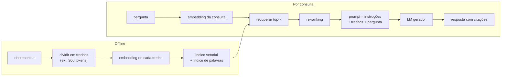

## Objetivos de Aprendizagem

- Explicar três limites do conhecimento guardado só nos pesos do modelo: desatualização, falta de dados privados e lembrança pouco confiável de fatos raros.
- Descrever o pipeline de recuperar e depois gerar: divisão em trechos, embedding, indexação, recuperação e condicionamento do gerador no texto recuperado.
- Contrastar recuperação esparsa (BM25) e densa (dual encoder) e explicar por que recuperação híbrida e re-ranking são comuns.
- Avaliar um sistema RAG separadamente na etapa de recuperação (recall@k) e na etapa de geração (fidelidade às fontes recuperadas).

## Contexto e Motivação

Um modelo pré-treinado guarda o que aprendeu do corpus nos seus pesos, comprimido e misturado. Esse armazenamento tem três problemas estruturais. Ele fica **desatualizado**: o modelo não sabe nada depois do seu corte de treino. É **incompleto**: a documentação interna de uma empresa, os arquivos de um usuário e os chamados de suporte de ontem nunca estiveram nos dados de treino. E é **pouco confiável para fatos raros**: um número citado uma única vez no corpus pode ser lembrado vagamente ou inventado com confiança, e o modelo não consegue apontar de onde veio. O conceito de fine-tuning notou que ensinar fatos novos por atualizações de gradiente é uma correção ruim.

A geração aumentada por recuperação (RAG), batizada por Lewis e colegas no Facebook AI Research em 2020, separa os dois trabalhos. Um **recuperador** encontra trechos relevantes numa coleção externa no momento da consulta; um **gerador** escreve a resposta condicionado a esses trechos. Atualizar o conhecimento significa atualizar a coleção, o que leva segundos, não uma execução de treino, e toda afirmação pode ser rastreada até uma fonte. O recuperador denso do mesmo artigo se baseou no Dense Passage Retrieval (Karpukhin e colegas, 2020), que mostrou que embeddings aprendidos, descendentes dos vetores de palavras vistos antes nesta trilha, podem vencer a busca clássica por palavras-chave em perguntas de domínio aberto.

## Teoria Central

### O pipeline

A **divisão em trechos** (chunking) quebra os documentos em passagens pequenas o bastante para serem específicas e grandes o bastante para fazerem sentido sozinhas, muitas vezes algumas centenas de tokens com alguma sobreposição. A **indexação** calcula um embedding para cada trecho e o guarda numa estrutura que permite busca rápida por vizinhos mais próximos. Na consulta, a pergunta passa por embedding, os `k` trechos mais parecidos são buscados e colocados no prompt com uma instrução para responder usando-os.

### Recuperação esparsa: BM25

O método clássico pontua um documento pelos termos da consulta que ele contém. O **BM25** pesa cada termo encontrado pela sua frequência inversa nos documentos (termos raros contam mais), satura ocorrências repetidas (a décima menção acrescenta pouco) e normaliza pelo comprimento do documento. Ele não precisa de treino, é exato em identificadores e nomes raros e é fácil de explicar. A sua fraqueza é o descasamento de vocabulário: uma consulta sobre "carro" não casa com um trecho que só diz "automóvel".

### Recuperação densa: dual encoders

Um **dual encoder** usa dois encoders transformer (muitas vezes compartilhando pesos), um para consultas e outro para trechos, cada um produzindo um único vetor. A relevância é o produto interno `score(q, p) = E_Q(q) · E_P(p)`. Ele é treinado de forma contrastiva em pares (pergunta, trecho relevante): o escore do trecho correto é empurrado acima dos escores dos outros trechos do mesmo lote, os negativos do lote, a mesma ideia do negative sampling do word2vec. Como os vetores dos trechos não dependem da consulta, eles são calculados uma vez, offline. Na consulta, achar os `k` maiores produtos internos entre milhões de vetores usa índices de **vizinhos mais próximos aproximados** (baseados em grafos, como o HNSW, ou em agrupamento mais quantização) que trocam uma pequena perda de recall por acelerações de ordens de grandeza.

### Recuperação híbrida e re-ranking

Métodos esparsos e densos falham em consultas diferentes, então sistemas em produção costumam rodar os dois e mesclar as listas ranqueadas. Um **re-ranker** então repontua algumas dezenas de candidatos com um **cross-encoder**, um modelo que lê consulta e trecho juntos, muito mais preciso do que comparar dois vetores independentes, mas lento demais para rodar sobre a coleção inteira. Recupere de forma ampla e barata, depois ranqueie de forma estreita e cuidadosa.

### Avaliando as duas etapas separadamente

Quando uma resposta RAG está errada, a causa é que o trecho certo não foi recuperado, ou que foi recuperado e o gerador o ignorou ou o leu errado. Meça separadamente. Para a recuperação, **recall@k**: a fração de perguntas para as quais um trecho contendo a resposta aparece entre os `k` primeiros. Para a geração, **fidelidade**: se toda afirmação da resposta é sustentada pelos trechos recuperados, mais a correção da resposta contra uma referência. Um sistema com 60% de recall@5 não passa de uns 60% de acerto nas perguntas que dependem da coleção, por melhor que seja o gerador.

## Exemplos Resolvidos

### Exemplo 1: diagnosticando uma falha

**Problema:** Um assistente interno responde "Qual é a nossa política de licença parental?" com um número desatualizado de 12 semanas, embora o documento de política atual diga 16 semanas. Os logs mostram que os 3 trechos recuperados vieram do manual de 2023. O que falhou, e quais são duas correções?

**Rastreamento:** A recuperação falhou, não a geração: o gerador usou fielmente o que recebeu. O documento antigo e o novo são semanticamente quase idênticos, então a similaridade de embeddings não consegue distingui-los. Correções: anexar metadados (data de vigência, status do documento) aos trechos e filtrar ou impulsionar documentos vigentes na recuperação; e remover ou marcar documentos substituídos no índice para que não sejam candidatos. Trocar o gerador não ajudaria, porque o trecho correto nunca chegou até ele.

### Exemplo 2: esparso versus denso em duas consultas

**Problema:** Para as consultas (a) "erro E-4012 no checkout" e (b) "por que pagar às vezes falha", qual recuperador tende a achar a página de solução de problemas certa, que diz "O código de erro E-4012 indica que o gateway de pagamento excedeu o tempo limite"?

**Resolução:** (a) contém um token exato e raro, `E-4012`, com frequência inversa muito alta; o BM25 vai ranquear a página em primeiro, enquanto um encoder denso pode diluir o código numa região genérica de "erro de pagamento" e ranquear várias páginas parecidas acima dela. (b) quase não compartilha palavras com a página ("pagar" versus "pagamento", "falha" versus "excedeu o tempo limite"); o BM25 a pontua mal, enquanto um recuperador denso treinado em pares pergunta-trecho mapeia as duas perto do mesmo significado. Esse padrão complementar é o argumento padrão a favor da recuperação híbrida.

## Equívocos Comuns e Armadilhas

- **"Com recuperação, o modelo não alucina."** O gerador ainda pode ignorar trechos, juntá-los de forma errada ou preencher lacunas com os seus pesos. Prompts que exigem citações e avaliações que checam fidelidade reduzem isso, mas não eliminam.
- **"Uma janela de contexto maior torna a recuperação desnecessária."** Colocar uma base de conhecimento inteira em todo prompt é caro por requisição, e modelos usam informação em contextos muito longos de forma desigual, atendendo com menos confiabilidade ao material do meio. A recuperação mantém o contexto pequeno e relevante.
- **"Texto recuperado é entrada confiável."** Documentos recuperados podem conter instruções plantadas por quem os escreveu (injeção indireta de prompt). Eles devem ser tratados como dados a citar, nunca como comandos, e o controle de acesso precisa ser aplicado na recuperação, para que um usuário nunca receba trechos que não pode ler.

## Resumo

O conhecimento nos pesos é desatualizado, incompleto e pouco confiável para fatos raros. O RAG recupera trechos relevantes de uma coleção externa no momento da consulta e condiciona a geração a eles, de modo que atualizar conhecimento é atualizar o índice e as respostas podem citar fontes. A recuperação esparsa (BM25) se destaca em termos exatos e raros, a recuperação densa com dual encoder em paráfrases; recuperação híbrida mais re-ranking com cross-encoder combina as duas. O recall da recuperação e a fidelidade da geração precisam ser medidos separadamente, porque cada etapa falha de um jeito. O próximo conceito sai do texto e vai para imagens, começando por localizar objetos em vez de só classificá-los.

## Documentation Links

- [Lewis et al.: Retrieval-Augmented Generation for Knowledge-Intensive NLP Tasks (NeurIPS 2020)](https://arxiv.org/abs/2005.11401): doc
- [Karpukhin et al.: Dense Passage Retrieval for Open-Domain Question Answering (EMNLP 2020)](https://arxiv.org/abs/2004.04906): doc
- [Stanford CS224N: Natural Language Processing with Deep Learning](https://web.stanford.edu/class/cs224n/): doc
