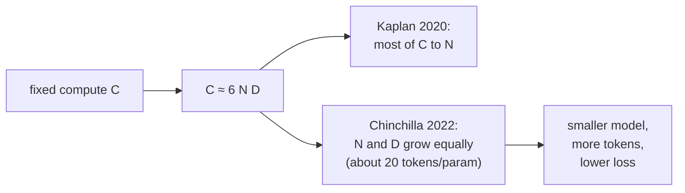

## Learning Objectives

- Describe the empirical finding that language-model test loss falls as a power law in parameters, data, and compute, and read a power law on a log-log plot.
- Use the approximation `C ≈ 6 · N · D` to relate training compute to model size and number of training tokens.
- Explain how the Chinchilla analysis changed the recommended split of a fixed compute budget between parameters and data, and apply the "about 20 tokens per parameter" rule.
- Recognize what scaling laws do not predict: specific capabilities, behavior outside the fitted range, and inference cost.

## Context & Motivation

`ai-theory/machine-learning` framed model size through the bias-variance trade-off: a model too small underfits, a model too large for its data overfits, and validation error has a sweet spot. Large language models trained on enormous corpora live in a different regime. They typically see each training token only once or a few times, so classic overfitting barely appears, and making them bigger keeps helping. The practical question becomes an allocation problem: given a fixed budget of GPU time, how large should the model be, and how many tokens should it train on?

In 2020, Kaplan and colleagues at OpenAI measured this systematically across models spanning more than six orders of magnitude in size and found that test loss follows remarkably smooth power laws. Two years later, Hoffmann and colleagues at DeepMind repeated the analysis with a different experimental design and reached a substantially different allocation, which they validated by training Chinchilla, a 70-billion-parameter model that outperformed the 280-billion-parameter Gopher trained with the same compute. These two papers turned model sizing from intuition into a calculation, and they are why frontier labs fit scaling curves on small models before committing to a large run.

## Core Theory

### Power laws

A power law has the form `L(x) = (x_c / x)^α`: multiplying the input `x` by a constant factor multiplies the loss by a constant factor, regardless of where you start. On a log-log plot it is a straight line with slope `−α`. Kaplan et al. found, for models not bottlenecked by the other two factors:

$$L(N) \approx \Big(\frac{N_c}{N}\Big)^{0.076}, \qquad L(D) \approx \Big(\frac{D_c}{D}\Big)^{0.095}, \qquad L(C) \approx \Big(\frac{C_c}{C}\Big)^{0.050}$$

Here `N` counts non-embedding parameters, `D` training tokens, and `C` training compute.

The small exponents mean improvement is slow but extremely steady: each 10x increase in compute buys roughly the same fractional reduction in loss. Architecture details such as depth versus width mattered surprisingly little compared with total scale, within the ranges tested.

### Counting compute

Training a dense transformer costs approximately `C ≈ 6 · N · D` floating-point operations: about 2 FLOPs per parameter per token for the forward pass (one multiply and one add) and about 4 for the backward pass. This simple formula connects the three quantities, so for a given compute budget, choosing `N` determines `D` and vice versa.

### The allocation question and the Chinchilla correction

Kaplan et al. concluded that, as compute grows, most of it should go to a bigger model, with parameters growing roughly as `C^0.73` and data much more slowly. Models of that era followed this advice: GPT-3 had 175 billion parameters but trained on only about 300 billion tokens.

Hoffmann et al. pointed out that the earlier experiments used a fixed learning-rate schedule length for all runs, which systematically understated how much smaller models improve when trained longer. With schedules matched to each run's length, they fit a loss model with a separate term for each resource:

$$L(N, D) = E + \frac{A}{N^{\alpha}} + \frac{B}{D^{\beta}}, \qquad E \approx 1.69,\ A \approx 406.4,\ B \approx 410.7,\ \alpha \approx 0.34,\ \beta \approx 0.28$$

`E` is the irreducible loss (the entropy of text itself); the other two terms are the penalties for finite model size and finite data. Minimizing this subject to `6ND = C` gives `N_opt ∝ C^0.5` and `D_opt ∝ C^0.5`: parameters and tokens should grow in equal proportion. Empirically this works out to roughly **20 training tokens per parameter** at the compute-optimal point, far more data than GPT-3 used.

### Compute-optimal is not the only optimum

Chinchilla minimizes loss for a given training budget. A model that will serve billions of requests also pays for every inference, and inference cost is proportional to `N`, not to `D`. It is therefore often rational to train a smaller model on far more than 20 tokens per parameter: training costs more than the compute-optimal recipe for that loss, but every later request is cheaper. Many widely deployed open models are trained at hundreds or thousands of tokens per parameter for exactly this reason.

## Worked Examples

### Example 1: sizing a run from a budget

**Problem:** A lab has a training budget of `C = 5.76 × 10^23` FLOPs. Using `C ≈ 6ND` and the 20-tokens-per-parameter rule, find the compute-optimal model size and token count.

**Trace:** Substitute `D = 20N` into `C = 6ND`: `C = 6 · N · 20N = 120 N^2`. Then `N^2 = 5.76 × 10^23 / 120 = 4.8 × 10^21`, so `N ≈ 6.9 × 10^10`, about 70 billion parameters. `D = 20N ≈ 1.4 × 10^12`, about 1.4 trillion tokens. These are exactly Chinchilla's settings. The same budget spent the Kaplan way produced Gopher, 280 billion parameters on about 300 billion tokens, and Chinchilla beat it on nearly every benchmark reported.

### Example 2: when to overtrain

**Problem:** Two models reach the same validation loss: model A has 70B parameters trained compute-optimally; model B has 13B parameters trained on many more tokens, costing 1.5 times A's training compute. The model will serve 10^12 tokens of inference per month for two years. Which is cheaper overall?

**Resolution:** Inference costs about `2N` FLOPs per generated token. For A, `2 · 7 × 10^10 · 10^12 = 1.4 × 10^23` FLOPs per month; for B, `2 · 1.3 × 10^10 · 10^12 = 2.6 × 10^22`. Over 24 months, A spends about `3.4 × 10^24` on inference and B about `6.2 × 10^23`, a difference of roughly `2.7 × 10^24`. B's extra training cost is half of A's training budget; if A's training was on the order of `5.8 × 10^23` (Example 1), B's extra is about `2.9 × 10^23`, an order of magnitude smaller than the inference savings. B is far cheaper overall. Compute-optimal training answers a narrower question than "what should we deploy".

## Common Misconceptions & Pitfalls

- **"Scaling laws predict when a model gains a specific ability."** They predict average test loss. Performance on a particular benchmark can stay flat and then rise sharply as loss improves smoothly; forecasting those jumps from loss alone is unreliable.
- **"A power law fitted on small models holds forever."** It is an empirical fit over a measured range. Extrapolating several orders of magnitude assumes no change in data quality, data availability, or architecture, and running out of high-quality unique text is a real constraint that the original fits did not model.
- **"Bigger is always better, so maximize N."** For a fixed compute budget, an oversized model trained on too few tokens reaches a worse loss than a smaller one trained longer. That was the core of the Chinchilla correction.

## Summary

Language-model test loss decreases as a smooth power law in parameters, data, and compute, so performance at scale can be forecast from small runs. Training compute is approximately `6ND`, which links model size and token count under a fixed budget. The Chinchilla analysis showed parameters and tokens should grow together, about 20 tokens per parameter at the compute-optimal point, correcting an earlier recipe that favored oversized models trained on too little data. When inference dominates cost, training a smaller model well past that point is often the better trade. The next concept turns from building a pretrained model to adapting one cheaply.

## Documentation Links

- [Kaplan et al.: Scaling Laws for Neural Language Models (2020)](https://arxiv.org/abs/2001.08361): doc
- [Hoffmann et al.: Training Compute-Optimal Large Language Models (Chinchilla, 2022)](https://arxiv.org/abs/2203.15556): doc
- [Stanford CS336: Language Modeling from Scratch](https://stanford-cs336.github.io/spring2025/): doc
