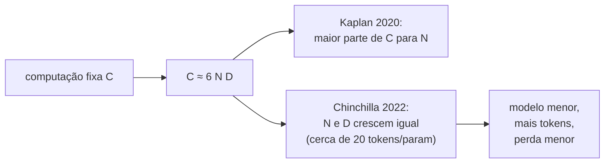

## Objetivos de Aprendizagem

- Descrever o achado empírico de que a perda de teste de modelos de linguagem cai como lei de potência em parâmetros, dados e computação, e ler uma lei de potência num gráfico log-log.
- Usar a aproximação `C ≈ 6 · N · D` para relacionar a computação de treino com o tamanho do modelo e o número de tokens de treino.
- Explicar como a análise do Chinchilla mudou a divisão recomendada de um orçamento fixo de computação entre parâmetros e dados, e aplicar a regra de "cerca de 20 tokens por parâmetro".
- Reconhecer o que as leis de escala não preveem: capacidades específicas, comportamento fora da faixa ajustada e custo de inferência.

## Contexto e Motivação

`ai-theory/machine-learning` tratou o tamanho do modelo pelo compromisso entre viés e variância: um modelo pequeno demais sofre underfitting, um grande demais para os seus dados sofre overfitting, e o erro de validação tem um ponto ótimo. Modelos de linguagem grandes, treinados em corpora enormes, vivem num regime diferente. Eles normalmente veem cada token de treino só uma ou poucas vezes, então o overfitting clássico quase não aparece, e aumentá-los continua ajudando. A pergunta prática vira um problema de alocação: dado um orçamento fixo de tempo de GPU, qual tamanho o modelo deve ter e com quantos tokens ele deve treinar?

Em 2020, Kaplan e colegas na OpenAI mediram isso sistematicamente em modelos cobrindo mais de seis ordens de grandeza de tamanho e descobriram que a perda de teste segue leis de potência notavelmente suaves. Dois anos depois, Hoffmann e colegas na DeepMind repetiram a análise com outro desenho experimental e chegaram a uma alocação bem diferente, validada treinando o Chinchilla, um modelo de 70 bilhões de parâmetros que superou o Gopher, de 280 bilhões, treinado com a mesma computação. Esses dois artigos transformaram o dimensionamento de modelos de intuição em cálculo, e são o motivo de laboratórios de ponta ajustarem curvas de escala em modelos pequenos antes de se comprometerem com uma execução grande.

## Teoria Central

### Leis de potência

Uma lei de potência tem a forma `L(x) = (x_c / x)^α`: multiplicar a entrada `x` por um fator constante multiplica a perda por um fator constante, não importa de onde se parta. Num gráfico log-log ela é uma reta com inclinação `−α`. Kaplan et al. encontraram, para modelos não limitados pelos outros dois fatores:

$$L(N) \approx \Big(\frac{N_c}{N}\Big)^{0.076}, \qquad L(D) \approx \Big(\frac{D_c}{D}\Big)^{0.095}, \qquad L(C) \approx \Big(\frac{C_c}{C}\Big)^{0.050}$$

Aqui `N` conta os parâmetros fora da camada de embedding, `D` os tokens de treino e `C` a computação de treino.

Os expoentes pequenos significam que a melhora é lenta, mas extremamente estável: cada aumento de 10x em computação compra aproximadamente a mesma redução fracionária na perda. Detalhes de arquitetura como profundidade versus largura importaram surpreendentemente pouco comparados com a escala total, dentro das faixas testadas.

### Contando computação

Treinar um transformer denso custa aproximadamente `C ≈ 6 · N · D` operações de ponto flutuante: cerca de 2 FLOPs por parâmetro por token na passada direta (uma multiplicação e uma soma) e cerca de 4 na passada reversa. Essa fórmula simples liga as três grandezas, então, para um orçamento de computação dado, escolher `N` determina `D` e vice-versa.

### A questão da alocação e a correção do Chinchilla

Kaplan et al. concluíram que, conforme a computação cresce, a maior parte dela deve ir para um modelo maior, com parâmetros crescendo aproximadamente como `C^0.73` e dados bem mais devagar. Os modelos daquela época seguiram esse conselho: o GPT-3 tinha 175 bilhões de parâmetros, mas treinou com só cerca de 300 bilhões de tokens.

Hoffmann et al. apontaram que os experimentos anteriores usavam o mesmo comprimento de agenda de taxa de aprendizado em todas as execuções, o que subestimava sistematicamente o quanto modelos menores melhoram quando treinados por mais tempo. Com agendas ajustadas ao comprimento de cada execução, eles ajustaram um modelo de perda com um termo separado para cada recurso:

$$L(N, D) = E + \frac{A}{N^{\alpha}} + \frac{B}{D^{\beta}}, \qquad E \approx 1{,}69,\ A \approx 406{,}4,\ B \approx 410{,}7,\ \alpha \approx 0{,}34,\ \beta \approx 0{,}28$$

`E` é a perda irredutível (a entropia do próprio texto); os outros dois termos são as penalidades por tamanho finito de modelo e por dados finitos. Minimizar isso sujeito a `6ND = C` dá `N_opt ∝ C^0.5` e `D_opt ∝ C^0.5`: parâmetros e tokens devem crescer na mesma proporção. Empiricamente isso dá cerca de **20 tokens de treino por parâmetro** no ponto ótimo em computação, bem mais dados do que o GPT-3 usou.

### Ótimo em computação não é o único ótimo

O Chinchilla minimiza a perda para um orçamento de treino dado. Um modelo que vai atender bilhões de requisições também paga por toda inferência, e o custo de inferência é proporcional a `N`, não a `D`. Por isso muitas vezes é racional treinar um modelo menor com bem mais do que 20 tokens por parâmetro: o treino custa mais do que a receita ótima em computação para aquela perda, mas cada requisição posterior fica mais barata. Muitos modelos abertos amplamente usados são treinados com centenas ou milhares de tokens por parâmetro exatamente por esse motivo.

## Exemplos Resolvidos

### Exemplo 1: dimensionando uma execução a partir de um orçamento

**Problema:** Um laboratório tem um orçamento de treino de `C = 5,76 × 10^23` FLOPs. Usando `C ≈ 6ND` e a regra de 20 tokens por parâmetro, encontre o tamanho de modelo e a contagem de tokens ótimos em computação.

**Rastreamento:** Substitua `D = 20N` em `C = 6ND`: `C = 6 · N · 20N = 120 N^2`. Então `N^2 = 5,76 × 10^23 / 120 = 4,8 × 10^21`, logo `N ≈ 6,9 × 10^10`, cerca de 70 bilhões de parâmetros. `D = 20N ≈ 1,4 × 10^12`, cerca de 1,4 trilhão de tokens. Essas são exatamente as configurações do Chinchilla. O mesmo orçamento gasto do jeito de Kaplan produziu o Gopher, 280 bilhões de parâmetros com cerca de 300 bilhões de tokens, e o Chinchilla o venceu em quase todos os benchmarks reportados.

### Exemplo 2: quando treinar além do ótimo

**Problema:** Dois modelos atingem a mesma perda de validação: o modelo A tem 70B parâmetros treinados de forma ótima em computação; o modelo B tem 13B parâmetros treinados com muito mais tokens, custando 1,5 vez a computação de treino de A. O modelo vai atender 10^12 tokens de inferência por mês durante dois anos. Qual sai mais barato no total?

**Resolução:** A inferência custa cerca de `2N` FLOPs por token gerado. Para A, `2 · 7 × 10^10 · 10^12 = 1,4 × 10^23` FLOPs por mês; para B, `2 · 1,3 × 10^10 · 10^12 = 2,6 × 10^22`. Em 24 meses, A gasta cerca de `3,4 × 10^24` em inferência e B cerca de `6,2 × 10^23`, uma diferença de aproximadamente `2,7 × 10^24`. O custo extra de treino de B é metade do orçamento de treino de A; se o treino de A foi da ordem de `5,8 × 10^23` (Exemplo 1), o extra de B é cerca de `2,9 × 10^23`, uma ordem de grandeza menor do que a economia em inferência. B sai muito mais barato no total. O treino ótimo em computação responde a uma pergunta mais estreita do que "o que devemos colocar em produção".

## Equívocos Comuns e Armadilhas

- **"Leis de escala preveem quando um modelo ganha uma habilidade específica."** Elas preveem a perda média de teste. O desempenho num benchmark específico pode ficar parado e depois subir de repente enquanto a perda melhora suavemente; prever esses saltos só a partir da perda não é confiável.
- **"Uma lei de potência ajustada em modelos pequenos vale para sempre."** É um ajuste empírico sobre uma faixa medida. Extrapolar várias ordens de grandeza supõe que nada muda na qualidade dos dados, na disponibilidade de dados ou na arquitetura, e esgotar texto único de alta qualidade é uma restrição real que os ajustes originais não modelavam.
- **"Maior é sempre melhor, então maximize N."** Para um orçamento de computação fixo, um modelo superdimensionado treinado com poucos tokens atinge uma perda pior do que um menor treinado por mais tempo. Esse foi o cerne da correção do Chinchilla.

## Resumo

A perda de teste de modelos de linguagem diminui como uma lei de potência suave em parâmetros, dados e computação, então o desempenho em escala pode ser previsto a partir de execuções pequenas. A computação de treino é aproximadamente `6ND`, o que liga tamanho de modelo e contagem de tokens sob um orçamento fixo. A análise do Chinchilla mostrou que parâmetros e tokens devem crescer juntos, cerca de 20 tokens por parâmetro no ponto ótimo em computação, corrigindo uma receita anterior que favorecia modelos superdimensionados treinados com poucos dados. Quando a inferência domina o custo, treinar um modelo menor bem além desse ponto costuma ser a melhor troca. O próximo conceito deixa de construir um modelo pré-treinado e passa a adaptá-lo de forma barata.

## Documentation Links

- [Kaplan et al.: Scaling Laws for Neural Language Models (2020)](https://arxiv.org/abs/2001.08361): doc
- [Hoffmann et al.: Training Compute-Optimal Large Language Models (Chinchilla, 2022)](https://arxiv.org/abs/2203.15556): doc
- [Stanford CS336: Language Modeling from Scratch](https://stanford-cs336.github.io/spring2025/): doc
