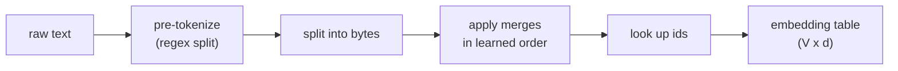

## Learning Objectives

- Explain why a neural language model needs a fixed, finite vocabulary of integer token ids, and what goes wrong with a pure character vocabulary and with a pure word vocabulary.
- Run the byte-pair encoding (BPE) training loop by hand on a small corpus: count adjacent pairs, merge the most frequent one, repeat.
- Apply a learned merge list to tokenize a word that never appeared in training, and explain why BPE never produces an unknown token when it starts from bytes.
- Connect vocabulary size to sequence length, embedding-table size, and the cost of attention.

## Context & Motivation

`ai-theory/deep-learning` built the transformer as a function from a sequence of vectors to a sequence of vectors. It quietly assumed that text had already become such a sequence. This concept fills that gap, and it is the first step of every language model studied in this track: before the first embedding lookup, a **tokenizer** maps a string to a list of integers, each an index into a vocabulary of fixed size `V`.

There are two obvious choices, and both are bad. A **character vocabulary** (or a byte vocabulary, `V = 256`) can spell any string, but sequences become very long: an English word averages about five characters, so a 1,000-word document becomes about 6,000 positions, and self-attention cost grows with the square of that length. The model must also spend capacity learning that `t`, `h`, `e` usually form one unit. A **word vocabulary** gives short sequences, but language has an open-ended set of words (names, typos, code identifiers, new terms, other languages), so any word outside the vocabulary collapses to a single `<unk>` token and its meaning is lost. Making the word vocabulary large enough to avoid that makes the embedding table and the output softmax enormous.

Subword tokenization sits between the two: frequent words become a single token, rare words are spelled out from a few frequent pieces. Byte-pair encoding, adapted to neural machine translation by Sennrich, Haddow and Birch in 2016 from a 1994 data-compression algorithm, is the most widely used way to choose those pieces, and the byte-level variant introduced with GPT-2 is what most current large models use.

## Core Theory

### The training loop

BPE learns a vocabulary from a training corpus with a greedy loop:

1. Start with a base vocabulary of single symbols (characters, or all 256 byte values in the byte-level variant). Split every word in the corpus into those symbols, keeping a count of how often each word occurs.
2. Count every adjacent pair of symbols across the corpus, weighted by word frequency.
3. Take the most frequent pair, say (`e`, `r`), add the new symbol `er` to the vocabulary, and record the rule `e r -> er` as the next entry in an ordered **merge list**.
4. Replace every occurrence of that pair in the corpus with the new symbol, and go back to step 2.

The loop stops when the vocabulary reaches a target size chosen in advance, typically between 30,000 and 200,000 for modern models. The output is two artifacts: the vocabulary (symbol to id) and the ordered merge list.

### Encoding new text

To tokenize a string, split it into base symbols and then apply the learned merges **in the order they were learned**: repeatedly find, among the adjacent pairs currently present, the one whose merge appears earliest in the merge list, merge it, and continue until no adjacent pair has a merge rule. The resulting symbols are looked up in the vocabulary to get ids.

Because every base symbol is in the vocabulary, every string can be encoded. In the byte-level version, the base vocabulary is all 256 byte values, so any UTF-8 text, emoji, or binary-looking string is representable, and there is no `<unk>` token at all. A word never seen in training simply ends up as more, smaller pieces.

### Pre-tokenization

Real tokenizers first split text with a regular expression (on spaces, punctuation, and digits) and run BPE only inside each chunk, so a merge never crosses a word boundary. GPT-2's tokenizer also attaches the leading space to the word that follows it, which is why ` the` (with a space) and `the` are different tokens. These details matter in practice: they explain why models are sometimes inconsistent about numbers split into odd pieces, or about a word at the start of a line.

### Vocabulary size is a trade-off

A larger vocabulary means shorter sequences (cheaper attention, more text in a fixed context window) but a bigger embedding matrix (`V × d` parameters) and a bigger output layer, and each rare token gets fewer training examples, so its embedding is learned worse. A smaller vocabulary means the opposite. There is no single correct value; it is a hyperparameter tuned together with model size and training data.

## Worked Examples

### Example 1: learning three merges

**Problem:** The corpus contains the words `low` (5 times), `lower` (2 times), `newest` (6 times), and `widest` (3 times). Starting from characters plus an end-of-word marker `_`, learn the first three merges.

**Trace:** Split into symbols: `l o w _` (5), `l o w e r _` (2), `n e w e s t _` (6), `w i d e s t _` (3). Count adjacent pairs, weighted: `e s` appears in `newest` (6) and `widest` (3), total 9; `s t` also appears 9 times; `t _` appears 9 times; `l o` appears 7 times; `o w` appears 7 times; `w e` appears 2 + 6 = 8 times. The most frequent pair is a tie at 9; breaking ties by first occurrence, merge `e s -> es`. Now `newest` is `n e w es t _` and `widest` is `w i d es t _`. Recount: `es t` appears 9 times, so the second merge is `es t -> est`. The third merge is `est _ -> est_` (9 times). After three merges the vocabulary has learned the suffix `est_`, purely from frequency, with no linguistic rule supplied.

### Example 2: encoding an unseen word

**Problem:** Using only the three merges above, tokenize `lowest`, which never appeared in the corpus.

**Trace:** Start from `l o w e s t _`. The earliest merge in the list whose pair is present is `e s -> es`, giving `l o w es t _`. Next, `es t -> est` applies, giving `l o w est _`. Then `est _ -> est_`, giving `l o w est_`. No other merge rule matches, so the result is four tokens: `l`, `o`, `w`, `est_`. With more merges learned (for example `l o` and `lo w`, which a real run on this corpus would reach soon), it would become `low` + `est_`, two meaningful pieces, even though the whole word was never seen.

## Common Misconceptions & Pitfalls

- **"A token is a word."** A token is whatever string the merge list happens to produce: a whole common word, a word plus its leading space, a suffix, or a single byte. Rough rules of thumb (about four characters of English per token) break down badly for code, numbers, and languages underrepresented in the tokenizer's training data, where the same content can cost several times more tokens.
- **"BPE encoding just picks the longest vocabulary entry that matches."** Encoding replays the merges in their learned order. Greedy longest-match can produce a different, inconsistent split; implementations that get this wrong produce token sequences the model never saw during training.
- **"The tokenizer is a detail you can swap after training."** The embedding table rows are indexed by token id. Changing the tokenizer changes what every id means, so a trained model is tied to its exact tokenizer, merge list included.

## Summary

A language model reads integer ids from a fixed vocabulary, and the choice of vocabulary trades sequence length against table size and coverage. Byte-pair encoding learns that vocabulary greedily, repeatedly merging the most frequent adjacent pair of symbols and recording each merge in order; encoding replays those merges on new text. Starting from bytes guarantees every string is representable with no unknown token, while frequent words still compress to a single id. The next concept moves from ids to meaning: how the vectors those ids index into come to encode similarity between words.

## Documentation Links

- [Sennrich, Haddow, Birch: Neural Machine Translation of Rare Words with Subword Units (ACL 2016)](https://arxiv.org/abs/1508.07909): doc
- [Stanford CS224N: Natural Language Processing with Deep Learning](https://web.stanford.edu/class/cs224n/): doc
- [Stanford CS336: Language Modeling from Scratch](https://stanford-cs336.github.io/spring2025/): doc
