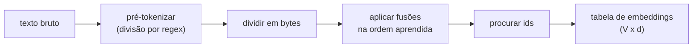

## Objetivos de Aprendizagem

- Explicar por que um modelo de linguagem neural precisa de um vocabulário fixo e finito de ids inteiros, e o que dá errado com um vocabulário só de caracteres e com um vocabulário só de palavras.
- Executar à mão o laço de treino do byte-pair encoding (BPE) num corpus pequeno: contar pares adjacentes, fundir o mais frequente, repetir.
- Aplicar uma lista de fusões aprendida para tokenizar uma palavra que nunca apareceu no treino, e explicar por que o BPE nunca produz um token desconhecido quando parte de bytes.
- Relacionar o tamanho do vocabulário com o comprimento das sequências, o tamanho da tabela de embeddings e o custo da atenção.

## Contexto e Motivação

`ai-theory/deep-learning` construiu o transformer como uma função de uma sequência de vetores para outra sequência de vetores. Ficou implícito que o texto já tinha virado essa sequência. Este conceito preenche essa lacuna, e é o primeiro passo de todo modelo de linguagem estudado nesta trilha: antes da primeira consulta de embedding, um **tokenizador** transforma uma string numa lista de inteiros, cada um sendo um índice num vocabulário de tamanho fixo `V`.

Há duas escolhas óbvias, e as duas são ruins. Um **vocabulário de caracteres** (ou de bytes, `V = 256`) consegue soletrar qualquer string, mas as sequências ficam muito longas: uma palavra em inglês tem em média uns cinco caracteres, então um documento de 1.000 palavras vira umas 6.000 posições, e o custo da self-attention cresce com o quadrado desse comprimento. O modelo ainda precisa gastar capacidade aprendendo que `t`, `h`, `e` costumam formar uma unidade. Um **vocabulário de palavras** dá sequências curtas, mas a língua tem um conjunto aberto de palavras (nomes, erros de digitação, identificadores de código, termos novos, outros idiomas), então qualquer palavra fora do vocabulário colapsa num único token `<unk>` e o seu significado se perde. Aumentar o vocabulário de palavras para evitar isso deixa a tabela de embeddings e o softmax de saída enormes.

A tokenização em subpalavras fica entre os dois: palavras frequentes viram um único token, palavras raras são soletradas a partir de poucos pedaços frequentes. O byte-pair encoding, adaptado para tradução automática neural por Sennrich, Haddow e Birch em 2016 a partir de um algoritmo de compressão de dados de 1994, é a forma mais usada de escolher esses pedaços, e a variante em nível de bytes introduzida com o GPT-2 é a que a maioria dos modelos grandes atuais usa.

## Teoria Central

### O laço de treino

O BPE aprende um vocabulário a partir de um corpus de treino com um laço guloso:

1. Comece com um vocabulário base de símbolos únicos (caracteres, ou todos os 256 valores de byte na variante em nível de bytes). Divida cada palavra do corpus nesses símbolos, guardando quantas vezes cada palavra ocorre.
2. Conte todo par adjacente de símbolos no corpus, ponderado pela frequência da palavra.
3. Pegue o par mais frequente, por exemplo (`e`, `r`), adicione o novo símbolo `er` ao vocabulário e registre a regra `e r -> er` como a próxima entrada de uma **lista de fusões** ordenada.
4. Substitua toda ocorrência desse par no corpus pelo novo símbolo e volte ao passo 2.

O laço para quando o vocabulário atinge um tamanho alvo escolhido de antemão, tipicamente entre 30.000 e 200.000 nos modelos modernos. A saída são dois artefatos: o vocabulário (símbolo para id) e a lista ordenada de fusões.

### Codificando texto novo

Para tokenizar uma string, divida-a em símbolos base e então aplique as fusões aprendidas **na ordem em que foram aprendidas**: repetidamente encontre, entre os pares adjacentes presentes, aquele cuja fusão aparece mais cedo na lista, funda-o e continue até que nenhum par adjacente tenha regra de fusão. Os símbolos resultantes são procurados no vocabulário para obter os ids.

Como todo símbolo base está no vocabulário, toda string pode ser codificada. Na versão em nível de bytes, o vocabulário base é formado pelos 256 valores de byte, então qualquer texto UTF-8, emoji ou string com cara de binário é representável, e não existe token `<unk>` algum. Uma palavra nunca vista no treino simplesmente acaba em mais pedaços, e menores.

### Pré-tokenização

Tokenizadores reais primeiro dividem o texto com uma expressão regular (em espaços, pontuação e dígitos) e rodam o BPE só dentro de cada pedaço, de modo que uma fusão nunca atravessa a fronteira de uma palavra. O tokenizador do GPT-2 também cola o espaço anterior à palavra seguinte, e é por isso que ` the` (com espaço) e `the` são tokens diferentes. Esses detalhes importam na prática: eles explicam por que modelos às vezes são inconsistentes com números quebrados em pedaços estranhos, ou com uma palavra no início de uma linha.

### O tamanho do vocabulário é um compromisso

Um vocabulário maior significa sequências mais curtas (atenção mais barata, mais texto numa janela de contexto fixa), mas uma matriz de embeddings maior (`V × d` parâmetros) e uma camada de saída maior, e cada token raro recebe menos exemplos de treino, então o seu embedding é aprendido pior. Um vocabulário menor significa o oposto. Não existe valor único correto; é um hiperparâmetro ajustado junto com o tamanho do modelo e os dados de treino.

## Exemplos Resolvidos

### Exemplo 1: aprendendo três fusões

**Problema:** O corpus contém as palavras `low` (5 vezes), `lower` (2 vezes), `newest` (6 vezes) e `widest` (3 vezes). Partindo de caracteres mais um marcador de fim de palavra `_`, aprenda as três primeiras fusões.

**Rastreamento:** Divida em símbolos: `l o w _` (5), `l o w e r _` (2), `n e w e s t _` (6), `w i d e s t _` (3). Conte os pares adjacentes, ponderados: `e s` aparece em `newest` (6) e `widest` (3), total 9; `s t` também aparece 9 vezes; `t _` aparece 9 vezes; `l o` aparece 7 vezes; `o w` aparece 7 vezes; `w e` aparece 2 + 6 = 8 vezes. O par mais frequente é um empate em 9; desempatando pela primeira ocorrência, funda `e s -> es`. Agora `newest` é `n e w es t _` e `widest` é `w i d es t _`. Recontando: `es t` aparece 9 vezes, então a segunda fusão é `es t -> est`. A terceira fusão é `est _ -> est_` (9 vezes). Depois de três fusões o vocabulário aprendeu o sufixo `est_`, puramente por frequência, sem nenhuma regra linguística fornecida.

### Exemplo 2: codificando uma palavra nunca vista

**Problema:** Usando só as três fusões acima, tokenize `lowest`, que nunca apareceu no corpus.

**Rastreamento:** Comece de `l o w e s t _`. A fusão mais antiga da lista cujo par está presente é `e s -> es`, dando `l o w es t _`. Em seguida, `es t -> est` se aplica, dando `l o w est _`. Depois `est _ -> est_`, dando `l o w est_`. Nenhuma outra regra casa, então o resultado são quatro tokens: `l`, `o`, `w`, `est_`. Com mais fusões aprendidas (por exemplo `l o` e `lo w`, que uma execução real nesse corpus alcançaria logo), viraria `low` + `est_`, dois pedaços com significado, mesmo que a palavra inteira nunca tenha sido vista.

## Equívocos Comuns e Armadilhas

- **"Um token é uma palavra."** Um token é qualquer string que a lista de fusões acabe produzindo: uma palavra comum inteira, uma palavra com o espaço que a precede, um sufixo ou um único byte. Regras de bolso (cerca de quatro caracteres de inglês por token) falham feio para código, números e idiomas pouco representados nos dados de treino do tokenizador, nos quais o mesmo conteúdo pode custar várias vezes mais tokens.
- **"A codificação BPE só escolhe a entrada mais longa do vocabulário que casa."** A codificação repete as fusões na ordem em que foram aprendidas. O casamento guloso pelo mais longo pode produzir uma divisão diferente e inconsistente; implementações que erram isso produzem sequências de tokens que o modelo nunca viu no treino.
- **"O tokenizador é um detalhe que dá para trocar depois do treino."** As linhas da tabela de embeddings são indexadas pelo id do token. Trocar o tokenizador muda o que cada id significa, então um modelo treinado fica preso ao seu tokenizador exato, lista de fusões incluída.

## Resumo

Um modelo de linguagem lê ids inteiros de um vocabulário fixo, e a escolha do vocabulário troca comprimento de sequência por tamanho de tabela e cobertura. O byte-pair encoding aprende esse vocabulário de forma gulosa, fundindo repetidamente o par adjacente de símbolos mais frequente e registrando cada fusão em ordem; a codificação repete essas fusões em texto novo. Partir de bytes garante que toda string é representável sem token desconhecido, enquanto palavras frequentes ainda se comprimem num único id. O próximo conceito sai dos ids para o significado: como os vetores que esses ids indexam passam a codificar similaridade entre palavras.

## Documentation Links

- [Sennrich, Haddow, Birch: Neural Machine Translation of Rare Words with Subword Units (ACL 2016)](https://arxiv.org/abs/1508.07909): doc
- [Stanford CS224N: Natural Language Processing with Deep Learning](https://web.stanford.edu/class/cs224n/): doc
- [Stanford CS336: Language Modeling from Scratch](https://stanford-cs336.github.io/spring2025/): doc
