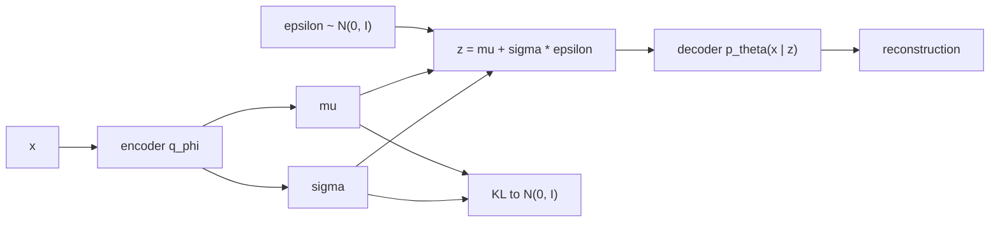

## Learning Objectives

- Explain why a plain autoencoder is not a generative model, and what a generative model of data needs to provide.
- Write the latent-variable model $p_\theta(x) = \int p_\theta(x \mid z)\, p(z)\, dz$ and explain why maximizing it directly is intractable.
- Derive the evidence lower bound (ELBO) and interpret its two terms, reconstruction and KL regularization.
- Apply the reparameterization trick and compute the closed-form KL divergence between a diagonal Gaussian and the standard normal.

## Context & Motivation

`ai-theory/deep-learning` built autoencoders: an encoder compresses an input $x$ to a code $z$ and a decoder reconstructs $x$ from $z$. The code space is useful for compression and features, but it is not a model you can sample from. The encoder places training examples wherever reconstruction is easiest, leaving most of the code space unused; decode a random point and the output is usually meaningless. A **generative model** must define a probability distribution over data, so that new samples look like the training data and the likelihood of an example can be evaluated or at least bounded.

The variational autoencoder (VAE), introduced by Kingma and Welling in 2013 (and independently by Rezende, Mohamed, and Wierstra), keeps the encoder-decoder shape but gives it a probabilistic meaning and a principled objective. Its central ideas, the evidence lower bound and the reparameterization trick, reappear across modern generative modeling: diffusion models (the next concept) are trained with a closely related bound, and the latent spaces in which large image generators operate are often produced by a VAE. Stanford's CS236 (Deep Generative Models) develops all of these from this starting point.

## Core Theory

### A latent-variable model

Assume each data point $x$ is generated in two steps: draw a latent $z$ from a simple prior $p(z) = \mathcal{N}(0, I)$, then draw $x$ from a decoder distribution $p_\theta(x \mid z)$ whose parameters come from a neural network. The model's probability of $x$ is

$$p_\theta(x) = \int p_\theta(x \mid z)\, p(z)\, dz$$

Maximum likelihood would maximize $\log p_\theta(x)$ over the training set, but the integral over all $z$ has no closed form when the decoder is a neural network, and the true posterior $p_\theta(z \mid x)$, which says which latents could have produced $x$, is equally intractable. This is the same structure as the Gaussian mixture model in `ai-theory/machine-learning`, where the EM algorithm handled a discrete latent with an exact posterior; here the latent is continuous and the posterior has no formula.

### The evidence lower bound

Introduce an **encoder** $q_\phi(z \mid x)$, a neural network that outputs an approximate posterior, typically a diagonal Gaussian with mean $\mu_\phi(x)$ and variance $\sigma^2_\phi(x)$. For any such $q$, Jensen's inequality gives

$$\log p_\theta(x) \;\geq\; \underbrace{\mathbb{E}_{q_\phi(z \mid x)}\big[\log p_\theta(x \mid z)\big]}_{\text{reconstruction}} \;-\; \underbrace{\mathrm{KL}\big(q_\phi(z \mid x)\,\|\,p(z)\big)}_{\text{regularization}}$$

The right-hand side is the **ELBO**. The gap between the two sides is exactly $\mathrm{KL}(q_\phi(z \mid x) \,\|\, p_\theta(z \mid x))$, so raising the ELBO both improves the model and makes the encoder a better approximation of the true posterior. Training maximizes the ELBO jointly over $\theta$ and $\phi$.

The two terms pull in opposite directions. Reconstruction wants each $x$ encoded to a precise, distinctive region of latent space. The KL term wants every $q_\phi(z \mid x)$ to look like the standard normal prior, overlapping its neighbors and filling the space. The balance is what makes the latent space usable: codes of real examples cover the prior's region densely, so a $z$ drawn from $\mathcal{N}(0, I)$ decodes to something plausible.

### The reparameterization trick

The reconstruction term is an expectation over $z \sim q_\phi(z \mid x)$, and gradient descent needs its gradient with respect to $\phi$. Sampling is not differentiable as written. The trick is to move the randomness outside the network:

$$z = \mu_\phi(x) + \sigma_\phi(x) \odot \varepsilon, \qquad \varepsilon \sim \mathcal{N}(0, I)$$

Now $z$ is a deterministic, differentiable function of $\phi$ and of an independent noise sample, so ordinary backpropagation flows through $\mu$ and $\sigma$. One sample of $\varepsilon$ per example per step is usually enough.

### The KL term in closed form

For a diagonal Gaussian encoder and a standard normal prior, the KL divergence needs no sampling:

$$\mathrm{KL}\big(\mathcal{N}(\mu, \mathrm{diag}(\sigma^2))\,\|\,\mathcal{N}(0, I)\big) = \frac{1}{2} \sum_{j=1}^{d} \left( \mu_j^2 + \sigma_j^2 - \log \sigma_j^2 - 1 \right)$$

Each dimension pays for a mean away from 0 and for a variance away from 1.

To generate, discard the encoder: sample $z \sim \mathcal{N}(0, I)$ and decode.

## Worked Examples

### Example 1: computing the KL term

**Problem:** For one input, a 2-dimensional encoder outputs $\mu = (1, 0)$ and $\sigma^2 = (1, 0.25)$. Compute the KL term.

**Trace:** Dimension 1: $1^2 + 1 - \log 1 - 1 = 1$. Dimension 2: $0^2 + 0.25 - \log 0.25 - 1 = 0.25 + 1.386 - 1 = 0.636$. Sum: $1.636$; times $\tfrac{1}{2}$: $\mathrm{KL} \approx 0.818$ nats. The first dimension is penalized only for its shifted mean; the second only for its shrunken variance. An encoder that output $\mu = 0, \sigma^2 = 1$ everywhere would pay zero KL, but then $z$ would carry no information about $x$ and reconstruction would suffer, which is the tension the ELBO balances.

### Example 2: diagnosing blurry samples and unused latents

**Problem:** A VAE trained on face images produces blurry samples, and a check shows that 40 of its 64 latent dimensions have $\mu \approx 0$ and $\sigma^2 \approx 1$ for every input. Explain both observations.

**Resolution:** Blurriness comes from the decoder likelihood. A Gaussian $p_\theta(x \mid z)$ with fixed variance turns the reconstruction term into a squared error, and when several sharp images are plausible for the same $z$, the squared-error optimum is their average, which is blurry. The inactive dimensions are **posterior collapse** in miniature: for those dimensions the KL penalty outweighs any reconstruction benefit, so the encoder sets them equal to the prior and the decoder ignores them. Remedies include annealing the KL weight upward from 0 during training, using a more expressive decoder likelihood, or accepting fewer active dimensions. Weighting the KL term by $\beta > 1$ (the $\beta$-VAE) pushes the other way, toward more disentangled but blurrier representations.

## Common Misconceptions & Pitfalls

- **"A VAE is an autoencoder with noise added."** The noise is a consequence of the objective, not a regularization trick. Without the KL term pulling every posterior toward the prior, the encoder would shrink $\sigma$ to zero and the model would collapse back to a plain autoencoder with an unusable latent space.
- **"Maximizing the ELBO maximizes the likelihood."** It maximizes a lower bound. If the encoder family is too restrictive (a diagonal Gaussian when the true posterior is multimodal), the gap stays large and the model can be worse than its ELBO suggests is necessary.
- **"Sample quality measures how good the VAE is."** VAEs often have good likelihood bounds and smooth latent spaces but blurrier samples than GANs or diffusion models; which property matters depends on the use, for example a VAE is often used purely as a compressor into a latent space where another generator works.

## Summary

A generative model must define a distribution you can sample from. The VAE assumes data is decoded from a latent drawn from $\mathcal{N}(0, I)$, approximates the intractable posterior with an encoder, and maximizes the evidence lower bound: a reconstruction term minus the KL divergence from each approximate posterior to the prior. The reparameterization trick makes the sampling step differentiable, and the KL term has a closed form for Gaussians. The KL pressure is what fills the latent space so random codes decode to plausible data, at the price of blurriness and possibly inactive dimensions. The next concept keeps the idea of a fixed noise distribution but reaches it gradually, through many small denoising steps.

## Documentation Links

- [Kingma, Welling: Auto-Encoding Variational Bayes (ICLR 2014)](https://arxiv.org/abs/1312.6114): doc
- [Kingma, Welling: An Introduction to Variational Autoencoders (2019)](https://arxiv.org/abs/1906.02691): doc
- [Stanford CS236: Deep Generative Models](https://deepgenerativemodels.github.io/): doc
