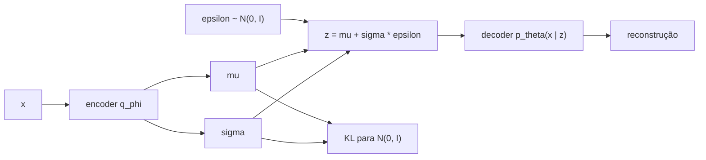

## Objetivos de Aprendizagem

- Explicar por que um autoencoder comum não é um modelo generativo, e o que um modelo generativo de dados precisa oferecer.
- Escrever o modelo de variável latente $p_\theta(x) = \int p_\theta(x \mid z)\, p(z)\, dz$ e explicar por que maximizá-lo diretamente é intratável.
- Derivar o limite inferior da evidência (ELBO) e interpretar os seus dois termos, reconstrução e regularização por KL.
- Aplicar o truque da reparametrização e calcular a divergência KL em forma fechada entre uma gaussiana diagonal e a normal padrão.

## Contexto e Motivação

`ai-theory/deep-learning` construiu autoencoders: um encoder comprime uma entrada $x$ num código $z$ e um decoder reconstrói $x$ a partir de $z$. O espaço de códigos é útil para compressão e features, mas não é um modelo do qual se possa amostrar. O encoder coloca os exemplos de treino onde a reconstrução é mais fácil, deixando a maior parte do espaço de códigos sem uso; decodifique um ponto aleatório e a saída costuma não ter sentido. Um **modelo generativo** precisa definir uma distribuição de probabilidade sobre os dados, para que amostras novas se pareçam com os dados de treino e a verossimilhança de um exemplo possa ser avaliada ou ao menos limitada.

O autoencoder variacional (VAE), introduzido por Kingma e Welling em 2013 (e de forma independente por Rezende, Mohamed e Wierstra), mantém o formato encoder-decoder, mas lhe dá um significado probabilístico e um objetivo com fundamento. As suas ideias centrais, o limite inferior da evidência e o truque da reparametrização, reaparecem em toda a modelagem generativa moderna: modelos de difusão (o próximo conceito) são treinados com um limite muito parecido, e os espaços latentes em que grandes geradores de imagem operam costumam ser produzidos por um VAE. O CS236 de Stanford (Deep Generative Models) desenvolve tudo isso a partir deste ponto.

## Teoria Central

### Um modelo de variável latente

Suponha que cada ponto de dado $x$ é gerado em dois passos: sorteie um latente $z$ de um prior simples $p(z) = \mathcal{N}(0, I)$ e depois sorteie $x$ de uma distribuição do decoder $p_\theta(x \mid z)$ cujos parâmetros vêm de uma rede neural. A probabilidade de $x$ no modelo é

$$p_\theta(x) = \int p_\theta(x \mid z)\, p(z)\, dz$$

A máxima verossimilhança maximizaria $\log p_\theta(x)$ sobre o conjunto de treino, mas a integral sobre todo $z$ não tem forma fechada quando o decoder é uma rede neural, e a posterior verdadeira $p_\theta(z \mid x)$, que diz quais latentes poderiam ter produzido $x$, é igualmente intratável. É a mesma estrutura do modelo de mistura de gaussianas de `ai-theory/machine-learning`, em que o algoritmo EM lidava com um latente discreto com posterior exata; aqui o latente é contínuo e a posterior não tem fórmula.

### O limite inferior da evidência

Introduza um **encoder** $q_\phi(z \mid x)$, uma rede neural que produz uma posterior aproximada, tipicamente uma gaussiana diagonal com média $\mu_\phi(x)$ e variância $\sigma^2_\phi(x)$. Para qualquer $q$ assim, a desigualdade de Jensen dá

$$\log p_\theta(x) \;\geq\; \underbrace{\mathbb{E}_{q_\phi(z \mid x)}\big[\log p_\theta(x \mid z)\big]}_{\text{reconstrução}} \;-\; \underbrace{\mathrm{KL}\big(q_\phi(z \mid x)\,\|\,p(z)\big)}_{\text{regularização}}$$

O lado direito é o **ELBO**. A diferença entre os dois lados é exatamente $\mathrm{KL}(q_\phi(z \mid x) \,\|\, p_\theta(z \mid x))$, então aumentar o ELBO melhora o modelo e também torna o encoder uma aproximação melhor da posterior verdadeira. O treino maximiza o ELBO conjuntamente em $\theta$ e $\phi$.

Os dois termos puxam em direções opostas. A reconstrução quer cada $x$ codificado numa região precisa e distinta do espaço latente. O termo de KL quer que toda $q_\phi(z \mid x)$ se pareça com o prior normal padrão, sobrepondo-se às vizinhas e preenchendo o espaço. O equilíbrio é o que torna o espaço latente utilizável: os códigos de exemplos reais cobrem densamente a região do prior, então um $z$ sorteado de $\mathcal{N}(0, I)$ decodifica em algo plausível.

### O truque da reparametrização

O termo de reconstrução é uma esperança sobre $z \sim q_\phi(z \mid x)$, e a descida de gradiente precisa do seu gradiente em relação a $\phi$. Do jeito que está escrita, a amostragem não é diferenciável. O truque é tirar a aleatoriedade de dentro da rede:

$$z = \mu_\phi(x) + \sigma_\phi(x) \odot \varepsilon, \qquad \varepsilon \sim \mathcal{N}(0, I)$$

Agora $z$ é uma função determinística e diferenciável de $\phi$ e de uma amostra de ruído independente, então a retropropagação comum flui por $\mu$ e $\sigma$. Uma amostra de $\varepsilon$ por exemplo por passo costuma bastar.

### O termo de KL em forma fechada

Para um encoder gaussiano diagonal e um prior normal padrão, a divergência KL não precisa de amostragem:

$$\mathrm{KL}\big(\mathcal{N}(\mu, \mathrm{diag}(\sigma^2))\,\|\,\mathcal{N}(0, I)\big) = \frac{1}{2} \sum_{j=1}^{d} \left( \mu_j^2 + \sigma_j^2 - \log \sigma_j^2 - 1 \right)$$

Cada dimensão paga por uma média longe de 0 e por uma variância longe de 1.

Para gerar, descarte o encoder: sorteie $z \sim \mathcal{N}(0, I)$ e decodifique.

## Exemplos Resolvidos

### Exemplo 1: calculando o termo de KL

**Problema:** Para uma entrada, um encoder bidimensional produz $\mu = (1, 0)$ e $\sigma^2 = (1; 0{,}25)$. Calcule o termo de KL.

**Rastreamento:** Dimensão 1: $1^2 + 1 - \log 1 - 1 = 1$. Dimensão 2: $0^2 + 0{,}25 - \log 0{,}25 - 1 = 0{,}25 + 1{,}386 - 1 = 0{,}636$. Soma: $1{,}636$; vezes $\tfrac{1}{2}$: $\mathrm{KL} \approx 0{,}818$ nats. A primeira dimensão é penalizada só pela média deslocada; a segunda só pela variância encolhida. Um encoder que produzisse $\mu = 0, \sigma^2 = 1$ em toda parte pagaria KL zero, mas então $z$ não carregaria informação nenhuma sobre $x$ e a reconstrução sofreria, que é exatamente a tensão que o ELBO equilibra.

### Exemplo 2: diagnosticando amostras borradas e latentes sem uso

**Problema:** Um VAE treinado em imagens de rostos produz amostras borradas, e uma checagem mostra que 40 das suas 64 dimensões latentes têm $\mu \approx 0$ e $\sigma^2 \approx 1$ para toda entrada. Explique as duas observações.

**Resolução:** O borrão vem da verossimilhança do decoder. Uma $p_\theta(x \mid z)$ gaussiana com variância fixa transforma o termo de reconstrução num erro quadrático, e quando várias imagens nítidas são plausíveis para o mesmo $z$, o ótimo do erro quadrático é a média delas, que é borrada. As dimensões inativas são um **colapso da posterior** em miniatura: nessas dimensões a penalidade de KL pesa mais do que qualquer ganho de reconstrução, então o encoder as iguala ao prior e o decoder as ignora. Remédios incluem aumentar gradualmente o peso do KL a partir de 0 durante o treino, usar uma verossimilhança de decoder mais expressiva ou aceitar menos dimensões ativas. Pesar o termo de KL por $\beta > 1$ (o $\beta$-VAE) empurra para o outro lado, rumo a representações mais desemaranhadas, porém mais borradas.

## Equívocos Comuns e Armadilhas

- **"Um VAE é um autoencoder com ruído adicionado."** O ruído é consequência do objetivo, não um truque de regularização. Sem o termo de KL puxando toda posterior para o prior, o encoder encolheria $\sigma$ até zero e o modelo voltaria a ser um autoencoder comum com espaço latente inutilizável.
- **"Maximizar o ELBO maximiza a verossimilhança."** Maximiza um limite inferior. Se a família do encoder for restritiva demais (uma gaussiana diagonal quando a posterior verdadeira é multimodal), a diferença continua grande e o modelo pode ser pior do que o necessário.
- **"A qualidade das amostras mede o quão bom é o VAE."** VAEs costumam ter bons limites de verossimilhança e espaços latentes suaves, mas amostras mais borradas do que GANs ou modelos de difusão; qual propriedade importa depende do uso, por exemplo um VAE muitas vezes é usado só como compressor para um espaço latente em que outro gerador trabalha.

## Resumo

Um modelo generativo precisa definir uma distribuição da qual se possa amostrar. O VAE supõe que os dados são decodificados a partir de um latente sorteado de $\mathcal{N}(0, I)$, aproxima a posterior intratável com um encoder e maximiza o limite inferior da evidência: um termo de reconstrução menos a divergência KL de cada posterior aproximada para o prior. O truque da reparametrização torna o passo de amostragem diferenciável, e o termo de KL tem forma fechada para gaussianas. A pressão do KL é o que preenche o espaço latente para que códigos aleatórios decodifiquem em dados plausíveis, ao preço de borrão e possivelmente de dimensões inativas. O próximo conceito mantém a ideia de uma distribuição de ruído fixa, mas chega até ela gradualmente, por muitos pequenos passos de remoção de ruído.

## Documentation Links

- [Kingma, Welling: Auto-Encoding Variational Bayes (ICLR 2014)](https://arxiv.org/abs/1312.6114): doc
- [Kingma, Welling: An Introduction to Variational Autoencoders (2019)](https://arxiv.org/abs/1906.02691): doc
- [Stanford CS236: Deep Generative Models](https://deepgenerativemodels.github.io/): doc
