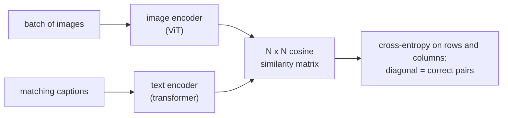

## Learning Objectives

- Describe how a Vision Transformer turns an image into a token sequence: patches, linear projection, a class token, and position embeddings.
- Explain the inductive biases a CNN has and a ViT lacks, and why that makes ViTs weaker on small datasets and stronger on very large ones.
- Write CLIP's symmetric contrastive loss over a batch of image-text pairs and explain what the temperature controls.
- Perform zero-shot classification with a contrastive image-text model by embedding class-name prompts.

## Context & Motivation

Until about 2020, computer vision and natural language processing used different backbones: convolutions for pixels, transformers for words. The previous concept's detectors and segmenters were all built on CNN features. Two papers from 2021 dissolved that split. Dosovitskiy and colleagues at Google showed in "An Image is Worth 16x16 Words" that a nearly unmodified transformer, applied to image patches as if they were tokens, matches or beats the best CNNs when pretrained on enough data. Radford and colleagues at OpenAI then trained CLIP, an image encoder and a text encoder optimized together on 400 million image-caption pairs collected from the web, producing a shared space in which a picture and a sentence describing it land close together.

The practical consequence is large. Instead of collecting a labeled dataset for every new visual category, a CLIP-style model classifies images into categories described only in words, and its image encoder became the visual front end of many later multimodal systems, including the text-to-image diffusion models of a later concept in this track.

## Core Theory

### Images as sequences of patches

A ViT splits an image of size $H \times W$ with $C$ channels into non-overlapping $P \times P$ patches, giving $N = HW / P^2$ patches. Each patch is flattened into a vector of length $P^2 C$ and mapped by a single learned linear projection $E$ to the model dimension $D$. A learned **class token** is prepended, and a learned **position embedding** is added to every token, because self-attention by itself is permutation invariant and would otherwise ignore where each patch came from:

$$z_0 = [\,x_{cls};\ x_1 E;\ x_2 E;\ \dots;\ x_N E\,] + E_{pos}$$

The sequence then goes through a standard transformer encoder (the same blocks studied in `ai-theory/deep-learning`), and the final state of the class token feeds a classification head. ViT-Base uses $D = 768$ and 12 layers; at $224 \times 224$ resolution with $P = 16$, that is $N = 196$ patch tokens.

### Inductive bias versus data

A CNN hard-wires two assumptions: **locality** (each filter sees a small neighborhood) and **translation equivariance** (the same filter slides everywhere, so a shifted object produces a shifted response). These are good assumptions for natural images and act as a strong prior when data is limited. A ViT has almost none of this built in; apart from cutting patches, every relation between regions must be learned through attention, and from the first layer any patch can attend to any other.

The original paper measured the consequence directly. Trained on ImageNet's 1.3 million images alone, ViT underperformed comparable ResNets. Pretrained on 14 million (ImageNet-21k) and especially on 300 million images (JFT-300M), it overtook them while using less pretraining compute. With enough data, learned relations beat hand-designed priors; with little data, the priors win. Later work (stronger augmentation and regularization, distillation, hybrid designs with convolutional stems) narrowed the small-data gap.

### CLIP: learning from captions

CLIP pairs an image encoder $f$ (a ResNet or a ViT) with a text encoder $g$ (a transformer), each followed by a linear projection to a shared space and normalized to unit length. For a batch of $N$ matching pairs, compute the $N \times N$ matrix of cosine similarities $s_{ij} = f(I_i)^\top g(T_j)$. The $N$ diagonal entries are correct pairs; the $N^2 - N$ off-diagonal entries are mismatches. The loss is cross-entropy in both directions, image-to-text and text-to-image:

$$\mathcal{L} = -\frac{1}{2N} \sum_{i=1}^{N} \left[ \log \frac{e^{s_{ii}/\tau}}{\sum_{j} e^{s_{ij}/\tau}} + \log \frac{e^{s_{ii}/\tau}}{\sum_{j} e^{s_{ji}/\tau}} \right]$$

The temperature $\tau$ (learned during training) sets how sharply the softmax separates the correct pair from the others. Large batches matter: CLIP used 32,768 pairs per batch, so every image is contrasted with over 32,000 wrong captions at each step, the same in-batch negatives idea seen in dense retrieval.

### Zero-shot classification

To classify an image into $K$ categories without training a classifier, write one prompt per class, for example "a photo of a {class name}", embed each prompt with the text encoder, embed the image, and pick the class whose prompt embedding has the highest cosine similarity. The text encoder has effectively generated the weights of a linear classifier from words. On ImageNet, zero-shot CLIP matched the accuracy of a ResNet-50 trained on ImageNet's 1.28 million labeled examples, without using any of them, and it was far more robust when the same categories appeared as sketches or renditions instead of photos.

## Worked Examples

### Example 1: counting tokens and the cost of resolution

**Problem:** A ViT with $P = 16$ processes images at $224 \times 224$. The team wants to fine-tune at $384 \times 384$. How many patch tokens result, and by roughly what factor does self-attention cost grow?

**Trace:** At 224: $224/16 = 14$, so $14 \times 14 = 196$ patches. At 384: $384/16 = 24$, so $24 \times 24 = 576$ patches. Self-attention cost grows with the square of the sequence length: $(576/196)^2 \approx 8.6$ times more attention computation per layer. A second detail: the learned position embeddings exist for a $14 \times 14$ grid only, so they are resized to $24 \times 24$ by 2D interpolation, which works because neighboring position embeddings learn similar values.

### Example 2: a zero-shot decision

**Problem:** An image embedding has cosine similarities 0.31 with "a photo of a dog", 0.24 with "a photo of a cat", and 0.19 with "a photo of a fox". With $\tau = 0.01$, what probabilities does the softmax give?

**Trace:** Divide by $\tau$: logits 31, 24, 19. Subtract the maximum: 0, −7, −12. Exponentiate: 1, $e^{-7} \approx 0.00091$, $e^{-12} \approx 0.0000061$. Normalize: dog $\approx 0.9991$, cat $\approx 0.0009$, fox $\approx 0.000006$. Raw cosine similarities that look close (0.31 versus 0.24) become a confident decision because the small learned temperature stretches them. Changing the prompt wording (for example "a photo of a dog, a type of pet") can shift these similarities noticeably, which is why prompt ensembling over several templates improves zero-shot accuracy.

## Common Misconceptions & Pitfalls

- **"Transformers are simply better than CNNs for vision."** It depends on the data regime and the compute budget. On small datasets without heavy augmentation, CNNs' built-in priors still help, and modern CNNs designed with lessons from ViTs remain competitive.
- **"CLIP understands images the way captions describe them."** It learns whatever correlates with caption text on the web, including biases and shortcuts; it is weak at counting, at precise spatial relations, and at fine-grained categories rarely named in captions.
- **"Zero-shot means the model never saw the category."** It means no labeled examples were used for this task. The category's name and images almost certainly appeared in the 400 million web pairs; zero-shot transfer measures generalization of the training signal, not knowledge from nothing.

## Summary

A Vision Transformer treats fixed-size image patches as tokens, adds a class token and learned position embeddings, and runs a standard transformer encoder. Lacking a CNN's locality and translation-equivariance priors, it needs more data, but with enough pretraining data it matches or exceeds CNNs. CLIP trains an image encoder and a text encoder with a symmetric contrastive loss over large batches of web image-caption pairs, producing a shared embedding space in which zero-shot classification is just choosing the closest class-name prompt. The next concept moves from recognizing images to generating data, starting with a probabilistic model of a latent space.

## Documentation Links

- [Dosovitskiy et al.: An Image is Worth 16x16 Words: Transformers for Image Recognition at Scale (ICLR 2021)](https://arxiv.org/abs/2010.11929): doc
- [Radford et al.: Learning Transferable Visual Models From Natural Language Supervision (CLIP, ICML 2021)](https://arxiv.org/abs/2103.00020): doc
- [Stanford CS231n: Deep Learning for Computer Vision](https://cs231n.stanford.edu/): doc
