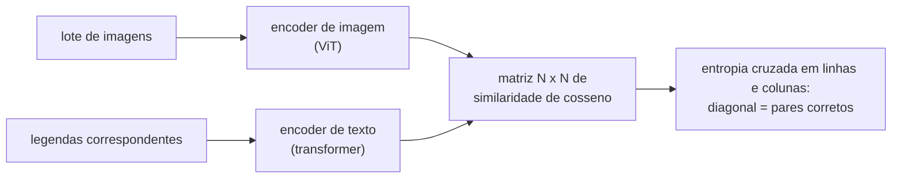

## Objetivos de Aprendizagem

- Descrever como um Vision Transformer transforma uma imagem numa sequência de tokens: patches, projeção linear, um token de classe e embeddings de posição.
- Explicar os vieses indutivos que uma CNN tem e um ViT não tem, e por que isso deixa os ViTs mais fracos em datasets pequenos e mais fortes em datasets muito grandes.
- Escrever a perda contrastiva simétrica do CLIP sobre um lote de pares imagem-texto e explicar o que a temperatura controla.
- Fazer classificação zero-shot com um modelo contrastivo imagem-texto gerando embeddings de prompts com os nomes das classes.

## Contexto e Motivação

Até por volta de 2020, visão computacional e processamento de linguagem natural usavam backbones diferentes: convoluções para pixels, transformers para palavras. Os detectores e segmentadores do conceito anterior foram todos construídos sobre features de CNN. Dois artigos de 2021 desfizeram essa divisão. Dosovitskiy e colegas no Google mostraram em "An Image is Worth 16x16 Words" que um transformer quase sem modificação, aplicado a patches de imagem como se fossem tokens, iguala ou supera as melhores CNNs quando pré-treinado com dados suficientes. Radford e colegas na OpenAI então treinaram o CLIP, um encoder de imagem e um de texto otimizados juntos em 400 milhões de pares imagem-legenda coletados da web, produzindo um espaço compartilhado em que uma imagem e uma frase que a descreve caem perto uma da outra.

A consequência prática é grande. Em vez de coletar um dataset rotulado para cada nova categoria visual, um modelo no estilo CLIP classifica imagens em categorias descritas só com palavras, e o seu encoder de imagem virou a porta de entrada visual de muitos sistemas multimodais posteriores, incluindo os modelos de difusão texto-para-imagem de um conceito mais adiante nesta trilha.

## Teoria Central

### Imagens como sequências de patches

Um ViT divide uma imagem de tamanho $H \times W$ com $C$ canais em patches $P \times P$ sem sobreposição, gerando $N = HW / P^2$ patches. Cada patch é achatado num vetor de comprimento $P^2 C$ e mapeado por uma única projeção linear aprendida $E$ para a dimensão do modelo $D$. Um **token de classe** aprendido é colocado no início, e um **embedding de posição** aprendido é somado a todo token, porque a self-attention por si só é invariante a permutações e, sem isso, ignoraria de onde cada patch veio:

$$z_0 = [\,x_{cls};\ x_1 E;\ x_2 E;\ \dots;\ x_N E\,] + E_{pos}$$

A sequência então passa por um encoder transformer padrão (os mesmos blocos estudados em `ai-theory/deep-learning`), e o estado final do token de classe alimenta uma cabeça de classificação. O ViT-Base usa $D = 768$ e 12 camadas; em resolução $224 \times 224$ com $P = 16$, são $N = 196$ tokens de patch.

### Viés indutivo versus dados

Uma CNN embute duas suposições: **localidade** (cada filtro vê uma vizinhança pequena) e **equivariância à translação** (o mesmo filtro desliza por toda parte, então um objeto deslocado produz uma resposta deslocada). São boas suposições para imagens naturais e funcionam como um prior forte quando há poucos dados. Um ViT não tem quase nada disso embutido; fora o corte em patches, toda relação entre regiões precisa ser aprendida pela atenção, e desde a primeira camada qualquer patch pode atender a qualquer outro.

O artigo original mediu a consequência diretamente. Treinado só com as 1,3 milhão de imagens do ImageNet, o ViT ficou atrás de ResNets comparáveis. Pré-treinado com 14 milhões (ImageNet-21k) e principalmente com 300 milhões de imagens (JFT-300M), ele as ultrapassou usando menos computação de pré-treino. Com dados suficientes, relações aprendidas vencem priors desenhados à mão; com poucos dados, os priors vencem. Trabalhos posteriores (augmentação e regularização mais fortes, destilação, projetos híbridos com uma entrada convolucional) reduziram a diferença em dados pequenos.

### CLIP: aprendendo com legendas

O CLIP combina um encoder de imagem $f$ (uma ResNet ou um ViT) com um encoder de texto $g$ (um transformer), cada um seguido de uma projeção linear para um espaço compartilhado e normalizado para comprimento unitário. Para um lote de $N$ pares correspondentes, calcule a matriz $N \times N$ de similaridades de cosseno $s_{ij} = f(I_i)^\top g(T_j)$. As $N$ entradas da diagonal são os pares corretos; as $N^2 - N$ fora da diagonal são descasamentos. A perda é entropia cruzada nas duas direções, imagem para texto e texto para imagem:

$$\mathcal{L} = -\frac{1}{2N} \sum_{i=1}^{N} \left[ \log \frac{e^{s_{ii}/\tau}}{\sum_{j} e^{s_{ij}/\tau}} + \log \frac{e^{s_{ii}/\tau}}{\sum_{j} e^{s_{ji}/\tau}} \right]$$

A temperatura $\tau$ (aprendida durante o treino) define o quão nitidamente o softmax separa o par correto dos demais. Lotes grandes importam: o CLIP usou 32.768 pares por lote, então cada imagem é contrastada com mais de 32.000 legendas erradas a cada passo, a mesma ideia de negativos do lote vista na recuperação densa.

### Classificação zero-shot

Para classificar uma imagem em $K$ categorias sem treinar um classificador, escreva um prompt por classe, por exemplo "a photo of a {nome da classe}", gere o embedding de cada prompt com o encoder de texto, gere o da imagem e escolha a classe cujo embedding de prompt tem a maior similaridade de cosseno. O encoder de texto efetivamente gerou os pesos de um classificador linear a partir de palavras. No ImageNet, o CLIP zero-shot igualou a acurácia de uma ResNet-50 treinada com as 1,28 milhão de imagens rotuladas do ImageNet, sem usar nenhuma delas, e foi muito mais robusto quando as mesmas categorias apareciam como desenhos ou representações artísticas em vez de fotos.

## Exemplos Resolvidos

### Exemplo 1: contando tokens e o custo da resolução

**Problema:** Um ViT com $P = 16$ processa imagens em $224 \times 224$. O time quer fazer fine-tuning em $384 \times 384$. Quantos tokens de patch resultam, e por qual fator aproximado cresce o custo da self-attention?

**Rastreamento:** Em 224: $224/16 = 14$, então $14 \times 14 = 196$ patches. Em 384: $384/16 = 24$, então $24 \times 24 = 576$ patches. O custo da self-attention cresce com o quadrado do comprimento da sequência: $(576/196)^2 \approx 8{,}6$ vezes mais computação de atenção por camada. Um segundo detalhe: os embeddings de posição aprendidos só existem para uma grade $14 \times 14$, então são redimensionados para $24 \times 24$ por interpolação 2D, o que funciona porque embeddings de posições vizinhas aprendem valores parecidos.

### Exemplo 2: uma decisão zero-shot

**Problema:** Um embedding de imagem tem similaridade de cosseno 0,31 com "a photo of a dog", 0,24 com "a photo of a cat" e 0,19 com "a photo of a fox". Com $\tau = 0{,}01$, que probabilidades o softmax dá?

**Rastreamento:** Divida por $\tau$: logits 31, 24, 19. Subtraia o máximo: 0, −7, −12. Exponencie: 1, $e^{-7} \approx 0{,}00091$, $e^{-12} \approx 0{,}0000061$. Normalize: cachorro $\approx 0{,}9991$, gato $\approx 0{,}0009$, raposa $\approx 0{,}000006$. Similaridades de cosseno brutas que parecem próximas (0,31 contra 0,24) viram uma decisão confiante porque a pequena temperatura aprendida as estica. Mudar a redação do prompt (por exemplo "a photo of a dog, a type of pet") pode deslocar essas similaridades de forma visível, e é por isso que fazer um ensemble de prompts com vários modelos de frase melhora a acurácia zero-shot.

## Equívocos Comuns e Armadilhas

- **"Transformers são simplesmente melhores do que CNNs para visão."** Depende do regime de dados e do orçamento de computação. Em datasets pequenos sem augmentação pesada, os priors embutidos das CNNs ainda ajudam, e CNNs modernas projetadas com lições dos ViTs continuam competitivas.
- **"O CLIP entende imagens do jeito que as legendas as descrevem."** Ele aprende o que quer que se correlacione com o texto de legendas na web, incluindo vieses e atalhos; é fraco em contar, em relações espaciais precisas e em categorias finas raramente nomeadas em legendas.
- **"Zero-shot significa que o modelo nunca viu a categoria."** Significa que nenhum exemplo rotulado foi usado para essa tarefa. O nome da categoria e imagens dela quase certamente apareceram nos 400 milhões de pares da web; a transferência zero-shot mede a generalização do sinal de treino, não conhecimento vindo do nada.

## Resumo

Um Vision Transformer trata patches de imagem de tamanho fixo como tokens, acrescenta um token de classe e embeddings de posição aprendidos e roda um encoder transformer padrão. Sem os priors de localidade e equivariância à translação de uma CNN, ele precisa de mais dados, mas com dados de pré-treino suficientes iguala ou supera as CNNs. O CLIP treina um encoder de imagem e um de texto com uma perda contrastiva simétrica sobre lotes grandes de pares imagem-legenda da web, produzindo um espaço de embeddings compartilhado em que a classificação zero-shot é só escolher o prompt de nome de classe mais próximo. O próximo conceito sai do reconhecimento de imagens e vai para a geração de dados, começando por um modelo probabilístico de um espaço latente.

## Documentation Links

- [Dosovitskiy et al.: An Image is Worth 16x16 Words: Transformers for Image Recognition at Scale (ICLR 2021)](https://arxiv.org/abs/2010.11929): doc
- [Radford et al.: Learning Transferable Visual Models From Natural Language Supervision (CLIP, ICML 2021)](https://arxiv.org/abs/2103.00020): doc
- [Stanford CS231n: Deep Learning for Computer Vision](https://cs231n.stanford.edu/): doc
