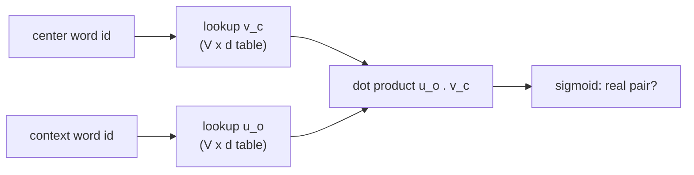

## Learning Objectives

- State the distributional hypothesis and explain how it turns unlabeled text into a supervised learning signal.
- Describe the skip-gram objective of word2vec: predict context words from a center word using a dot product between two embedding vectors.
- Explain why the full softmax over the vocabulary is too expensive and how negative sampling replaces it with a handful of binary classifications.
- Interpret embedding geometry: cosine similarity, analogy offsets, and the limits of a single static vector per word.

## Context & Motivation

The previous concept turned text into integer ids. An id is just an index: id 4,712 is no closer to id 4,713 than to id 12. A one-hot vector of length `V` has the same problem, every pair of distinct words is equally far apart. Any model that is supposed to generalize from "the cat sat" to "the dog sat" needs a representation in which `cat` and `dog` are close.

The idea that makes this learnable without labels is the **distributional hypothesis**, stated by the linguists Harris (1954) and Firth (1957): words that occur in similar contexts tend to have similar meanings. "You shall know a word by the company it keeps." If `cat` and `dog` both appear next to `pet`, `fed`, `vet`, and `sleeping`, a model trained to predict neighbors will be pushed to give them similar internal representations.

Word2vec (Mikolov and colleagues at Google, 2013) made this practical at scale. It is a shallow model, one embedding lookup and one dot product, and that simplicity is why it could be trained on billions of words on a single machine. Its learned vectors became the standard input layer for NLP systems for years, and the embedding table at the bottom of every transformer is the same idea, trained jointly with the rest of the network instead of separately.

## Core Theory

### Turning text into prediction tasks

Slide a window over the corpus. At each position, the word in the middle is the **center word** `c` and the words within `m` positions on either side are its **context words** `o`. Every (center, context) pair is a training example. The **skip-gram** model learns to predict context from center; its sibling **CBOW** (continuous bag of words) predicts the center from the averaged context. No human labeling is needed: the corpus itself supplies the answers.

### The skip-gram model

Each word `w` gets two vectors of dimension `d` (typically 100 to 300): `v_w` when it plays the center role and `u_w` when it plays the context role. The probability that `o` appears in the context of `c` is modeled with a softmax over the whole vocabulary:

$$P(o \mid c) = \frac{\exp(u_o^\top v_c)}{\sum_{w=1}^{V} \exp(u_w^\top v_c)}$$

Training maximizes the log-probability of every observed pair, which is the cross-entropy loss from `ai-theory/deep-learning` with the vocabulary as the set of classes. The dot product is the only interaction: to make `P(o | c)` large, the model must make `u_o` and `v_c` point in similar directions. Two center words that predict the same contexts end up with similar `v` vectors, which is exactly the distributional hypothesis written as an optimization problem.

### Negative sampling

The denominator sums over all `V` words, often hundreds of thousands, for every single training pair. Negative sampling replaces the `V`-way classification with `k + 1` binary ones: is this pair real or fake? For a real pair `(c, o)`, draw `k` "negative" words `n_1, ..., n_k` at random (typically `k` between 5 and 20, sampled proportionally to word frequency raised to the 3/4 power) and maximize

$$\log \sigma(u_o^\top v_c) + \sum_{i=1}^{k} \log \sigma(-u_{n_i}^\top v_c)$$

where `σ` is the logistic sigmoid. The first term pulls the true context toward the center word; the second pushes random words away. Each update now touches `k + 1` context vectors instead of `V`, which is what made training on a 100-billion-word corpus feasible.

### What the geometry encodes

After training, similarity is measured with cosine similarity, `cos(a, b) = (a · b) / (‖a‖ ‖b‖)`. Nearest neighbors are usually semantically or syntactically related words. More surprisingly, some relations appear as roughly constant offsets: `v_king − v_man + v_woman` lands near `v_queen`, and `v_Paris − v_France + v_Italy` lands near `v_Rome`. The offsets are approximate and selective (they work for some relation types much better than others), but they show that the training objective organized the space along consistent directions without being told to.

### The limitation: one vector per word type

A static embedding gives `bank` one vector, whether the sentence is about rivers or money; that vector is an average of both senses. Contextual models (the transformers of the next concept) fix this by computing a different vector for each occurrence, from the surrounding tokens. The static table still exists in those models, as the first layer, but it is no longer the final representation.

## Worked Examples

### Example 1: generating training pairs

**Problem:** With window size `m = 2`, list the skip-gram training pairs whose center word is `sat` in the sentence `the cat sat on the mat`.

**Trace:** `sat` is at position 3. The context covers positions 1, 2, 4, and 5: `the`, `cat`, `on`, `the`. The pairs are (sat, the), (sat, cat), (sat, on), (sat, the). The repeated `the` produces two pairs, so frequent function words dominate the raw counts; word2vec counters this by randomly discarding very frequent words (subsampling) before building pairs, so that rarer, more informative co-occurrences get more weight.

### Example 2: one negative-sampling update, by sign

**Problem:** For the real pair (sat, cat) with one negative sample `galaxy`, describe the direction each vector moves after one gradient step.

**Resolution:** The positive term `log σ(u_cat · v_sat)` increases when the dot product increases, so its gradient moves `v_sat` toward `u_cat` and `u_cat` toward `v_sat`. The negative term `log σ(−u_galaxy · v_sat)` increases when that dot product decreases, so `v_sat` moves away from `u_galaxy` and `u_galaxy` away from `v_sat`. Repeated over billions of pairs, `sat` ends up near the context vectors of words it actually appears with, and far from those it does not. The size of each step is scaled by how wrong the current prediction is: if `σ(u_cat · v_sat)` is already close to 1, the positive update is tiny.

## Common Misconceptions & Pitfalls

- **"Embeddings capture meaning."** They capture patterns of co-occurrence in the training corpus, including its biases. Embeddings trained on news text place occupations closer to one gender than another because the text does; this is a property of the data that the method faithfully reproduces, not an error to be ignored.
- **"Analogy arithmetic proves the space is linear in meaning."** Published analogy results usually exclude the three input words from the candidate answers; without that exclusion, the nearest neighbor of `v_king − v_man + v_woman` is often `king` itself. The offsets are real but noisy.
- **"word2vec is a deep network."** It is deliberately shallow, a single linear layer with no hidden nonlinearity. Its success came from training cheaply on far more data, not from depth.

## Summary

The distributional hypothesis says that context reveals meaning, and word2vec turns it into a self-supervised objective: predict neighboring words from a center word through a dot product of two learned vectors. Negative sampling replaces the expensive full softmax with a few binary real-or-fake decisions, making training on billions of words cheap. The resulting space places related words close together and encodes some relations as consistent offsets, but gives each word a single static vector regardless of context. The next concept keeps the embedding table and stacks a transformer on top, trained with objectives that produce context-dependent representations.

## Documentation Links

- [Mikolov et al.: Efficient Estimation of Word Representations in Vector Space (2013)](https://arxiv.org/abs/1301.3781): doc
- [Mikolov et al.: Distributed Representations of Words and Phrases and their Compositionality (NeurIPS 2013)](https://arxiv.org/abs/1310.4546): doc
- [Stanford CS224N: Natural Language Processing with Deep Learning](https://web.stanford.edu/class/cs224n/): doc
