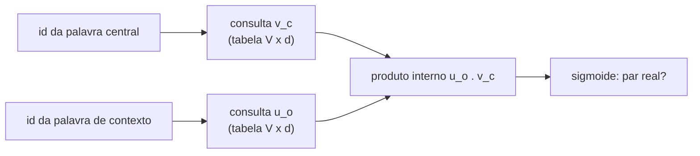

## Objetivos de Aprendizagem

- Enunciar a hipótese distribucional e explicar como ela transforma texto sem rótulo num sinal de aprendizado supervisionado.
- Descrever o objetivo skip-gram do word2vec: prever palavras de contexto a partir de uma palavra central usando um produto interno entre dois vetores de embedding.
- Explicar por que o softmax completo sobre o vocabulário é caro demais e como o negative sampling o substitui por um punhado de classificações binárias.
- Interpretar a geometria dos embeddings: similaridade de cosseno, deslocamentos de analogia e os limites de um único vetor estático por palavra.

## Contexto e Motivação

O conceito anterior transformou texto em ids inteiros. Um id é só um índice: o id 4.712 não está mais perto do id 4.713 do que do id 12. Um vetor one-hot de comprimento `V` tem o mesmo problema, todo par de palavras distintas fica igualmente distante. Qualquer modelo que deva generalizar de "o gato sentou" para "o cachorro sentou" precisa de uma representação em que `gato` e `cachorro` fiquem próximos.

A ideia que torna isso aprendível sem rótulos é a **hipótese distribucional**, enunciada pelos linguistas Harris (1954) e Firth (1957): palavras que ocorrem em contextos parecidos tendem a ter significados parecidos. "Conhecerás uma palavra pela companhia que ela mantém." Se `gato` e `cachorro` aparecem ao lado de `bicho`, `alimentou`, `veterinário` e `dormindo`, um modelo treinado para prever vizinhos será empurrado a dar a eles representações internas parecidas.

O word2vec (Mikolov e colegas no Google, 2013) tornou isso prático em escala. É um modelo raso, uma consulta de embedding e um produto interno, e essa simplicidade é o motivo de ele poder ser treinado com bilhões de palavras numa única máquina. Os seus vetores aprendidos viraram a camada de entrada padrão de sistemas de PLN por anos, e a tabela de embeddings na base de todo transformer é a mesma ideia, treinada junto com o resto da rede em vez de separadamente.

## Teoria Central

### Transformando texto em tarefas de previsão

Deslize uma janela pelo corpus. Em cada posição, a palavra do meio é a **palavra central** `c` e as palavras até `m` posições de cada lado são as suas **palavras de contexto** `o`. Todo par (central, contexto) é um exemplo de treino. O modelo **skip-gram** aprende a prever o contexto a partir da central; o seu irmão **CBOW** (continuous bag of words) prevê a central a partir da média do contexto. Nenhuma rotulação humana é necessária: o próprio corpus fornece as respostas.

### O modelo skip-gram

Cada palavra `w` ganha dois vetores de dimensão `d` (tipicamente de 100 a 300): `v_w` quando faz o papel de central e `u_w` quando faz o papel de contexto. A probabilidade de `o` aparecer no contexto de `c` é modelada com um softmax sobre o vocabulário inteiro:

$$P(o \mid c) = \frac{\exp(u_o^\top v_c)}{\sum_{w=1}^{V} \exp(u_w^\top v_c)}$$

O treino maximiza a log-probabilidade de todo par observado, que é a perda de entropia cruzada de `ai-theory/deep-learning` com o vocabulário como conjunto de classes. O produto interno é a única interação: para tornar `P(o | c)` grande, o modelo precisa fazer `u_o` e `v_c` apontarem em direções parecidas. Duas palavras centrais que preveem os mesmos contextos acabam com vetores `v` parecidos, que é exatamente a hipótese distribucional escrita como problema de otimização.

### Negative sampling

O denominador soma sobre todas as `V` palavras, muitas vezes centenas de milhares, para cada par de treino. O negative sampling troca a classificação em `V` classes por `k + 1` classificações binárias: este par é real ou falso? Para um par real `(c, o)`, sorteie `k` palavras "negativas" `n_1, ..., n_k` (tipicamente `k` entre 5 e 20, amostradas proporcionalmente à frequência da palavra elevada a 3/4) e maximize

$$\log \sigma(u_o^\top v_c) + \sum_{i=1}^{k} \log \sigma(-u_{n_i}^\top v_c)$$

em que `σ` é a sigmoide logística. O primeiro termo puxa o contexto verdadeiro para perto da palavra central; o segundo empurra palavras aleatórias para longe. Cada atualização agora mexe em `k + 1` vetores de contexto em vez de `V`, e foi isso que tornou viável treinar num corpus de 100 bilhões de palavras.

### O que a geometria codifica

Depois do treino, a similaridade é medida com a similaridade de cosseno, `cos(a, b) = (a · b) / (‖a‖ ‖b‖)`. Os vizinhos mais próximos costumam ser palavras relacionadas semântica ou sintaticamente. Mais surpreendente, algumas relações aparecem como deslocamentos aproximadamente constantes: `v_king − v_man + v_woman` cai perto de `v_queen`, e `v_Paris − v_France + v_Italy` cai perto de `v_Rome`. Os deslocamentos são aproximados e seletivos (funcionam muito melhor para alguns tipos de relação do que para outros), mas mostram que o objetivo de treino organizou o espaço ao longo de direções consistentes sem que ninguém mandasse.

### A limitação: um vetor por tipo de palavra

Um embedding estático dá a `banco` um único vetor, seja a frase sobre um banco de praça ou um banco financeiro; esse vetor é uma média dos dois sentidos. Modelos contextuais (os transformers do próximo conceito) corrigem isso calculando um vetor diferente para cada ocorrência, a partir dos tokens ao redor. A tabela estática continua existindo nesses modelos, como primeira camada, mas deixa de ser a representação final.

## Exemplos Resolvidos

### Exemplo 1: gerando pares de treino

**Problema:** Com tamanho de janela `m = 2`, liste os pares de treino skip-gram cuja palavra central é `sat` na frase `the cat sat on the mat`.

**Rastreamento:** `sat` está na posição 3. O contexto cobre as posições 1, 2, 4 e 5: `the`, `cat`, `on`, `the`. Os pares são (sat, the), (sat, cat), (sat, on), (sat, the). O `the` repetido gera dois pares, então palavras funcionais frequentes dominam as contagens brutas; o word2vec compensa isso descartando aleatoriamente palavras muito frequentes (subamostragem) antes de montar os pares, para que coocorrências mais raras e mais informativas ganhem mais peso.

### Exemplo 2: uma atualização de negative sampling, pelo sinal

**Problema:** Para o par real (sat, cat) com uma amostra negativa `galaxy`, descreva a direção em que cada vetor se move depois de um passo de gradiente.

**Resolução:** O termo positivo `log σ(u_cat · v_sat)` aumenta quando o produto interno aumenta, então o seu gradiente move `v_sat` em direção a `u_cat` e `u_cat` em direção a `v_sat`. O termo negativo `log σ(−u_galaxy · v_sat)` aumenta quando esse produto interno diminui, então `v_sat` se afasta de `u_galaxy` e `u_galaxy` se afasta de `v_sat`. Repetido em bilhões de pares, `sat` termina perto dos vetores de contexto das palavras com que realmente aparece e longe dos demais. O tamanho de cada passo é escalado pelo quão errada está a previsão atual: se `σ(u_cat · v_sat)` já está perto de 1, a atualização positiva é minúscula.

## Equívocos Comuns e Armadilhas

- **"Embeddings capturam significado."** Eles capturam padrões de coocorrência no corpus de treino, incluindo os seus vieses. Embeddings treinados em notícias colocam profissões mais perto de um gênero do que de outro porque o texto faz isso; é uma propriedade dos dados que o método reproduz fielmente, não um erro a ser ignorado.
- **"A aritmética de analogias prova que o espaço é linear em significado."** Resultados publicados de analogia costumam excluir as três palavras de entrada das respostas candidatas; sem essa exclusão, o vizinho mais próximo de `v_king − v_man + v_woman` muitas vezes é o próprio `king`. Os deslocamentos são reais, mas ruidosos.
- **"O word2vec é uma rede profunda."** Ele é raso de propósito, uma única camada linear sem não linearidade oculta. O seu sucesso veio de treinar barato com muito mais dados, não de profundidade.

## Resumo

A hipótese distribucional diz que o contexto revela o significado, e o word2vec a transforma num objetivo autossupervisionado: prever palavras vizinhas a partir de uma palavra central por meio do produto interno de dois vetores aprendidos. O negative sampling troca o softmax completo e caro por algumas decisões binárias de real ou falso, tornando barato treinar com bilhões de palavras. O espaço resultante coloca palavras relacionadas perto umas das outras e codifica algumas relações como deslocamentos consistentes, mas dá a cada palavra um único vetor estático independente do contexto. O próximo conceito mantém a tabela de embeddings e empilha um transformer em cima, treinado com objetivos que produzem representações dependentes do contexto.

## Documentation Links

- [Mikolov et al.: Efficient Estimation of Word Representations in Vector Space (2013)](https://arxiv.org/abs/1301.3781): doc
- [Mikolov et al.: Distributed Representations of Words and Phrases and their Compositionality (NeurIPS 2013)](https://arxiv.org/abs/1310.4546): doc
- [Stanford CS224N: Natural Language Processing with Deep Learning](https://web.stanford.edu/class/cs224n/): doc
