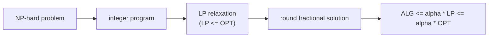

## Learning Objectives

- Define the approximation ratio of an algorithm for a minimization problem and explain why proving it requires a lower bound on the unknown optimum.
- Formulate weighted vertex cover as an integer linear program, relax it to an LP, and prove that threshold rounding at 1/2 gives a 2-approximation.
- Define the integrality gap of a relaxation and show the vertex cover LP's gap approaches 2.
- Analyze the greedy algorithm for set cover and state its $H_n \approx \ln n$ guarantee and the matching hardness result.

## Context & Motivation

`algorithms-software/computability-complexity` showed that problems such as vertex cover and set cover are NP-complete, so no polynomial-time algorithm is expected to solve them exactly. That is not the end of the story in practice: a delivery company still needs to place depots, and a network operator still needs to monitor every link. An **approximation algorithm** runs in polynomial time and returns a solution provably within a fixed factor of the optimum, on every input.

The difficulty is that the optimum is unknown; proving "within a factor 2 of OPT" requires a lower bound on OPT that can be computed. `algorithms-software/linear-programming-optimization` provides one: relax the integrality constraints of an integer program to obtain a linear program, which is solvable in polynomial time and whose value can only be better than the integer optimum. Rounding the fractional LP solution back to an integer one, while tracking how much the rounding costs, is one of the main techniques in Williamson and Shmoys's textbook and MIT's 6.854.

## Core Theory

### Approximation ratio

For a minimization problem, an algorithm is an **$\alpha$-approximation** ($\alpha \geq 1$) if on every instance it returns a feasible solution of cost $\mathrm{ALG} \leq \alpha \cdot \mathrm{OPT}$. Every proof has the same skeleton: find a quantity $L$ with $L \leq \mathrm{OPT}$ that can be computed, then show $\mathrm{ALG} \leq \alpha L$. The LP relaxation is the most versatile choice of $L$.

### Vertex cover as an integer program

Given a graph with vertex weights $w_v \geq 0$, choose a minimum-weight set of vertices touching every edge. With $x_v = 1$ meaning "$v$ is chosen":

$$\min \sum_{v} w_v x_v \quad \text{subject to} \quad x_u + x_v \geq 1 \ \text{ for every edge } (u, v), \qquad x_v \in \{0, 1\}$$

The **LP relaxation** replaces $x_v \in \{0, 1\}$ with $0 \leq x_v \leq 1$. Every integer solution is also an LP solution, so $\mathrm{LP} \leq \mathrm{OPT}$.

### Threshold rounding

Solve the LP to get $x^*$, and pick $S = \{v : x^*_v \geq 1/2\}$.

- **Feasible**: for each edge, $x^*_u + x^*_v \geq 1$, so at least one of them is at least $1/2$ and is chosen.
- **Cost**: each chosen vertex has $1 \leq 2x^*_v$, so $\sum_{v \in S} w_v \leq \sum_v 2 w_v x^*_v = 2 \cdot \mathrm{LP} \leq 2 \cdot \mathrm{OPT}$.

That is a complete 2-approximation proof. (For unweighted vertex cover, taking both endpoints of a maximal matching also gives a factor of 2 with no LP at all.)

### Integrality gap

The **integrality gap** is the worst ratio $\mathrm{OPT}/\mathrm{LP}$ over all instances. It limits any rounding argument that compares only to the LP: no rounding of this LP can prove a factor better than the gap. On the complete graph $K_n$, setting every $x_v = 1/2$ is feasible with value $n/2$, while any vertex cover must include all but one vertex, so $\mathrm{OPT} = n - 1$. The gap is $(n-1)/(n/2) \to 2$, so threshold rounding is as good as this relaxation allows. Improving on 2 for vertex cover is a major open problem: it is NP-hard to approximate within about 1.36, and within $2 - \varepsilon$ under the Unique Games Conjecture.

### Greedy set cover

Given a universe of $n$ elements and a family of sets with costs, cover every element at minimum total cost. Greedy: repeatedly pick the set minimizing **cost per newly covered element**, until everything is covered.

Analysis by charging: when greedy picks a set, spread its cost equally over the elements it newly covers. When $k$ elements remain uncovered, the optimal solution covers them with total cost $\mathrm{OPT}$, so some set covers them at an average cost of at most $\mathrm{OPT}/k$ per element; greedy's choice is at least that good. Ordering elements by when they get covered, the $j$-th element from the end is charged at most $\mathrm{OPT}/j$. Summing:

$$\mathrm{ALG} \leq \mathrm{OPT}\left(1 + \frac12 + \dots + \frac1n\right) = H_n \cdot \mathrm{OPT} \leq (\ln n + 1)\,\mathrm{OPT}$$

This is essentially tight: Feige (1998) and later Dinur and Steurer (2014) showed that approximating set cover within $(1 - \varepsilon)\ln n$ is NP-hard. A simple greedy rule matches the best possible polynomial-time guarantee.

## Worked Examples

### Example 1: rounding on a triangle

**Problem:** Unweighted vertex cover on a triangle (vertices $a, b, c$, all three edges). Solve the LP, round, and compare with OPT.

**Trace:** Setting $x_a = x_b = x_c = 1/2$ satisfies every edge constraint with equality and has value $1.5$. No feasible fractional solution does better: summing the three constraints gives $2(x_a + x_b + x_c) \geq 3$, so the LP optimum is exactly $1.5$. Threshold rounding picks all three vertices, cost 3. The true optimum is 2 (any two vertices). The ratio $3/2 = 1.5$ is within the guaranteed factor of 2, and $\mathrm{ALG}/\mathrm{LP} = 2$ shows the analysis is tight against the LP even when the actual solution is not that bad.

### Example 2: greedy set cover by hand

**Problem:** Universe $\{1, \dots, 6\}$, unit-cost sets $A = \{1,2,3,4\}$, $B = \{1,2,5\}$, $C = \{3,4,6\}$, $D = \{5,6\}$. Run greedy.

**Trace:** All costs are 1, so greedy maximizes newly covered elements. Step 1: $A$ covers 4, the most; pick $A$, remaining $\{5, 6\}$. Step 2: $B$ covers $\{5\}$, $C$ covers $\{6\}$, $D$ covers $\{5,6\}$; pick $D$. Done with cost 2, which is optimal here. Change $A$ to $\{1,2,3,4,5\}$ and add $E = \{6\}$, keeping $B$, $C$, $D$: greedy picks $A$ (5 new), then any set containing 6, cost 2, still optimal. Instances where greedy is off by a $\ln n$ factor exist and are built carefully so that each greedy choice covers slightly more than any optimal set while the optimum uses only two large sets; the bound guarantees that, however adversarial the instance, the loss never exceeds $H_n$.

## Common Misconceptions & Pitfalls

- **"An approximation ratio of 2 means the answer is usually twice the optimum."** It is a worst-case guarantee; on typical instances LP rounding and greedy are often within a few percent of optimal. Ratio and typical quality answer different questions.
- **"Rounding an LP solution always works."** Naive rounding can be infeasible or arbitrarily bad; each problem needs a rounding scheme whose feasibility and cost are both proved. Randomized rounding (choose $v$ with probability $x^*_v$) is another standard tool, analyzed with the concentration bounds of an earlier concept.
- **"NP-hard means nothing can be guaranteed."** NP-hard problems differ enormously in approximability: knapsack admits a $(1+\varepsilon)$-approximation for any $\varepsilon$, set cover only $\ln n$, and general TSP no constant factor at all unless P = NP.

## Summary

An approximation algorithm returns, in polynomial time, a solution within a proven factor of the optimum, which requires a computable lower bound on the optimum. Relaxing an integer program to a linear program provides that bound. For vertex cover, rounding every variable at least $1/2$ up is feasible and costs at most twice the LP value, a 2-approximation, and the integrality gap of 2 on complete graphs shows the relaxation cannot prove more. Greedy set cover, charging each set's cost to the elements it newly covers, achieves $H_n \approx \ln n$, matching the hardness of approximation. The next concept keeps the idea of comparing against an optimum that cannot be computed, but now because the input arrives one piece at a time.

## Documentation Links

- [Williamson, Shmoys: The Design of Approximation Algorithms (Cambridge University Press, free online edition)](https://www.designofapproxalgs.com/): doc
- [MIT 6.854J: Advanced Algorithms (OCW)](https://ocw.mit.edu/courses/6-854j-advanced-algorithms-fall-2008/): doc
