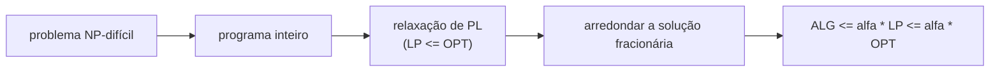

## Objetivos de Aprendizagem

- Definir a razão de aproximação de um algoritmo para um problema de minimização e explicar por que prová-la exige um limite inferior para o ótimo desconhecido.
- Formular a cobertura de vértices com pesos como programa linear inteiro, relaxá-la para uma PL e provar que o arredondamento por limiar em 1/2 dá uma 2-aproximação.
- Definir o gap de integralidade de uma relaxação e mostrar que o gap da PL de cobertura de vértices tende a 2.
- Analisar o algoritmo guloso para cobertura de conjuntos e enunciar a sua garantia $H_n \approx \ln n$ e o resultado de dificuldade correspondente.

## Contexto e Motivação

`algorithms-software/computability-complexity` mostrou que problemas como cobertura de vértices e cobertura de conjuntos são NP-completos, então não se espera nenhum algoritmo polinomial que os resolva exatamente. Na prática, a história não acaba aí: uma transportadora ainda precisa posicionar depósitos, e um operador de rede ainda precisa monitorar todo enlace. Um **algoritmo de aproximação** roda em tempo polinomial e devolve uma solução comprovadamente dentro de um fator fixo do ótimo, em toda entrada.

A dificuldade é que o ótimo é desconhecido; provar "dentro de um fator 2 do OPT" exige um limite inferior para o OPT que possa ser calculado. `algorithms-software/linear-programming-optimization` fornece um: relaxar as restrições de integralidade de um programa inteiro para obter um programa linear, resolvível em tempo polinomial e cujo valor só pode ser melhor do que o ótimo inteiro. Arredondar a solução fracionária da PL de volta para uma inteira, acompanhando quanto o arredondamento custa, é uma das técnicas principais do livro de Williamson e Shmoys e do 6.854 do MIT.

## Teoria Central

### Razão de aproximação

Para um problema de minimização, um algoritmo é uma **$\alpha$-aproximação** ($\alpha \geq 1$) se em toda instância devolve uma solução viável de custo $\mathrm{ALG} \leq \alpha \cdot \mathrm{OPT}$. Toda prova tem o mesmo esqueleto: encontrar uma quantidade $L$ com $L \leq \mathrm{OPT}$ que possa ser calculada e então mostrar $\mathrm{ALG} \leq \alpha L$. A relaxação de PL é a escolha mais versátil de $L$.

### Cobertura de vértices como programa inteiro

Dado um grafo com pesos nos vértices $w_v \geq 0$, escolha um conjunto de vértices de peso mínimo que toque toda aresta. Com $x_v = 1$ significando "$v$ foi escolhido":

$$\min \sum_{v} w_v x_v \quad \text{sujeito a} \quad x_u + x_v \geq 1 \ \text{ para toda aresta } (u, v), \qquad x_v \in \{0, 1\}$$

A **relaxação de PL** troca $x_v \in \{0, 1\}$ por $0 \leq x_v \leq 1$. Toda solução inteira também é solução da PL, então $\mathrm{LP} \leq \mathrm{OPT}$.

### Arredondamento por limiar

Resolva a PL para obter $x^*$ e escolha $S = \{v : x^*_v \geq 1/2\}$.

- **Viável**: para cada aresta, $x^*_u + x^*_v \geq 1$, então pelo menos um deles é no mínimo $1/2$ e é escolhido.
- **Custo**: cada vértice escolhido tem $1 \leq 2x^*_v$, então $\sum_{v \in S} w_v \leq \sum_v 2 w_v x^*_v = 2 \cdot \mathrm{LP} \leq 2 \cdot \mathrm{OPT}$.

Essa é uma prova completa de 2-aproximação. (Para cobertura de vértices sem pesos, pegar as duas pontas de um emparelhamento maximal também dá fator 2 sem PL nenhuma.)

### Gap de integralidade

O **gap de integralidade** é a pior razão $\mathrm{OPT}/\mathrm{LP}$ sobre todas as instâncias. Ele limita qualquer argumento de arredondamento que compare só com a PL: nenhum arredondamento dessa PL consegue provar um fator melhor do que o gap. No grafo completo $K_n$, pôr todo $x_v = 1/2$ é viável com valor $n/2$, enquanto qualquer cobertura de vértices precisa incluir todos os vértices menos um, então $\mathrm{OPT} = n - 1$. O gap é $(n-1)/(n/2) \to 2$, então o arredondamento por limiar é tão bom quanto essa relaxação permite. Melhorar o fator 2 para cobertura de vértices é um grande problema em aberto: é NP-difícil aproximar dentro de cerca de 1,36, e dentro de $2 - \varepsilon$ sob a Unique Games Conjecture.

### Cobertura de conjuntos gulosa

Dado um universo de $n$ elementos e uma família de conjuntos com custos, cubra todo elemento com custo total mínimo. Guloso: escolha repetidamente o conjunto que minimiza o **custo por elemento recém-coberto**, até cobrir tudo.

Análise por cobrança: quando o guloso escolhe um conjunto, espalhe o seu custo igualmente entre os elementos que ele cobre pela primeira vez. Quando restam $k$ elementos descobertos, a solução ótima os cobre com custo total $\mathrm{OPT}$, então algum conjunto os cobre com custo médio de no máximo $\mathrm{OPT}/k$ por elemento; a escolha do guloso é pelo menos tão boa. Ordenando os elementos pelo momento em que são cobertos, o $j$-ésimo elemento contando do fim é cobrado no máximo $\mathrm{OPT}/j$. Somando:

$$\mathrm{ALG} \leq \mathrm{OPT}\left(1 + \frac12 + \dots + \frac1n\right) = H_n \cdot \mathrm{OPT} \leq (\ln n + 1)\,\mathrm{OPT}$$

Isso é essencialmente justo: Feige (1998) e depois Dinur e Steurer (2014) mostraram que aproximar a cobertura de conjuntos dentro de $(1 - \varepsilon)\ln n$ é NP-difícil. Uma regra gulosa simples iguala a melhor garantia possível em tempo polinomial.

## Exemplos Resolvidos

### Exemplo 1: arredondando num triângulo

**Problema:** Cobertura de vértices sem pesos num triângulo (vértices $a, b, c$, as três arestas). Resolva a PL, arredonde e compare com o OPT.

**Rastreamento:** Pôr $x_a = x_b = x_c = 1/2$ satisfaz toda restrição de aresta com igualdade e tem valor $1{,}5$. Nenhuma solução fracionária viável faz melhor: somar as três restrições dá $2(x_a + x_b + x_c) \geq 3$, então o ótimo da PL é exatamente $1{,}5$. O arredondamento por limiar escolhe os três vértices, custo 3. O ótimo verdadeiro é 2 (quaisquer dois vértices). A razão $3/2 = 1{,}5$ fica dentro do fator garantido 2, e $\mathrm{ALG}/\mathrm{LP} = 2$ mostra que a análise é justa em relação à PL mesmo quando a solução real não é tão ruim.

### Exemplo 2: cobertura de conjuntos gulosa à mão

**Problema:** Universo $\{1, \dots, 6\}$, conjuntos de custo unitário $A = \{1,2,3,4\}$, $B = \{1,2,5\}$, $C = \{3,4,6\}$, $D = \{5,6\}$. Rode o guloso.

**Rastreamento:** Todos os custos são 1, então o guloso maximiza os elementos recém-cobertos. Passo 1: $A$ cobre 4, o máximo; escolha $A$, restam $\{5, 6\}$. Passo 2: $B$ cobre $\{5\}$, $C$ cobre $\{6\}$, $D$ cobre $\{5,6\}$; escolha $D$. Fim com custo 2, que aqui é ótimo. Troque $A$ por $\{1,2,3,4,5\}$ e acrescente $E = \{6\}$, mantendo $B$, $C$, $D$: o guloso escolhe $A$ (5 novos), depois qualquer conjunto que contenha 6, custo 2, ainda ótimo. Instâncias em que o guloso erra por um fator $\ln n$ existem e são construídas com cuidado para que cada escolha gulosa cubra um pouco mais do que qualquer conjunto ótimo, enquanto o ótimo usa só dois conjuntos grandes; o limite garante que, por mais adversária que seja a instância, a perda nunca passa de $H_n$.

## Equívocos Comuns e Armadilhas

- **"Razão de aproximação 2 significa que a resposta costuma ser o dobro do ótimo."** É uma garantia de pior caso; em instâncias típicas, o arredondamento de PL e o guloso costumam ficar a poucos por cento do ótimo. Razão e qualidade típica respondem perguntas diferentes.
- **"Arredondar uma solução de PL sempre funciona."** O arredondamento ingênuo pode ser inviável ou arbitrariamente ruim; cada problema precisa de um esquema de arredondamento cuja viabilidade e cujo custo sejam ambos provados. O arredondamento aleatorizado (escolher $v$ com probabilidade $x^*_v$) é outra ferramenta padrão, analisada com os limites de concentração de um conceito anterior.
- **"NP-difícil significa que nada pode ser garantido."** Problemas NP-difíceis diferem enormemente em aproximabilidade: a mochila admite uma $(1+\varepsilon)$-aproximação para qualquer $\varepsilon$, a cobertura de conjuntos só $\ln n$, e o TSP geral nenhum fator constante, a menos que P = NP.

## Resumo

Um algoritmo de aproximação devolve, em tempo polinomial, uma solução dentro de um fator comprovado do ótimo, o que exige um limite inferior calculável para o ótimo. Relaxar um programa inteiro para um programa linear fornece esse limite. Na cobertura de vértices, arredondar para cima toda variável de pelo menos $1/2$ é viável e custa no máximo o dobro do valor da PL, uma 2-aproximação, e o gap de integralidade 2 em grafos completos mostra que a relaxação não consegue provar mais. A cobertura de conjuntos gulosa, cobrando o custo de cada conjunto dos elementos que ele cobre pela primeira vez, alcança $H_n \approx \ln n$, igualando a dificuldade de aproximação. O próximo conceito mantém a ideia de comparar com um ótimo que não pode ser calculado, mas agora porque a entrada chega aos pedaços.

## Documentation Links

- [Williamson, Shmoys: The Design of Approximation Algorithms (Cambridge University Press, free online edition)](https://www.designofapproxalgs.com/): doc
- [MIT 6.854J: Advanced Algorithms (OCW)](https://ocw.mit.edu/courses/6-854j-advanced-algorithms-fall-2008/): doc
