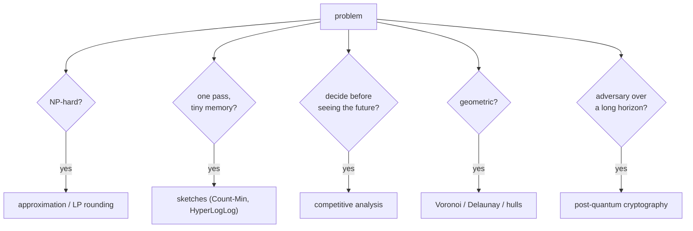

## Learning Objectives

- Classify a realistic problem by the resource that makes it hard: computational intractability, limited memory or a single pass, incomplete information, geometric structure, or an adversary.
- Select the matching tool from this track (approximation, randomization, sketching, online analysis, geometry, or cryptographic hardness) and state precisely what guarantee it provides.
- Identify what each guarantee does not cover, and choose an evaluation that exposes that gap.
- Explain why theory often reaches a design decision faster than experimentation, and where experimentation is still needed.

## Context & Motivation

The concepts of this track each answered one kind of question. Some problems are NP-hard, so approximation algorithms trade optimality for a proven factor. Some inputs are too large to store, so sketches answer in one pass with bounded error. Some decisions must be made before the future is known, so competitive analysis measures the cost of not knowing. Some structure is geometric, so exact predicates and sweep lines apply. And some guarantees must hold against an intelligent adversary, so cryptography rests on carefully chosen hardness assumptions.

Real requests mix these. A logistics team, an analytics team, and a security team each bring a problem stated in business terms. The skill this capstone practices, in the spirit of the problem sets in MIT's 6.854 and Stanford's CS168, is recognizing the theoretical shape underneath, picking a tool with a provable guarantee, and being explicit about where the guarantee ends.

## Core Theory

### A diagnostic checklist

1. **Is the exact problem tractable?** If it is NP-hard (recognized by reduction from a known NP-hard problem), ask for an approximation guarantee or a fast exact method for the instance sizes at hand.
2. **Is memory or the number of passes limited?** If the data is a stream or is spread across machines, look for a mergeable sketch with a known error bound.
3. **Must decisions be made before the input is complete?** Then the right benchmark is the offline optimum and the right question is the competitive ratio.
4. **Is there geometry?** Distances and positions suggest nearest-neighbor structures, Voronoi or Delaunay, convex hulls, sweeps, and exact predicates.
5. **Is there an adversary?** Then average-case reasoning is insufficient: guarantees must hold for worst-case or adversarially chosen inputs, and cryptographic assumptions must be chosen for the threat's time horizon.

## Worked Examples

### Example 1: placing warehouses

**Request:** A retailer serves customers in 300 towns and will open $k = 8$ warehouses, each in one of those towns. The goal is that no town is too far from its nearest warehouse: minimize the maximum town-to-warehouse distance.

**Analysis:** This is the **$k$-center** problem, which is NP-hard and, under P $\neq$ NP, cannot be approximated within any factor below 2. Gonzalez's greedy algorithm, a close relative of the greedy rules in the approximation concept, achieves exactly 2: pick any town, then repeatedly add the town farthest from the current choices; the proof shows that if the result's radius exceeded twice the optimum, there would be $k + 1$ points pairwise more than twice the optimal radius apart, which $k$ optimal balls could not cover. Once warehouses are fixed, each customer's nearest warehouse is a **Voronoi** query: build the diagram of the 8 warehouses and locate each customer in its cell (or use the Delaunay triangulation for nearest-neighbor walks). If warehouses could only go on a separate list of candidate sites, the problem would become $k$-supplier, where the best possible factor is 3; if the objective were total travel cost with opening costs, it would be facility location, with LP-rounding algorithms giving small constant factors.

**Guarantee and gap:** the radius is at most twice optimal, in the metric used. Road distances differ from straight lines, and real constraints (capacities, zoning) are outside the model; an integer-programming solver can then refine the greedy solution, using it as a starting point and the factor-2 bound as a sanity check.

### Example 2: unique visitors across a server fleet

**Request:** 400 web servers each log visitor IDs. The product team wants daily and weekly unique-visitor counts per country, within about 1%, without shipping raw logs to one place.

**Analysis:** Exact distinct counting needs memory linear in the number of distinct IDs, and IDs from different servers overlap, so per-server counts cannot be added. **HyperLogLog** fits exactly: each server keeps one sketch per country per day with $m = 2^{14}$ registers (about 12 KB, standard error about 0.8%), and a coordinator merges sketches by register-wise maximum, which gives the sketch of the union. Weekly counts merge seven daily sketches; no raw IDs move. If the team also wants the most active visitors, a **Count-Min** sketch provides heavy-hitter estimates with one-sided error, mergeable by addition.

**Guarantee and gap:** the error bound is statistical (relative standard error), not deterministic, and it covers distinct IDs, not distinct people: one person with two devices counts twice. That modeling gap is not something the sketch can fix.

### Example 3: a key exchange that must last 20 years

**Request:** A health-records platform establishes encrypted channels between hospitals. Records must remain confidential for at least 20 years.

**Analysis:** Elliptic-curve Diffie-Hellman is secure against classical attackers today, but traffic recorded now could be decrypted by a future quantum computer running Shor's algorithm, and 20 years is a horizon over which that risk cannot be dismissed. **ML-KEM** (FIPS 203), based on Module Learning With Errors, has no known efficient quantum attack and a worst-case hardness foundation. The recommended deployment is **hybrid**: derive the session key from both an X25519 exchange and an ML-KEM encapsulation, so the channel stays secure if either assumption holds. That covers both a future quantum attacker and the possibility that the newer lattice parameters turn out weaker than expected.

**Guarantee and gap:** the reduction-based guarantee covers the key exchange under its assumptions; it does not cover endpoint compromise, key management, or side channels in implementations, which in practice are how most systems are breached.

## Common Misconceptions & Pitfalls

- **"NP-hard means we need heuristics with no guarantees."** Many NP-hard problems have simple algorithms with tight guarantees (2 for $k$-center and vertex cover, $\ln n$ for set cover); start there, then improve empirically.
- **"Approximate answers are second-class."** For distinct counts over a fleet, the exact answer is not even practically available; a mergeable sketch with 1% error is the better engineering answer, not a compromise.
- **"Security proofs settle the question."** They relocate it to an assumption and a model. Choosing assumptions for the right time horizon, and hybridizing when uncertain, is part of the design.

## Summary

Theory gives design decisions a vocabulary of guarantees. Recognizing $k$-center as NP-hard leads to a greedy 2-approximation, optimal unless P = NP, with Voronoi cells assigning customers to warehouses. Recognizing distinct counting across machines as a streaming problem leads to mergeable HyperLogLog sketches with about 1% error in kilobytes. Recognizing a long-horizon adversary with possible quantum capabilities leads to hybrid key exchange with lattice-based ML-KEM. In each case the guarantee is stated precisely, and so is what it does not cover: the metric, the identity model, or the implementation.

## Documentation Links

- [MIT 6.854J: Advanced Algorithms (OCW)](https://ocw.mit.edu/courses/6-854j-advanced-algorithms-fall-2008/): doc
- [Stanford CS168: The Modern Algorithmic Toolbox](https://web.stanford.edu/class/cs168/): doc
