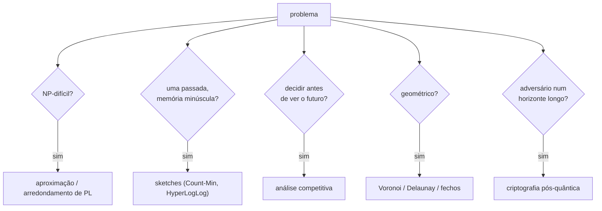

## Objetivos de Aprendizagem

- Classificar um problema realista pelo recurso que o torna difícil: intratabilidade computacional, memória limitada ou uma só passada, informação incompleta, estrutura geométrica ou um adversário.
- Escolher a ferramenta correspondente desta trilha (aproximação, aleatorização, sketches, análise online, geometria ou dificuldade criptográfica) e enunciar com precisão qual garantia ela fornece.
- Identificar o que cada garantia não cobre e escolher uma avaliação que exponha essa lacuna.
- Explicar por que a teoria muitas vezes chega a uma decisão de projeto mais rápido do que a experimentação, e onde a experimentação ainda é necessária.

## Contexto e Motivação

Cada conceito desta trilha respondeu um tipo de pergunta. Alguns problemas são NP-difíceis, então algoritmos de aproximação trocam otimalidade por um fator comprovado. Algumas entradas são grandes demais para guardar, então sketches respondem numa passada com erro limitado. Algumas decisões precisam ser tomadas antes de o futuro ser conhecido, então a análise competitiva mede o custo de não saber. Alguma estrutura é geométrica, então predicados exatos e linhas de varredura se aplicam. E algumas garantias precisam valer contra um adversário inteligente, então a criptografia se apoia em hipóteses de dificuldade escolhidas com cuidado.

Pedidos reais misturam tudo isso. Um time de logística, um de analytics e um de segurança trazem cada um um problema descrito em termos de negócio. A habilidade que este capstone pratica, no espírito das listas de exercícios do 6.854 do MIT e do CS168 de Stanford, é reconhecer a forma teórica por baixo, escolher uma ferramenta com garantia comprovada e ser explícito sobre onde a garantia termina.

## Teoria Central

### Uma lista de diagnóstico

1. **O problema exato é tratável?** Se é NP-difícil (reconhecido por redução a partir de um problema NP-difícil conhecido), peça uma garantia de aproximação ou um método exato rápido para os tamanhos de instância em questão.
2. **A memória ou o número de passadas é limitado?** Se os dados são um fluxo ou estão espalhados entre máquinas, procure um sketch combinável com limite de erro conhecido.
3. **As decisões precisam ser tomadas antes de a entrada estar completa?** Então a referência certa é o ótimo offline e a pergunta certa é a razão competitiva.
4. **Há geometria?** Distâncias e posições sugerem estruturas de vizinho mais próximo, Voronoi ou Delaunay, fechos convexos, varreduras e predicados exatos.
5. **Há um adversário?** Então raciocinar sobre o caso médio não basta: as garantias precisam valer para entradas de pior caso ou escolhidas por um adversário, e as hipóteses criptográficas precisam ser escolhidas para o horizonte de tempo da ameaça.

## Exemplos Resolvidos

### Exemplo 1: posicionando armazéns

**Pedido:** Um varejista atende clientes em 300 cidades e vai abrir $k = 8$ armazéns, cada um numa dessas cidades. O objetivo é que nenhuma cidade fique longe demais do armazém mais próximo: minimizar a maior distância de cidade a armazém.

**Análise:** Este é o problema do **$k$-centro**, que é NP-difícil e, sob P $\neq$ NP, não pode ser aproximado dentro de nenhum fator abaixo de 2. O algoritmo guloso de Gonzalez, parente próximo das regras gulosas do conceito de aproximação, alcança exatamente 2: escolha qualquer cidade e depois adicione repetidamente a cidade mais distante das escolhas atuais; a prova mostra que, se o raio do resultado passasse do dobro do ótimo, haveria $k + 1$ pontos a mais do que o dobro do raio ótimo uns dos outros, que $k$ bolas ótimas não conseguiriam cobrir. Com os armazéns fixados, o armazém mais próximo de cada cliente é uma consulta de **Voronoi**: construa o diagrama dos 8 armazéns e localize cada cliente na sua célula (ou use a triangulação de Delaunay para caminhadas de vizinho mais próximo). Se os armazéns só pudessem ficar numa lista separada de locais candidatos, o problema viraria o $k$-supplier, em que o melhor fator possível é 3; se o objetivo fosse o custo total de deslocamento com custos de abertura, seria localização de instalações, com algoritmos de arredondamento de PL dando fatores constantes pequenos.

**Garantia e lacuna:** o raio é no máximo o dobro do ótimo, na métrica usada. Distâncias por estrada diferem de linhas retas, e restrições reais (capacidades, zoneamento) ficam fora do modelo; um solver de programação inteira pode então refinar a solução gulosa, usando-a como ponto de partida e o limite de fator 2 como checagem de sanidade.

### Exemplo 2: visitantes únicos numa frota de servidores

**Pedido:** 400 servidores web registram os IDs dos visitantes. O time de produto quer contagens diárias e semanais de visitantes únicos por país, com cerca de 1% de erro, sem mandar logs brutos para um só lugar.

**Análise:** A contagem distinta exata precisa de memória linear no número de IDs distintos, e IDs de servidores diferentes se sobrepõem, então as contagens por servidor não podem ser somadas. O **HyperLogLog** encaixa exatamente: cada servidor mantém um sketch por país por dia com $m = 2^{14}$ registradores (cerca de 12 KB, erro padrão de cerca de 0,8%), e um coordenador combina os sketches pelo máximo registrador a registrador, o que dá o sketch da união. Contagens semanais combinam sete sketches diários; nenhum ID bruto se move. Se o time também quiser os visitantes mais ativos, um sketch **Count-Min** fornece estimativas de heavy hitters com erro de um lado só, combináveis por soma.

**Garantia e lacuna:** o limite de erro é estatístico (erro padrão relativo), não determinístico, e cobre IDs distintos, não pessoas distintas: uma pessoa com dois dispositivos conta duas vezes. Essa lacuna de modelagem não é algo que o sketch possa corrigir.

### Exemplo 3: uma troca de chaves que precisa durar 20 anos

**Pedido:** Uma plataforma de prontuários médicos estabelece canais cifrados entre hospitais. Os prontuários precisam continuar confidenciais por pelo menos 20 anos.

**Análise:** O Diffie-Hellman com curvas elípticas é seguro contra atacantes clássicos hoje, mas o tráfego gravado agora poderia ser decifrado por um futuro computador quântico rodando o algoritmo de Shor, e 20 anos é um horizonte em que esse risco não pode ser descartado. O **ML-KEM** (FIPS 203), baseado em Module Learning With Errors, não tem ataque quântico eficiente conhecido e tem um fundamento de dificuldade de pior caso. A implantação recomendada é **híbrida**: derivar a chave de sessão tanto de uma troca X25519 quanto de um encapsulamento ML-KEM, de modo que o canal continue seguro se qualquer uma das hipóteses valer. Isso cobre tanto um futuro atacante quântico quanto a possibilidade de os parâmetros de reticulado, mais novos, se mostrarem mais fracos do que o esperado.

**Garantia e lacuna:** a garantia baseada em redução cobre a troca de chaves sob as suas hipóteses; ela não cobre o comprometimento das pontas, a gestão de chaves nem canais laterais nas implementações, que na prática são como a maioria dos sistemas é invadida.

## Equívocos Comuns e Armadilhas

- **"NP-difícil significa que precisamos de heurísticas sem garantia."** Muitos problemas NP-difíceis têm algoritmos simples com garantias justas (2 para $k$-centro e cobertura de vértices, $\ln n$ para cobertura de conjuntos); comece por eles e depois melhore empiricamente.
- **"Respostas aproximadas são de segunda classe."** Para contagens distintas numa frota, a resposta exata nem está disponível na prática; um sketch combinável com 1% de erro é a melhor resposta de engenharia, não um compromisso.
- **"Provas de segurança encerram a questão."** Elas a transferem para uma hipótese e um modelo. Escolher hipóteses para o horizonte de tempo certo, e hibridizar quando houver incerteza, faz parte do projeto.

## Resumo

A teoria dá às decisões de projeto um vocabulário de garantias. Reconhecer o $k$-centro como NP-difícil leva a uma 2-aproximação gulosa, ótima a menos que P = NP, com células de Voronoi atribuindo clientes a armazéns. Reconhecer a contagem distinta entre máquinas como um problema de streaming leva a sketches HyperLogLog combináveis com cerca de 1% de erro em kilobytes. Reconhecer um adversário de longo horizonte com possíveis capacidades quânticas leva a uma troca de chaves híbrida com o ML-KEM baseado em reticulados. Em cada caso a garantia é enunciada com precisão, e também o que ela não cobre: a métrica, o modelo de identidade ou a implementação.

## Documentation Links

- [MIT 6.854J: Advanced Algorithms (OCW)](https://ocw.mit.edu/courses/6-854j-advanced-algorithms-fall-2008/): doc
- [Stanford CS168: The Modern Algorithmic Toolbox](https://web.stanford.edu/class/cs168/): doc
