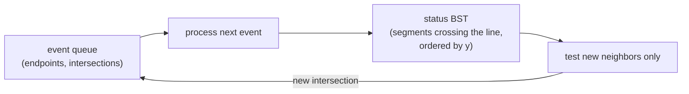

## Learning Objectives

- Compute the orientation predicate as the sign of a $2 \times 2$ determinant and use it to decide left turns, right turns, and collinearity without division or angles.
- Run Andrew's monotone chain algorithm to build a convex hull in $O(n \log n)$ and prove the matching $\Omega(n \log n)$ lower bound by reduction from sorting.
- Describe the sweep-line paradigm (event queue plus status structure) and apply it to Bentley-Ottmann segment intersection in $O((n + k)\log n)$.
- Explain why geometric code needs exact or robust predicates and explicit handling of degenerate inputs.

## Context & Motivation

Computational geometry studies algorithms on points, segments, and polygons, and it underlies GIS map overlays, collision detection in games and robotics, mesh generation for simulation, and the rasterization in `specialization/computer-graphics`. Its problems look elementary when drawn by hand and become surprisingly subtle in code, where "is this point to the left of that line?" must be answered correctly for millions of points with finite-precision numbers.

Two ideas dominate the introductory theory, as presented in de Berg, Cheong, van Kreveld, and Overmars's standard textbook and in courses such as CMU's 15-456 and Stanford's CS268. First, almost every algorithm reduces to a handful of exact **predicates**, of which the orientation test is the most important. Second, many problems in the plane are solved by a **sweep line**: imagine a vertical line moving left to right, maintain what it currently intersects, and do work only at discrete events. This concept develops both through two classic problems, the convex hull and segment intersection.

## Core Theory

### The orientation predicate

For points $p, q, r$ in the plane:

$$\mathrm{orient}(p, q, r) = (q_x - p_x)(r_y - p_y) - (q_y - p_y)(r_x - p_x)$$

It equals twice the signed area of triangle $pqr$. Positive means $p \to q \to r$ turns left (counterclockwise), negative means a right turn, zero means the three points are collinear. With integer coordinates it uses only subtraction and multiplication, so it can be computed exactly. Segment intersection tests, point-in-polygon tests, and hull algorithms all reduce to signs of this expression.

### Convex hull: Andrew's monotone chain

The **convex hull** of a point set is the smallest convex polygon containing it, like a rubber band snapped around nails. Andrew's algorithm (1979):

1. Sort the points by $x$, breaking ties by $y$.
2. **Lower hull**: scan left to right, maintaining a stack. Before pushing each point, pop while the last two stack points and the new point do **not** make a left turn ($\mathrm{orient} \leq 0$).
3. **Upper hull**: the same scan from right to left.
4. Concatenate, dropping the duplicated endpoints.

Each point is pushed and popped at most once per pass, so after sorting the scan is linear: $O(n \log n)$ total. If the output has only $h$ vertices, Chan's algorithm achieves $O(n \log h)$, which is better when the hull is small.

### A lower bound by reduction from sorting

No comparison-based hull algorithm can beat $\Omega(n \log n)$. Given numbers $x_1, \dots, x_n$ to sort, map each to the point $(x_i, x_i^2)$ on the parabola $y = x^2$. Every such point is a hull vertex (the parabola is convex), and the hull, reported in counterclockwise order, lists them in sorted order of $x$. A hull algorithm faster than $n \log n$ would therefore sort faster than the comparison sort lower bound from `algorithms-software/algorithms` allows (in the algebraic decision tree model used for geometric algorithms).

### The sweep-line paradigm

Move a vertical line from left to right across the plane. Maintain two structures:

- an **event queue**, a priority queue of $x$-coordinates where something changes;
- a **status structure**, a balanced BST of the objects currently crossing the sweep line, ordered by where they cross it.

Between events nothing combinatorial changes, so the algorithm only works at events, turning a continuous problem into a discrete sequence of updates.

### Bentley-Ottmann segment intersection

Report all $k$ intersections among $n$ line segments. Checking every pair costs $\Theta(n^2)$ even when $k$ is tiny. The sweep relies on one observation: just before two segments intersect, they are **adjacent** in the vertical order along the sweep line. So:

- At a **left endpoint**, insert the segment into the status structure and test it against its new neighbors above and below.
- At a **right endpoint**, delete it and test its former neighbors against each other, since they just became adjacent.
- At an **intersection**, report it, swap the two segments' order in the status, and test each against its new neighbor.

Every discovered intersection is inserted as a future event. Each event costs $O(\log n)$ for the queue and status operations, and there are $2n + k$ events, giving $O((n + k)\log n)$, which is output-sensitive: fast when intersections are few.

### Robustness and degeneracies

Textbook pseudocode assumes **general position**: no three collinear points, no two points with the same $x$, no three segments through one point. Real data violates all of these, and floating-point evaluation of $\mathrm{orient}$ can return the wrong sign for nearly collinear points, making a hull algorithm output a non-convex polygon or crash. Production libraries use exact integer arithmetic or adaptive-precision predicates (Shewchuk's are standard) and handle ties explicitly, for example deciding whether collinear boundary points belong to the hull.

## Worked Examples

### Example 1: building a hull by hand

**Problem:** Compute the convex hull of $(0,0), (4,0), (2,1), (4,4), (0,4), (2,5)$ with the monotone chain.

**Trace:** Sorted: $(0,0), (0,4), (2,1), (2,5), (4,0), (4,4)$. Lower hull: push $(0,0)$, $(0,4)$. For $(2,1)$: $\mathrm{orient}((0,0),(0,4),(2,1)) = 0 \cdot 1 - 4 \cdot 2 = -8 \leq 0$, pop $(0,4)$, push $(2,1)$. For $(2,5)$: $\mathrm{orient}((0,0),(2,1),(2,5)) = 2 \cdot 5 - 1 \cdot 2 = 8 > 0$, push. For $(4,0)$: $\mathrm{orient}((2,1),(2,5),(4,0)) = -8$, pop; $\mathrm{orient}((0,0),(2,1),(4,0)) = -4$, pop; push. For $(4,4)$: $\mathrm{orient}((0,0),(4,0),(4,4)) = 16$, push. Lower: $(0,0), (4,0), (4,4)$. The upper scan from the right gives $(4,4), (2,5), (0,4), (0,0)$. Combined counterclockwise: $(0,0), (4,0), (4,4), (2,5), (0,4)$. The point $(2,1)$ is interior and was popped in both passes.

### Example 2: why only neighbors need checking

**Problem:** Segments $A$ from $(0,0)$ to $(10,10)$, $B$ from $(1,8)$ to $(9,0)$, and $C$ from $(2,5)$ to $(8,5)$. Trace the first events of the sweep and find which pairs are tested.

**Trace:** Events by $x$: $A$ starts at 0, $B$ at 1, $C$ at 2. At $x = 0$: status $[A]$. At $x = 1$: $B$ is at $y = 8$, above $A$ (at $y = 1$); status bottom to top $[A, B]$; test $A$ against $B$: they cross at $(4.5, 4.5)$, added as an event. At $x = 2$: $C$ is at $y = 5$, $A$ at 2, $B$ at 7, so $C$ is inserted between them: $[A, C, B]$; test $C$ with $A$ (crossing at $(5, 5)$) and $C$ with $B$ (crossing at $(4, 5)$), both added. Next event at $x = 4$: $C$ and $B$ swap, giving $[A, B, C]$, and $B$ is now tested against its new neighbor $A$, already known. The algorithm never compares segments that are not adjacent at some moment, which is why it scales with $n + k$ rather than $n^2$.

## Common Misconceptions & Pitfalls

- **"Use angles to decide turns."** Computing angles with `atan2` and comparing them is slower and less accurate than the orientation determinant, and it introduces wraparound special cases. Signs of determinants are the standard.
- **"Floating point is fine for geometry."** For nearly degenerate inputs, rounding flips predicate signs, and algorithms that assume consistent answers can loop, crash, or return invalid output. Exact or robust predicates are a correctness requirement, not a nicety.
- **"Bentley-Ottmann is always better than checking all pairs."** When $k$ is close to $n^2$, its $O((n+k)\log n)$ is worse than the $O(n^2)$ brute force. The sweep pays off when intersections are sparse, which is common in practice.

## Summary

Computational geometry reduces to exact predicates, chiefly the orientation test, the sign of a $2 \times 2$ determinant that distinguishes left turns, right turns, and collinearity. Andrew's monotone chain sorts the points and builds lower and upper hulls with a stack in $O(n \log n)$, optimal because points on a parabola turn hull construction into sorting. The sweep-line paradigm processes discrete events with a priority queue and keeps the objects crossing the line in a balanced tree; Bentley-Ottmann uses it to report $k$ segment intersections in $O((n + k)\log n)$ by testing only segments that become adjacent. Exact predicates and explicit handling of degeneracies make these algorithms correct on real data. The next concept builds the two most important structures on point sets: Voronoi diagrams and Delaunay triangulations.

## Documentation Links

- [de Berg, Cheong, van Kreveld, Overmars: Computational Geometry: Algorithms and Applications (3rd ed., Springer)](https://link.springer.com/book/10.1007/978-3-540-77974-2): doc
- [CMU 15-456: Computational Geometry](https://www.cs.cmu.edu/afs/cs/academic/class/15456-s14/): doc
- [Stanford CS268: Geometric Algorithms](http://graphics.stanford.edu/courses/cs268-16-fall/): doc
