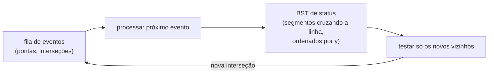

## Objetivos de Aprendizagem

- Calcular o predicado de orientação como o sinal de um determinante $2 \times 2$ e usá-lo para decidir curvas à esquerda, à direita e colinearidade sem divisão nem ângulos.
- Executar o algoritmo da cadeia monótona de Andrew para construir um fecho convexo em $O(n \log n)$ e provar o limite inferior $\Omega(n \log n)$ correspondente por redução a partir da ordenação.
- Descrever o paradigma da linha de varredura (fila de eventos mais estrutura de status) e aplicá-lo à interseção de segmentos de Bentley-Ottmann em $O((n + k)\log n)$.
- Explicar por que código geométrico precisa de predicados exatos ou robustos e de tratamento explícito de entradas degeneradas.

## Contexto e Motivação

A geometria computacional estuda algoritmos sobre pontos, segmentos e polígonos, e sustenta sobreposições de mapas em SIG, detecção de colisão em jogos e robótica, geração de malhas para simulação e a rasterização de `specialization/computer-graphics`. Os seus problemas parecem elementares quando desenhados à mão e ficam surpreendentemente sutis no código, em que "este ponto está à esquerda daquela reta?" precisa ser respondido corretamente para milhões de pontos com números de precisão finita.

Duas ideias dominam a teoria introdutória, como apresentada no livro padrão de de Berg, Cheong, van Kreveld e Overmars e em cursos como o 15-456 da CMU e o CS268 de Stanford. Primeiro, quase todo algoritmo se reduz a um punhado de **predicados** exatos, dos quais o teste de orientação é o mais importante. Segundo, muitos problemas no plano são resolvidos por uma **linha de varredura**: imagine uma reta vertical se movendo da esquerda para a direita, mantenha o que ela cruza no momento e trabalhe só em eventos discretos. Este conceito desenvolve as duas ideias por meio de dois problemas clássicos, o fecho convexo e a interseção de segmentos.

## Teoria Central

### O predicado de orientação

Para pontos $p, q, r$ no plano:

$$\mathrm{orient}(p, q, r) = (q_x - p_x)(r_y - p_y) - (q_y - p_y)(r_x - p_x)$$

Ele vale o dobro da área com sinal do triângulo $pqr$. Positivo significa que $p \to q \to r$ vira à esquerda (sentido anti-horário), negativo significa uma curva à direita, zero significa que os três pontos são colineares. Com coordenadas inteiras ele usa só subtração e multiplicação, então pode ser calculado exatamente. Testes de interseção de segmentos, testes de ponto em polígono e algoritmos de fecho se reduzem todos a sinais dessa expressão.

### Fecho convexo: a cadeia monótona de Andrew

O **fecho convexo** de um conjunto de pontos é o menor polígono convexo que o contém, como um elástico solto em volta de pregos. O algoritmo de Andrew (1979):

1. Ordene os pontos por $x$, desempatando por $y$.
2. **Fecho inferior**: varra da esquerda para a direita mantendo uma pilha. Antes de empilhar cada ponto, desempilhe enquanto os dois últimos pontos da pilha e o novo ponto **não** fizerem uma curva à esquerda ($\mathrm{orient} \leq 0$).
3. **Fecho superior**: a mesma varredura, da direita para a esquerda.
4. Concatene, descartando as pontas duplicadas.

Cada ponto é empilhado e desempilhado no máximo uma vez por passada, então depois da ordenação a varredura é linear: $O(n \log n)$ no total. Se a saída tem só $h$ vértices, o algoritmo de Chan alcança $O(n \log h)$, melhor quando o fecho é pequeno.

### Um limite inferior por redução a partir da ordenação

Nenhum algoritmo de fecho baseado em comparações consegue vencer $\Omega(n \log n)$. Dados números $x_1, \dots, x_n$ para ordenar, mapeie cada um no ponto $(x_i, x_i^2)$ da parábola $y = x^2$. Todo ponto assim é vértice do fecho (a parábola é convexa), e o fecho, reportado em ordem anti-horária, os lista em ordem crescente de $x$. Um algoritmo de fecho mais rápido do que $n \log n$ ordenaria, portanto, mais rápido do que o limite inferior da ordenação por comparações de `algorithms-software/algorithms` permite (no modelo de árvore de decisão algébrica usado para algoritmos geométricos).

### O paradigma da linha de varredura

Mova uma reta vertical da esquerda para a direita pelo plano. Mantenha duas estruturas:

- uma **fila de eventos**, uma fila de prioridade de coordenadas $x$ em que algo muda;
- uma **estrutura de status**, uma BST balanceada dos objetos que cruzam a linha de varredura no momento, ordenados pelo ponto em que a cruzam.

Entre eventos nada combinatório muda, então o algoritmo só trabalha nos eventos, transformando um problema contínuo numa sequência discreta de atualizações.

### Interseção de segmentos de Bentley-Ottmann

Reporte todas as $k$ interseções entre $n$ segmentos de reta. Checar todo par custa $\Theta(n^2)$ mesmo quando $k$ é minúsculo. A varredura se apoia numa observação: logo antes de dois segmentos se cruzarem, eles são **vizinhos** na ordem vertical ao longo da linha de varredura. Então:

- Numa **ponta esquerda**, insira o segmento na estrutura de status e teste-o contra os novos vizinhos de cima e de baixo.
- Numa **ponta direita**, remova-o e teste os antigos vizinhos um contra o outro, já que acabaram de ficar vizinhos.
- Numa **interseção**, reporte-a, troque a ordem dos dois segmentos no status e teste cada um contra o seu novo vizinho.

Toda interseção descoberta é inserida como evento futuro. Cada evento custa $O(\log n)$ para as operações de fila e de status, e há $2n + k$ eventos, dando $O((n + k)\log n)$, sensível à saída: rápido quando há poucas interseções.

### Robustez e degenerescências

Pseudocódigo de livro supõe **posição geral**: nenhum trio de pontos colineares, nenhum par de pontos com o mesmo $x$, nenhum trio de segmentos por um mesmo ponto. Dados reais violam tudo isso, e avaliar $\mathrm{orient}$ em ponto flutuante pode devolver o sinal errado para pontos quase colineares, fazendo um algoritmo de fecho devolver um polígono não convexo ou travar. Bibliotecas de produção usam aritmética inteira exata ou predicados de precisão adaptativa (os de Shewchuk são o padrão) e tratam empates explicitamente, por exemplo decidindo se pontos colineares na fronteira pertencem ao fecho.

## Exemplos Resolvidos

### Exemplo 1: construindo um fecho à mão

**Problema:** Calcule o fecho convexo de $(0,0), (4,0), (2,1), (4,4), (0,4), (2,5)$ com a cadeia monótona.

**Rastreamento:** Ordenados: $(0,0), (0,4), (2,1), (2,5), (4,0), (4,4)$. Fecho inferior: empilhe $(0,0)$, $(0,4)$. Para $(2,1)$: $\mathrm{orient}((0,0),(0,4),(2,1)) = 0 \cdot 1 - 4 \cdot 2 = -8 \leq 0$, desempilhe $(0,4)$, empilhe $(2,1)$. Para $(2,5)$: $\mathrm{orient}((0,0),(2,1),(2,5)) = 2 \cdot 5 - 1 \cdot 2 = 8 > 0$, empilhe. Para $(4,0)$: $\mathrm{orient}((2,1),(2,5),(4,0)) = -8$, desempilhe; $\mathrm{orient}((0,0),(2,1),(4,0)) = -4$, desempilhe; empilhe. Para $(4,4)$: $\mathrm{orient}((0,0),(4,0),(4,4)) = 16$, empilhe. Inferior: $(0,0), (4,0), (4,4)$. A varredura superior a partir da direita dá $(4,4), (2,5), (0,4), (0,0)$. Juntando em sentido anti-horário: $(0,0), (4,0), (4,4), (2,5), (0,4)$. O ponto $(2,1)$ é interior e foi desempilhado nas duas passadas.

### Exemplo 2: por que só vizinhos precisam ser checados

**Problema:** Segmentos $A$ de $(0,0)$ a $(10,10)$, $B$ de $(1,8)$ a $(9,0)$ e $C$ de $(2,5)$ a $(8,5)$. Acompanhe os primeiros eventos da varredura e veja quais pares são testados.

**Rastreamento:** Eventos por $x$: $A$ começa em 0, $B$ em 1, $C$ em 2. Em $x = 0$: status $[A]$. Em $x = 1$: $B$ está em $y = 8$, acima de $A$ (em $y = 1$); status de baixo para cima $[A, B]$; teste $A$ contra $B$: eles se cruzam em $(4{,}5; 4{,}5)$, adicionado como evento. Em $x = 2$: $C$ está em $y = 5$, $A$ em 2, $B$ em 7, então $C$ é inserido entre eles: $[A, C, B]$; teste $C$ com $A$ (cruzam em $(5, 5)$) e $C$ com $B$ (cruzam em $(4, 5)$), os dois adicionados. O próximo evento, em $x = 4$: $C$ e $B$ trocam, dando $[A, B, C]$, e $B$ agora é testado contra o novo vizinho $A$, já conhecido. O algoritmo nunca compara segmentos que não sejam vizinhos em algum momento, e é por isso que escala com $n + k$ e não com $n^2$.

## Equívocos Comuns e Armadilhas

- **"Use ângulos para decidir as curvas."** Calcular ângulos com `atan2` e compará-los é mais lento e menos preciso do que o determinante de orientação, e introduz casos especiais de volta completa. Sinais de determinantes são o padrão.
- **"Ponto flutuante serve para geometria."** Em entradas quase degeneradas, o arredondamento inverte sinais de predicados, e algoritmos que supõem respostas consistentes podem entrar em laço, travar ou devolver saída inválida. Predicados exatos ou robustos são um requisito de correção, não um capricho.
- **"Bentley-Ottmann é sempre melhor do que checar todos os pares."** Quando $k$ se aproxima de $n^2$, o seu $O((n+k)\log n)$ é pior do que o $O(n^2)$ da força bruta. A varredura compensa quando as interseções são esparsas, o que é comum na prática.

## Resumo

A geometria computacional se reduz a predicados exatos, principalmente o teste de orientação, o sinal de um determinante $2 \times 2$ que distingue curvas à esquerda, à direita e colinearidade. A cadeia monótona de Andrew ordena os pontos e constrói os fechos inferior e superior com uma pilha em $O(n \log n)$, ótimo porque pontos numa parábola transformam a construção do fecho em ordenação. O paradigma da linha de varredura processa eventos discretos com uma fila de prioridade e mantém os objetos que cruzam a linha numa árvore balanceada; o Bentley-Ottmann o usa para reportar $k$ interseções de segmentos em $O((n + k)\log n)$ testando só segmentos que ficam vizinhos. Predicados exatos e tratamento explícito de degenerescências tornam esses algoritmos corretos em dados reais. O próximo conceito constrói as duas estruturas mais importantes sobre conjuntos de pontos: diagramas de Voronoi e triangulações de Delaunay.

## Documentation Links

- [de Berg, Cheong, van Kreveld, Overmars: Computational Geometry: Algorithms and Applications (3rd ed., Springer)](https://link.springer.com/book/10.1007/978-3-540-77974-2): doc
- [CMU 15-456: Computational Geometry](https://www.cs.cmu.edu/afs/cs/academic/class/15456-s14/): doc
- [Stanford CS268: Geometric Algorithms](http://graphics.stanford.edu/courses/cs268-16-fall/): doc
