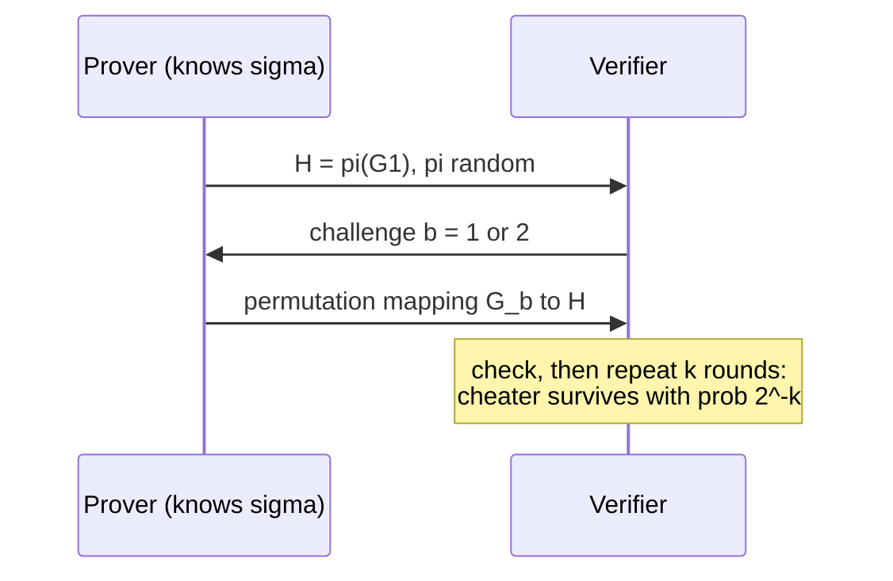

## Learning Objectives

- Define an interactive proof system by its completeness and soundness conditions, and explain why the verifier must be randomized for interaction to add power.
- Walk through the interactive proof for graph non-isomorphism, a problem not known to be in NP, and compute its soundness error.
- State IP = PSPACE and explain the role of the sum-check protocol at a high level.
- Define zero knowledge through a simulator, and verify that the classic graph-isomorphism protocol is complete, sound, and zero-knowledge.

## Context & Motivation

`algorithms-software/computability-complexity` characterized NP by **certificates**: a language is in NP if every "yes" instance has a short proof that a deterministic polynomial-time verifier can check by reading it. Proofs in mathematics and in everyday life are often more interactive: a skeptic asks questions, and the prover's ability to answer unpredictable questions is what convinces. In 1985, Goldwasser, Micali, and Rackoff (and independently Babai) formalized this as **interactive proofs**, and in the same paper introduced an idea that sounds paradoxical: a proof that convinces the verifier a statement is true while revealing nothing else, a **zero-knowledge** proof.

Both ideas turned out to be enormously consequential. Interactive proofs with a randomized verifier can prove everything in PSPACE (Shamir, 1992), far beyond NP, and their descendants, probabilistically checkable proofs, are the basis of the hardness of approximation results quoted in the approximation-algorithms concept. Zero-knowledge proofs became a practical cryptographic tool: they underlie identification schemes, anonymous credentials, and the succinct proofs used to verify computations in blockchains. Goldwasser and Micali received the Turing Award in 2012; the material is core to MIT's 6.875 (Foundations of Cryptography).

## Core Theory

### Interactive proofs

A prover $P$ (computationally unbounded) and a verifier $V$ (probabilistic polynomial time) exchange messages about an input $x$; at the end $V$ accepts or rejects. A language $A$ has an interactive proof if:

- **Completeness**: if $x \in A$, the honest prover makes $V$ accept with probability at least $2/3$.
- **Soundness**: if $x \notin A$, **every** prover strategy makes $V$ accept with probability at most $1/3$.

As with BPP, repetition drives both errors exponentially small. **IP** is the class of languages with such proofs. If $V$ were deterministic, the prover could precompute the whole conversation, and the transcript would just be an NP certificate; randomness, kept secret from the prover, is what adds power.

### Graph non-isomorphism

Two graphs are **isomorphic** if relabeling the vertices of one gives the other. Graph isomorphism is in NP (the relabeling is a certificate). Its complement, **non-isomorphism**, is not known to be in NP: how would you certify that no relabeling works among $n!$ candidates? Yet it has a simple interactive proof:

1. $V$ secretly picks $i \in \{1, 2\}$ at random and a random permutation $\pi$, and sends $H = \pi(G_i)$.
2. $P$ replies with $j$, its claim of which graph $H$ came from.
3. $V$ accepts if $j = i$.

If $G_1 \not\cong G_2$, $H$ is isomorphic to exactly one of them, and the unbounded prover can always tell which: completeness 1. If $G_1 \cong G_2$, a random relabeling of $G_1$ has exactly the same distribution as a random relabeling of $G_2$, so $H$ carries no information about $i$, and any prover is right with probability exactly $1/2$. Repeating $k$ times gives soundness error $2^{-k}$.

### IP = PSPACE

Lund, Fortnow, Karloff, and Nisan introduced the **sum-check protocol**, which lets a verifier check a claim of the form $\sum_{x \in \{0,1\}^n} p(x) = K$ for a low-degree polynomial $p$ while doing only polynomial work: in each round the prover sends a univariate polynomial for one variable, the verifier checks consistency and fixes that variable to a random field element, and Schwartz-Zippel (from the previous concept) bounds the probability that a cheating prover survives. Shamir extended the technique to TQBF, proving $\mathrm{IP} = \mathrm{PSPACE}$: anything provable with polynomial memory is provable to a polynomial-time verifier through interaction.

### Zero knowledge

A protocol is **zero-knowledge** if whatever a verifier sees could have been produced without the prover. Formally, for every efficient verifier strategy $V^*$ there is an efficient **simulator** $S$ that, given only $x$ (and not the prover's secret), outputs transcripts distributed identically (or computationally indistinguishably) to real conversations between $P$ and $V^*$. If the verifier could have produced the transcript alone, the conversation taught it nothing beyond the fact that $x \in A$.

**Zero-knowledge proof of graph isomorphism.** The prover knows a permutation $\sigma$ with $G_2 = \sigma(G_1)$ and wants to prove $G_1 \cong G_2$ without revealing $\sigma$:

1. $P$ picks a random permutation $\pi$ and sends $H = \pi(G_1)$.
2. $V$ sends a random challenge $b \in \{1, 2\}$.
3. If $b = 1$, $P$ reveals $\pi$ (mapping $G_1$ to $H$); if $b = 2$, $P$ reveals $\pi \circ \sigma^{-1}$ (mapping $G_2$ to $H$).
4. $V$ checks that the revealed permutation maps $G_b$ to $H$.

**Completeness**: an honest prover always answers correctly. **Soundness**: if the graphs are not isomorphic, $H$ is isomorphic to at most one of them, so a cheater fails one of the two challenges, and is caught with probability $1/2$ per round. **Zero knowledge**: the simulator picks $b'$ at random, a random $\pi$, sends $H = \pi(G_{b'})$, and if the verifier's challenge equals $b'$ it outputs $(H, b', \pi)$; otherwise it rewinds and tries again. Each revealed permutation is a uniformly random relabeling, which is exactly what a real transcript shows, so the distributions match, and the expected number of attempts is 2.

Goldreich, Micali, and Wigderson (1986) showed that **every language in NP** has a zero-knowledge proof, assuming one-way functions exist, via a protocol for graph 3-coloring with cryptographic commitments.

## Worked Examples

### Example 1: soundness after repetition

**Problem:** In the graph-isomorphism zero-knowledge protocol, how many rounds are needed so that a prover who does not know an isomorphism (because none exists) is accepted with probability below one in a million?

**Trace:** Each round a cheating prover can prepare for only one challenge, so survives with probability $1/2$. After $k$ independent rounds: $2^{-k} < 10^{-6}$ requires $k \geq 20$ ($2^{-20} \approx 9.5 \times 10^{-7}$). Twenty rounds of three messages each. Zero knowledge is preserved under sequential repetition, so the 20-round protocol still reveals nothing.

### Example 2: why the simulator does not prove anything

**Problem:** The simulator produces accepting transcripts without knowing $\sigma$. Why doesn't that let a cheating prover convince a real verifier?

**Resolution:** The simulator chooses $b'$ before seeing the challenge and **rewinds** whenever the verifier's challenge differs, discarding failed attempts. A real prover interacting with a real verifier cannot rewind: it commits to $H$, then receives a challenge it cannot control. The transcripts look the same, but producing them requires the power to restart the verifier, which only the simulator has. That asymmetry is precisely why the transcript proves something to the verifier who lived it, while proving nothing to a third party who sees it afterwards, since it could have been simulated.

## Common Misconceptions & Pitfalls

- **"Zero knowledge means the verifier learns nothing at all."** It learns that the statement is true, and nothing more. In the identification setting, it learns that the prover knows a secret, without learning the secret.
- **"Interactive proofs only matter in theory."** Non-interactive variants (via the Fiat-Shamir transform, which replaces the verifier's random challenges with a hash of the transcript) are deployed in signature schemes such as Schnorr signatures and in succinct proof systems that verify large computations.
- **"Soundness must hold against efficient provers only."** In interactive proofs, soundness holds against all provers, even unbounded ones. Systems sound only against efficient provers are called **arguments**; most deployed succinct systems are arguments relying on cryptographic assumptions.

## Summary

Interactive proofs let a randomized polynomial-time verifier question an all-powerful prover, requiring that true statements be accepted with high probability and false ones rejected against every prover strategy. Randomness hidden from the prover is essential: it yields a simple proof of graph non-isomorphism, a problem not known to be in NP, and, through sum-check, IP = PSPACE. Zero-knowledge proofs convince without revealing anything else, defined by a simulator that fakes transcripts with rewinding; graph isomorphism has a classic three-message protocol, and every NP language has one if one-way functions exist. The next concept makes that assumption the subject: what one-way functions are and how they yield pseudorandomness.

## Documentation Links

- [Goldwasser, Micali, Rackoff: The Knowledge Complexity of Interactive Proof Systems (SIAM J. Computing 1989)](https://people.csail.mit.edu/silvio/Selected%20Scientific%20Papers/Proof%20Systems/The_Knowledge_Complexity_Of_Interactive_Proof_Systems.pdf): doc
- [Arora, Barak: Computational Complexity: A Modern Approach (Princeton draft)](https://theory.cs.princeton.edu/complexity/): doc
- [MIT 6.875: Foundations of Cryptography](https://mit6875.github.io/): doc
