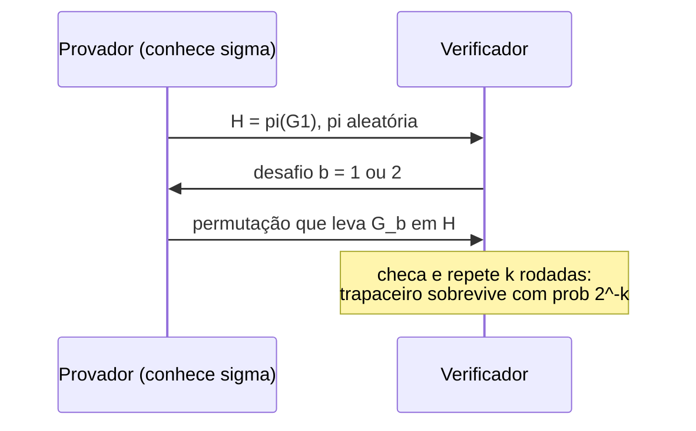

## Objetivos de Aprendizagem

- Definir um sistema de prova interativa pelas condições de completude e de correção (soundness), e explicar por que o verificador precisa ser aleatorizado para a interação acrescentar poder.
- Percorrer a prova interativa para a não isomorfia de grafos, um problema que não se sabe estar em NP, e calcular o seu erro de soundness.
- Enunciar IP = PSPACE e explicar, em alto nível, o papel do protocolo sum-check.
- Definir conhecimento zero por meio de um simulador e verificar que o protocolo clássico de isomorfia de grafos é completo, correto e de conhecimento zero.

## Contexto e Motivação

`algorithms-software/computability-complexity` caracterizou NP por **certificados**: uma linguagem está em NP se toda instância "sim" tem uma prova curta que um verificador determinístico polinomial checa lendo-a. Provas na matemática e no dia a dia muitas vezes são mais interativas: um cético faz perguntas, e a capacidade de quem prova de responder perguntas imprevisíveis é o que convence. Em 1985, Goldwasser, Micali e Rackoff (e, de forma independente, Babai) formalizaram isso como **provas interativas** e, no mesmo artigo, introduziram uma ideia que soa paradoxal: uma prova que convence o verificador de que uma afirmação é verdadeira sem revelar mais nada, uma prova de **conhecimento zero**.

As duas ideias se mostraram enormemente importantes. Provas interativas com verificador aleatorizado conseguem provar tudo em PSPACE (Shamir, 1992), muito além de NP, e as suas descendentes, as provas verificáveis probabilisticamente, são a base dos resultados de dificuldade de aproximação citados no conceito de algoritmos de aproximação. Provas de conhecimento zero viraram uma ferramenta criptográfica prática: sustentam esquemas de identificação, credenciais anônimas e as provas sucintas usadas para verificar computações em blockchains. Goldwasser e Micali receberam o Prêmio Turing em 2012; o material é central no 6.875 do MIT (Foundations of Cryptography).

## Teoria Central

### Provas interativas

Um provador $P$ (computacionalmente ilimitado) e um verificador $V$ (probabilístico, de tempo polinomial) trocam mensagens sobre uma entrada $x$; no final $V$ aceita ou rejeita. Uma linguagem $A$ tem uma prova interativa se:

- **Completude**: se $x \in A$, o provador honesto faz $V$ aceitar com probabilidade de pelo menos $2/3$.
- **Soundness**: se $x \notin A$, **toda** estratégia de provador faz $V$ aceitar com probabilidade no máximo $1/3$.

Como no BPP, a repetição torna os dois erros exponencialmente pequenos. **IP** é a classe das linguagens com provas assim. Se $V$ fosse determinístico, o provador poderia pré-calcular a conversa inteira, e a transcrição seria só um certificado NP; a aleatoriedade, mantida em segredo do provador, é o que acrescenta poder.

### Não isomorfia de grafos

Dois grafos são **isomorfos** se renomear os vértices de um dá o outro. A isomorfia de grafos está em NP (a renomeação é um certificado). O seu complemento, a **não isomorfia**, não se sabe estar em NP: como certificar que nenhuma renomeação funciona entre $n!$ candidatas? Mesmo assim, ela tem uma prova interativa simples:

1. $V$ escolhe em segredo $i \in \{1, 2\}$ ao acaso e uma permutação aleatória $\pi$, e envia $H = \pi(G_i)$.
2. $P$ responde com $j$, a sua afirmação de qual grafo gerou $H$.
3. $V$ aceita se $j = i$.

Se $G_1 \not\cong G_2$, $H$ é isomorfo a exatamente um deles, e o provador ilimitado sempre consegue dizer qual: completude 1. Se $G_1 \cong G_2$, uma renomeação aleatória de $G_1$ tem exatamente a mesma distribuição de uma renomeação aleatória de $G_2$, então $H$ não carrega informação nenhuma sobre $i$, e qualquer provador acerta com probabilidade exatamente $1/2$. Repetir $k$ vezes dá erro de soundness $2^{-k}$.

### IP = PSPACE

Lund, Fortnow, Karloff e Nisan introduziram o **protocolo sum-check**, que permite a um verificador checar uma afirmação da forma $\sum_{x \in \{0,1\}^n} p(x) = K$ para um polinômio $p$ de grau baixo fazendo só trabalho polinomial: a cada rodada o provador envia um polinômio de uma variável, o verificador checa a consistência e fixa essa variável num elemento aleatório do corpo, e o Schwartz-Zippel (do conceito anterior) limita a probabilidade de um provador trapaceiro sobreviver. Shamir estendeu a técnica ao TQBF, provando $\mathrm{IP} = \mathrm{PSPACE}$: tudo o que pode ser provado com memória polinomial pode ser provado a um verificador de tempo polinomial por meio de interação.

### Conhecimento zero

Um protocolo é de **conhecimento zero** se tudo o que um verificador vê poderia ter sido produzido sem o provador. Formalmente, para toda estratégia eficiente de verificador $V^*$ existe um **simulador** eficiente $S$ que, recebendo só $x$ (e não o segredo do provador), produz transcrições com a mesma distribuição (ou computacionalmente indistinguíveis) das conversas reais entre $P$ e $V^*$. Se o verificador poderia ter produzido a transcrição sozinho, a conversa não lhe ensinou nada além de que $x \in A$.

**Prova de conhecimento zero da isomorfia de grafos.** O provador conhece uma permutação $\sigma$ com $G_2 = \sigma(G_1)$ e quer provar que $G_1 \cong G_2$ sem revelar $\sigma$:

1. $P$ escolhe uma permutação aleatória $\pi$ e envia $H = \pi(G_1)$.
2. $V$ envia um desafio aleatório $b \in \{1, 2\}$.
3. Se $b = 1$, $P$ revela $\pi$ (que leva $G_1$ em $H$); se $b = 2$, $P$ revela $\pi \circ \sigma^{-1}$ (que leva $G_2$ em $H$).
4. $V$ checa que a permutação revelada leva $G_b$ em $H$.

**Completude**: um provador honesto sempre responde corretamente. **Soundness**: se os grafos não são isomorfos, $H$ é isomorfo a no máximo um deles, então um trapaceiro falha num dos dois desafios e é pego com probabilidade $1/2$ por rodada. **Conhecimento zero**: o simulador escolhe $b'$ ao acaso e um $\pi$ aleatório, envia $H = \pi(G_{b'})$ e, se o desafio do verificador for igual a $b'$, produz $(H, b', \pi)$; senão, rebobina e tenta de novo. Cada permutação revelada é uma renomeação uniformemente aleatória, exatamente o que uma transcrição real mostra, então as distribuições coincidem, e o número esperado de tentativas é 2.

Goldreich, Micali e Wigderson (1986) mostraram que **toda linguagem em NP** tem uma prova de conhecimento zero, supondo que funções de mão única existam, por meio de um protocolo para 3-coloração de grafos com compromissos criptográficos.

## Exemplos Resolvidos

### Exemplo 1: soundness depois da repetição

**Problema:** No protocolo de conhecimento zero da isomorfia de grafos, quantas rodadas são necessárias para que um provador que não conhece uma isomorfia (porque nenhuma existe) seja aceito com probabilidade abaixo de um em um milhão?

**Rastreamento:** A cada rodada, um provador trapaceiro só consegue se preparar para um desafio, então sobrevive com probabilidade $1/2$. Depois de $k$ rodadas independentes: $2^{-k} < 10^{-6}$ exige $k \geq 20$ ($2^{-20} \approx 9{,}5 \times 10^{-7}$). Vinte rodadas de três mensagens cada. O conhecimento zero se preserva sob repetição sequencial, então o protocolo de 20 rodadas continua não revelando nada.

### Exemplo 2: por que o simulador não prova nada

**Problema:** O simulador produz transcrições que aceitam sem conhecer $\sigma$. Por que isso não permite a um provador trapaceiro convencer um verificador real?

**Resolução:** O simulador escolhe $b'$ antes de ver o desafio e **rebobina** sempre que o desafio do verificador difere, descartando as tentativas falhas. Um provador real interagindo com um verificador real não pode rebobinar: ele se compromete com $H$ e então recebe um desafio que não controla. As transcrições parecem iguais, mas produzi-las exige o poder de reiniciar o verificador, que só o simulador tem. Essa assimetria é exatamente o motivo de a transcrição provar algo ao verificador que a viveu, enquanto não prova nada a um terceiro que a veja depois, já que ela poderia ter sido simulada.

## Equívocos Comuns e Armadilhas

- **"Conhecimento zero significa que o verificador não aprende nada."** Ele aprende que a afirmação é verdadeira, e nada mais. No cenário de identificação, aprende que o provador conhece um segredo, sem aprender o segredo.
- **"Provas interativas só importam na teoria."** Variantes não interativas (via a transformação de Fiat-Shamir, que troca os desafios aleatórios do verificador por um hash da transcrição) são usadas em esquemas de assinatura como as assinaturas de Schnorr e em sistemas de prova sucinta que verificam computações grandes.
- **"A soundness só precisa valer contra provadores eficientes."** Em provas interativas, a soundness vale contra todos os provadores, até os ilimitados. Sistemas corretos só contra provadores eficientes são chamados de **argumentos**; a maioria dos sistemas sucintos em uso são argumentos que dependem de hipóteses criptográficas.

## Resumo

Provas interativas deixam um verificador aleatorizado de tempo polinomial questionar um provador todo-poderoso, exigindo que afirmações verdadeiras sejam aceitas com alta probabilidade e as falsas rejeitadas contra toda estratégia de provador. A aleatoriedade escondida do provador é essencial: ela dá uma prova simples da não isomorfia de grafos, um problema que não se sabe estar em NP, e, via sum-check, IP = PSPACE. Provas de conhecimento zero convencem sem revelar mais nada, definidas por um simulador que forja transcrições rebobinando; a isomorfia de grafos tem um protocolo clássico de três mensagens, e toda linguagem NP tem um se existirem funções de mão única. O próximo conceito faz dessa hipótese o assunto: o que são funções de mão única e como elas geram pseudoaleatoriedade.

## Documentation Links

- [Goldwasser, Micali, Rackoff: The Knowledge Complexity of Interactive Proof Systems (SIAM J. Computing 1989)](https://people.csail.mit.edu/silvio/Selected%20Scientific%20Papers/Proof%20Systems/The_Knowledge_Complexity_Of_Interactive_Proof_Systems.pdf): doc
- [Arora, Barak: Computational Complexity: A Modern Approach (Princeton draft)](https://theory.cs.princeton.edu/complexity/): doc
- [MIT 6.875: Foundations of Cryptography](https://mit6875.github.io/): doc
