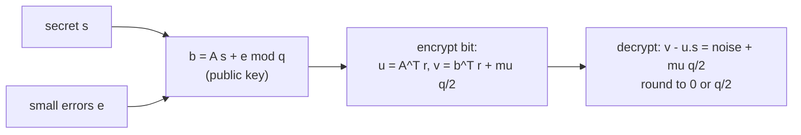

## Learning Objectives

- Explain why Shor's algorithm threatens RSA and Diffie-Hellman and why "post-quantum" cryptography needs different hardness assumptions.
- Define lattices and the shortest vector problem, and state the Learning With Errors (LWE) problem in its search and decision forms.
- Explain why small noise turns an easy linear-algebra problem into a hard one, and what Regev's worst-case to average-case reduction says.
- Run Regev's public-key encryption on a toy example and explain how decryption tolerates the accumulated noise, and connect it to ML-KEM (FIPS 203).

## Context & Motivation

`software-distributed/security-cryptography` built public-key cryptography on two problems: factoring large integers (RSA) and computing discrete logarithms (Diffie-Hellman and elliptic-curve variants). In 1994 Peter Shor, then at Bell Labs and later at MIT, showed that a large enough quantum computer solves both in polynomial time. No such machine exists yet, but encrypted traffic recorded today can be decrypted whenever one does ("harvest now, decrypt later"), so long-lived secrets need protection now.

The leading replacement is built on **lattices**, and specifically on the Learning With Errors problem introduced by Oded Regev in 2005, work that earned him the Gödel Prize. LWE has three attractive properties: no efficient quantum algorithm is known for it, it is provably as hard as worst-case lattice problems, and it supports efficient schemes with simple arithmetic. In August 2024 NIST published FIPS 203, standardizing ML-KEM (derived from the CRYSTALS-Kyber submission) as the post-quantum key-encapsulation mechanism, and major browsers and messaging apps have already deployed it in hybrid mode alongside elliptic-curve key exchange.

## Core Theory

### Lattices

A **lattice** is the set of all integer combinations of $n$ linearly independent basis vectors $b_1, \dots, b_n \in \mathbb{R}^n$: $\mathcal{L} = \{\sum_i z_i b_i : z_i \in \mathbb{Z}\}$, a regular grid of points, possibly skewed. The same lattice has many bases, some short and nearly orthogonal (good), others long and skewed (bad). The **shortest vector problem** (SVP) asks for the shortest nonzero lattice vector. With a good basis it is easy to approximate; given only a bad basis in high dimension, the best known algorithms, classical or quantum, take time exponential in $n$ to approximate it within polynomial factors.

### Learning With Errors

Fix a modulus $q$, a dimension $n$, and a secret $s \in \mathbb{Z}_q^n$. The adversary sees many samples

$$(a_i,\ b_i = \langle a_i, s \rangle + e_i \bmod q)$$

where each $a_i$ is uniform in $\mathbb{Z}_q^n$ and each error $e_i$ is small, drawn from a narrow distribution around 0 (typically a discrete Gaussian of width much less than $q$). In matrix form, $b = A s + e \bmod q$.

- **Search-LWE**: recover $s$.
- **Decision-LWE**: distinguish $(A, b)$ from $(A, u)$ with $u$ uniform.

Without the errors, Gaussian elimination recovers $s$ from $n$ samples in polynomial time. With them, elimination amplifies the noise: combining equations adds and multiplies their errors until they cover all of $\mathbb{Z}_q$ and the result is meaningless. The noise is what makes the problem hard.

### Why we believe it is hard

Regev proved that solving LWE on **average** (random $A$, random $s$) is at least as hard as solving approximate SVP-type problems in the **worst case**, for every lattice, via a quantum reduction (later partially dequantized by Peikert). This is unusual and valuable: for RSA, there is no proof that random instances are as hard as the hardest ones. If LWE-based encryption could be broken for the parameters used, there would be an efficient quantum algorithm for worst-case lattice problems, which decades of research have not found.

### Regev's encryption scheme

- **Key generation**: secret key $s \in \mathbb{Z}_q^n$. Public key: an LWE instance $(A, b = As + e)$ with $m$ rows.
- **Encrypt a bit** $\mu \in \{0, 1\}$: pick a random subset of the rows, encoded as $r \in \{0, 1\}^m$, and output

$$u = A^\top r, \qquad v = b^\top r + \mu \left\lfloor \tfrac{q}{2} \right\rfloor \pmod q$$

- **Decrypt**: compute $v - \langle u, s \rangle = e^\top r + \mu \lfloor q/2 \rfloor \pmod q$. The term $e^\top r$ is a sum of a few small errors, so it stays small. If the result is closer to 0, output 0; if closer to $q/2$, output 1.

Correctness requires $|e^\top r| < q/4$, which constrains the parameters. Security follows from decision-LWE: the public key is indistinguishable from uniform, and then $(u, v)$ is (by a leftover-hash argument) indistinguishable from uniform too, hiding $\mu$.

### From Regev to ML-KEM

Plain LWE needs public keys of size about $n \cdot m \cdot \log q$ bits, megabytes at secure parameters. ML-KEM replaces vectors of integers with vectors of **polynomials** in the ring $\mathbb{Z}_q[x]/(x^{256} + 1)$ with $q = 3329$ (Module-LWE), so one ring element carries 256 coefficients and multiplication is fast via a number-theoretic transform. Public keys are about 800 to 1,600 bytes for ML-KEM-512, -768, and -1024, and encapsulation takes microseconds. The structure gives efficiency; the hardness argument is the module analog of Regev's.

## Worked Examples

### Example 1: noise defeats elimination

**Problem:** Let $q = 17$, $n = 2$, secret $s = (3, 5)$. Samples: $a_1 = (1, 2), b_1 = 14$; $a_2 = (4, 1), b_2 = 16$; $a_3 = (2, 7), b_3 = 7$. (Errors $+1, -1, 0$ were added.) Solve the first two equations exactly, as if there were no noise, and check against the third.

**Trace:** The system is $x + 2y = 14$, $4x + y = 16$ modulo 17. From the first, $x = 14 - 2y$; substituting, $56 - 7y \equiv 16$, so $7y \equiv 40 \equiv 6$. The inverse of 7 mod 17 is 5 ($7 \cdot 5 = 35 \equiv 1$), so $y \equiv 30 \equiv 13$ and $x \equiv 14 - 26 \equiv 5$. The "solution" $(5, 13)$ is wrong. Checking sample 3: $2 \cdot 5 + 7 \cdot 13 = 101 \equiv 16$, but $b_3 = 7$: off by 9, nowhere near the small error expected. Errors of size 1 in the inputs produced a completely wrong answer. Here brute force over $17^2$ candidates is trivial; with $n = 768$ and appropriate $q$, no known attack is feasible.

### Example 2: encrypting and decrypting one bit

**Problem:** Using the samples above plus $a_4 = (5, 3), b_4 = 14$ (error $+1$) as the public key, encrypt $\mu = 1$ with the subset $r = (1, 1, 0, 1)$, then decrypt with $s$.

**Trace:** $\lfloor 17/2 \rfloor = 8$. $u = a_1 + a_2 + a_4 = (10, 6)$. $v = b_1 + b_2 + b_4 + 8 = 14 + 16 + 14 + 8 = 52 \equiv 1 \pmod{17}$. Decrypt: $\langle u, s \rangle = 30 + 30 = 60 \equiv 9$, so $v - 9 \equiv -8 \equiv 9$. The distance from 9 to $8$ is 1, the distance to 0 is 8, so output $\mu = 1$. Indeed the accumulated noise is $e_1 + e_2 + e_4 = 1 - 1 + 1 = 1$, and $9 = 8 + 1$. Had the noise sum exceeded $q/4 \approx 4$, decryption could have failed, which is why real parameters choose $q$ large relative to the error width times the number of combined rows.

## Common Misconceptions & Pitfalls

- **"Post-quantum cryptography requires a quantum computer."** It runs on ordinary computers; it is designed to resist attackers who have quantum computers. Quantum key distribution is a different technology with different hardware needs.
- **"Lattice crypto is unproven, unlike RSA."** Neither is proven secure unconditionally. LWE has a stronger theoretical foundation (worst-case hardness) than factoring, but its concrete parameters are younger and cryptanalysis is ongoing, which is why deployments currently run it in hybrid mode together with classical key exchange.
- **"The noise is a weakness to be minimized."** The noise is the security. Too little noise and linear algebra recovers the secret; too much and decryption fails. Parameter selection balances exactly these two failure modes.

## Summary

Shor's algorithm breaks factoring and discrete logarithms on a quantum computer, so post-quantum cryptography needs new assumptions. Lattices are integer grids whose short vectors are hard to find from a bad basis, and Learning With Errors asks to recover a secret from linear equations modulo $q$ each perturbed by small noise; without noise it is Gaussian elimination, with noise it is as hard as worst-case lattice problems by Regev's reduction. Regev's encryption hides a bit as $q/2$ plus the sum of a few errors, which decryption rounds away, and ML-KEM, standardized as FIPS 203, implements the same idea efficiently over polynomial rings. The next concept leaves cryptography for geometry, where exact predicates on coordinates drive the algorithms.

## Documentation Links

- [Regev: The Learning with Errors Problem (survey, 2010)](https://cims.nyu.edu/~regev/papers/lwesurvey.pdf): doc
- [NIST FIPS 203: Module-Lattice-Based Key-Encapsulation Mechanism Standard (2024)](https://csrc.nist.gov/pubs/fips/203/final): doc
- [MIT 6.875: Foundations of Cryptography](https://mit6875.github.io/): doc
