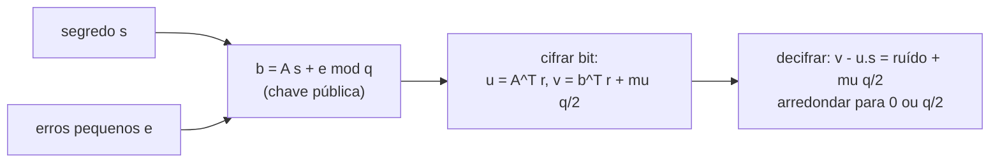

## Objetivos de Aprendizagem

- Explicar por que o algoritmo de Shor ameaça RSA e Diffie-Hellman e por que a criptografia "pós-quântica" precisa de outras hipóteses de dificuldade.
- Definir reticulados e o problema do vetor mais curto, e enunciar o problema Learning With Errors (LWE) nas formas de busca e de decisão.
- Explicar por que um ruído pequeno transforma um problema fácil de álgebra linear num difícil, e o que diz a redução de pior caso para caso médio de Regev.
- Executar a criptografia de chave pública de Regev num exemplo de brinquedo, explicar como a decifração tolera o ruído acumulado e relacioná-la ao ML-KEM (FIPS 203).

## Contexto e Motivação

`software-distributed/security-cryptography` construiu a criptografia de chave pública sobre dois problemas: fatorar inteiros grandes (RSA) e calcular logaritmos discretos (Diffie-Hellman e variantes com curvas elípticas). Em 1994, Peter Shor, então no Bell Labs e depois no MIT, mostrou que um computador quântico grande o bastante resolve os dois em tempo polinomial. Essa máquina ainda não existe, mas o tráfego cifrado gravado hoje pode ser decifrado quando ela existir ("colha agora, decifre depois"), então segredos de longa duração precisam de proteção já.

A principal substituta é construída sobre **reticulados**, e especificamente sobre o problema Learning With Errors, introduzido por Oded Regev em 2005, trabalho que lhe rendeu o Prêmio Gödel. O LWE tem três propriedades atraentes: não se conhece algoritmo quântico eficiente para ele, ele é comprovadamente tão difícil quanto problemas de reticulado no pior caso e permite esquemas eficientes com aritmética simples. Em agosto de 2024 o NIST publicou o FIPS 203, padronizando o ML-KEM (derivado da submissão CRYSTALS-Kyber) como mecanismo de encapsulamento de chaves pós-quântico, e grandes navegadores e aplicativos de mensagens já o adotaram em modo híbrido junto com a troca de chaves por curvas elípticas.

## Teoria Central

### Reticulados

Um **reticulado** é o conjunto de todas as combinações inteiras de $n$ vetores de base linearmente independentes $b_1, \dots, b_n \in \mathbb{R}^n$: $\mathcal{L} = \{\sum_i z_i b_i : z_i \in \mathbb{Z}\}$, uma grade regular de pontos, possivelmente inclinada. O mesmo reticulado tem muitas bases, algumas curtas e quase ortogonais (boas), outras longas e inclinadas (ruins). O **problema do vetor mais curto** (SVP) pede o vetor não nulo mais curto do reticulado. Com uma base boa, aproximá-lo é fácil; tendo só uma base ruim em alta dimensão, os melhores algoritmos conhecidos, clássicos ou quânticos, levam tempo exponencial em $n$ para aproximá-lo dentro de fatores polinomiais.

### Learning With Errors

Fixe um módulo $q$, uma dimensão $n$ e um segredo $s \in \mathbb{Z}_q^n$. O adversário vê muitas amostras

$$(a_i,\ b_i = \langle a_i, s \rangle + e_i \bmod q)$$

em que cada $a_i$ é uniforme em $\mathbb{Z}_q^n$ e cada erro $e_i$ é pequeno, sorteado de uma distribuição estreita em torno de 0 (tipicamente uma gaussiana discreta de largura bem menor do que $q$). Em forma matricial, $b = A s + e \bmod q$.

- **LWE de busca**: recuperar $s$.
- **LWE de decisão**: distinguir $(A, b)$ de $(A, u)$ com $u$ uniforme.

Sem os erros, a eliminação gaussiana recupera $s$ a partir de $n$ amostras em tempo polinomial. Com eles, a eliminação amplifica o ruído: combinar equações soma e multiplica os seus erros até cobrirem todo $\mathbb{Z}_q$, e o resultado perde o sentido. O ruído é o que torna o problema difícil.

### Por que acreditamos que é difícil

Regev provou que resolver o LWE no **caso médio** ($A$ aleatória, $s$ aleatório) é pelo menos tão difícil quanto resolver problemas aproximados do tipo SVP no **pior caso**, para todo reticulado, por meio de uma redução quântica (depois parcialmente desquantizada por Peikert). Isso é incomum e valioso: para o RSA, não existe prova de que instâncias aleatórias sejam tão difíceis quanto as mais difíceis. Se a criptografia baseada em LWE pudesse ser quebrada nos parâmetros usados, haveria um algoritmo quântico eficiente para problemas de reticulado no pior caso, que décadas de pesquisa não encontraram.

### O esquema de criptografia de Regev

- **Geração de chaves**: chave secreta $s \in \mathbb{Z}_q^n$. Chave pública: uma instância LWE $(A, b = As + e)$ com $m$ linhas.
- **Cifrar um bit** $\mu \in \{0, 1\}$: escolha um subconjunto aleatório das linhas, codificado como $r \in \{0, 1\}^m$, e produza

$$u = A^\top r, \qquad v = b^\top r + \mu \left\lfloor \tfrac{q}{2} \right\rfloor \pmod q$$

- **Decifrar**: calcule $v - \langle u, s \rangle = e^\top r + \mu \lfloor q/2 \rfloor \pmod q$. O termo $e^\top r$ é uma soma de alguns erros pequenos, então continua pequeno. Se o resultado estiver mais perto de 0, devolva 0; se mais perto de $q/2$, devolva 1.

A correção exige $|e^\top r| < q/4$, o que restringe os parâmetros. A segurança decorre do LWE de decisão: a chave pública é indistinguível da uniforme, e então $(u, v)$ é (por um argumento de leftover hash) indistinguível da uniforme também, escondendo $\mu$.

### De Regev ao ML-KEM

O LWE puro precisa de chaves públicas de cerca de $n \cdot m \cdot \log q$ bits, megabytes em parâmetros seguros. O ML-KEM troca vetores de inteiros por vetores de **polinômios** no anel $\mathbb{Z}_q[x]/(x^{256} + 1)$ com $q = 3329$ (Module-LWE), de modo que um elemento do anel carrega 256 coeficientes e a multiplicação é rápida via uma transformada teórico-numérica. As chaves públicas têm de cerca de 800 a 1.600 bytes para o ML-KEM-512, -768 e -1024, e o encapsulamento leva microssegundos. A estrutura dá eficiência; o argumento de dificuldade é o análogo modular do de Regev.

## Exemplos Resolvidos

### Exemplo 1: o ruído derrota a eliminação

**Problema:** Sejam $q = 17$, $n = 2$, segredo $s = (3, 5)$. Amostras: $a_1 = (1, 2), b_1 = 14$; $a_2 = (4, 1), b_2 = 16$; $a_3 = (2, 7), b_3 = 7$. (Foram somados os erros $+1, -1, 0$.) Resolva as duas primeiras equações de forma exata, como se não houvesse ruído, e confira com a terceira.

**Rastreamento:** O sistema é $x + 2y = 14$, $4x + y = 16$ módulo 17. Da primeira, $x = 14 - 2y$; substituindo, $56 - 7y \equiv 16$, então $7y \equiv 40 \equiv 6$. O inverso de 7 mod 17 é 5 ($7 \cdot 5 = 35 \equiv 1$), então $y \equiv 30 \equiv 13$ e $x \equiv 14 - 26 \equiv 5$. A "solução" $(5, 13)$ está errada. Conferindo a amostra 3: $2 \cdot 5 + 7 \cdot 13 = 101 \equiv 16$, mas $b_3 = 7$: diferença de 9, nada perto do pequeno erro esperado. Erros de tamanho 1 nas entradas produziram uma resposta completamente errada. Aqui a força bruta sobre $17^2$ candidatos é trivial; com $n = 768$ e um $q$ adequado, nenhum ataque conhecido é viável.

### Exemplo 2: cifrando e decifrando um bit

**Problema:** Usando as amostras acima mais $a_4 = (5, 3), b_4 = 14$ (erro $+1$) como chave pública, cifre $\mu = 1$ com o subconjunto $r = (1, 1, 0, 1)$ e depois decifre com $s$.

**Rastreamento:** $\lfloor 17/2 \rfloor = 8$. $u = a_1 + a_2 + a_4 = (10, 6)$. $v = b_1 + b_2 + b_4 + 8 = 14 + 16 + 14 + 8 = 52 \equiv 1 \pmod{17}$. Decifrar: $\langle u, s \rangle = 30 + 30 = 60 \equiv 9$, então $v - 9 \equiv -8 \equiv 9$. A distância de 9 até $8$ é 1, até 0 é 8, então a saída é $\mu = 1$. De fato o ruído acumulado é $e_1 + e_2 + e_4 = 1 - 1 + 1 = 1$, e $9 = 8 + 1$. Se a soma dos ruídos passasse de $q/4 \approx 4$, a decifração poderia falhar, e é por isso que parâmetros reais escolhem $q$ grande em relação à largura do erro vezes o número de linhas combinadas.

## Equívocos Comuns e Armadilhas

- **"Criptografia pós-quântica exige um computador quântico."** Ela roda em computadores comuns; é projetada para resistir a atacantes que tenham computadores quânticos. A distribuição quântica de chaves é outra tecnologia, com outras exigências de hardware.
- **"Criptografia de reticulados não é comprovada, ao contrário do RSA."** Nenhuma das duas é comprovadamente segura de forma incondicional. O LWE tem um fundamento teórico mais forte (dificuldade de pior caso) do que a fatoração, mas os seus parâmetros concretos são mais novos e a criptoanálise continua, e é por isso que as implantações atuais o rodam em modo híbrido junto com a troca de chaves clássica.
- **"O ruído é uma fraqueza a ser minimizada."** O ruído é a segurança. Pouco ruído e a álgebra linear recupera o segredo; ruído demais e a decifração falha. A escolha de parâmetros equilibra exatamente esses dois modos de falha.

## Resumo

O algoritmo de Shor quebra a fatoração e os logaritmos discretos num computador quântico, então a criptografia pós-quântica precisa de novas hipóteses. Reticulados são grades inteiras cujos vetores curtos são difíceis de achar a partir de uma base ruim, e o Learning With Errors pede para recuperar um segredo a partir de equações lineares módulo $q$, cada uma perturbada por um pequeno ruído; sem ruído é eliminação gaussiana, com ruído é tão difícil quanto problemas de reticulado no pior caso, pela redução de Regev. A criptografia de Regev esconde um bit como $q/2$ mais a soma de alguns erros, que a decifração elimina arredondando, e o ML-KEM, padronizado como FIPS 203, implementa a mesma ideia de forma eficiente sobre anéis de polinômios. O próximo conceito deixa a criptografia e vai para a geometria, em que predicados exatos sobre coordenadas guiam os algoritmos.

## Documentation Links

- [Regev: The Learning with Errors Problem (survey, 2010)](https://cims.nyu.edu/~regev/papers/lwesurvey.pdf): doc
- [NIST FIPS 203: Module-Lattice-Based Key-Encapsulation Mechanism Standard (2024)](https://csrc.nist.gov/pubs/fips/203/final): doc
- [MIT 6.875: Foundations of Cryptography](https://mit6875.github.io/): doc
