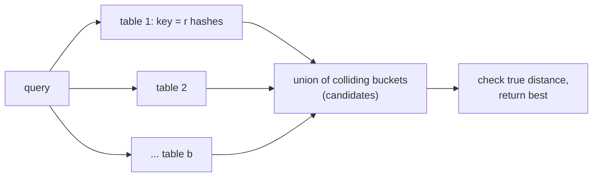

## Learning Objectives

- Explain the curse of dimensionality for exact nearest-neighbor search and why approximate answers are the practical goal in high dimensions.
- Define a locality-sensitive hash family by its parameters $(r_1, r_2, p_1, p_2)$ and give two examples: MinHash for Jaccard similarity and random hyperplanes for angular distance.
- Compute the collision probability of the banding (AND-OR) construction and locate its similarity threshold.
- State the query-time exponent $\rho = \ln(1/p_1)/\ln(1/p_2)$ and explain what it buys over a linear scan.

## Context & Motivation

`algorithms-software/data-structures-ii` studied universal hashing, whose goal is to make distinct keys collide as rarely as possible. Many real problems want the opposite. A search engine must find near-duplicate web pages among billions; a recommendation system must find users with similar tastes; the retrieval stage of Track B's retrieval-augmented generation must find the stored vectors closest to a query embedding. All are **nearest-neighbor** problems: given a query point, find the closest points in a large set.

In low dimensions, space-partitioning trees (kd-trees) answer such queries quickly. In hundreds of dimensions they degrade to scanning nearly everything, because in high dimensions almost all points are roughly equally far from a query, so pruning rarely works. This is the **curse of dimensionality**. Indyk and Motwani's 1998 answer was **locality-sensitive hashing** (LSH): design random hash functions under which close points are likely to collide and far points are not, then look only at the query's colliding buckets. The same idea, developed by Broder at AltaVista for duplicate detection (MinHash) and by Charikar for vectors (random hyperplanes), is covered in Stanford's CS168 and MIT's 6.854.

## Core Theory

### Approximate near neighbors

Exact search cannot beat a scan in the worst case in high dimensions under widely believed conjectures, so the target is relaxed: for a radius $r$ and approximation factor $c > 1$, if some point lies within distance $r$ of the query, return a point within distance $cr$. Allowing a slightly farther answer is what opens the door to sublinear query time.

### Locality-sensitive families

A family $\mathcal{H}$ of hash functions is $(r_1, r_2, p_1, p_2)$-sensitive, with $r_1 < r_2$ and $p_1 > p_2$, if for $h$ drawn at random from $\mathcal{H}$:

- if $d(x, y) \leq r_1$, then $\Pr[h(x) = h(y)] \geq p_1$;
- if $d(x, y) \geq r_2$, then $\Pr[h(x) = h(y)] \leq p_2$.

Two classic families:

**MinHash (Jaccard similarity).** For sets $A$ and $B$, $J(A, B) = |A \cap B| / |A \cup B|$. Pick a random permutation $\pi$ of the universe and let $h(A) = \min_{a \in A} \pi(a)$. The minimum element of $A \cup B$ under $\pi$ is equally likely to be any of its elements, and $h(A) = h(B)$ exactly when that element lies in $A \cap B$, so $\Pr[h(A) = h(B)] = J(A, B)$. In practice, a random hash function stands in for the permutation.

**Random hyperplanes (angular distance).** For vectors $x, y$, draw a random Gaussian vector $g$ and let $h(x) = \mathrm{sign}(g^\top x)$. The hyperplane orthogonal to $g$ separates $x$ and $y$ with probability $\theta/\pi$, where $\theta$ is the angle between them, so $\Pr[h(x) = h(y)] = 1 - \theta/\pi$. This connects directly to cosine similarity in embedding search.

### Amplification: AND then OR

A single hash has a weak gap between $p_1$ and $p_2$. Amplify it in two steps:

- **AND**: concatenate $r$ independent hashes into one key; two points share the key with probability $p^r$. This pushes far pairs' probability toward 0, but also hurts near pairs.
- **OR**: build $b$ independent such tables; a pair is a **candidate** if it collides in at least one. Probability: $1 - (1 - p^r)^b$.

For MinHash with similarity $s$, the candidate probability $f(s) = 1 - (1 - s^r)^b$ is an S-shaped curve with its steep part near the threshold $s^* \approx (1/b)^{1/r}$. Choosing $r$ and $b$ places the threshold where the application needs it. Candidates are then checked exactly, so false positives cost only time and false negatives are the true error.

### Query time

With the right parameters, LSH answers $c$-approximate near-neighbor queries in time about $O(n^{\rho})$ with $\rho = \ln(1/p_1)/\ln(1/p_2) < 1$, using $O(n^{1+\rho})$ space. For Hamming distance with bit sampling, $\rho = 1/c$; for Euclidean distance, Andoni and Indyk achieved $\rho \approx 1/c^2$, which is known to be optimal for this kind of hashing scheme. For $c = 2$ in Euclidean space, that is roughly $n^{0.25}$ work per query instead of $n$.

## Worked Examples

### Example 1: tuning bands for near-duplicate detection

**Problem:** Documents are represented by 100 MinHash values split into $b = 20$ bands of $r = 5$ rows. What is the probability that a pair with Jaccard similarity 0.8 becomes a candidate? With similarity 0.3? Where is the threshold?

**Trace:** For $s = 0.8$: $s^5 = 0.328$, so $1 - (1 - 0.328)^{20} = 1 - 0.672^{20} \approx 1 - 0.00036 = 0.9996$. For $s = 0.3$: $s^5 = 0.00243$, so $1 - (0.99757)^{20} \approx 1 - 0.953 = 0.047$. Threshold: $(1/20)^{1/5} \approx 0.55$. True near-duplicates are almost never missed (about 1 in 2,800), and only about 5% of dissimilar pairs need an exact check. Raising $r$ to 10 with $b = 10$ moves the threshold up to about $0.79$, useful if "duplicate" should mean very close.

### Example 2: random hyperplanes for embeddings

**Problem:** Embeddings are compared by angle. Each table concatenates $k = 10$ hyperplane bits, and there are $L = 20$ tables. Compare the probability of retrieving a neighbor at angle 30 degrees with one at 90 degrees (orthogonal, unrelated).

**Trace:** One bit agrees with probability $1 - 30/180 = 0.833$ at 30 degrees and $0.5$ at 90 degrees. Ten bits: $0.833^{10} \approx 0.161$ versus $0.5^{10} \approx 0.00098$. Across 20 tables: $1 - (1 - 0.161)^{20} \approx 1 - 0.030 = 0.97$ versus $1 - (0.99902)^{20} \approx 0.019$. So a close neighbor is found 97% of the time while an unrelated vector is examined less than 2% of the time, and the query inspects only a small fraction of the database.

## Common Misconceptions & Pitfalls

- **"LSH is a hash table with a clever hash."** A single table almost never works; the guarantees come from the AND-OR amplification across many independent tables, which multiplies memory use. Space, not time, is usually the binding constraint.
- **"Approximate search returns wrong answers."** It returns candidates verified by exact distance; the approximation is that it may miss the true nearest neighbor with small probability or return one slightly farther. For retrieval and deduplication, this is usually indistinguishable in quality from exact search.
- **"LSH is what vector databases use."** Many modern systems use graph-based indexes (such as HNSW) or quantization, which often perform better in practice on real data; LSH remains the method with the cleanest worst-case guarantees and is common for set similarity with MinHash.

## Summary

High-dimensional exact nearest-neighbor search degrades to a linear scan, so the goal becomes approximate search. Locality-sensitive hash families make close points collide with probability $p_1$ and far points with probability $p_2 < p_1$: MinHash collides with probability equal to Jaccard similarity, and random hyperplanes with probability $1 - \theta/\pi$. Concatenating $r$ hashes and taking $b$ tables turns that gap into a sharp threshold near $(1/b)^{1/r}$, and the resulting index answers queries in about $n^{\rho}$ time with $\rho = \ln(1/p_1)/\ln(1/p_2)$. The next concept turns from searching to optimizing, and from exact answers to provably good ones for NP-hard problems.

## Documentation Links

- [Stanford CS168: The Modern Algorithmic Toolbox, Lecture 4: Dimensionality Reduction](https://web.stanford.edu/class/cs168/l/l4.pdf): doc
- [Andoni, Indyk: LSH Algorithm and Implementation (E2LSH)](http://www.mit.edu/~andoni/LSH/): doc
- [MIT 6.854J: Advanced Algorithms (OCW)](https://ocw.mit.edu/courses/6-854j-advanced-algorithms-fall-2008/): doc
