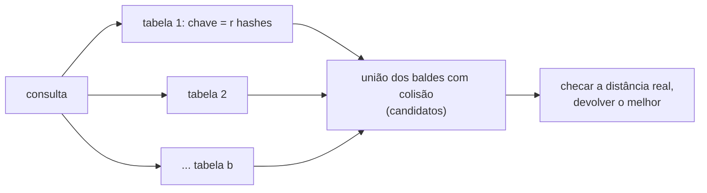

## Objetivos de Aprendizagem

- Explicar a maldição da dimensionalidade para a busca exata de vizinhos mais próximos e por que respostas aproximadas são o objetivo prático em alta dimensão.
- Definir uma família de hash sensível à localidade pelos parâmetros $(r_1, r_2, p_1, p_2)$ e dar dois exemplos: MinHash para similaridade de Jaccard e hiperplanos aleatórios para distância angular.
- Calcular a probabilidade de colisão da construção em bandas (AND-OR) e localizar o seu limiar de similaridade.
- Enunciar o expoente do tempo de consulta $\rho = \ln(1/p_1)/\ln(1/p_2)$ e explicar o que ele ganha em relação a uma varredura linear.

## Contexto e Motivação

`algorithms-software/data-structures-ii` estudou o hashing universal, cujo objetivo é fazer chaves distintas colidirem o mais raramente possível. Muitos problemas reais querem o contrário. Um buscador precisa achar páginas quase duplicadas entre bilhões; um sistema de recomendação precisa achar usuários com gostos parecidos; a etapa de recuperação da geração aumentada por recuperação da Trilha B precisa achar os vetores guardados mais próximos de um embedding de consulta. Todos são problemas de **vizinho mais próximo**: dado um ponto de consulta, encontre os pontos mais próximos num conjunto grande.

Em poucas dimensões, árvores de particionamento do espaço (kd-trees) respondem essas consultas rápido. Em centenas de dimensões elas degradam para varrer quase tudo, porque em alta dimensão quase todos os pontos ficam mais ou menos à mesma distância de uma consulta, e a poda raramente funciona. Essa é a **maldição da dimensionalidade**. A resposta de Indyk e Motwani em 1998 foi o **hashing sensível à localidade** (LSH): projetar funções hash aleatórias sob as quais pontos próximos tendem a colidir e pontos distantes não, e então olhar só os baldes em que a consulta colide. A mesma ideia, desenvolvida por Broder na AltaVista para detecção de duplicatas (MinHash) e por Charikar para vetores (hiperplanos aleatórios), é vista no CS168 de Stanford e no 6.854 do MIT.

## Teoria Central

### Vizinhos próximos aproximados

A busca exata não consegue vencer uma varredura no pior caso em alta dimensão, sob conjecturas amplamente aceitas, então o alvo é relaxado: para um raio $r$ e um fator de aproximação $c > 1$, se algum ponto estiver a distância no máximo $r$ da consulta, devolva um ponto a distância no máximo $cr$. Permitir uma resposta um pouco mais distante é o que abre a porta para tempo de consulta sublinear.

### Famílias sensíveis à localidade

Uma família $\mathcal{H}$ de funções hash é $(r_1, r_2, p_1, p_2)$-sensível, com $r_1 < r_2$ e $p_1 > p_2$, se para $h$ sorteada de $\mathcal{H}$:

- se $d(x, y) \leq r_1$, então $\Pr[h(x) = h(y)] \geq p_1$;
- se $d(x, y) \geq r_2$, então $\Pr[h(x) = h(y)] \leq p_2$.

Duas famílias clássicas:

**MinHash (similaridade de Jaccard).** Para conjuntos $A$ e $B$, $J(A, B) = |A \cap B| / |A \cup B|$. Sorteie uma permutação aleatória $\pi$ do universo e defina $h(A) = \min_{a \in A} \pi(a)$. O elemento mínimo de $A \cup B$ sob $\pi$ tem a mesma chance de ser qualquer um dos seus elementos, e $h(A) = h(B)$ exatamente quando esse elemento está em $A \cap B$, então $\Pr[h(A) = h(B)] = J(A, B)$. Na prática, uma função hash aleatória faz o papel da permutação.

**Hiperplanos aleatórios (distância angular).** Para vetores $x, y$, sorteie um vetor gaussiano aleatório $g$ e defina $h(x) = \mathrm{sign}(g^\top x)$. O hiperplano ortogonal a $g$ separa $x$ e $y$ com probabilidade $\theta/\pi$, em que $\theta$ é o ângulo entre eles, então $\Pr[h(x) = h(y)] = 1 - \theta/\pi$. Isso se liga diretamente à similaridade de cosseno na busca por embeddings.

### Amplificação: AND, depois OR

Um único hash tem uma diferença fraca entre $p_1$ e $p_2$. Amplifique-a em dois passos:

- **AND**: concatene $r$ hashes independentes numa única chave; dois pontos compartilham a chave com probabilidade $p^r$. Isso empurra a probabilidade de pares distantes para perto de 0, mas também prejudica pares próximos.
- **OR**: construa $b$ tabelas independentes assim; um par vira **candidato** se colidir em pelo menos uma. Probabilidade: $1 - (1 - p^r)^b$.

Para MinHash com similaridade $s$, a probabilidade de candidato $f(s) = 1 - (1 - s^r)^b$ é uma curva em S com a parte íngreme perto do limiar $s^* \approx (1/b)^{1/r}$. Escolher $r$ e $b$ coloca o limiar onde a aplicação precisa. Os candidatos são então checados de forma exata, então falsos positivos custam só tempo e falsos negativos são o erro de verdade.

### Tempo de consulta

Com os parâmetros certos, o LSH responde consultas de vizinho próximo $c$-aproximado em tempo de cerca de $O(n^{\rho})$ com $\rho = \ln(1/p_1)/\ln(1/p_2) < 1$, usando espaço $O(n^{1+\rho})$. Para distância de Hamming com amostragem de bits, $\rho = 1/c$; para distância euclidiana, Andoni e Indyk alcançaram $\rho \approx 1/c^2$, que se sabe ser ótimo para esse tipo de esquema de hashing. Para $c = 2$ no espaço euclidiano, isso dá cerca de $n^{0{,}25}$ de trabalho por consulta em vez de $n$.

## Exemplos Resolvidos

### Exemplo 1: ajustando as bandas para detectar quase duplicatas

**Problema:** Documentos são representados por 100 valores MinHash divididos em $b = 20$ bandas de $r = 5$ linhas. Qual a probabilidade de um par com similaridade de Jaccard 0,8 virar candidato? E com similaridade 0,3? Onde fica o limiar?

**Rastreamento:** Para $s = 0{,}8$: $s^5 = 0{,}328$, então $1 - (1 - 0{,}328)^{20} = 1 - 0{,}672^{20} \approx 1 - 0{,}00036 = 0{,}9996$. Para $s = 0{,}3$: $s^5 = 0{,}00243$, então $1 - (0{,}99757)^{20} \approx 1 - 0{,}953 = 0{,}047$. Limiar: $(1/20)^{1/5} \approx 0{,}55$. Quase duplicatas verdadeiras quase nunca são perdidas (cerca de 1 em 2.800), e só uns 5% dos pares diferentes precisam de checagem exata. Subir $r$ para 10 com $b = 10$ leva o limiar para cerca de $0{,}79$, útil se "duplicata" deve significar muito próximo.

### Exemplo 2: hiperplanos aleatórios para embeddings

**Problema:** Embeddings são comparados por ângulo. Cada tabela concatena $k = 10$ bits de hiperplano, e há $L = 20$ tabelas. Compare a probabilidade de recuperar um vizinho a 30 graus com a de um a 90 graus (ortogonal, sem relação).

**Rastreamento:** Um bit concorda com probabilidade $1 - 30/180 = 0{,}833$ a 30 graus e $0{,}5$ a 90 graus. Dez bits: $0{,}833^{10} \approx 0{,}161$ contra $0{,}5^{10} \approx 0{,}00098$. Em 20 tabelas: $1 - (1 - 0{,}161)^{20} \approx 1 - 0{,}030 = 0{,}97$ contra $1 - (0{,}99902)^{20} \approx 0{,}019$. Assim, um vizinho próximo é encontrado 97% das vezes, enquanto um vetor sem relação é examinado menos de 2% das vezes, e a consulta inspeciona só uma pequena fração do banco.

## Equívocos Comuns e Armadilhas

- **"LSH é uma tabela hash com um hash esperto."** Uma única tabela quase nunca funciona; as garantias vêm da amplificação AND-OR sobre muitas tabelas independentes, o que multiplica o uso de memória. Espaço, e não tempo, costuma ser a restrição que aperta.
- **"Busca aproximada devolve respostas erradas."** Ela devolve candidatos verificados pela distância exata; a aproximação é que pode perder o vizinho mais próximo verdadeiro com pequena probabilidade ou devolver um um pouco mais distante. Para recuperação e deduplicação, isso costuma ser indistinguível em qualidade da busca exata.
- **"LSH é o que bancos de dados vetoriais usam."** Muitos sistemas modernos usam índices baseados em grafos (como o HNSW) ou quantização, que costumam se sair melhor na prática em dados reais; o LSH continua sendo o método com as garantias de pior caso mais limpas e é comum para similaridade de conjuntos com MinHash.

## Resumo

A busca exata pelo vizinho mais próximo em alta dimensão degrada para uma varredura linear, então o objetivo vira a busca aproximada. Famílias de hash sensíveis à localidade fazem pontos próximos colidirem com probabilidade $p_1$ e pontos distantes com probabilidade $p_2 < p_1$: o MinHash colide com probabilidade igual à similaridade de Jaccard, e os hiperplanos aleatórios com probabilidade $1 - \theta/\pi$. Concatenar $r$ hashes e usar $b$ tabelas transforma essa diferença num limiar nítido perto de $(1/b)^{1/r}$, e o índice resultante responde consultas em tempo de cerca de $n^{\rho}$ com $\rho = \ln(1/p_1)/\ln(1/p_2)$. O próximo conceito sai da busca e vai para a otimização, e de respostas exatas para respostas comprovadamente boas em problemas NP-difíceis.

## Documentation Links

- [Stanford CS168: The Modern Algorithmic Toolbox, Lecture 4: Dimensionality Reduction](https://web.stanford.edu/class/cs168/l/l4.pdf): doc
- [Andoni, Indyk: LSH Algorithm and Implementation (E2LSH)](http://www.mit.edu/~andoni/LSH/): doc
- [MIT 6.854J: Advanced Algorithms (OCW)](https://ocw.mit.edu/courses/6-854j-advanced-algorithms-fall-2008/): doc
