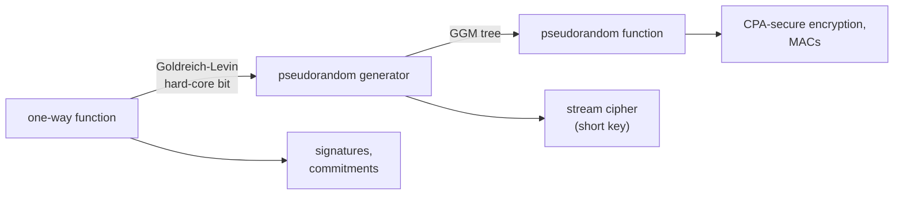

## Learning Objectives

- Explain why perfect secrecy forces keys as long as messages, and how computational security relaxes it by limiting the adversary to efficient algorithms and negligible success.
- Define one-way functions and give standard candidates, and explain why their existence would imply P $\neq$ NP.
- Define computational indistinguishability and pseudorandom generators, and build a one-bit-stretch generator from a one-way permutation and a hard-core predicate.
- Write a security proof by reduction: show that a stream cipher built from a pseudorandom generator is secure if the generator is.

## Context & Motivation

`software-distributed/security-cryptography` proved that the one-time pad achieves **perfect secrecy**, a ciphertext reveals nothing at all about the message, and Shannon showed this requires a truly random key at least as long as all the messages ever sent with it. That is impractical: nobody pre-shares a terabyte of key to send a terabyte of data. The same discipline then used block ciphers, hash functions, RSA, and Diffie-Hellman, whose security was argued from experience: decades of cryptanalysis have not broken them.

Modern theoretical cryptography, developed by Goldwasser, Micali, Blum, Yao, and others in the 1980s and taught in MIT's 6.875 and Barak's Harvard CS127, replaces "nobody has broken it" with **reductions**: a scheme is proved secure by showing that any efficient attack on it would yield an efficient algorithm for a problem assumed to be hard. The minimal such assumption is the existence of **one-way functions**. From them alone one can build pseudorandom generators, pseudorandom functions, private-key encryption, message authentication, digital signatures, and commitments, which is why one-way functions are the foundation on which the rest rests.

## Core Theory

### Computational security

Two relaxations make short keys possible. The adversary is **efficient**, a probabilistic polynomial-time (PPT) algorithm in the security parameter $n$ (roughly the key length). And it may succeed, but only with **negligible** probability: a function $\varepsilon(n)$ is negligible if it is eventually smaller than $1/n^c$ for every constant $c$, like $2^{-n}$. Negligible success cannot be amplified to noticeable by polynomially many repetitions.

### One-way functions

A function $f: \{0,1\}^* \to \{0,1\}^*$ is **one-way** if:

- it is computable in polynomial time, and
- for every PPT algorithm $A$, $\Pr_{x \leftarrow \{0,1\}^n}\big[A(1^n, f(x)) \in f^{-1}(f(x))\big]$ is negligible.

Inverting means finding **any** preimage, not necessarily $x$. Standard candidates: multiplication of two random $n$-bit primes (inverting is factoring), modular exponentiation $x \mapsto g^x \bmod p$ (inverting is the discrete logarithm), and subset sum. If P = NP, no one-way function exists, since checking a candidate preimage is in P and so finding one would be in NP. Proving one-way functions exist would therefore prove P $\neq$ NP, so all of cryptography rests on an unproven assumption, and the goal is to make that assumption as weak as possible.

### Indistinguishability and pseudorandom generators

Two distributions $X_n$ and $Y_n$ are **computationally indistinguishable** if for every PPT distinguisher $D$,

$$\big|\Pr[D(X_n) = 1] - \Pr[D(Y_n) = 1]\big| \leq \mathrm{negl}(n)$$

A **pseudorandom generator** (PRG) is a polynomial-time $G: \{0,1\}^n \to \{0,1\}^{\ell(n)}$ with $\ell(n) > n$ whose output on a uniformly random seed is computationally indistinguishable from uniform on $\{0,1\}^{\ell(n)}$. The output cannot be truly random, since there are only $2^n$ outputs among $2^{\ell(n)}$ strings, but no efficient test can tell. Yao showed an equivalent criterion: $G$ is a PRG if and only if no efficient algorithm predicts its next output bit from the previous ones with probability noticeably above $1/2$.

### From one-way permutations to a PRG

A **hard-core predicate** $h$ of $f$ is a bit computable from $x$ but unpredictable from $f(x)$: no PPT algorithm guesses $h(x)$ from $f(x)$ with probability noticeably above $1/2$. Goldreich and Levin (1989) proved that every one-way function has one, in a slightly modified form: for $g(x, r) = (f(x), r)$, the inner product $\langle x, r \rangle \bmod 2$ is hard-core.

If $f$ is a one-way **permutation** with hard-core bit $h$, then

$$G(s) = f(s) \,\|\, h(s)$$

stretches $n$ bits to $n + 1$. The first $n$ bits are uniformly random because $f$ is a permutation of a uniform $s$, and the last bit is unpredictable from them by the hard-core property. Iterating (Blum-Micali: output $h(s)$, replace $s$ by $f(s)$, repeat) stretches to any polynomial length. Håstad, Impagliazzo, Levin, and Luby (1999) showed PRGs can be built from **any** one-way function, and conversely every PRG is itself a one-way function. So PRGs exist exactly when one-way functions do.

### Using a PRG: a stream cipher and its proof

Encrypt with $\mathrm{Enc}_k(m) = G(k) \oplus m$, a one-time pad whose pad is generated from a short key. **Theorem**: if $G$ is a PRG, no PPT adversary can distinguish encryptions of two messages $m_0, m_1$ of its choice with more than negligible advantage.

**Proof by reduction.** Suppose adversary $A$ distinguishes with advantage $\varepsilon$. Build a distinguisher $D$ for $G$: given a string $y$ (either $G(k)$ or truly uniform), $D$ runs $A$, gets $m_0, m_1$, picks a random bit $b$, gives $A$ the ciphertext $y \oplus m_b$, and outputs 1 if $A$ guesses $b$ correctly. If $y = G(k)$, this is exactly the real encryption game, so $A$ wins with probability $1/2 + \varepsilon$. If $y$ is uniform, $y \oplus m_b$ is a true one-time pad and $A$ wins with probability exactly $1/2$. So $D$ distinguishes $G$ from uniform with advantage $\varepsilon$, which must be negligible. Every security proof in this style has the same shape: an attack on the scheme becomes an attack on the assumption.

## Worked Examples

### Example 1: breaking a bad generator

**Problem:** A proposed generator outputs $G(s) = s \,\|\, \mathrm{parity}(s)$, stretching $n$ bits to $n + 1$. Show it is not a PRG.

**Trace:** Distinguisher $D(y)$: output 1 if the last bit of $y$ equals the parity of the first $n$ bits. On $G(s)$, $D$ outputs 1 with probability 1. On a uniform string, the last bit is independent of the rest, so $D$ outputs 1 with probability $1/2$. The advantage is $1/2$, far from negligible. Stretching alone is not enough: the extra bit must be unpredictable, which is exactly what a hard-core predicate of a one-way permutation provides and a parity of visible bits does not.

### Example 2: key reuse destroys the stream cipher

**Problem:** A system encrypts two messages with the same key: $c_1 = G(k) \oplus m_1$ and $c_2 = G(k) \oplus m_2$. What does an eavesdropper learn, and which step of the security proof fails?

**Resolution:** $c_1 \oplus c_2 = m_1 \oplus m_2$, independent of the key. If one message is known or guessable (a protocol header, a common file format), the other is recovered directly; even without that, statistics of natural language often reveal both. The proof covered a single encryption: it used the pad $G(k)$ once, as in the one-time pad. Encrypting many messages securely requires fresh randomness per message, for example a pseudorandom function evaluated at a random nonce, which is how standard modes such as counter mode work. This exact mistake has broken real systems, including WEP Wi-Fi encryption.

## Common Misconceptions & Pitfalls

- **"Pseudorandom means statistically random."** A PRG's output fails some tests, for instance testing whether the string is in the image of $G$, but those tests take exponential time. Pseudorandomness is relative to efficient observers.
- **"Hash functions are one-way functions, so they are PRGs."** Cryptographic hashes are designed to be one-way and collision-resistant, but their security is heuristic, and one-wayness alone does not make an output pseudorandom. Constructions need the specific properties their proofs assume.
- **"A security proof means the system is secure."** It means the system is as secure as the assumption, in the model the proof considered. Side channels, key reuse, and implementation bugs are outside the model and break proved schemes in practice.

## Summary

Perfect secrecy needs keys as long as the data, so modern cryptography limits adversaries to efficient algorithms and negligible success probability. One-way functions, easy to compute but hard to invert on random inputs, are the minimal assumption; their existence would imply P $\neq$ NP. A pseudorandom generator stretches a short seed into output no efficient distinguisher can tell from uniform; from a one-way permutation and a hard-core bit, $f(s) \| h(s)$ stretches by one bit and iteration stretches further, and PRGs exist exactly when one-way functions do. Security of a PRG-based stream cipher follows by reduction, turning any attack on the cipher into a distinguisher for the generator. The next concept looks at a specific hardness assumption chosen to survive quantum computers.

## Documentation Links

- [MIT 6.875: Foundations of Cryptography](https://mit6875.github.io/): doc
- [Barak: An Intensive Introduction to Cryptography (Harvard CS127)](https://intensecrypto.org/public/): doc
- [Goldreich: Foundations of Cryptography (Weizmann)](https://www.wisdom.weizmann.ac.il/~oded/foc-book.html): doc
