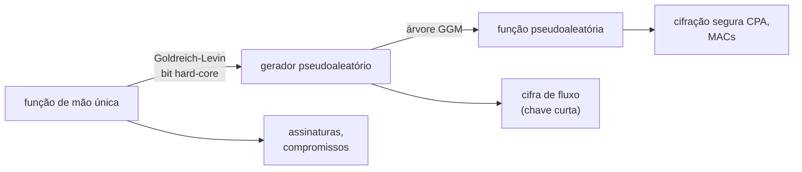

## Objetivos de Aprendizagem

- Explicar por que o sigilo perfeito força chaves tão longas quanto as mensagens, e como a segurança computacional o relaxa limitando o adversário a algoritmos eficientes e sucesso desprezível.
- Definir funções de mão única e dar candidatas padrão, e explicar por que a existência delas implicaria P $\neq$ NP.
- Definir indistinguibilidade computacional e geradores pseudoaleatórios, e construir um gerador que estica um bit a partir de uma permutação de mão única e de um predicado hard-core.
- Escrever uma prova de segurança por redução: mostrar que uma cifra de fluxo construída a partir de um gerador pseudoaleatório é segura se o gerador for.

## Contexto e Motivação

`software-distributed/security-cryptography` provou que o one-time pad alcança **sigilo perfeito**, um texto cifrado não revela absolutamente nada sobre a mensagem, e Shannon mostrou que isso exige uma chave verdadeiramente aleatória pelo menos tão longa quanto todas as mensagens já enviadas com ela. Isso é impraticável: ninguém compartilha antes um terabyte de chave para enviar um terabyte de dados. A mesma disciplina então usou cifras de bloco, funções hash, RSA e Diffie-Hellman, cuja segurança era defendida pela experiência: décadas de criptoanálise não os quebraram.

A criptografia teórica moderna, desenvolvida por Goldwasser, Micali, Blum, Yao e outros nos anos 1980 e ensinada no 6.875 do MIT e no CS127 de Barak em Harvard, troca "ninguém quebrou" por **reduções**: um esquema é provado seguro mostrando que qualquer ataque eficiente contra ele daria um algoritmo eficiente para um problema que se supõe difícil. A hipótese mínima desse tipo é a existência de **funções de mão única**. Só a partir delas dá para construir geradores pseudoaleatórios, funções pseudoaleatórias, criptografia de chave privada, autenticação de mensagens, assinaturas digitais e compromissos, e é por isso que as funções de mão única são o alicerce sobre o qual o resto se apoia.

## Teoria Central

### Segurança computacional

Dois relaxamentos tornam chaves curtas possíveis. O adversário é **eficiente**, um algoritmo probabilístico de tempo polinomial (PPT) no parâmetro de segurança $n$ (mais ou menos o comprimento da chave). E ele pode ter sucesso, mas só com probabilidade **desprezível**: uma função $\varepsilon(n)$ é desprezível se fica, a partir de certo ponto, menor do que $1/n^c$ para toda constante $c$, como $2^{-n}$. Um sucesso desprezível não pode ser amplificado para perceptível com um número polinomial de repetições.

### Funções de mão única

Uma função $f: \{0,1\}^* \to \{0,1\}^*$ é **de mão única** se:

- é calculável em tempo polinomial, e
- para todo algoritmo PPT $A$, $\Pr_{x \leftarrow \{0,1\}^n}\big[A(1^n, f(x)) \in f^{-1}(f(x))\big]$ é desprezível.

Inverter significa achar **qualquer** pré-imagem, não necessariamente $x$. Candidatas padrão: a multiplicação de dois primos aleatórios de $n$ bits (inverter é fatorar), a exponenciação modular $x \mapsto g^x \bmod p$ (inverter é o logaritmo discreto) e a soma de subconjuntos. Se P = NP, não existe função de mão única, já que checar uma pré-imagem candidata está em P e então achar uma estaria em NP. Provar que funções de mão única existem provaria, portanto, P $\neq$ NP, então toda a criptografia se apoia numa hipótese não provada, e o objetivo é deixar essa hipótese o mais fraca possível.

### Indistinguibilidade e geradores pseudoaleatórios

Duas distribuições $X_n$ e $Y_n$ são **computacionalmente indistinguíveis** se para todo distinguidor PPT $D$,

$$\big|\Pr[D(X_n) = 1] - \Pr[D(Y_n) = 1]\big| \leq \mathrm{negl}(n)$$

Um **gerador pseudoaleatório** (PRG) é uma função de tempo polinomial $G: \{0,1\}^n \to \{0,1\}^{\ell(n)}$ com $\ell(n) > n$ cuja saída sobre uma semente uniformemente aleatória é computacionalmente indistinguível da uniforme em $\{0,1\}^{\ell(n)}$. A saída não pode ser verdadeiramente aleatória, já que há só $2^n$ saídas entre $2^{\ell(n)}$ cadeias, mas nenhum teste eficiente percebe. Yao mostrou um critério equivalente: $G$ é um PRG se e somente se nenhum algoritmo eficiente prevê o próximo bit da saída a partir dos anteriores com probabilidade perceptivelmente acima de $1/2$.

### De permutações de mão única a um PRG

Um **predicado hard-core** $h$ de $f$ é um bit calculável a partir de $x$, mas imprevisível a partir de $f(x)$: nenhum algoritmo PPT adivinha $h(x)$ a partir de $f(x)$ com probabilidade perceptivelmente acima de $1/2$. Goldreich e Levin (1989) provaram que toda função de mão única tem um, numa forma levemente modificada: para $g(x, r) = (f(x), r)$, o produto interno $\langle x, r \rangle \bmod 2$ é hard-core.

Se $f$ é uma **permutação** de mão única com bit hard-core $h$, então

$$G(s) = f(s) \,\|\, h(s)$$

estica $n$ bits para $n + 1$. Os primeiros $n$ bits são uniformemente aleatórios porque $f$ é uma permutação de um $s$ uniforme, e o último bit é imprevisível a partir deles pela propriedade hard-core. Iterar (Blum-Micali: produza $h(s)$, troque $s$ por $f(s)$, repita) estica até qualquer comprimento polinomial. Håstad, Impagliazzo, Levin e Luby (1999) mostraram que PRGs podem ser construídos a partir de **qualquer** função de mão única e, na direção oposta, todo PRG é ele mesmo uma função de mão única. Então PRGs existem exatamente quando funções de mão única existem.

### Usando um PRG: uma cifra de fluxo e a sua prova

Cifre com $\mathrm{Enc}_k(m) = G(k) \oplus m$, um one-time pad cujo pad é gerado a partir de uma chave curta. **Teorema**: se $G$ é um PRG, nenhum adversário PPT consegue distinguir cifrações de duas mensagens $m_0, m_1$ escolhidas por ele com vantagem mais do que desprezível.

**Prova por redução.** Suponha que o adversário $A$ distingue com vantagem $\varepsilon$. Construa um distinguidor $D$ para $G$: recebendo uma cadeia $y$ (ou $G(k)$ ou verdadeiramente uniforme), $D$ roda $A$, obtém $m_0, m_1$, sorteia um bit $b$, entrega a $A$ o texto cifrado $y \oplus m_b$ e devolve 1 se $A$ adivinhar $b$ corretamente. Se $y = G(k)$, este é exatamente o jogo de cifração real, então $A$ vence com probabilidade $1/2 + \varepsilon$. Se $y$ é uniforme, $y \oplus m_b$ é um one-time pad verdadeiro e $A$ vence com probabilidade exatamente $1/2$. Então $D$ distingue $G$ da uniforme com vantagem $\varepsilon$, que precisa ser desprezível. Toda prova de segurança nesse estilo tem o mesmo formato: um ataque ao esquema vira um ataque à hipótese.

## Exemplos Resolvidos

### Exemplo 1: quebrando um gerador ruim

**Problema:** Um gerador proposto produz $G(s) = s \,\|\, \mathrm{parity}(s)$, esticando $n$ bits para $n + 1$. Mostre que ele não é um PRG.

**Rastreamento:** Distinguidor $D(y)$: devolva 1 se o último bit de $y$ for igual à paridade dos primeiros $n$ bits. Em $G(s)$, $D$ devolve 1 com probabilidade 1. Numa cadeia uniforme, o último bit é independente do resto, então $D$ devolve 1 com probabilidade $1/2$. A vantagem é $1/2$, longe de desprezível. Esticar não basta: o bit extra precisa ser imprevisível, que é exatamente o que um predicado hard-core de uma permutação de mão única oferece e uma paridade de bits visíveis não.

### Exemplo 2: reusar a chave destrói a cifra de fluxo

**Problema:** Um sistema cifra duas mensagens com a mesma chave: $c_1 = G(k) \oplus m_1$ e $c_2 = G(k) \oplus m_2$. O que um bisbilhoteiro aprende, e qual passo da prova de segurança falha?

**Resolução:** $c_1 \oplus c_2 = m_1 \oplus m_2$, independente da chave. Se uma mensagem for conhecida ou adivinhável (um cabeçalho de protocolo, um formato de arquivo comum), a outra é recuperada diretamente; mesmo sem isso, estatísticas da língua natural muitas vezes revelam as duas. A prova cobria uma única cifração: usava o pad $G(k)$ uma vez, como no one-time pad. Cifrar muitas mensagens com segurança exige aleatoriedade nova por mensagem, por exemplo uma função pseudoaleatória avaliada num nonce aleatório, que é como modos padrão como o modo contador funcionam. Exatamente esse erro já quebrou sistemas reais, incluindo a criptografia WEP de Wi-Fi.

## Equívocos Comuns e Armadilhas

- **"Pseudoaleatório significa estatisticamente aleatório."** A saída de um PRG falha em alguns testes, por exemplo testar se a cadeia está na imagem de $G$, mas esses testes levam tempo exponencial. A pseudoaleatoriedade é relativa a observadores eficientes.
- **"Funções hash são funções de mão única, então são PRGs."** Hashes criptográficos são projetados para serem de mão única e resistentes a colisões, mas a sua segurança é heurística, e ser de mão única por si só não torna uma saída pseudoaleatória. As construções precisam das propriedades específicas que as suas provas supõem.
- **"Uma prova de segurança significa que o sistema é seguro."** Significa que o sistema é tão seguro quanto a hipótese, no modelo que a prova considerou. Canais laterais, reuso de chave e bugs de implementação estão fora do modelo e quebram esquemas provados na prática.

## Resumo

O sigilo perfeito exige chaves tão longas quanto os dados, então a criptografia moderna limita os adversários a algoritmos eficientes e probabilidade de sucesso desprezível. Funções de mão única, fáceis de calcular mas difíceis de inverter em entradas aleatórias, são a hipótese mínima; a existência delas implicaria P $\neq$ NP. Um gerador pseudoaleatório estica uma semente curta numa saída que nenhum distinguidor eficiente separa da uniforme; a partir de uma permutação de mão única e um bit hard-core, $f(s) \| h(s)$ estica um bit e a iteração estica mais, e PRGs existem exatamente quando existem funções de mão única. A segurança de uma cifra de fluxo baseada em PRG segue por redução, transformando qualquer ataque à cifra num distinguidor para o gerador. O próximo conceito olha para uma hipótese de dificuldade específica escolhida para sobreviver a computadores quânticos.

## Documentation Links

- [MIT 6.875: Foundations of Cryptography](https://mit6875.github.io/): doc
- [Barak: An Intensive Introduction to Cryptography (Harvard CS127)](https://intensecrypto.org/public/): doc
- [Goldreich: Foundations of Cryptography (Weizmann)](https://www.wisdom.weizmann.ac.il/~oded/foc-book.html): doc
