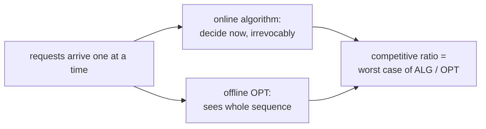

## Learning Objectives

- Define an online algorithm and its competitive ratio against an offline optimum that knows the whole input in advance.
- Solve the ski rental problem with a break-even strategy and prove it is $(2 - 1/B)$-competitive, the best possible for deterministic algorithms.
- Explain Belady's offline optimal paging rule, prove that LRU is $k$-competitive, and show that no deterministic paging algorithm does better than $k$.
- Explain how randomization against an oblivious adversary improves paging to $O(\log k)$.

## Context & Motivation

Many decisions must be made before the future is known. An operating system must choose which page to evict from memory when a new one is needed, without knowing which pages will be accessed next; `computer/computer-architecture` studied cache replacement policies such as LRU as engineering choices. A cloud customer must decide whether to keep paying for on-demand machines or commit to a reservation, without knowing how long the workload will last. A taxi dispatcher must assign each request as it arrives.

These are **online** problems: the input arrives one piece at a time and each decision is irrevocable. The previous concept compared an algorithm with an optimum that was too expensive to compute; here the optimum is impossible to compute because it depends on information the algorithm does not yet have. **Competitive analysis**, introduced by Sleator and Tarjan in 1985 for exactly the paging and list-update problems, compares the online algorithm on every input with an offline algorithm that sees the entire input in advance. It is a standard part of MIT's 6.854 and Stanford's CS261.

## Core Theory

### Competitive ratio

An online algorithm $\mathrm{ALG}$ for a minimization problem is **$c$-competitive** if there is a constant $a$ such that for every input sequence $\sigma$,

$$\mathrm{ALG}(\sigma) \leq c \cdot \mathrm{OPT}(\sigma) + a$$

where $\mathrm{OPT}(\sigma)$ is the cost of the best offline solution for $\sigma$. It is useful to think of an **adversary** who knows the algorithm and constructs the worst sequence for it.

### Ski rental

Renting skis costs 1 per day; buying costs $B$. You do not know how many days $d$ you will ski. The offline optimum is $\min(d, B)$. Consider the **break-even** strategy: rent for the first $B - 1$ days, and buy on day $B$ if still skiing.

- If $d < B$: you pay $d = \mathrm{OPT}$.
- If $d \geq B$: you pay $(B - 1) + B = 2B - 1$, while $\mathrm{OPT} = B$.

So the strategy is $(2 - 1/B)$-competitive. No deterministic strategy does better: if a strategy buys on day $j$, the adversary ends the season right after day $j$, and either buying early ($j < B$) or late ($j > B$) gives a worse ratio than buying at $B$. The same reasoning drives real decisions such as when a spinning lock should block, or when to switch from on-demand to reserved capacity.

### Paging

A cache holds $k$ pages; a request for a page not in the cache is a **fault** that forces an eviction (if the cache is full). The cost is the number of faults.

**Belady's rule** (offline optimum): on a fault, evict the page whose next request is farthest in the future. An exchange argument shows it is optimal, and it is the yardstick for everything else.

**LRU is $k$-competitive.** Split the request sequence into phases: each phase is a maximal run of requests to $k$ distinct pages. LRU faults at most $k$ times per phase, because once a page is requested within a phase it remains among the $k$ most recently used until the phase ends. OPT faults at least once per phase boundary: during one phase plus the first request of the next, $k + 1$ distinct pages are requested, and a cache of size $k$ cannot hold them all, so some fault is unavoidable in that window. Comparing counts gives $\mathrm{LRU} \leq k \cdot \mathrm{OPT} + k$.

**No deterministic algorithm beats $k$.** Use only $k + 1$ distinct pages. At every step the adversary requests the one page not in the algorithm's cache, so the algorithm faults on every request. Belady, evicting the page needed farthest in the future, faults at most once every $k$ requests, because after a fault, the evicted page is not needed for at least $k - 1$ more requests. The ratio approaches $k$.

### Randomization

The lower bound relies on the adversary knowing which page the algorithm will evict. Against an **oblivious adversary**, who fixes the request sequence in advance without seeing the algorithm's coin flips, the randomized **marking algorithm** (on a fault, evict a uniformly random unmarked page; mark pages when requested; unmark all at the start of a new phase) is $2H_k$-competitive, where $H_k \approx \ln k$. A matching lower bound of $H_k$ holds for every randomized algorithm. Randomization turns a factor of $k$ into a factor of $O(\log k)$.

## Worked Examples

### Example 1: ski rental in numbers

**Problem:** Buying costs $B = 10$. Compute the break-even strategy's cost and ratio for seasons of 3, 10, and 100 days.

**Trace:** 3 days: the strategy rents 3 days, pays 3; OPT = 3; ratio 1. 10 days: rents days 1 to 9 (cost 9), buys on day 10 (cost 10), total 19; OPT = 10; ratio 1.9. 100 days: still pays 19 (it already owns the skis after day 10); OPT = 10; ratio 1.9. The worst case is exactly the season that ends right after the purchase, and the ratio $2 - 1/10 = 1.9$ is never exceeded.

### Example 2: LRU against Belady

**Problem:** Cache size $k = 2$, request sequence A, B, C, A, B, C. Count faults for LRU and for Belady.

**Trace:** LRU: A (fault), B (fault), C (fault, evict A, least recently used), A (fault, evict B), B (fault, evict C), C (fault, evict A). Six faults: every request misses, the cyclic pattern that defeats LRU. Belady: A (fault), B (fault), C (fault; future requests are A, B, C, so B is needed later than A; evict B), A (hit), B (fault; future is C only, A is never needed again; evict A), C (hit). Four faults. On a longer cycle A, B, C repeated many times, LRU still faults on every request while Belady faults about once every 2 requests, a ratio approaching $k = 2$, exactly the lower bound.

## Common Misconceptions & Pitfalls

- **"A competitive ratio of $k$ means LRU is bad."** It is a worst-case bound against an adversary. Real access patterns have locality, and LRU performs close to optimal on them; competitive analysis is pessimistic by design, and refinements (such as resource augmentation, comparing LRU with cache $k$ to OPT with a smaller cache) explain LRU's practical success.
- **"Offline OPT is a realistic target."** It knows the future. Its role is to define a fair benchmark; the question is how much is lost because of uncertainty, not how to match clairvoyance.
- **"Randomization helps against any adversary."** It helps against an oblivious adversary. An adaptive adversary who sees each random choice before generating the next request can make randomized paging no better than deterministic.

## Summary

Online algorithms decide irrevocably as input arrives and are measured by their competitive ratio against an offline optimum that knows the whole sequence. Ski rental's break-even strategy, renting until the purchase price has been spent, is $(2 - 1/B)$-competitive and optimal among deterministic strategies. For paging, Belady's farthest-in-future rule is the offline optimum, LRU is $k$-competitive by a phase argument, and an adversary cycling through $k + 1$ pages shows no deterministic algorithm can do better. Randomized marking achieves $O(\log k)$ against an oblivious adversary. The next concept faces a different limit, not on knowledge of the future but on memory: processing a huge stream in one pass with tiny space.

## Documentation Links

- [Sleator, Tarjan: Amortized Efficiency of List Update and Paging Rules (CACM 1985), via MIT 6.854J](https://ocw.mit.edu/courses/6-854j-advanced-algorithms-fall-2008/): doc
- [Stanford CS261: A Second Course in Algorithms (Roughgarden, lecture notes)](https://timroughgarden.org/w16/w16.html): doc
