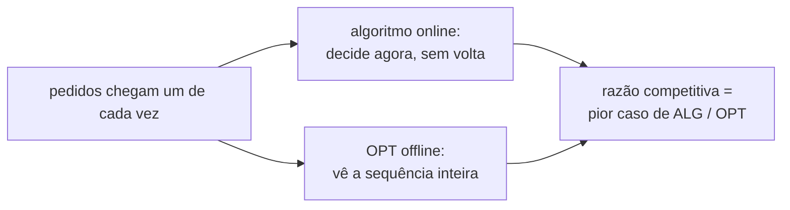

## Objetivos de Aprendizagem

- Definir um algoritmo online e a sua razão competitiva contra um ótimo offline que conhece a entrada inteira de antemão.
- Resolver o problema do aluguel de esquis com uma estratégia de empate e provar que ela é $(2 - 1/B)$-competitiva, o melhor possível para algoritmos determinísticos.
- Explicar a regra ótima offline de Belady para paginação, provar que o LRU é $k$-competitivo e mostrar que nenhum algoritmo determinístico de paginação faz melhor do que $k$.
- Explicar como a aleatorização contra um adversário oblívio melhora a paginação para $O(\log k)$.

## Contexto e Motivação

Muitas decisões precisam ser tomadas antes de o futuro ser conhecido. Um sistema operacional precisa escolher qual página tirar da memória quando outra é necessária, sem saber quais páginas serão acessadas em seguida; `computer/computer-architecture` estudou políticas de substituição de cache como o LRU como escolhas de engenharia. Um cliente de nuvem precisa decidir se continua pagando por máquinas sob demanda ou se compromete com uma reserva, sem saber quanto tempo a carga vai durar. Um despachante de táxi precisa atribuir cada pedido assim que ele chega.

Esses são problemas **online**: a entrada chega um pedaço de cada vez e cada decisão é irrevogável. O conceito anterior comparou um algoritmo com um ótimo caro demais para calcular; aqui o ótimo é impossível de calcular porque depende de informação que o algoritmo ainda não tem. A **análise competitiva**, introduzida por Sleator e Tarjan em 1985 justamente para os problemas de paginação e de atualização de listas, compara o algoritmo online em toda entrada com um algoritmo offline que vê a entrada inteira de antemão. Ela é parte padrão do 6.854 do MIT e do CS261 de Stanford.

## Teoria Central

### Razão competitiva

Um algoritmo online $\mathrm{ALG}$ para um problema de minimização é **$c$-competitivo** se existe uma constante $a$ tal que, para toda sequência de entrada $\sigma$,

$$\mathrm{ALG}(\sigma) \leq c \cdot \mathrm{OPT}(\sigma) + a$$

em que $\mathrm{OPT}(\sigma)$ é o custo da melhor solução offline para $\sigma$. É útil pensar num **adversário** que conhece o algoritmo e constrói a pior sequência para ele.

### Aluguel de esquis

Alugar esquis custa 1 por dia; comprar custa $B$. Você não sabe quantos dias $d$ vai esquiar. O ótimo offline é $\min(d, B)$. Considere a estratégia de **empate**: alugar nos primeiros $B - 1$ dias e comprar no dia $B$ se ainda estiver esquiando.

- Se $d < B$: você paga $d = \mathrm{OPT}$.
- Se $d \geq B$: você paga $(B - 1) + B = 2B - 1$, enquanto $\mathrm{OPT} = B$.

Então a estratégia é $(2 - 1/B)$-competitiva. Nenhuma estratégia determinística faz melhor: se uma estratégia compra no dia $j$, o adversário encerra a temporada logo depois do dia $j$, e comprar cedo ($j < B$) ou tarde ($j > B$) dá uma razão pior do que comprar em $B$. O mesmo raciocínio guia decisões reais, como quando um lock que gira em espera deve bloquear, ou quando trocar capacidade sob demanda por reservada.

### Paginação

Uma cache guarda $k$ páginas; um pedido de uma página fora da cache é uma **falta** que força uma remoção (se a cache estiver cheia). O custo é o número de faltas.

**Regra de Belady** (ótimo offline): numa falta, remova a página cujo próximo pedido está mais longe no futuro. Um argumento de troca mostra que ela é ótima, e ela é a régua para todo o resto.

**O LRU é $k$-competitivo.** Divida a sequência de pedidos em fases: cada fase é uma sequência maximal de pedidos a $k$ páginas distintas. O LRU falta no máximo $k$ vezes por fase, porque, uma vez que uma página é pedida dentro de uma fase, ela continua entre as $k$ usadas mais recentemente até o fim da fase. O OPT falta pelo menos uma vez por fronteira de fase: durante uma fase mais o primeiro pedido da seguinte, $k + 1$ páginas distintas são pedidas, e uma cache de tamanho $k$ não consegue guardar todas, então alguma falta é inevitável nessa janela. Comparar as contagens dá $\mathrm{LRU} \leq k \cdot \mathrm{OPT} + k$.

**Nenhum algoritmo determinístico vence $k$.** Use só $k + 1$ páginas distintas. A cada passo o adversário pede a única página que não está na cache do algoritmo, então o algoritmo falta em todo pedido. O Belady, removendo a página necessária mais longe no futuro, falta no máximo uma vez a cada $k$ pedidos, porque depois de uma falta a página removida não é necessária por pelo menos mais $k - 1$ pedidos. A razão tende a $k$.

### Aleatorização

O limite inferior depende de o adversário saber qual página o algoritmo vai remover. Contra um **adversário oblívio**, que fixa a sequência de pedidos de antemão sem ver as moedas do algoritmo, o **algoritmo de marcação** aleatorizado (numa falta, remova uma página não marcada escolhida uniformemente ao acaso; marque as páginas quando pedidas; desmarque todas no início de uma nova fase) é $2H_k$-competitivo, em que $H_k \approx \ln k$. Um limite inferior correspondente de $H_k$ vale para todo algoritmo aleatorizado. A aleatorização transforma um fator $k$ num fator $O(\log k)$.

## Exemplos Resolvidos

### Exemplo 1: aluguel de esquis em números

**Problema:** Comprar custa $B = 10$. Calcule o custo e a razão da estratégia de empate para temporadas de 3, 10 e 100 dias.

**Rastreamento:** 3 dias: a estratégia aluga 3 dias, paga 3; OPT = 3; razão 1. 10 dias: aluga do dia 1 ao 9 (custo 9), compra no dia 10 (custo 10), total 19; OPT = 10; razão 1,9. 100 dias: continua pagando 19 (já tem os esquis depois do dia 10); OPT = 10; razão 1,9. O pior caso é exatamente a temporada que termina logo depois da compra, e a razão $2 - 1/10 = 1{,}9$ nunca é ultrapassada.

### Exemplo 2: LRU contra Belady

**Problema:** Cache de tamanho $k = 2$, sequência de pedidos A, B, C, A, B, C. Conte as faltas do LRU e do Belady.

**Rastreamento:** LRU: A (falta), B (falta), C (falta, remove A, a menos usada recentemente), A (falta, remove B), B (falta, remove C), C (falta, remove A). Seis faltas: todo pedido erra, o padrão cíclico que derrota o LRU. Belady: A (falta), B (falta), C (falta; os pedidos futuros são A, B, C, então B é necessária depois de A; remove B), A (acerto), B (falta; o futuro é só C, A nunca mais é necessária; remove A), C (acerto). Quatro faltas. Num ciclo mais longo A, B, C repetido muitas vezes, o LRU continua faltando em todo pedido enquanto o Belady falta mais ou menos uma vez a cada 2 pedidos, uma razão que tende a $k = 2$, exatamente o limite inferior.

## Equívocos Comuns e Armadilhas

- **"Razão competitiva $k$ significa que o LRU é ruim."** É um limite de pior caso contra um adversário. Padrões de acesso reais têm localidade, e o LRU se sai perto do ótimo neles; a análise competitiva é pessimista por construção, e refinamentos (como o aumento de recursos, comparando o LRU com cache $k$ contra o OPT com uma cache menor) explicam o sucesso prático do LRU.
- **"O OPT offline é um alvo realista."** Ele conhece o futuro. O seu papel é definir uma referência justa; a pergunta é quanto se perde por causa da incerteza, não como igualar a clarividência.
- **"A aleatorização ajuda contra qualquer adversário."** Ela ajuda contra um adversário oblívio. Um adversário adaptativo, que vê cada escolha aleatória antes de gerar o próximo pedido, pode tornar a paginação aleatorizada não melhor do que a determinística.

## Resumo

Algoritmos online decidem de forma irrevogável conforme a entrada chega e são medidos pela razão competitiva contra um ótimo offline que conhece a sequência inteira. A estratégia de empate do aluguel de esquis, alugar até ter gastado o preço da compra, é $(2 - 1/B)$-competitiva e ótima entre as determinísticas. Na paginação, a regra de Belady (mais longe no futuro) é o ótimo offline, o LRU é $k$-competitivo por um argumento de fases e um adversário que circula por $k + 1$ páginas mostra que nenhum algoritmo determinístico faz melhor. A marcação aleatorizada alcança $O(\log k)$ contra um adversário oblívio. O próximo conceito enfrenta outro limite, não de conhecimento do futuro, mas de memória: processar um fluxo enorme numa só passada com espaço minúsculo.

## Documentation Links

- [Sleator, Tarjan: Amortized Efficiency of List Update and Paging Rules (CACM 1985), via MIT 6.854J](https://ocw.mit.edu/courses/6-854j-advanced-algorithms-fall-2008/): doc
- [Stanford CS261: A Second Course in Algorithms (Roughgarden, lecture notes)](https://timroughgarden.org/w16/w16.html): doc
