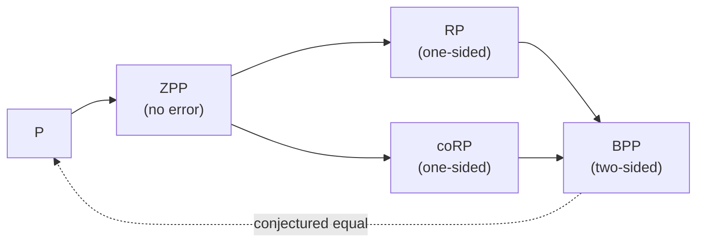

## Learning Objectives

- Define the randomized classes BPP, RP, coRP, and ZPP and the error each allows.
- Show with a Chernoff bound that BPP's error constant 1/3 is arbitrary: majority voting over $O(k)$ runs drives the error below $2^{-k}$.
- State the Schwartz-Zippel lemma and use it to put polynomial identity testing in coRP, and verify matrix products with Freivalds's algorithm.
- Explain the evidence for the conjecture P = BPP, including the hardness-versus-randomness connection to circuit lower bounds.

## Context & Motivation

Earlier concepts in this track used randomness as a design tool: Karger's contractions, hash families, sketches. Complexity theory asks whether randomness is fundamentally necessary for efficient computation. Are there problems a polynomial-time algorithm can solve with coin flips but not without them?

For decades the answer seemed to be yes. Testing whether a number is prime had fast randomized algorithms (Solovay-Strassen 1977, Miller-Rabin 1980) but no known deterministic polynomial one until Agrawal, Kayal, and Saxena's AKS algorithm in 2002. Testing whether a polynomial given as a formula or circuit is identically zero still has a trivial randomized algorithm and no known deterministic polynomial one. Yet the modern consensus, built on results by Nisan, Wigderson, and Impagliazzo in the 1990s, is that randomness can probably always be removed: P = BPP. This concept presents the classes, the tools, and the evidence, following Arora and Barak, Sipser's 18.404J, and Vadhan's monograph on pseudorandomness.

## Core Theory

### The classes

A probabilistic Turing machine flips fair coins and must run in polynomial time on every input and every coin sequence. For a language $A$:

- **BPP** (bounded-error probabilistic polynomial time): for every $x$, $\Pr[\text{correct}] \geq 2/3$. Two-sided error.
- **RP**: if $x \in A$, accept with probability at least $1/2$; if $x \notin A$, always reject. One-sided error: an acceptance is a proof.
- **coRP**: the complement of RP languages; errors only on "yes" instances.
- **ZPP** = RP $\cap$ coRP: always correct, polynomial **expected** time (Las Vegas).

Known relations: $\mathrm{P} \subseteq \mathrm{ZPP} \subseteq \mathrm{RP} \subseteq \mathrm{BPP}$, and $\mathrm{RP} \subseteq \mathrm{NP}$ (an accepting coin sequence is a certificate). Whether $\mathrm{BPP} \subseteq \mathrm{NP}$ is open, although $\mathrm{BPP} \subseteq \Sigma_2 \cap \Pi_2$ (Sipser-Gács-Lautemann) and $\mathrm{BPP} \subseteq \mathrm{P/poly}$ (Adleman) are known.

### Amplification

The constant $2/3$ is arbitrary. Run a BPP algorithm $t$ times independently and output the majority answer. Let $X$ be the number of correct runs, so $\mathbb{E}[X] \geq 2t/3$. The majority is wrong only if $X \leq t/2$, which is a deviation of at least a quarter below the mean ($\delta = 1/4$). The Chernoff lower-tail bound from the min-cut concept gives

$$\Pr\big[X \leq t/2\big] \leq e^{-\delta^2 \mu / 2} = e^{-(1/16)(2t/3)/2} = e^{-t/48}$$

so $t = O(k)$ runs reduce the error below $2^{-k}$. Any constant gap above 1/2, even $1/2 + 1/n^c$ for a polynomial, can be amplified the same way. For RP, $t$ runs and accepting if any run accepts gives error $2^{-t}$ directly.

### Polynomial identity testing

Given an arithmetic expression (or circuit) for a polynomial $p(x_1, \dots, x_n)$, decide whether $p \equiv 0$. Expanding it symbolically can take exponential time, since $(x_1 + y_1)(x_2 + y_2)\cdots(x_n + y_n)$ has $2^n$ monomials.

**Schwartz-Zippel lemma.** If $p$ is a nonzero polynomial of total degree $d$ over a field and $r_1, \dots, r_n$ are chosen independently and uniformly from a finite set $S$, then

$$\Pr\big[p(r_1, \dots, r_n) = 0\big] \leq \frac{d}{|S|}$$

So evaluate $p$ at a random point (cheap, by plugging numbers into the expression): if $p \equiv 0$ the result is always 0; if not, it is nonzero with probability at least $1 - d/|S|$. Taking $|S| \geq 2d$ puts identity testing in coRP. No deterministic polynomial-time algorithm is known, and Kabanets and Impagliazzo (2004) showed that finding one would imply new circuit lower bounds, a statement of how deep the question is.

The same idea gives **Freivalds's algorithm** for verifying a matrix product: to check $AB = C$ for $n \times n$ matrices, pick a random vector $r \in \{0, 1\}^n$ and compare $A(Br)$ with $Cr$. Each side costs $O(n^2)$, far less than multiplying the matrices. If $AB \neq C$, the check fails to notice with probability at most $1/2$; repeating $k$ times reduces that to $2^{-k}$.

### Hardness versus randomness

Why believe P = BPP? A BPP algorithm only uses its random bits to make some test statistically representative. A **pseudorandom generator** stretches a short truly random seed into a long string that no efficient test can distinguish from random. If a generator with seed length $O(\log n)$ existed, a BPP algorithm could be derandomized by trying all $2^{O(\log n)} = \mathrm{poly}(n)$ seeds and taking the majority.

Nisan and Wigderson showed that such generators can be built from hard functions. Impagliazzo and Wigderson (1997) proved: **if some problem solvable in time $2^{O(n)}$ requires Boolean circuits of size $2^{\Omega(n)}$, then P = BPP.** Since most functions do require exponential circuits, the hypothesis is widely believed. Hardness and randomness are two sides of one coin: either strong lower bounds exist and randomness is unnecessary, or some problems are easy in a surprising way.

## Worked Examples

### Example 1: how many repetitions

**Problem:** A BPP algorithm is correct with probability $2/3$. How many independent runs with a majority vote guarantee error at most $10^{-9}$ using the bound above?

**Trace:** Require $e^{-t/48} \leq 10^{-9}$, so $t \geq 48 \ln(10^9) \approx 48 \times 20.7 \approx 995$. About a thousand runs. The bound is loose; an exact binomial calculation gives a few hundred. Either way the cost is a constant factor that depends only on the desired error, not on the input size, which is why BPP is considered as practical as P.

### Example 2: catching a wrong matrix product

**Problem:** $A = \begin{pmatrix} 1 & 2 \\ 3 & 4 \end{pmatrix}$, $B = \begin{pmatrix} 1 & 0 \\ 0 & 1 \end{pmatrix}$, and a claimed product $C = \begin{pmatrix} 1 & 2 \\ 3 & 5 \end{pmatrix}$. Run Freivalds with $r = (0, 1)^\top$ and with $r = (1, 0)^\top$.

**Trace:** With $r = (0, 1)^\top$: $Br = (0, 1)^\top$, $A(Br) = (2, 4)^\top$, $Cr = (2, 5)^\top$. They differ, so the product is wrong, detected with $O(n^2)$ work. With $r = (1, 0)^\top$: $Br = (1, 0)^\top$, $A(Br) = (1, 3)^\top$, $Cr = (1, 3)^\top$. They agree, so this choice misses the error, because the wrong entry is in the second column and $r$ ignores that column. The difference matrix $D = AB - C$ has a nonzero entry, and the test misses it only if $r$ happens to lie in a set containing at most half of $\{0,1\}^n$, which is where the $1/2$ bound comes from.

## Common Misconceptions & Pitfalls

- **"BPP algorithms might be wrong, so they are not real solutions."** With error $2^{-100}$ after amplification, the chance of a wrong answer is far below the chance of a hardware error. The theoretical question is whether the coins are needed, not whether the answers are trustworthy.
- **"Primality was the main evidence for BPP being larger than P."** It was a famous example, but AKS removed it in 2002. Polynomial identity testing is the most prominent problem in BPP (indeed in coRP) still lacking a deterministic polynomial algorithm.
- **"Proving P = BPP would be easy if it is true."** Unconditional derandomization of identity testing implies circuit lower bounds that are far beyond current techniques; the conjecture is believed largely because the alternative contradicts other strongly believed hardness assumptions.

## Summary

BPP captures efficient computation with coin flips and bounded two-sided error; RP and coRP allow one-sided error and ZPP none. Majority voting with a Chernoff bound shrinks the error exponentially, so the 2/3 in the definition is arbitrary. The Schwartz-Zippel lemma puts polynomial identity testing in coRP by evaluating at a random point, and Freivalds verifies matrix products in quadratic time the same way. Pseudorandom generators built from hard functions would derandomize BPP, and Impagliazzo and Wigderson showed that exponential circuit lower bounds imply P = BPP. The next concept adds randomness to the verifier rather than the algorithm, and lets the prover and verifier talk.

## Documentation Links

- [Arora, Barak: Computational Complexity: A Modern Approach (Princeton draft)](https://theory.cs.princeton.edu/complexity/): doc
- [Vadhan: Pseudorandomness (Harvard, monograph)](https://people.seas.harvard.edu/~salil/pseudorandomness/): doc
- [MIT 18.404J: Theory of Computation (Sipser, OCW)](https://ocw.mit.edu/courses/18-404j-theory-of-computation-fall-2020/): doc
