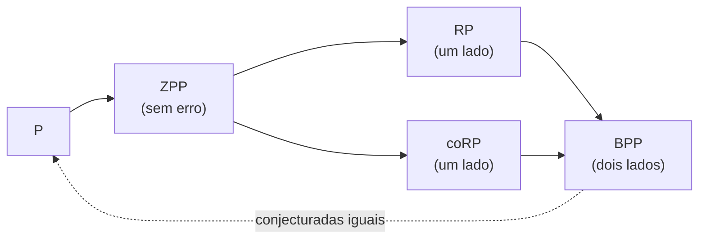

## Objetivos de Aprendizagem

- Definir as classes aleatorizadas BPP, RP, coRP e ZPP e o erro que cada uma permite.
- Mostrar com um limite de Chernoff que a constante de erro 1/3 do BPP é arbitrária: a votação por maioria sobre $O(k)$ execuções derruba o erro para menos de $2^{-k}$.
- Enunciar o lema de Schwartz-Zippel e usá-lo para colocar o teste de identidade de polinômios em coRP, e verificar produtos de matrizes com o algoritmo de Freivalds.
- Explicar as evidências a favor da conjectura P = BPP, incluindo a ligação entre dificuldade e aleatoriedade via limites inferiores de circuitos.

## Contexto e Motivação

Conceitos anteriores desta trilha usaram a aleatoriedade como ferramenta de projeto: as contrações de Karger, famílias de hash, sketches. A teoria da complexidade pergunta se a aleatoriedade é fundamentalmente necessária para a computação eficiente. Existem problemas que um algoritmo polinomial resolve jogando moedas, mas não sem elas?

Por décadas a resposta pareceu ser sim. Testar se um número é primo tinha algoritmos aleatorizados rápidos (Solovay-Strassen 1977, Miller-Rabin 1980), mas nenhum determinístico polinomial conhecido até o algoritmo AKS de Agrawal, Kayal e Saxena, em 2002. Testar se um polinômio dado como fórmula ou circuito é identicamente zero ainda tem um algoritmo aleatorizado trivial e nenhum determinístico polinomial conhecido. Mesmo assim, o consenso moderno, construído sobre resultados de Nisan, Wigderson e Impagliazzo nos anos 1990, é que a aleatoriedade provavelmente sempre pode ser removida: P = BPP. Este conceito apresenta as classes, as ferramentas e as evidências, seguindo Arora e Barak, o 18.404J de Sipser e a monografia de Vadhan sobre pseudoaleatoriedade.

## Teoria Central

### As classes

Uma máquina de Turing probabilística joga moedas honestas e precisa rodar em tempo polinomial em toda entrada e em toda sequência de moedas. Para uma linguagem $A$:

- **BPP** (tempo polinomial probabilístico com erro limitado): para todo $x$, $\Pr[\text{correto}] \geq 2/3$. Erro dos dois lados.
- **RP**: se $x \in A$, aceita com probabilidade de pelo menos $1/2$; se $x \notin A$, sempre rejeita. Erro de um lado só: uma aceitação é uma prova.
- **coRP**: os complementos das linguagens RP; erra só em instâncias "sim".
- **ZPP** = RP $\cap$ coRP: sempre correto, tempo **esperado** polinomial (Las Vegas).

Relações conhecidas: $\mathrm{P} \subseteq \mathrm{ZPP} \subseteq \mathrm{RP} \subseteq \mathrm{BPP}$, e $\mathrm{RP} \subseteq \mathrm{NP}$ (uma sequência de moedas que aceita é um certificado). Se $\mathrm{BPP} \subseteq \mathrm{NP}$ está em aberto, embora se saiba que $\mathrm{BPP} \subseteq \Sigma_2 \cap \Pi_2$ (Sipser-Gács-Lautemann) e $\mathrm{BPP} \subseteq \mathrm{P/poly}$ (Adleman).

### Amplificação

A constante $2/3$ é arbitrária. Rode um algoritmo BPP $t$ vezes de forma independente e devolva a resposta da maioria. Seja $X$ o número de execuções corretas, então $\mathbb{E}[X] \geq 2t/3$. A maioria só erra se $X \leq t/2$, um desvio de pelo menos um quarto abaixo da média ($\delta = 1/4$). O limite de Chernoff para a cauda inferior, do conceito de corte mínimo, dá

$$\Pr\big[X \leq t/2\big] \leq e^{-\delta^2 \mu / 2} = e^{-(1/16)(2t/3)/2} = e^{-t/48}$$

então $t = O(k)$ execuções reduzem o erro para menos de $2^{-k}$. Qualquer folga constante acima de 1/2, até $1/2 + 1/n^c$ para um polinômio, pode ser amplificada do mesmo jeito. Para RP, $t$ execuções aceitando se qualquer uma aceitar dão erro $2^{-t}$ diretamente.

### Teste de identidade de polinômios

Dada uma expressão aritmética (ou circuito) para um polinômio $p(x_1, \dots, x_n)$, decida se $p \equiv 0$. Expandi-la simbolicamente pode levar tempo exponencial, já que $(x_1 + y_1)(x_2 + y_2)\cdots(x_n + y_n)$ tem $2^n$ monômios.

**Lema de Schwartz-Zippel.** Se $p$ é um polinômio não nulo de grau total $d$ sobre um corpo e $r_1, \dots, r_n$ são escolhidos de forma independente e uniforme num conjunto finito $S$, então

$$\Pr\big[p(r_1, \dots, r_n) = 0\big] \leq \frac{d}{|S|}$$

Então avalie $p$ num ponto aleatório (barato, substituindo números na expressão): se $p \equiv 0$, o resultado é sempre 0; se não, é diferente de zero com probabilidade de pelo menos $1 - d/|S|$. Tomar $|S| \geq 2d$ coloca o teste de identidade em coRP. Não se conhece nenhum algoritmo determinístico polinomial, e Kabanets e Impagliazzo (2004) mostraram que encontrar um implicaria novos limites inferiores de circuitos, o que dá a medida de quão profunda é a pergunta.

A mesma ideia dá o **algoritmo de Freivalds** para verificar um produto de matrizes: para checar $AB = C$ com matrizes $n \times n$, escolha um vetor aleatório $r \in \{0, 1\}^n$ e compare $A(Br)$ com $Cr$. Cada lado custa $O(n^2)$, bem menos do que multiplicar as matrizes. Se $AB \neq C$, a checagem deixa de perceber com probabilidade no máximo $1/2$; repetir $k$ vezes reduz isso para $2^{-k}$.

### Dificuldade versus aleatoriedade

Por que acreditar que P = BPP? Um algoritmo BPP só usa os seus bits aleatórios para tornar algum teste estatisticamente representativo. Um **gerador pseudoaleatório** estica uma semente curta, verdadeiramente aleatória, numa cadeia longa que nenhum teste eficiente consegue distinguir de uma aleatória. Se existisse um gerador com semente de comprimento $O(\log n)$, um algoritmo BPP poderia ser desaleatorizado testando todas as $2^{O(\log n)} = \mathrm{poly}(n)$ sementes e tomando a maioria.

Nisan e Wigderson mostraram que esses geradores podem ser construídos a partir de funções difíceis. Impagliazzo e Wigderson (1997) provaram: **se algum problema resolvível em tempo $2^{O(n)}$ exige circuitos booleanos de tamanho $2^{\Omega(n)}$, então P = BPP.** Como a maioria das funções de fato exige circuitos exponenciais, a hipótese é amplamente aceita. Dificuldade e aleatoriedade são dois lados da mesma moeda: ou existem limites inferiores fortes e a aleatoriedade é desnecessária, ou alguns problemas são fáceis de um jeito surpreendente.

## Exemplos Resolvidos

### Exemplo 1: quantas repetições

**Problema:** Um algoritmo BPP acerta com probabilidade $2/3$. Quantas execuções independentes com votação por maioria garantem erro de no máximo $10^{-9}$ usando o limite acima?

**Rastreamento:** Exija $e^{-t/48} \leq 10^{-9}$, então $t \geq 48 \ln(10^9) \approx 48 \times 20{,}7 \approx 995$. Cerca de mil execuções. O limite é folgado; um cálculo binomial exato dá algumas centenas. De todo modo, o custo é um fator constante que depende só do erro desejado, não do tamanho da entrada, e é por isso que o BPP é considerado tão prático quanto o P.

### Exemplo 2: pegando um produto de matrizes errado

**Problema:** $A = \begin{pmatrix} 1 & 2 \\ 3 & 4 \end{pmatrix}$, $B = \begin{pmatrix} 1 & 0 \\ 0 & 1 \end{pmatrix}$ e um produto alegado $C = \begin{pmatrix} 1 & 2 \\ 3 & 5 \end{pmatrix}$. Rode Freivalds com $r = (0, 1)^\top$ e com $r = (1, 0)^\top$.

**Rastreamento:** Com $r = (0, 1)^\top$: $Br = (0, 1)^\top$, $A(Br) = (2, 4)^\top$, $Cr = (2, 5)^\top$. São diferentes, então o produto está errado, detectado com trabalho $O(n^2)$. Com $r = (1, 0)^\top$: $Br = (1, 0)^\top$, $A(Br) = (1, 3)^\top$, $Cr = (1, 3)^\top$. Coincidem, então essa escolha deixa o erro passar, porque a entrada errada está na segunda coluna e $r$ ignora essa coluna. A matriz diferença $D = AB - C$ tem uma entrada não nula, e o teste só a perde se $r$ cair num conjunto que contém no máximo metade de $\{0,1\}^n$, que é de onde vem o limite $1/2$.

## Equívocos Comuns e Armadilhas

- **"Algoritmos BPP podem errar, então não são soluções de verdade."** Com erro $2^{-100}$ depois da amplificação, a chance de uma resposta errada fica muito abaixo da chance de um erro de hardware. A pergunta teórica é se as moedas são necessárias, não se as respostas são confiáveis.
- **"A primalidade era a principal evidência de que BPP é maior do que P."** Era um exemplo famoso, mas o AKS o eliminou em 2002. O teste de identidade de polinômios é o problema mais proeminente em BPP (na verdade em coRP) ainda sem algoritmo determinístico polinomial.
- **"Provar P = BPP seria fácil se fosse verdade."** A desaleatorização incondicional do teste de identidade implica limites inferiores de circuitos muito além das técnicas atuais; a conjectura é aceita principalmente porque a alternativa contradiz outras hipóteses de dificuldade fortemente aceitas.

## Resumo

BPP captura a computação eficiente com moedas e erro de dois lados limitado; RP e coRP permitem erro de um lado e ZPP, nenhum. A votação por maioria com um limite de Chernoff encolhe o erro exponencialmente, então o 2/3 da definição é arbitrário. O lema de Schwartz-Zippel coloca o teste de identidade de polinômios em coRP avaliando num ponto aleatório, e o Freivalds verifica produtos de matrizes em tempo quadrático do mesmo jeito. Geradores pseudoaleatórios construídos a partir de funções difíceis desaleatorizariam o BPP, e Impagliazzo e Wigderson mostraram que limites inferiores exponenciais de circuitos implicam P = BPP. O próximo conceito põe a aleatoriedade no verificador em vez do algoritmo, e deixa provador e verificador conversarem.

## Documentation Links

- [Arora, Barak: Computational Complexity: A Modern Approach (Princeton draft)](https://theory.cs.princeton.edu/complexity/): doc
- [Vadhan: Pseudorandomness (Harvard, monograph)](https://people.seas.harvard.edu/~salil/pseudorandomness/): doc
- [MIT 18.404J: Theory of Computation (Sipser, OCW)](https://ocw.mit.edu/courses/18-404j-theory-of-computation-fall-2020/): doc
