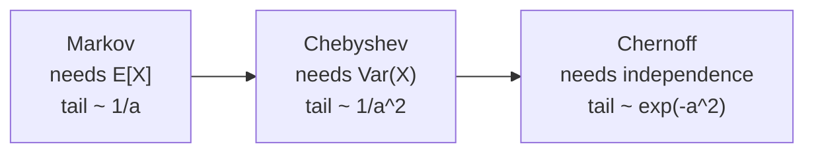

## Learning Objectives

- Distinguish Las Vegas algorithms (always correct, random running time) from Monte Carlo algorithms (bounded running time, small probability of error), and explain how independent repetition reduces error.
- Describe Karger's contraction algorithm for global minimum cut and prove that one run succeeds with probability at least $2/(n(n-1))$.
- Compute how many repetitions make the failure probability at most $1/n$, and derive the corollary that a graph has at most $\binom{n}{2}$ minimum cuts.
- State the Markov, Chebyshev, and Chernoff bounds and compare how tightly each bounds the same tail probability.

## Context & Motivation

`algorithms-software/algorithms` computed minimum $s$-$t$ cuts through maximum flow: fix a source and a sink, push flow, and read off the cut. The **global** minimum cut problem asks for the smallest set of edges whose removal disconnects the graph at all, with no designated $s$ and $t$. Solving it with flows means running max-flow for many pairs, which is expensive and intricate.

In 1993 David Karger, then a PhD student at Stanford, gave an algorithm that fits in a few lines and uses no flow at all: pick a random edge, merge its endpoints, repeat until two vertices remain, and output the edges between them. It is usually wrong. But it is right often enough, with a probability that can be proven, that repeating it a polynomial number of times makes it right with near certainty. The analysis is a model for how randomized algorithms are reasoned about in MIT's 6.856 (Randomized Algorithms) and 6.046, and it relies on the tail bounds that also underpin hashing, sketching, and the complexity class BPP later in this track.

## Core Theory

### Two kinds of randomized algorithms

A **Las Vegas** algorithm always returns a correct answer; only its running time is random (randomized quicksort is the classic example). A **Monte Carlo** algorithm runs in bounded time but may return a wrong answer with some probability. If a Monte Carlo algorithm fails with probability at most $q < 1$ and runs are independent, then $T$ runs all fail with probability at most $q^T$, which decays exponentially. When answers can be compared (for minimum cut, keep the smallest cut found), repetition turns a weak success probability into a strong one.

### Karger's contraction algorithm

Work on a multigraph (parallel edges allowed). **Contracting** edge $(u, v)$ merges $u$ and $v$ into one vertex, keeps all other edges (some become parallel), and deletes self-loops. The algorithm:

1. While more than two vertices remain, pick an edge uniformly at random and contract it.
2. Output the edges between the two remaining super-vertices.

Each super-vertex is a set of original vertices, so the output is a cut of the original graph. It is a minimum cut exactly when no edge of some fixed minimum cut $C$ was ever contracted.

### The success probability

Let $C$ be a minimum cut with $k$ edges. Every vertex has degree at least $k$ (otherwise its edges alone would be a smaller cut), so the graph has at least $nk/2$ edges. The probability that the first contraction picks an edge of $C$ is at most $k/(nk/2) = 2/n$. After $i$ contractions there are $n - i$ vertices, the same argument applies to the contracted graph (contraction never decreases the min-cut size), and so:

$$\Pr[\text{C survives}] \geq \prod_{i=0}^{n-3} \left(1 - \frac{2}{n-i}\right) = \prod_{j=3}^{n} \frac{j-2}{j} = \frac{2}{n(n-1)}$$

The product telescopes because each numerator cancels the denominator two factors later. This is small, about $2/n^2$, but only polynomially small.

### Amplification

Run the algorithm $T = \binom{n}{2} \ln n$ times and keep the smallest cut. Using $1 - x \leq e^{-x}$:

$$\Pr[\text{all runs miss } C] \leq \left(1 - \binom{n}{2}^{-1}\right)^{\binom{n}{2}\ln n} \leq e^{-\ln n} = \frac{1}{n}$$

Each run takes $O(n^2)$ time with a simple implementation, so the total is $O(n^4 \log n)$. Karger and Stein (1996) observed that early contractions are safe and late ones risky, and recursed: contract to about $n/\sqrt 2$ vertices twice independently and recurse on each, giving $O(n^2 \log^3 n)$.

A free corollary: every minimum cut survives with probability at least $2/(n(n-1))$, and these are disjoint events (the algorithm outputs one cut), so their probabilities sum to at most 1. Hence a graph has **at most $\binom{n}{2}$ distinct minimum cuts**, a purely combinatorial fact proved by probability.

### Concentration bounds

Analyzing randomized algorithms constantly requires bounding the probability that a random quantity is far from its mean. Three tools, from weakest assumptions to strongest conclusions:

- **Markov**: for $X \geq 0$, $\Pr[X \geq a] \leq \mathbb{E}[X]/a$. Needs only the mean.
- **Chebyshev**: $\Pr[|X - \mathbb{E}[X]| \geq a] \leq \mathrm{Var}(X)/a^2$. Needs the variance; decays quadratically.
- **Chernoff**: if $X$ is a sum of independent indicator variables with mean $\mu$, then for $0 < \delta \leq 1$, $\Pr[X \geq (1+\delta)\mu] \leq e^{-\delta^2 \mu / 3}$, and symmetrically $\Pr[X \leq (1-\delta)\mu] \leq e^{-\delta^2 \mu / 2}$. Needs independence; decays exponentially.

Chernoff is what justifies statements like "with high probability every bucket of a hash table has $O(\log n / \log\log n)$ items" or "majority vote over 50 independent runs is wrong with probability below $10^{-6}$".

## Worked Examples

### Example 1: how many runs on a small graph

**Problem:** A graph has $n = 10$ vertices. What is the guaranteed single-run success probability of Karger's algorithm, and how many runs guarantee failure probability at most 1%?

**Trace:** Single run: $2/(10 \cdot 9) = 1/45 \approx 0.022$. We need $(1 - 1/45)^T \leq 0.01$. Taking logarithms, $T \geq \ln(0.01)/\ln(44/45) \approx 4.605/0.02247 \approx 205$. So 205 independent runs suffice. Using the cruder $e^{-T/45} \leq 0.01$ gives $T \geq 45 \ln 100 \approx 208$, nearly the same. Each run is cheap, so even a guarantee of $10^{-9}$ (about 933 runs) is practical for small graphs.

### Example 2: three bounds on one tail

**Problem:** Flip a fair coin 100 times. Bound $\Pr[\text{at least 75 heads}]$ with Markov, Chebyshev, and Chernoff.

**Trace:** $X$ = number of heads, $\mu = 50$, $\mathrm{Var}(X) = 100 \cdot \tfrac14 = 25$. Markov: $\Pr[X \geq 75] \leq 50/75 \approx 0.67$. Chebyshev: deviation 25, so $\Pr[|X - 50| \geq 25] \leq 25/625 = 0.04$. Chernoff with $\delta = 0.5$: $e^{-0.25 \cdot 50/3} = e^{-4.17} \approx 0.016$. The true probability is about $3 \times 10^{-7}$. Each additional assumption buys a much better bound, and Chernoff's exponential decay is the one that scales: at 1,000 flips and 750 heads, Chernoff gives $e^{-41.7} \approx 10^{-18}$ while Chebyshev still only gives $250/62500 = 0.004$.

## Common Misconceptions & Pitfalls

- **"A randomized algorithm is unreliable."** Its failure probability is a parameter you choose. Failure below $2^{-100}$ is far less likely than a hardware fault during the computation, and it costs only a logarithmic number of extra repetitions.
- **"Contraction picks a random vertex pair."** It picks a uniformly random **edge**, which is what makes vertices joined by many parallel edges (likely on the same side of the minimum cut) merge first. Picking random vertex pairs breaks the analysis.
- **"Chernoff applies to any sum."** It requires independence (or a specific weaker form of it). Sums of dependent variables, such as indicators that items collide with each other, need other tools, often Chebyshev with a pairwise-independence argument.

## Summary

Monte Carlo algorithms trade certainty for simplicity, and independent repetition drives their error down exponentially. Karger's algorithm contracts random edges until two vertices remain; because every vertex has degree at least the min-cut size, each step avoids a fixed minimum cut with probability at least $1 - 2/(\text{vertices left})$, and the telescoping product gives success at least $2/(n(n-1))$. About $\binom{n}{2}\ln n$ runs make failure at most $1/n$, and the analysis also proves a graph has at most $\binom{n}{2}$ minimum cuts. Markov, Chebyshev, and Chernoff bound tail probabilities with progressively stronger assumptions and conclusions. The next concept uses randomness differently: hash functions chosen so that similar items collide on purpose.

## Documentation Links

- [MIT 6.856J: Randomized Algorithms (OCW)](https://ocw.mit.edu/courses/6-856j-randomized-algorithms-fall-2002/): doc
- [MIT 6.046J: Design and Analysis of Algorithms (OCW)](https://ocw.mit.edu/courses/6-046j-design-and-analysis-of-algorithms-spring-2015/): doc
