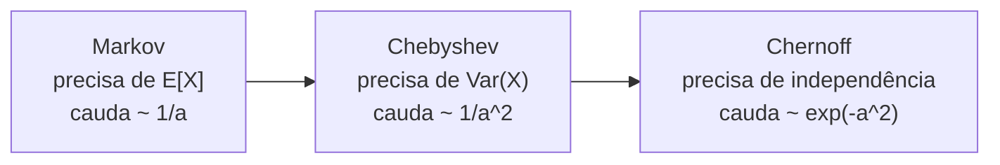

## Objetivos de Aprendizagem

- Distinguir algoritmos Las Vegas (sempre corretos, tempo de execução aleatório) de algoritmos Monte Carlo (tempo limitado, pequena probabilidade de erro), e explicar como a repetição independente reduz o erro.
- Descrever o algoritmo de contração de Karger para o corte mínimo global e provar que uma execução acerta com probabilidade de pelo menos $2/(n(n-1))$.
- Calcular quantas repetições tornam a probabilidade de falha no máximo $1/n$, e derivar o corolário de que um grafo tem no máximo $\binom{n}{2}$ cortes mínimos.
- Enunciar os limites de Markov, Chebyshev e Chernoff e comparar o quão apertado cada um limita a mesma probabilidade de cauda.

## Contexto e Motivação

`algorithms-software/algorithms` calculou cortes mínimos $s$-$t$ por meio do fluxo máximo: fixe uma fonte e um sumidouro, empurre fluxo e leia o corte. O problema do corte mínimo **global** pede o menor conjunto de arestas cuja remoção desconecta o grafo, sem $s$ e $t$ designados. Resolvê-lo com fluxos significa rodar fluxo máximo para muitos pares, o que é caro e complicado.

Em 1993, David Karger, então doutorando em Stanford, deu um algoritmo que cabe em poucas linhas e não usa fluxo nenhum: escolha uma aresta aleatória, funda as suas pontas, repita até sobrarem dois vértices e devolva as arestas entre eles. Ele costuma errar. Mas acerta com frequência suficiente, com uma probabilidade que pode ser provada, e repeti-lo um número polinomial de vezes o faz acertar com quase certeza. A análise é um modelo de como se raciocina sobre algoritmos aleatorizados no 6.856 (Randomized Algorithms) e no 6.046 do MIT, e depende dos limites de cauda que também sustentam hashing, sketches e a classe de complexidade BPP, mais adiante nesta trilha.

## Teoria Central

### Dois tipos de algoritmo aleatorizado

Um algoritmo **Las Vegas** sempre devolve uma resposta correta; só o seu tempo de execução é aleatório (o quicksort aleatorizado é o exemplo clássico). Um algoritmo **Monte Carlo** roda em tempo limitado, mas pode devolver uma resposta errada com alguma probabilidade. Se um algoritmo Monte Carlo falha com probabilidade no máximo $q < 1$ e as execuções são independentes, então $T$ execuções falham todas com probabilidade no máximo $q^T$, que decai exponencialmente. Quando dá para comparar respostas (no corte mínimo, fique com o menor corte encontrado), a repetição transforma uma probabilidade de sucesso fraca numa forte.

### O algoritmo de contração de Karger

Trabalhe num multigrafo (arestas paralelas permitidas). **Contrair** a aresta $(u, v)$ funde $u$ e $v$ num único vértice, mantém todas as outras arestas (algumas viram paralelas) e apaga laços. O algoritmo:

1. Enquanto restarem mais de dois vértices, escolha uma aresta uniformemente ao acaso e contraia-a.
2. Devolva as arestas entre os dois supervértices restantes.

Cada supervértice é um conjunto de vértices originais, então a saída é um corte do grafo original. Ela é um corte mínimo exatamente quando nenhuma aresta de algum corte mínimo fixo $C$ foi contraída.

### A probabilidade de sucesso

Seja $C$ um corte mínimo com $k$ arestas. Todo vértice tem grau pelo menos $k$ (senão as suas arestas sozinhas seriam um corte menor), então o grafo tem pelo menos $nk/2$ arestas. A probabilidade de a primeira contração escolher uma aresta de $C$ é no máximo $k/(nk/2) = 2/n$. Depois de $i$ contrações restam $n - i$ vértices, o mesmo argumento vale para o grafo contraído (a contração nunca diminui o tamanho do corte mínimo), e assim:

$$\Pr[\text{C sobrevive}] \geq \prod_{i=0}^{n-3} \left(1 - \frac{2}{n-i}\right) = \prod_{j=3}^{n} \frac{j-2}{j} = \frac{2}{n(n-1)}$$

O produto se cancela em telescópio porque cada numerador cancela o denominador dois fatores depois. É pequeno, cerca de $2/n^2$, mas só polinomialmente pequeno.

### Amplificação

Rode o algoritmo $T = \binom{n}{2} \ln n$ vezes e fique com o menor corte. Usando $1 - x \leq e^{-x}$:

$$\Pr[\text{todas as execuções perdem } C] \leq \left(1 - \binom{n}{2}^{-1}\right)^{\binom{n}{2}\ln n} \leq e^{-\ln n} = \frac{1}{n}$$

Cada execução leva tempo $O(n^2)$ numa implementação simples, então o total é $O(n^4 \log n)$. Karger e Stein (1996) observaram que as primeiras contrações são seguras e as últimas, arriscadas, e usaram recursão: contraia até cerca de $n/\sqrt 2$ vértices duas vezes de forma independente e recursione em cada uma, chegando a $O(n^2 \log^3 n)$.

Um corolário de graça: todo corte mínimo sobrevive com probabilidade de pelo menos $2/(n(n-1))$, e esses eventos são disjuntos (o algoritmo devolve um corte), então as suas probabilidades somam no máximo 1. Portanto um grafo tem **no máximo $\binom{n}{2}$ cortes mínimos distintos**, um fato puramente combinatório provado por probabilidade.

### Limites de concentração

Analisar algoritmos aleatorizados exige o tempo todo limitar a probabilidade de uma quantidade aleatória ficar longe da sua média. Três ferramentas, das suposições mais fracas às conclusões mais fortes:

- **Markov**: para $X \geq 0$, $\Pr[X \geq a] \leq \mathbb{E}[X]/a$. Precisa só da média.
- **Chebyshev**: $\Pr[|X - \mathbb{E}[X]| \geq a] \leq \mathrm{Var}(X)/a^2$. Precisa da variância; decai quadraticamente.
- **Chernoff**: se $X$ é uma soma de variáveis indicadoras independentes com média $\mu$, então para $0 < \delta \leq 1$, $\Pr[X \geq (1+\delta)\mu] \leq e^{-\delta^2 \mu / 3}$, e simetricamente $\Pr[X \leq (1-\delta)\mu] \leq e^{-\delta^2 \mu / 2}$. Precisa de independência; decai exponencialmente.

O Chernoff é o que justifica afirmações como "com alta probabilidade todo balde de uma tabela hash tem $O(\log n / \log\log n)$ itens" ou "a votação por maioria sobre 50 execuções independentes erra com probabilidade abaixo de $10^{-6}$".

## Exemplos Resolvidos

### Exemplo 1: quantas execuções num grafo pequeno

**Problema:** Um grafo tem $n = 10$ vértices. Qual é a probabilidade de sucesso garantida de uma execução do algoritmo de Karger, e quantas execuções garantem probabilidade de falha de no máximo 1%?

**Rastreamento:** Uma execução: $2/(10 \cdot 9) = 1/45 \approx 0{,}022$. Precisamos de $(1 - 1/45)^T \leq 0{,}01$. Tirando logaritmos, $T \geq \ln(0{,}01)/\ln(44/45) \approx 4{,}605/0{,}02247 \approx 205$. Então 205 execuções independentes bastam. Usando a forma mais grosseira $e^{-T/45} \leq 0{,}01$ dá $T \geq 45 \ln 100 \approx 208$, quase o mesmo. Cada execução é barata, então mesmo uma garantia de $10^{-9}$ (cerca de 933 execuções) é prática para grafos pequenos.

### Exemplo 2: três limites para uma cauda

**Problema:** Jogue uma moeda honesta 100 vezes. Limite $\Pr[\text{pelo menos 75 caras}]$ com Markov, Chebyshev e Chernoff.

**Rastreamento:** $X$ = número de caras, $\mu = 50$, $\mathrm{Var}(X) = 100 \cdot \tfrac14 = 25$. Markov: $\Pr[X \geq 75] \leq 50/75 \approx 0{,}67$. Chebyshev: desvio 25, então $\Pr[|X - 50| \geq 25] \leq 25/625 = 0{,}04$. Chernoff com $\delta = 0{,}5$: $e^{-0{,}25 \cdot 50/3} = e^{-4{,}17} \approx 0{,}016$. A probabilidade verdadeira é cerca de $3 \times 10^{-7}$. Cada suposição adicional compra um limite muito melhor, e o decaimento exponencial do Chernoff é o que escala: com 1.000 lançamentos e 750 caras, o Chernoff dá $e^{-41{,}7} \approx 10^{-18}$, enquanto o Chebyshev ainda dá só $250/62500 = 0{,}004$.

## Equívocos Comuns e Armadilhas

- **"Um algoritmo aleatorizado não é confiável."** A sua probabilidade de falha é um parâmetro que você escolhe. Uma falha abaixo de $2^{-100}$ é muito menos provável do que uma falha de hardware durante a computação, e custa só um número logarítmico de repetições extras.
- **"A contração escolhe um par de vértices aleatório."** Ela escolhe uma **aresta** uniformemente ao acaso, e é isso que faz vértices ligados por muitas arestas paralelas (provavelmente do mesmo lado do corte mínimo) se fundirem primeiro. Escolher pares de vértices aleatórios quebra a análise.
- **"O Chernoff vale para qualquer soma."** Ele exige independência (ou uma forma mais fraca específica dela). Somas de variáveis dependentes, como indicadores de itens que colidem entre si, precisam de outras ferramentas, muitas vezes Chebyshev com um argumento de independência par a par.

## Resumo

Algoritmos Monte Carlo trocam certeza por simplicidade, e a repetição independente derruba o seu erro exponencialmente. O algoritmo de Karger contrai arestas aleatórias até sobrarem dois vértices; como todo vértice tem grau pelo menos igual ao tamanho do corte mínimo, cada passo evita um corte mínimo fixo com probabilidade de pelo menos $1 - 2/(\text{vértices restantes})$, e o produto telescópico dá sucesso de pelo menos $2/(n(n-1))$. Cerca de $\binom{n}{2}\ln n$ execuções tornam a falha no máximo $1/n$, e a análise ainda prova que um grafo tem no máximo $\binom{n}{2}$ cortes mínimos. Markov, Chebyshev e Chernoff limitam probabilidades de cauda com suposições e conclusões progressivamente mais fortes. O próximo conceito usa a aleatoriedade de outro jeito: funções hash escolhidas para que itens parecidos colidam de propósito.

## Documentation Links

- [MIT 6.856J: Randomized Algorithms (OCW)](https://ocw.mit.edu/courses/6-856j-randomized-algorithms-fall-2002/): doc
- [MIT 6.046J: Design and Analysis of Algorithms (OCW)](https://ocw.mit.edu/courses/6-046j-design-and-analysis-of-algorithms-spring-2015/): doc
