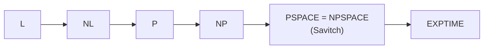

## Learning Objectives

- Define the space complexity classes $\mathrm{SPACE}(s(n))$ and $\mathrm{NSPACE}(s(n))$, PSPACE, and L, and explain why sublinear space requires a read-only input tape.
- Place the classes in the chain $\mathrm{L} \subseteq \mathrm{NL} \subseteq \mathrm{P} \subseteq \mathrm{NP} \subseteq \mathrm{PSPACE} \subseteq \mathrm{EXPTIME}$ and justify each inclusion.
- Prove Savitch's theorem, $\mathrm{NSPACE}(s) \subseteq \mathrm{SPACE}(s^2)$, with the recursive midpoint algorithm for reachability, and conclude PSPACE = NPSPACE.
- Explain why TQBF is PSPACE-complete and why that makes perfect play in generalized games PSPACE-hard.

## Context & Motivation

`algorithms-software/computability-complexity` measured problems by time and organized them into P, NP, and coNP. Time is not the only resource. Memory is often the binding constraint: a router, a smart card, or a streaming algorithm (the previous concept) has far less memory than it has time. Measuring space instead of time produces a landscape with surprising differences. Time once spent is gone, but space can be **reused**, and that single fact makes nondeterminism much cheaper for space than it is believed to be for time.

The central results here, Savitch's theorem (1970) and the PSPACE-completeness of quantified Boolean formulas (Stockmeyer and Meyer, 1973), are core material in MIT's 18.404J (Theory of Computation, taught by Sipser) and in Arora and Barak's textbook. They also explain why `ai-theory/artificial-intelligence`'s game-tree search is fundamentally hard: deciding who wins a game is the canonical PSPACE problem.

## Core Theory

### Space classes

A Turing machine's space usage on input $w$ is the number of work-tape cells it visits. For the classes below the input sits on a separate **read-only** tape that does not count, otherwise any machine would use at least $n$ cells just to hold its input and sublinear classes would be empty.

- $\mathrm{SPACE}(s(n))$: languages decided by a deterministic TM using $O(s(n))$ work space.
- $\mathrm{NSPACE}(s(n))$: the same for nondeterministic TMs.
- $\mathrm{PSPACE} = \bigcup_k \mathrm{SPACE}(n^k)$ and $\mathrm{NPSPACE} = \bigcup_k \mathrm{NSPACE}(n^k)$.
- $\mathrm{L} = \mathrm{SPACE}(\log n)$ and $\mathrm{NL} = \mathrm{NSPACE}(\log n)$: logarithmic space, enough for a constant number of pointers into the input.

### The inclusion chain

$$\mathrm{L} \subseteq \mathrm{NL} \subseteq \mathrm{P} \subseteq \mathrm{NP} \subseteq \mathrm{PSPACE} \subseteq \mathrm{EXPTIME}$$

- $\mathrm{NP} \subseteq \mathrm{PSPACE}$: try every certificate of polynomial length one at a time, **reusing** the same space for each check.
- $\mathrm{PSPACE} \subseteq \mathrm{EXPTIME}$: a machine using space $s$ has at most $2^{O(s)}$ distinct configurations (state, head positions, tape contents); if it ran longer than that, it would repeat a configuration and loop forever. So a decider halts within exponential time.
- $\mathrm{NL} \subseteq \mathrm{P}$: an NL machine has only polynomially many configurations; accepting means a path exists in its configuration graph from start to accept, which breadth-first search decides in polynomial time.

The space hierarchy theorem gives $\mathrm{L} \subsetneq \mathrm{PSPACE}$ and the time hierarchy theorem $\mathrm{P} \subsetneq \mathrm{EXPTIME}$, so at least one inclusion in each half of the chain is strict, but which ones is unknown.

### Savitch's theorem

**Theorem.** For $s(n) \geq \log n$, $\mathrm{NSPACE}(s(n)) \subseteq \mathrm{SPACE}(s(n)^2)$.

The proof reduces to **reachability** in the configuration graph: does the nondeterministic machine's start configuration reach an accepting one within $2^{O(s)}$ steps? Define a recursive procedure $\mathrm{CANYIELD}(c_1, c_2, t)$ that answers whether $c_1$ reaches $c_2$ in at most $t$ steps:

1. If $t = 1$: check directly whether $c_1 = c_2$ or $c_1$ moves to $c_2$ in one step.
2. Otherwise, for each configuration $c_m$ (a candidate **midpoint**): if $\mathrm{CANYIELD}(c_1, c_m, t/2)$ and $\mathrm{CANYIELD}(c_m, c_2, t/2)$, accept.
3. Reject if no midpoint works.

Each recursive frame stores a few configurations, $O(s)$ space. The recursion depth is $\log_2 t = O(s)$ because $t$ halves each time. The second recursive call **reuses the space** of the first. Total: $O(s) \cdot O(s) = O(s^2)$. The running time is exponential, which is irrelevant to the space bound.

Since the square of a polynomial is a polynomial, **PSPACE = NPSPACE**: unlike the open P versus NP question, nondeterminism adds nothing to polynomial space. (A different, later result, Immerman-Szelepcsényi, shows $\mathrm{NL} = \mathrm{coNL}$.)

### TQBF and games

A **fully quantified Boolean formula** has every variable bound by $\exists$ or $\forall$, for example $\forall x\, \exists y\, [(x \lor y) \land (\lnot x \lor \lnot y)]$. **TQBF** asks whether such a formula is true.

- **In PSPACE**: evaluate recursively, trying both values of the outermost variable and reusing space for the second branch; depth equals the number of variables, each frame constant size.
- **PSPACE-hard**: for any PSPACE machine, a formula of polynomial size expresses "configuration $c_1$ reaches $c_2$ in $t$ steps" using the same midpoint idea as Savitch, with a $\forall$ quantifier letting one subformula check both halves instead of writing it twice (which would blow up the size).

TQBF is a game: the $\exists$ player chooses values to make the formula true, the $\forall$ player to make it false, alternating. Many two-player games of perfect information with polynomially bounded length (generalized geography, generalized Hex on $n \times n$ boards) reduce from it and are PSPACE-complete. Games whose length can be exponential, such as generalized chess and Go with certain rules, are even EXPTIME-complete.

## Worked Examples

### Example 1: space versus time for a configuration graph

**Problem:** A nondeterministic machine uses $s = 40$ work cells over a binary tape alphabet, with 20 states, on inputs of length $n = 10^6$. Bound the number of configurations, the deterministic space Savitch's simulation needs (in configurations stored), and its running time.

**Trace:** A configuration records the state (20), the work tape contents ($2^{40}$), the work head position (40), and the input head position ($10^6$): about $20 \cdot 2^{40} \cdot 40 \cdot 10^6 \approx 8.8 \times 10^{20} \approx 2^{70}$ configurations. Reachability needs paths of length up to $t = 2^{70}$, so the recursion depth is about 70 frames, each storing three configurations of about 70 bits: roughly $70 \times 3 \times 70 \approx 15{,}000$ bits of work space. The running time, however, is about $(2^{70})^{70}$ midpoint attempts, astronomically large. Savitch trades enormous time for modest space, which is exactly the point of the theorem.

### Example 2: evaluating a quantified formula as a game

**Problem:** Decide whether $\forall x\, \exists y\, [(x \lor y) \land (\lnot x \lor \lnot y)]$ is true.

**Trace:** The matrix says exactly one of $x$, $y$ is true, that is, $y = \lnot x$. For $x = 0$: the $\exists$ player picks $y = 1$, and $(0 \lor 1) \land (1 \lor 0)$ is true. For $x = 1$: pick $y = 0$, and $(1 \lor 0) \land (0 \lor 1)$ is true. Both branches succeed, so the formula is true. The recursive evaluation stored only the current partial assignment, two bits, and explored the branches one at a time, the same space-reuse pattern as the PSPACE algorithm. Swapping the quantifiers, $\exists y\, \forall x$, makes it false: no single $y$ works for both values of $x$.

## Common Misconceptions & Pitfalls

- **"PSPACE problems are just slow NP problems."** PSPACE contains NP and coNP, and if PSPACE = NP then the polynomial hierarchy collapses; TQBF is believed to be strictly harder than SAT, because alternating quantifiers seem to need more than a single certificate.
- **"Savitch shows nondeterminism is free."** It shows it costs at most a square in **space**. For time, the analogous question is P versus NP, which remains open, and the best known deterministic simulation of nondeterministic time is exponential.
- **"Logarithmic space is too little to do anything."** L contains undirected graph connectivity (Reingold, 2005), arithmetic on input numbers, and many parsing tasks; a constant number of $O(\log n)$-bit counters and pointers is surprisingly powerful.

## Summary

Space complexity counts work-tape cells with a read-only input, giving L, NL, PSPACE, and NPSPACE, which fit into the chain from L to EXPTIME through P and NP. Because space can be reused, Savitch's recursive midpoint algorithm simulates nondeterministic space $s$ in deterministic space $s^2$, so PSPACE equals NPSPACE, in contrast with the open P versus NP question. TQBF, deciding fully quantified Boolean formulas, is PSPACE-complete, and its reading as a two-player game makes optimal play in many generalized games PSPACE-hard. The next concept asks a different question about resources: what changes when an efficient algorithm is allowed to flip coins?

## Documentation Links

- [MIT 18.404J: Theory of Computation (Sipser, OCW)](https://ocw.mit.edu/courses/18-404j-theory-of-computation-fall-2020/): doc
- [Arora, Barak: Computational Complexity: A Modern Approach (Princeton draft)](https://theory.cs.princeton.edu/complexity/): doc
