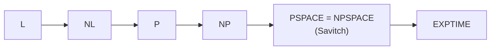

## Objetivos de Aprendizagem

- Definir as classes de complexidade de espaço $\mathrm{SPACE}(s(n))$ e $\mathrm{NSPACE}(s(n))$, PSPACE e L, e explicar por que espaço sublinear exige uma fita de entrada só de leitura.
- Situar as classes na cadeia $\mathrm{L} \subseteq \mathrm{NL} \subseteq \mathrm{P} \subseteq \mathrm{NP} \subseteq \mathrm{PSPACE} \subseteq \mathrm{EXPTIME}$ e justificar cada inclusão.
- Provar o teorema de Savitch, $\mathrm{NSPACE}(s) \subseteq \mathrm{SPACE}(s^2)$, com o algoritmo recursivo de ponto médio para alcançabilidade, e concluir que PSPACE = NPSPACE.
- Explicar por que o TQBF é PSPACE-completo e por que isso torna o jogo perfeito em jogos generalizados PSPACE-difícil.

## Contexto e Motivação

`algorithms-software/computability-complexity` mediu problemas pelo tempo e os organizou em P, NP e coNP. O tempo não é o único recurso. A memória muitas vezes é a restrição que aperta: um roteador, um smart card ou um algoritmo de streaming (o conceito anterior) têm muito menos memória do que tempo. Medir espaço em vez de tempo produz uma paisagem com diferenças surpreendentes. O tempo, uma vez gasto, se foi, mas o espaço pode ser **reutilizado**, e esse único fato torna o não determinismo muito mais barato para o espaço do que se acredita que seja para o tempo.

Os resultados centrais aqui, o teorema de Savitch (1970) e a PSPACE-completude das fórmulas booleanas quantificadas (Stockmeyer e Meyer, 1973), são matéria central do 18.404J do MIT (Theory of Computation, ministrado por Sipser) e do livro de Arora e Barak. Eles também explicam por que a busca em árvores de jogo de `ai-theory/artificial-intelligence` é fundamentalmente difícil: decidir quem vence um jogo é o problema PSPACE canônico.

## Teoria Central

### Classes de espaço

O uso de espaço de uma máquina de Turing na entrada $w$ é o número de células da fita de trabalho que ela visita. Para as classes abaixo, a entrada fica numa fita separada **só de leitura** que não conta, senão qualquer máquina usaria pelo menos $n$ células só para guardar a entrada e as classes sublineares seriam vazias.

- $\mathrm{SPACE}(s(n))$: linguagens decididas por uma MT determinística usando $O(s(n))$ de espaço de trabalho.
- $\mathrm{NSPACE}(s(n))$: o mesmo para MTs não determinísticas.
- $\mathrm{PSPACE} = \bigcup_k \mathrm{SPACE}(n^k)$ e $\mathrm{NPSPACE} = \bigcup_k \mathrm{NSPACE}(n^k)$.
- $\mathrm{L} = \mathrm{SPACE}(\log n)$ e $\mathrm{NL} = \mathrm{NSPACE}(\log n)$: espaço logarítmico, o suficiente para um número constante de ponteiros para a entrada.

### A cadeia de inclusões

$$\mathrm{L} \subseteq \mathrm{NL} \subseteq \mathrm{P} \subseteq \mathrm{NP} \subseteq \mathrm{PSPACE} \subseteq \mathrm{EXPTIME}$$

- $\mathrm{NP} \subseteq \mathrm{PSPACE}$: tente todo certificado de comprimento polinomial, um de cada vez, **reutilizando** o mesmo espaço em cada checagem.
- $\mathrm{PSPACE} \subseteq \mathrm{EXPTIME}$: uma máquina que usa espaço $s$ tem no máximo $2^{O(s)}$ configurações distintas (estado, posições das cabeças, conteúdo da fita); se rodasse por mais tempo que isso, repetiria uma configuração e entraria em laço para sempre. Então um decisor para em tempo exponencial.
- $\mathrm{NL} \subseteq \mathrm{P}$: uma máquina NL tem só um número polinomial de configurações; aceitar significa existir um caminho no seu grafo de configurações do início até a aceitação, o que a busca em largura decide em tempo polinomial.

O teorema da hierarquia de espaço dá $\mathrm{L} \subsetneq \mathrm{PSPACE}$ e o da hierarquia de tempo, $\mathrm{P} \subsetneq \mathrm{EXPTIME}$, então pelo menos uma inclusão em cada metade da cadeia é estrita, mas não se sabe quais.

### O teorema de Savitch

**Teorema.** Para $s(n) \geq \log n$, $\mathrm{NSPACE}(s(n)) \subseteq \mathrm{SPACE}(s(n)^2)$.

A prova se reduz à **alcançabilidade** no grafo de configurações: a configuração inicial da máquina não determinística alcança uma de aceitação em no máximo $2^{O(s)}$ passos? Defina um procedimento recursivo $\mathrm{CANYIELD}(c_1, c_2, t)$ que responde se $c_1$ alcança $c_2$ em no máximo $t$ passos:

1. Se $t = 1$: verifique diretamente se $c_1 = c_2$ ou se $c_1$ vai para $c_2$ num passo.
2. Senão, para cada configuração $c_m$ (um **ponto médio** candidato): se $\mathrm{CANYIELD}(c_1, c_m, t/2)$ e $\mathrm{CANYIELD}(c_m, c_2, t/2)$, aceite.
3. Rejeite se nenhum ponto médio funcionar.

Cada quadro recursivo guarda algumas configurações, espaço $O(s)$. A profundidade da recursão é $\log_2 t = O(s)$, porque $t$ cai pela metade a cada vez. A segunda chamada recursiva **reutiliza o espaço** da primeira. Total: $O(s) \cdot O(s) = O(s^2)$. O tempo de execução é exponencial, o que é irrelevante para o limite de espaço.

Como o quadrado de um polinômio é um polinômio, **PSPACE = NPSPACE**: ao contrário da questão em aberto P versus NP, o não determinismo não acrescenta nada ao espaço polinomial. (Um resultado diferente e posterior, o de Immerman-Szelepcsényi, mostra que $\mathrm{NL} = \mathrm{coNL}$.)

### TQBF e jogos

Uma **fórmula booleana totalmente quantificada** tem toda variável ligada por $\exists$ ou $\forall$, por exemplo $\forall x\, \exists y\, [(x \lor y) \land (\lnot x \lor \lnot y)]$. O **TQBF** pergunta se uma fórmula assim é verdadeira.

- **Está em PSPACE**: avalie recursivamente, testando os dois valores da variável mais externa e reutilizando o espaço para o segundo ramo; a profundidade é o número de variáveis, cada quadro de tamanho constante.
- **É PSPACE-difícil**: para qualquer máquina PSPACE, uma fórmula de tamanho polinomial expressa "a configuração $c_1$ alcança $c_2$ em $t$ passos" usando a mesma ideia de ponto médio de Savitch, com um quantificador $\forall$ permitindo que uma única subfórmula verifique as duas metades em vez de ser escrita duas vezes (o que explodiria o tamanho).

O TQBF é um jogo: o jogador $\exists$ escolhe valores para tornar a fórmula verdadeira, o jogador $\forall$ para torná-la falsa, alternando. Muitos jogos de dois jogadores com informação perfeita e duração limitada polinomialmente (geografia generalizada, Hex generalizado em tabuleiros $n \times n$) se reduzem a partir dele e são PSPACE-completos. Jogos cuja duração pode ser exponencial, como o xadrez generalizado e o Go com certas regras, são até EXPTIME-completos.

## Exemplos Resolvidos

### Exemplo 1: espaço versus tempo num grafo de configurações

**Problema:** Uma máquina não determinística usa $s = 40$ células de trabalho num alfabeto de fita binário, com 20 estados, em entradas de comprimento $n = 10^6$. Limite o número de configurações, o espaço determinístico de que a simulação de Savitch precisa (em configurações guardadas) e o seu tempo de execução.

**Rastreamento:** Uma configuração registra o estado (20), o conteúdo da fita de trabalho ($2^{40}$), a posição da cabeça de trabalho (40) e a posição da cabeça de entrada ($10^6$): cerca de $20 \cdot 2^{40} \cdot 40 \cdot 10^6 \approx 8{,}8 \times 10^{20} \approx 2^{70}$ configurações. A alcançabilidade precisa de caminhos de comprimento até $t = 2^{70}$, então a profundidade da recursão é de uns 70 quadros, cada um guardando três configurações de cerca de 70 bits: aproximadamente $70 \times 3 \times 70 \approx 15.000$ bits de espaço de trabalho. O tempo de execução, porém, é de cerca de $(2^{70})^{70}$ tentativas de ponto médio, astronomicamente grande. Savitch troca um tempo enorme por um espaço modesto, que é exatamente o ponto do teorema.

### Exemplo 2: avaliando uma fórmula quantificada como um jogo

**Problema:** Decida se $\forall x\, \exists y\, [(x \lor y) \land (\lnot x \lor \lnot y)]$ é verdadeira.

**Rastreamento:** A matriz diz que exatamente um de $x$, $y$ é verdadeiro, isto é, $y = \lnot x$. Para $x = 0$: o jogador $\exists$ escolhe $y = 1$, e $(0 \lor 1) \land (1 \lor 0)$ é verdadeiro. Para $x = 1$: escolha $y = 0$, e $(1 \lor 0) \land (0 \lor 1)$ é verdadeiro. Os dois ramos funcionam, então a fórmula é verdadeira. A avaliação recursiva guardou só a atribuição parcial atual, dois bits, e explorou os ramos um de cada vez, o mesmo padrão de reuso de espaço do algoritmo PSPACE. Trocar os quantificadores, $\exists y\, \forall x$, a torna falsa: nenhum $y$ único funciona para os dois valores de $x$.

## Equívocos Comuns e Armadilhas

- **"Problemas PSPACE são só problemas NP lentos."** PSPACE contém NP e coNP, e se PSPACE = NP a hierarquia polinomial colapsa; acredita-se que o TQBF seja estritamente mais difícil do que o SAT, porque quantificadores alternados parecem exigir mais do que um único certificado.
- **"Savitch mostra que o não determinismo é de graça."** Mostra que ele custa no máximo um quadrado em **espaço**. Para o tempo, a pergunta análoga é P versus NP, que continua em aberto, e a melhor simulação determinística conhecida de tempo não determinístico é exponencial.
- **"Espaço logarítmico é pouco demais para fazer qualquer coisa."** L contém a conectividade em grafos não direcionados (Reingold, 2005), aritmética sobre números da entrada e muitas tarefas de parsing; um número constante de contadores e ponteiros de $O(\log n)$ bits é surpreendentemente poderoso.

## Resumo

A complexidade de espaço conta células da fita de trabalho com uma entrada só de leitura, gerando L, NL, PSPACE e NPSPACE, que se encaixam na cadeia de L a EXPTIME passando por P e NP. Como o espaço pode ser reutilizado, o algoritmo recursivo de ponto médio de Savitch simula espaço não determinístico $s$ em espaço determinístico $s^2$, então PSPACE é igual a NPSPACE, em contraste com a questão em aberto P versus NP. O TQBF, decidir fórmulas booleanas totalmente quantificadas, é PSPACE-completo, e a sua leitura como um jogo de dois jogadores torna o jogo ótimo em muitos jogos generalizados PSPACE-difícil. O próximo conceito faz outra pergunta sobre recursos: o que muda quando um algoritmo eficiente pode jogar moedas?

## Documentation Links

- [MIT 18.404J: Theory of Computation (Sipser, OCW)](https://ocw.mit.edu/courses/18-404j-theory-of-computation-fall-2020/): doc
- [Arora, Barak: Computational Complexity: A Modern Approach (Princeton draft)](https://theory.cs.princeton.edu/complexity/): doc
