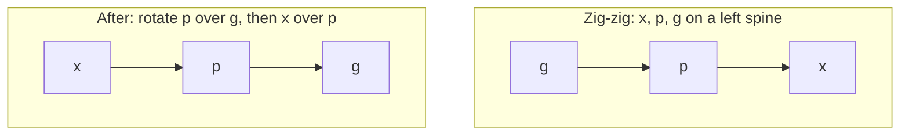

## Learning Objectives

- State the potential method precisely: amortized cost equals actual cost plus the change in a potential function, and explain why the total amortized cost bounds the total actual cost.
- Apply the potential method to a binary counter and recover its $O(1)$ amortized increment.
- Describe splaying with its three rotation cases (zig, zig-zig, zig-zag) and explain why zig-zig differs from simply rotating the node upward one level at a time.
- State the access lemma for splay trees and use it to conclude that any sequence of $m$ operations on $n$ keys costs $O((m + n) \log n)$.

## Context & Motivation

`algorithms-software/data-structures-ii` balanced binary search trees by storing extra information (heights in AVL trees, colors in red-black trees) and restoring an invariant after every update, so that every single operation costs $O(\log n)$. It also used amortized analysis once, for union-find, where some operations are expensive but the average over any sequence is tiny.

Sleator and Tarjan's splay tree (1985) takes amortization to its logical end. It stores no balance information at all. After every access it moves the accessed node to the root with a specific sequence of rotations called **splaying**. Individual operations can take linear time, yet any sequence of operations is as fast as a balanced tree's, and on access patterns with locality (recently or frequently used keys) it is much faster, because those keys stay near the root. Proving this requires a tool more flexible than counting: the **potential method**, which MIT's 6.854 (Advanced Algorithms) and 6.851 (Advanced Data Structures) use as their standard instrument.

## Core Theory

### The potential method

Assign each state $D_i$ of a data structure a real number $\Phi(D_i) \geq 0$, its **potential**, with $\Phi(D_0) = 0$ for the initial state (or at least a known value). Define the **amortized cost** of the $i$-th operation as

$$\hat c_i = c_i + \Phi(D_i) - \Phi(D_{i-1})$$

where $c_i$ is its actual cost. Summing over $m$ operations, the potential terms telescope:

$$\sum_{i=1}^{m} \hat c_i = \sum_{i=1}^{m} c_i + \Phi(D_m) - \Phi(D_0)$$

If $\Phi(D_m) \geq \Phi(D_0)$, the total amortized cost is an upper bound on the total actual cost. The art is choosing $\Phi$ so that expensive operations decrease the potential by about as much as they cost (spending stored energy), while cheap operations increase it only a little (depositing energy).

### A warm-up: the binary counter

Incrementing a $k$-bit counter flips trailing 1s to 0 and one 0 to 1; the worst case flips all $k$ bits. Let $\Phi$ be the number of 1 bits. An increment that flips $t$ ones to zero and one zero to one has actual cost $t + 1$ and changes the potential by $1 - t$. Amortized cost: $(t + 1) + (1 - t) = 2$. So $n$ increments from zero cost at most $2n$ bit flips, even though a single increment can cost $k$.

### Splaying

To access key $x$, search for it as in any BST, then splay $x$ to the root. Let $p$ be $x$'s parent and $g$ its grandparent:

- **Zig** ($p$ is the root): one rotation of $x$ over $p$.
- **Zig-zig** ($x$ and $p$ are both left children, or both right children): rotate $p$ over $g$ **first**, then $x$ over $p$.
- **Zig-zag** ($x$ is a left child and $p$ a right child, or vice versa): rotate $x$ over $p$, then $x$ over $g$, as in an AVL double rotation.

Insert splays the new node; delete splays the key, removes it, and joins the two subtrees by splaying the maximum of the left subtree.

The zig-zig order matters. Rotating $x$ upward one level at a time (the naive "move to root") can leave a long path long: on a path of $n$ nodes, repeatedly accessing the deepest node costs $\Theta(n)$ every time. Zig-zig instead roughly halves the depth of every node on the access path, which is what makes the amortized bound work.

### The access lemma

Let $s(v)$ be the number of nodes in $v$'s subtree, its **rank** $r(v) = \log_2 s(v)$, and the potential $\Phi = \sum_v r(v)$. The **access lemma** states that splaying $x$ in a tree with root $t$ has amortized cost at most

$$3\big(r(t) - r(x)\big) + 1 = O(\log n)$$

counting one unit per rotation. The proof bounds each zig-zig and zig-zag step's amortized cost by $3(r'(x) - r(x))$, where $r'$ is the rank after the step, and the sum telescopes along the path; only the final zig contributes the $+1$. The key inequality is that if $a + b \leq c$ then $\log a + \log b \leq 2\log c - 2$, which is exactly where zig-zig's restructuring pays for itself.

Since the initial potential is at most $n \log_2 n$ and potential never goes negative, any sequence of $m$ accesses, inserts, and deletes costs $O((m + n)\log n)$ in total. Stronger results follow from other weightings of $s(v)$: splay trees are within a constant factor of the best static BST for any access frequencies (**static optimality**), and recently accessed keys are cheap (**working-set property**). Whether they are within a constant of the best dynamic BST for every sequence, the **dynamic optimality conjecture**, has been open since 1985.

## Worked Examples

### Example 1: amortized cost of a costly increment

**Problem:** A 6-bit counter holds `010111`. Compute the actual and amortized cost of one increment under $\Phi$ = number of 1 bits.

**Trace:** The increment flips the three trailing 1s to 0 and the next 0 to 1, giving `011000`. Actual cost: 4 flips. Potential before: 4 ones; after: 2 ones; change: $-2$. Amortized cost: $4 + (-2) = 2$. The two units of potential released pay for the extra work. Earlier cheap increments, each costing 2 amortized but only 1 actual when no carry happened, are what deposited that energy.

### Example 2: why splaying fixes a bad path

**Problem:** Inserting keys 1, 2, ..., 7 in increasing order into an initially empty splay tree, with each insert splaying the new node, yields a left path: 7 at the root, 6 its left child, down to 1. Now access key 1. Describe the result and the amortized intuition.

**Trace:** Key 1 is at depth 6, so this access costs 7 node visits, the worst case for $n = 7$. Splaying from 1 upward: parent 2 and grandparent 3 form a left-left line, so zig-zig rotates 2 over 3, then 1 over 2. Repeating with grandparents 5 and then 7 brings 1 to the root after three zig-zig steps. The resulting tree has 1 at the root and the chain 7, 6, 5, 4, 3, 2 folded so that depths roughly halve: the deepest node is now at depth about 4 rather than 6. The insert sequence was cheap (each insert costs one comparison against the root plus one rotation), building up potential: a path has the maximum possible $\Phi$. The expensive access spends that potential. The access lemma guarantees this balance holds for every sequence, not just this one.

## Common Misconceptions & Pitfalls

- **"Amortized means average over random inputs."** Amortized bounds hold for every sequence of operations, in the worst case, with no probability involved. An average-case bound assumes a distribution of inputs; an amortized bound does not.
- **"Splay trees are always faster than red-black trees."** Each access restructures the tree, writing to memory even on reads, and a single operation can take linear time. Where individual latency matters (real-time systems) or where trees are shared between threads, worst-case balanced trees are often preferred.
- **"Moving the accessed node to the root by single rotations is the same as splaying."** It is not: the zig-zig order is essential. Single rotations alone admit sequences costing $\Theta(n)$ per access forever.

## Summary

The potential method defines amortized cost as actual cost plus the change in a nonnegative potential, so the sum of amortized costs bounds the sum of actual costs; it gives the binary counter an amortized cost of 2 per increment. Splay trees keep no balance information and move every accessed node to the root with zig, zig-zig, and zig-zag steps. With potential equal to the sum of logarithms of subtree sizes, the access lemma bounds each splay by $3(r(t) - r(x)) + 1$, giving $O(\log n)$ amortized per operation, plus static optimality and the working-set property; dynamic optimality remains open. The next concept trades determinism for randomness, analyzing an algorithm that is only correct with high probability.

## Documentation Links

- [Sleator, Tarjan: Self-Adjusting Binary Search Trees (JACM 1985)](https://www.cs.cmu.edu/~sleator/papers/self-adjusting.pdf): doc
- [MIT 6.854J: Advanced Algorithms (OCW)](https://ocw.mit.edu/courses/6-854j-advanced-algorithms-fall-2008/): doc
- [MIT 6.851: Advanced Data Structures (OCW)](https://ocw.mit.edu/courses/6-851-advanced-data-structures-spring-2012/): doc
