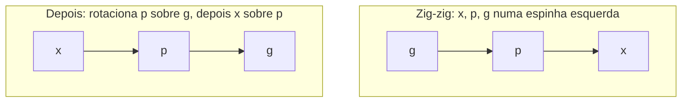

## Objetivos de Aprendizagem

- Enunciar o método do potencial com precisão: custo amortizado é o custo real mais a variação de uma função potencial, e explicar por que o custo amortizado total limita o custo real total.
- Aplicar o método do potencial a um contador binário e recuperar o seu incremento de custo amortizado $O(1)$.
- Descrever o splaying com os seus três casos de rotação (zig, zig-zig, zig-zag) e explicar por que o zig-zig difere de simplesmente rotacionar o nó para cima um nível de cada vez.
- Enunciar o lema de acesso das splay trees e usá-lo para concluir que qualquer sequência de $m$ operações sobre $n$ chaves custa $O((m + n) \log n)$.

## Contexto e Motivação

`algorithms-software/data-structures-ii` balanceou árvores binárias de busca guardando informação extra (alturas nas árvores AVL, cores nas rubro-negras) e restaurando um invariante depois de cada atualização, para que toda operação individual custe $O(\log n)$. A disciplina também usou análise amortizada uma vez, no union-find, em que algumas operações são caras, mas a média sobre qualquer sequência é minúscula.

A splay tree de Sleator e Tarjan (1985) leva a amortização até as últimas consequências. Ela não guarda informação de balanceamento nenhuma. Depois de todo acesso, move o nó acessado até a raiz com uma sequência específica de rotações chamada **splaying**. Operações individuais podem levar tempo linear, mas qualquer sequência de operações é tão rápida quanto numa árvore balanceada, e em padrões de acesso com localidade (chaves usadas recentemente ou com frequência) é bem mais rápida, porque essas chaves ficam perto da raiz. Provar isso exige uma ferramenta mais flexível do que contar: o **método do potencial**, que o 6.854 (Advanced Algorithms) e o 6.851 (Advanced Data Structures) do MIT usam como instrumento padrão.

## Teoria Central

### O método do potencial

Atribua a cada estado $D_i$ de uma estrutura de dados um número real $\Phi(D_i) \geq 0$, o seu **potencial**, com $\Phi(D_0) = 0$ no estado inicial (ou ao menos um valor conhecido). Defina o **custo amortizado** da $i$-ésima operação como

$$\hat c_i = c_i + \Phi(D_i) - \Phi(D_{i-1})$$

em que $c_i$ é o custo real. Somando sobre $m$ operações, os termos de potencial se cancelam em telescópio:

$$\sum_{i=1}^{m} \hat c_i = \sum_{i=1}^{m} c_i + \Phi(D_m) - \Phi(D_0)$$

Se $\Phi(D_m) \geq \Phi(D_0)$, o custo amortizado total é um limite superior do custo real total. A arte está em escolher $\Phi$ de modo que operações caras diminuam o potencial em mais ou menos o quanto custam (gastando energia armazenada), enquanto operações baratas o aumentam só um pouco (depositando energia).

### Um aquecimento: o contador binário

Incrementar um contador de $k$ bits troca os 1s finais por 0 e um 0 por 1; o pior caso troca todos os $k$ bits. Seja $\Phi$ o número de bits 1. Um incremento que troca $t$ uns por zero e um zero por um tem custo real $t + 1$ e muda o potencial em $1 - t$. Custo amortizado: $(t + 1) + (1 - t) = 2$. Assim, $n$ incrementos a partir de zero custam no máximo $2n$ trocas de bit, mesmo que um único incremento possa custar $k$.

### Splaying

Para acessar a chave $x$, busque-a como em qualquer BST e então faça o splay de $x$ até a raiz. Seja $p$ o pai de $x$ e $g$ o avô:

- **Zig** ($p$ é a raiz): uma rotação de $x$ sobre $p$.
- **Zig-zig** ($x$ e $p$ são ambos filhos esquerdos, ou ambos direitos): rotacione $p$ sobre $g$ **primeiro**, depois $x$ sobre $p$.
- **Zig-zag** ($x$ é filho esquerdo e $p$ filho direito, ou vice-versa): rotacione $x$ sobre $p$, depois $x$ sobre $g$, como numa rotação dupla de AVL.

A inserção faz splay do nó novo; a remoção faz splay da chave, remove-a e junta as duas subárvores fazendo splay do máximo da subárvore esquerda.

A ordem do zig-zig importa. Rotacionar $x$ para cima um nível por vez (o "mover para a raiz" ingênuo) pode deixar um caminho longo continuar longo: num caminho de $n$ nós, acessar repetidamente o nó mais fundo custa $\Theta(n)$ toda vez. O zig-zig, em vez disso, mais ou menos divide pela metade a profundidade de todo nó no caminho de acesso, e é isso que faz o limite amortizado funcionar.

### O lema de acesso

Seja $s(v)$ o número de nós na subárvore de $v$, o seu **posto** $r(v) = \log_2 s(v)$, e o potencial $\Phi = \sum_v r(v)$. O **lema de acesso** afirma que fazer o splay de $x$ numa árvore de raiz $t$ tem custo amortizado no máximo

$$3\big(r(t) - r(x)\big) + 1 = O(\log n)$$

contando uma unidade por rotação. A prova limita o custo amortizado de cada passo zig-zig e zig-zag por $3(r'(x) - r(x))$, em que $r'$ é o posto depois do passo, e a soma se cancela em telescópio ao longo do caminho; só o zig final contribui com o $+1$. A desigualdade central é que, se $a + b \leq c$, então $\log a + \log b \leq 2\log c - 2$, que é exatamente onde a reestruturação do zig-zig se paga.

Como o potencial inicial é no máximo $n \log_2 n$ e o potencial nunca fica negativo, qualquer sequência de $m$ acessos, inserções e remoções custa $O((m + n)\log n)$ no total. Resultados mais fortes saem de outras ponderações de $s(v)$: splay trees ficam a um fator constante da melhor BST estática para quaisquer frequências de acesso (**otimalidade estática**), e chaves acessadas recentemente são baratas (**propriedade do working set**). Se elas ficam a uma constante da melhor BST dinâmica para toda sequência, a **conjectura da otimalidade dinâmica**, é um problema aberto desde 1985.

## Exemplos Resolvidos

### Exemplo 1: custo amortizado de um incremento caro

**Problema:** Um contador de 6 bits guarda `010111`. Calcule o custo real e o amortizado de um incremento com $\Phi$ = número de bits 1.

**Rastreamento:** O incremento troca os três 1s finais por 0 e o próximo 0 por 1, dando `011000`. Custo real: 4 trocas. Potencial antes: 4 uns; depois: 2 uns; variação: $-2$. Custo amortizado: $4 + (-2) = 2$. As duas unidades de potencial liberadas pagam o trabalho extra. Os incrementos baratos anteriores, cada um custando 2 amortizado, mas só 1 real quando não houve vai-um, foram os que depositaram essa energia.

### Exemplo 2: por que o splaying conserta um caminho ruim

**Problema:** Inserir as chaves 1, 2, ..., 7 em ordem crescente numa splay tree inicialmente vazia, com cada inserção fazendo splay do nó novo, gera um caminho à esquerda: 7 na raiz, 6 como filho esquerdo, e assim até 1. Agora acesse a chave 1. Descreva o resultado e a intuição amortizada.

**Rastreamento:** A chave 1 está na profundidade 6, então este acesso custa 7 visitas a nós, o pior caso para $n = 7$. Fazendo splay a partir de 1: o pai 2 e o avô 3 formam uma linha esquerda-esquerda, então o zig-zig rotaciona 2 sobre 3, depois 1 sobre 2. Repetindo com os avôs 5 e depois 7, a chave 1 chega à raiz após três passos zig-zig. A árvore resultante tem 1 na raiz e a cadeia 7, 6, 5, 4, 3, 2 dobrada de modo que as profundidades mais ou menos caem pela metade: o nó mais fundo fica agora por volta da profundidade 4 em vez de 6. A sequência de inserções foi barata (cada inserção custa uma comparação com a raiz mais uma rotação), acumulando potencial: um caminho tem o maior $\Phi$ possível. O acesso caro gasta esse potencial. O lema de acesso garante que esse equilíbrio vale para toda sequência, não só para esta.

## Equívocos Comuns e Armadilhas

- **"Amortizado significa média sobre entradas aleatórias."** Limites amortizados valem para toda sequência de operações, no pior caso, sem probabilidade envolvida. Um limite de caso médio supõe uma distribuição das entradas; um limite amortizado não.
- **"Splay trees são sempre mais rápidas do que árvores rubro-negras."** Cada acesso reestrutura a árvore, escrevendo na memória mesmo em leituras, e uma única operação pode levar tempo linear. Quando a latência individual importa (sistemas de tempo real) ou quando as árvores são compartilhadas entre threads, árvores balanceadas no pior caso costumam ser preferidas.
- **"Mover o nó acessado até a raiz com rotações simples é o mesmo que splaying."** Não é: a ordem do zig-zig é essencial. Só com rotações simples existem sequências que custam $\Theta(n)$ por acesso para sempre.

## Resumo

O método do potencial define o custo amortizado como o custo real mais a variação de um potencial não negativo, de modo que a soma dos custos amortizados limita a soma dos custos reais; ele dá ao contador binário um custo amortizado de 2 por incremento. Splay trees não guardam informação de balanceamento e movem todo nó acessado até a raiz com passos zig, zig-zig e zig-zag. Com o potencial igual à soma dos logaritmos dos tamanhos das subárvores, o lema de acesso limita cada splay por $3(r(t) - r(x)) + 1$, dando $O(\log n)$ amortizado por operação, além da otimalidade estática e da propriedade do working set; a otimalidade dinâmica continua em aberto. O próximo conceito troca determinismo por aleatoriedade, analisando um algoritmo que só está correto com alta probabilidade.

## Documentation Links

- [Sleator, Tarjan: Self-Adjusting Binary Search Trees (JACM 1985)](https://www.cs.cmu.edu/~sleator/papers/self-adjusting.pdf): doc
- [MIT 6.854J: Advanced Algorithms (OCW)](https://ocw.mit.edu/courses/6-854j-advanced-algorithms-fall-2008/): doc
- [MIT 6.851: Advanced Data Structures (OCW)](https://ocw.mit.edu/courses/6-851-advanced-data-structures-spring-2012/): doc
