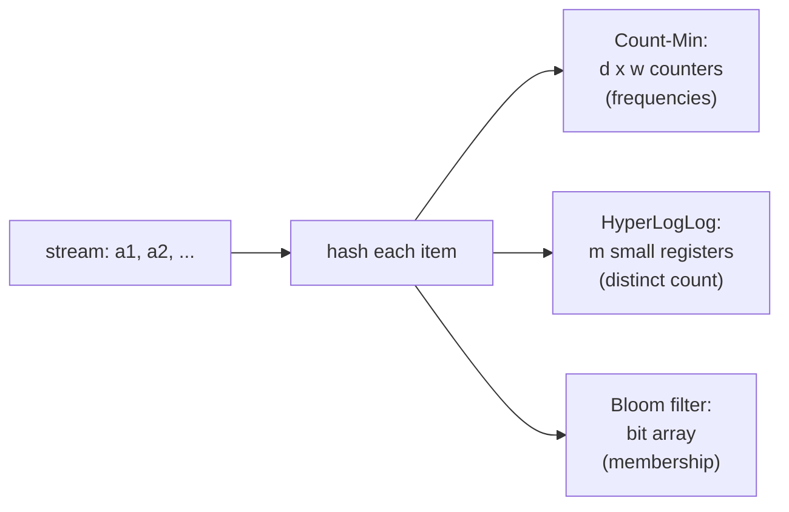

## Learning Objectives

- Describe the streaming model: one pass over a sequence too large to store, with memory polylogarithmic in its length, and explain why exact answers are often impossible in it.
- Explain the Count-Min sketch, prove that its estimates never undercount and overcount by at most $\varepsilon N$ with probability $1 - \delta$, and size it from $\varepsilon$ and $\delta$.
- Explain the idea behind HyperLogLog's distinct-count estimate (leading zeros of hashed values) and its standard error $1.04/\sqrt{m}$.
- Connect sketches to Bloom filters as members of the same family of small, mergeable, probabilistic summaries.

## Context & Motivation

A network router sees billions of packets per hour and must report which source addresses send the most traffic. An analytics service must count unique visitors per day across hundreds of servers. A database planner must estimate how many distinct values a column has without scanning it twice. In each case the data stream is far larger than memory, often cannot be stored at all, and arrives once.

`algorithms-software/data-structures-ii` met the Bloom filter, which answers set-membership questions in a few bits per element by accepting a controlled false-positive rate. **Streaming algorithms** generalize that bargain: in one pass and with memory polylogarithmic in the stream length, compute a small summary, a **sketch**, from which approximate answers can be read with provable error bounds. Most interesting exact statistics (the number of distinct elements, the exact most frequent item) provably require memory linear in the stream, so approximation and randomness are not optional. Stanford's CS168 and MIT's 6.854 treat Count-Min and distinct-element estimation as core tools; HyperLogLog, from Flajolet and colleagues (2007), runs inside Redis, BigQuery, and Presto.

## Core Theory

### The model

A stream is a sequence $a_1, a_2, \dots, a_N$ of items from a universe of size $n$. The algorithm reads each item once, in order, and keeps memory $O(\mathrm{polylog}(n, N))$. The **frequency** of item $x$ is $f_x$, the number of times it appears, and $N = \sum_x f_x$.

### Count-Min sketch: frequency estimation

Keep a table of $d$ rows and $w$ columns of counters, all zero, and $d$ independent hash functions $h_1, \dots, h_d$ from a pairwise-independent family, each mapping items to $\{1, \dots, w\}$.

- **Update** (item $x$ arrives): for each row $i$, increment $C[i][h_i(x)]$.
- **Query** (estimate $f_x$): return $\hat f_x = \min_i C[i][h_i(x)]$.

Every counter $x$ touches includes all of $x$'s own occurrences, so $\hat f_x \geq f_x$: the sketch **never undercounts**. Errors come from other items hashing to the same counter. In one row, the expected extra count is at most $N/w$, since each other item collides with probability $1/w$. By Markov's inequality, the extra count exceeds $eN/w$ with probability at most $1/e$. Rows are independent, so the minimum exceeds that only if every row does:

$$\Pr\big[\hat f_x > f_x + \tfrac{e}{w} N\big] \leq e^{-d}$$

Choosing $w = \lceil e/\varepsilon \rceil$ and $d = \lceil \ln(1/\delta) \rceil$ gives $\hat f_x \leq f_x + \varepsilon N$ with probability at least $1 - \delta$, using $O(\frac{1}{\varepsilon}\log\frac{1}{\delta})$ counters, independent of the universe size. Two sketches built with the same hash functions **merge** by adding their tables, so each server can sketch its own traffic and a coordinator combines them.

The error is relative to $N$, the whole stream, so Count-Min is accurate for **heavy hitters** (items with $f_x$ much larger than $\varepsilon N$) and useless for rare items, whose true counts are swamped by the additive error.

### Counting distinct elements

The number of distinct items $F_0$ cannot be computed exactly in sublinear space, but a remarkably small sketch estimates it. Hash every item to a uniformly random bit string. Among $F_0$ distinct items, about half the hashes start with `0`, a quarter with `00`, and in general a fraction $2^{-j}$ start with $j$ zeros. So if the longest run of leading zeros seen is $\rho$, then $F_0$ is plausibly around $2^{\rho}$. Repeated items hash identically, so duplicates do not affect the statistic: the sketch counts distinct items automatically.

A single maximum is a very noisy estimator. **HyperLogLog** splits the stream into $m$ buckets using the first bits of each hash, keeps the maximum leading-zero count $M_j$ in each bucket (a few bits each), and combines them with a harmonic mean:

$$\hat F_0 = \alpha_m \, m^2 \left( \sum_{j=1}^{m} 2^{-M_j} \right)^{-1}$$

where $\alpha_m \approx 0.7213/(1 + 1.079/m)$ corrects a systematic bias. Its standard error is about $1.04/\sqrt{m}$. With $m = 2^{14}$ registers of 6 bits each, about 12 KB, the error is about 0.8%, whether the stream has a thousand or a billion distinct items. HyperLogLog sketches also merge, by taking the register-wise maximum.

## Worked Examples

### Example 1: sizing a Count-Min sketch

**Problem:** A router processes $N = 10^9$ packets per hour and must estimate per-source counts within $\varepsilon N = 10^6$ (0.1% of traffic), with failure probability $\delta = 1\%$ per query. How large is the sketch?

**Trace:** $w = \lceil e/0.001 \rceil = 2{,}719$ columns and $d = \lceil \ln 100 \rceil = 5$ rows, so $13{,}595$ counters. With 4-byte counters, about 54 KB. An exact table of counts for every IPv4 source could need billions of entries. Any source sending more than about $2 \times 10^6$ packets will show an estimate clearly above the error band, so the heavy hitters are identified reliably, while a source with 100 packets may be reported as anything up to about $10^6$.

### Example 2: the leading-zeros intuition

**Problem:** A stream has some unknown number of distinct items. After hashing, the longest run of leading zeros observed among all hashes is 20. What does a single-register estimate suggest, and why is HyperLogLog needed?

**Resolution:** A hash starting with 20 zeros occurs with probability $2^{-20}$, so seeing one suggests roughly $2^{20} \approx 10^6$ distinct items. But a single lucky hash with a few extra zeros doubles the estimate per extra zero: seeing 21 zeros would suggest $2 \times 10^6$. The variance of one register is huge. Splitting into $m = 4{,}096$ buckets, each seeing about $F_0/4{,}096$ items, and averaging $2^{-M_j}$ harmonically (which damps the influence of unusually large registers) brings the standard error down to $1.04/\sqrt{4096} \approx 1.6\%$, using about 3 KB.

## Common Misconceptions & Pitfalls

- **"A sketch is just sampling."** Sampling misses rare items and needs to know $N$ in advance to choose a rate; sketches touch every item and give deterministic one-sided guarantees (Count-Min never undercounts) or tight relative errors (HyperLogLog), and they merge across machines exactly.
- **"Count-Min gives accurate counts for every item."** Its error is additive in $\varepsilon N$. For items with small true counts, the relative error can be enormous; use it for heavy hitters, or switch to variants such as Count-Sketch when error relative to the second moment is needed.
- **"HyperLogLog needs a cryptographic hash."** It needs a hash that behaves uniformly on the data; fast non-cryptographic hashes are standard. What matters is consistency: every sketch to be merged must use the same hash function.

## Summary

Streaming algorithms read data once, in order, with memory polylogarithmic in its size, and many exact statistics are impossible in that model, so they return approximate answers with provable error bounds. The Count-Min sketch hashes each item into one counter per row and estimates a frequency by the minimum over rows; it never undercounts, overcounts by at most $\varepsilon N$ with probability $1-\delta$ using $O(\frac1\varepsilon \log\frac1\delta)$ counters, and suits heavy hitters. HyperLogLog estimates the number of distinct items from the maximum leading-zero counts of hashed values across $m$ buckets, with standard error $1.04/\sqrt m$ in a few kilobytes. Both merge across machines. The next concept moves from algorithms to complexity, asking what can be decided when memory, not time, is the scarce resource.

## Documentation Links

- [Stanford CS168: The Modern Algorithmic Toolbox, Lecture 2: Approximate Heavy Hitters and the Count-Min Sketch](https://web.stanford.edu/class/cs168/l/l2.pdf): doc
- [Flajolet, Fusy, Gandouet, Meunier: HyperLogLog (AofA 2007)](https://algo.inria.fr/flajolet/Publications/FlFuGaMe07.pdf): doc
