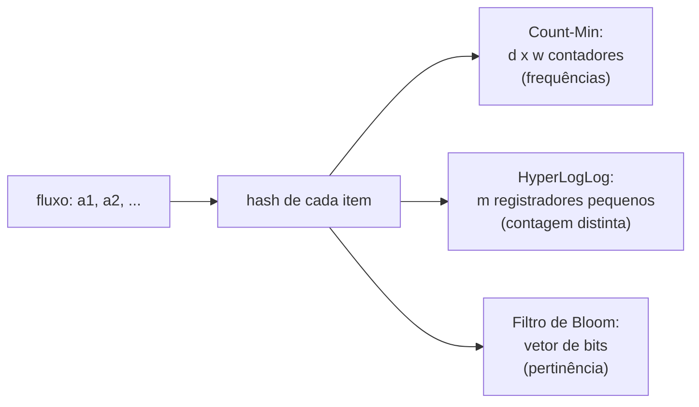

## Objetivos de Aprendizagem

- Descrever o modelo de streaming: uma passada sobre uma sequência grande demais para guardar, com memória polilogarítmica no seu comprimento, e explicar por que respostas exatas muitas vezes são impossíveis nele.
- Explicar o sketch Count-Min, provar que as suas estimativas nunca contam a menos e contam a mais no máximo $\varepsilon N$ com probabilidade $1 - \delta$, e dimensioná-lo a partir de $\varepsilon$ e $\delta$.
- Explicar a ideia por trás da estimativa de contagem distinta do HyperLogLog (zeros iniciais de valores com hash) e o seu erro padrão $1{,}04/\sqrt{m}$.
- Relacionar sketches com filtros de Bloom como membros da mesma família de resumos pequenos, combináveis e probabilísticos.

## Contexto e Motivação

Um roteador vê bilhões de pacotes por hora e precisa reportar quais endereços de origem mandam mais tráfego. Um serviço de analytics precisa contar visitantes únicos por dia em centenas de servidores. Um planejador de banco de dados precisa estimar quantos valores distintos uma coluna tem sem varrê-la duas vezes. Em cada caso o fluxo de dados é muito maior do que a memória, muitas vezes não pode ser guardado e chega uma única vez.

`algorithms-software/data-structures-ii` apresentou o filtro de Bloom, que responde perguntas de pertinência a conjunto com poucos bits por elemento aceitando uma taxa controlada de falsos positivos. **Algoritmos de streaming** generalizam esse acordo: numa passada e com memória polilogarítmica no comprimento do fluxo, calcule um resumo pequeno, um **sketch**, do qual respostas aproximadas podem ser lidas com limites de erro comprovados. A maioria das estatísticas exatas interessantes (o número de elementos distintos, o item exato mais frequente) comprovadamente exige memória linear no fluxo, então aproximação e aleatoriedade não são opcionais. O CS168 de Stanford e o 6.854 do MIT tratam o Count-Min e a estimativa de elementos distintos como ferramentas centrais; o HyperLogLog, de Flajolet e colegas (2007), roda dentro do Redis, do BigQuery e do Presto.

## Teoria Central

### O modelo

Um fluxo é uma sequência $a_1, a_2, \dots, a_N$ de itens de um universo de tamanho $n$. O algoritmo lê cada item uma vez, em ordem, e mantém memória $O(\mathrm{polylog}(n, N))$. A **frequência** do item $x$ é $f_x$, o número de vezes que ele aparece, e $N = \sum_x f_x$.

### Sketch Count-Min: estimando frequências

Mantenha uma tabela de $d$ linhas e $w$ colunas de contadores, todos zerados, e $d$ funções hash independentes $h_1, \dots, h_d$ de uma família independente par a par, cada uma mapeando itens em $\{1, \dots, w\}$.

- **Atualização** (chega o item $x$): para cada linha $i$, incremente $C[i][h_i(x)]$.
- **Consulta** (estimar $f_x$): devolva $\hat f_x = \min_i C[i][h_i(x)]$.

Todo contador que $x$ toca inclui todas as ocorrências do próprio $x$, então $\hat f_x \geq f_x$: o sketch **nunca conta a menos**. Os erros vêm de outros itens que caem no mesmo contador. Numa linha, a contagem extra esperada é no máximo $N/w$, já que cada outro item colide com probabilidade $1/w$. Pela desigualdade de Markov, a contagem extra passa de $eN/w$ com probabilidade no máximo $1/e$. As linhas são independentes, então o mínimo só passa disso se todas as linhas passarem:

$$\Pr\big[\hat f_x > f_x + \tfrac{e}{w} N\big] \leq e^{-d}$$

Escolher $w = \lceil e/\varepsilon \rceil$ e $d = \lceil \ln(1/\delta) \rceil$ dá $\hat f_x \leq f_x + \varepsilon N$ com probabilidade de pelo menos $1 - \delta$, usando $O(\frac{1}{\varepsilon}\log\frac{1}{\delta})$ contadores, independente do tamanho do universo. Dois sketches construídos com as mesmas funções hash se **combinam** somando as tabelas, então cada servidor pode fazer o sketch do próprio tráfego e um coordenador os combina.

O erro é relativo a $N$, o fluxo inteiro, então o Count-Min é preciso para **heavy hitters** (itens com $f_x$ muito maior do que $\varepsilon N$) e inútil para itens raros, cujas contagens verdadeiras são afogadas pelo erro aditivo.

### Contando elementos distintos

O número de itens distintos $F_0$ não pode ser calculado exatamente em espaço sublinear, mas um sketch notavelmente pequeno o estima. Aplique um hash a todo item para obter uma cadeia de bits uniformemente aleatória. Entre $F_0$ itens distintos, cerca de metade dos hashes começa com `0`, um quarto com `00`, e em geral uma fração $2^{-j}$ começa com $j$ zeros. Então, se a maior sequência de zeros iniciais vista é $\rho$, $F_0$ provavelmente está por volta de $2^{\rho}$. Itens repetidos têm o mesmo hash, então duplicatas não afetam a estatística: o sketch conta itens distintos automaticamente.

Um único máximo é um estimador muito ruidoso. O **HyperLogLog** divide o fluxo em $m$ baldes usando os primeiros bits de cada hash, guarda a maior contagem de zeros iniciais $M_j$ de cada balde (poucos bits cada) e as combina com uma média harmônica:

$$\hat F_0 = \alpha_m \, m^2 \left( \sum_{j=1}^{m} 2^{-M_j} \right)^{-1}$$

em que $\alpha_m \approx 0{,}7213/(1 + 1{,}079/m)$ corrige um viés sistemático. O seu erro padrão é de cerca de $1{,}04/\sqrt{m}$. Com $m = 2^{14}$ registradores de 6 bits cada, cerca de 12 KB, o erro fica em torno de 0,8%, tenha o fluxo mil ou um bilhão de itens distintos. Sketches HyperLogLog também se combinam, tomando o máximo registrador a registrador.

## Exemplos Resolvidos

### Exemplo 1: dimensionando um sketch Count-Min

**Problema:** Um roteador processa $N = 10^9$ pacotes por hora e precisa estimar contagens por origem dentro de $\varepsilon N = 10^6$ (0,1% do tráfego), com probabilidade de falha $\delta = 1\%$ por consulta. Qual o tamanho do sketch?

**Rastreamento:** $w = \lceil e/0{,}001 \rceil = 2.719$ colunas e $d = \lceil \ln 100 \rceil = 5$ linhas, então $13.595$ contadores. Com contadores de 4 bytes, cerca de 54 KB. Uma tabela exata de contagens para toda origem IPv4 poderia precisar de bilhões de entradas. Qualquer origem que mande mais de uns $2 \times 10^6$ pacotes vai mostrar uma estimativa claramente acima da faixa de erro, então os heavy hitters são identificados com confiança, enquanto uma origem com 100 pacotes pode ser reportada como qualquer coisa até cerca de $10^6$.

### Exemplo 2: a intuição dos zeros iniciais

**Problema:** Um fluxo tem um número desconhecido de itens distintos. Depois do hash, a maior sequência de zeros iniciais observada entre todos os hashes é 20. O que uma estimativa com um único registrador sugere, e por que o HyperLogLog é necessário?

**Resolução:** Um hash que começa com 20 zeros ocorre com probabilidade $2^{-20}$, então vê-lo sugere cerca de $2^{20} \approx 10^6$ itens distintos. Mas um único hash sortudo com alguns zeros a mais dobra a estimativa por zero extra: ver 21 zeros sugeriria $2 \times 10^6$. A variância de um registrador é enorme. Dividir em $m = 4.096$ baldes, cada um vendo cerca de $F_0/4.096$ itens, e fazer a média harmônica de $2^{-M_j}$ (que amortece a influência de registradores excepcionalmente grandes) derruba o erro padrão para $1{,}04/\sqrt{4096} \approx 1{,}6\%$, usando cerca de 3 KB.

## Equívocos Comuns e Armadilhas

- **"Um sketch é só amostragem."** A amostragem perde itens raros e precisa conhecer $N$ de antemão para escolher uma taxa; sketches tocam todo item e dão garantias determinísticas de um lado só (o Count-Min nunca conta a menos) ou erros relativos apertados (HyperLogLog), e se combinam entre máquinas de forma exata.
- **"O Count-Min dá contagens precisas para todo item."** O seu erro é aditivo em $\varepsilon N$. Para itens com contagens verdadeiras pequenas, o erro relativo pode ser enorme; use-o para heavy hitters, ou troque por variantes como o Count-Sketch quando for preciso erro relativo ao segundo momento.
- **"O HyperLogLog precisa de um hash criptográfico."** Ele precisa de um hash que se comporte de forma uniforme nos dados; hashes rápidos não criptográficos são o padrão. O que importa é a consistência: todo sketch a ser combinado precisa usar a mesma função hash.

## Resumo

Algoritmos de streaming leem os dados uma vez, em ordem, com memória polilogarítmica no tamanho, e muitas estatísticas exatas são impossíveis nesse modelo, então eles devolvem respostas aproximadas com limites de erro comprovados. O sketch Count-Min aplica hash a cada item num contador por linha e estima uma frequência pelo mínimo entre as linhas; ele nunca conta a menos, conta a mais no máximo $\varepsilon N$ com probabilidade $1-\delta$ usando $O(\frac1\varepsilon \log\frac1\delta)$ contadores e serve para heavy hitters. O HyperLogLog estima o número de itens distintos a partir das maiores contagens de zeros iniciais de valores com hash em $m$ baldes, com erro padrão $1{,}04/\sqrt m$ em poucos kilobytes. Os dois se combinam entre máquinas. O próximo conceito sai dos algoritmos e vai para a complexidade, perguntando o que pode ser decidido quando a memória, e não o tempo, é o recurso escasso.

## Documentation Links

- [Stanford CS168: The Modern Algorithmic Toolbox, Lecture 2: Approximate Heavy Hitters and the Count-Min Sketch](https://web.stanford.edu/class/cs168/l/l2.pdf): doc
- [Flajolet, Fusy, Gandouet, Meunier: HyperLogLog (AofA 2007)](https://algo.inria.fr/flajolet/Publications/FlFuGaMe07.pdf): doc
