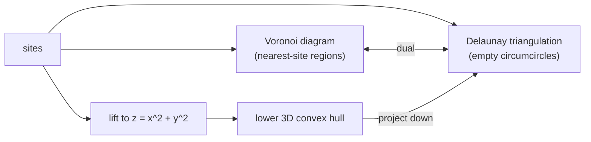

## Learning Objectives

- Define the Voronoi diagram of a set of sites and describe its cells, edges, and vertices in terms of bisectors and circumcenters.
- Define the Delaunay triangulation as the dual of the Voronoi diagram and state its empty-circumcircle property.
- Compute the incircle predicate as a $3 \times 3$ determinant and use it to decide edge flips, and explain the lifting-map connection to convex hulls.
- Explain why Delaunay triangulations maximize the minimum angle, and why both structures have linear size and $O(n \log n)$ construction.

## Context & Motivation

Which hospital is closest to each house in a city? Which cell tower should a phone connect to? Where do the territories of competing coffee shops meet? These are all questions about the **Voronoi diagram**, which divides the plane into regions closest to each of a set of sites. Its dual, the **Delaunay triangulation**, connects sites that share a Voronoi boundary, and it is the default way to turn scattered points into a mesh: terrain models from elevation samples, finite-element meshes for simulation, and interpolation of sensor readings all rely on it, because it avoids long thin triangles that cause numerical trouble.

The previous concept introduced the orientation predicate and the sweep line; this one adds a second predicate, the incircle test, and shows a beautiful connection: the Delaunay triangulation of points in the plane is a convex hull in three dimensions, via the same parabola trick used to prove the sorting lower bound. Both structures are central chapters of de Berg et al.'s textbook and of CMU's 15-456.

## Core Theory

### The Voronoi diagram

Given $n$ **sites** $p_1, \dots, p_n$ in the plane, the **Voronoi cell** of $p_i$ is the set of points at least as close to $p_i$ as to any other site:

$$V(p_i) = \{\, x : \lVert x - p_i \rVert \leq \lVert x - p_j \rVert \ \text{for all } j \,\}$$

Each condition $\lVert x - p_i \rVert \leq \lVert x - p_j \rVert$ is a half-plane bounded by the perpendicular bisector of $p_i p_j$, so every cell is a convex polygon, possibly unbounded. Cell boundaries are **Voronoi edges** (points equidistant from two sites) and **Voronoi vertices** (points equidistant from three or more sites, the circumcenters of those sites). A vertex's circle through its sites contains no other site in its interior, since otherwise that site would be closer.

The diagram has linear size: by Euler's formula, for $n \geq 3$ sites it has at most $2n - 5$ vertices and $3n - 6$ edges. Fortune's sweep-line algorithm (1987) builds it in $O(n \log n)$, which is optimal by the same reduction from sorting.

### The Delaunay triangulation

Connect two sites by an edge whenever their Voronoi cells share an edge. For points in general position (no four on a common circle), the result is a triangulation, the **Delaunay triangulation** $DT$, with one triangle per Voronoi vertex. Its defining property:

**Empty circumcircle.** A triangle with vertices among the sites belongs to $DT$ if and only if its circumcircle contains no other site in its interior.

Useful consequences: $DT$ contains the nearest-neighbor graph and the Euclidean minimum spanning tree as subgraphs, so either can be computed in $O(n \log n)$ by building $DT$ first and then working on its linear number of edges.

### The incircle predicate and edge flips

For sites $a, b, c$ in counterclockwise order and a query point $d$, the incircle test is the sign of

$$\mathrm{incircle}(a, b, c, d) = \det \begin{pmatrix} a_x - d_x & a_y - d_y & (a_x - d_x)^2 + (a_y - d_y)^2 \\ b_x - d_x & b_y - d_y & (b_x - d_x)^2 + (b_y - d_y)^2 \\ c_x - d_x & c_y - d_y & (c_x - d_x)^2 + (c_y - d_y)^2 \end{pmatrix}$$

Positive means $d$ lies inside the circle through $a, b, c$; negative, outside; zero, on it. Like orientation, it is a polynomial in the coordinates and can be evaluated exactly.

**Lawson's flip algorithm** starts from any triangulation. An edge shared by triangles $abc$ and $acd$ is **illegal** if $d$ lies inside the circumcircle of $abc$; replace it by the other diagonal $bd$ (a **flip**). Each flip strictly improves the triangulation's sorted angle sequence, so the process terminates, and when no illegal edge remains the triangulation is Delaunay. Combined with randomized incremental insertion (add sites in random order, flipping locally), this gives $O(n \log n)$ expected time.

### Why Delaunay triangles are well shaped

Among all triangulations of a point set, $DT$ maximizes the minimum angle; more precisely it maximizes the sorted vector of angles lexicographically. The reason is a classic circle fact: in a convex quadrilateral, choosing the diagonal that makes the triangulation locally Delaunay always yields the larger minimum angle among the six angles. Thin triangles create large interpolation errors and ill-conditioned linear systems in simulations, which is why mesh generators start from Delaunay triangulations.

### The lifting map

Lift every site $(x, y)$ to $(x, y, x^2 + y^2)$ on the paraboloid $z = x^2 + y^2$. A circle in the plane lifts to the intersection of the paraboloid with a plane, and a point inside the circle lifts to below that plane. Hence a triangle has an empty circumcircle exactly when its lifted triangle is a face of the **lower convex hull** of the lifted points, and the incircle determinant is the 3D orientation test in disguise. Delaunay triangulation in the plane equals a convex hull in space, generalizing the parabola argument of the previous concept.

## Worked Examples

### Example 1: deciding a flip with the incircle test

**Problem:** Four sites $A = (0,0)$, $B = (4,0)$, $C = (3,3)$, $D = (0,3)$ form a convex quadrilateral. A triangulation uses diagonal $BD$ (triangles $ABD$ and $BCD$). Is $BD$ legal?

**Trace:** Test whether $C$ lies inside the circumcircle of $A, B, D$ (counterclockwise: $\mathrm{orient}(A, B, D) = 4 \cdot 3 - 0 \cdot 0 = 12 > 0$). Rows relative to $C$: $A - C = (-3, -3, 18)$, $B - C = (1, -3, 10)$, $D - C = (-3, 0, 9)$. Determinant: $-3\,(-3 \cdot 9 - 10 \cdot 0) + 3\,(1 \cdot 9 - 10 \cdot (-3)) + 18\,(1 \cdot 0 - (-3)(-3)) = 81 + 117 - 162 = 36 > 0$. $C$ is inside, so $BD$ is illegal; flip to $AC$. Checking the new configuration, $\mathrm{incircle}(A, B, C, D) = -36 < 0$: $D$ is outside the circumcircle of $ABC$, so $AC$ is legal and the triangulation is Delaunay. Geometrically, the circumcircle of $ABD$ has center $(2, 1.5)$ and radius 2.5, and $C$ is only about 1.8 from that center.

### Example 2: comparing minimum angles

**Problem:** For the same quadrilateral, compute the smallest angle with diagonal $BD$ and with diagonal $AC$.

**Trace:** Diagonal $BD$: triangle $ABD$ has a right angle at $A$ and angles of about $36.9°$ at $B$ and $53.1°$ at $D$; triangle $BCD$ has about $34.7°$ at $B$, $108.4°$ at $C$, and $36.9°$ at $D$. Minimum: $34.7°$. Diagonal $AC$: triangle $ABC$ has $45°$ at $A$, about $71.6°$ at $B$, $63.4°$ at $C$; triangle $ACD$ has $45°$ at $A$, $90°$ at $D$, $45°$ at $C$. Minimum: $45°$. The flip chosen by the incircle test raised the smallest angle from $34.7°$ to $45°$, exactly as the max-min angle property promises.

## Common Misconceptions & Pitfalls

- **"Delaunay means connecting each point to its nearest neighbors."** Nearest-neighbor edges are contained in $DT$, but $DT$ has many more edges, and its defining property is about empty circles, not distances to individual neighbors.
- **"The Delaunay triangulation is always unique."** With four or more cocircular sites (the corners of a rectangle, for example), several triangulations satisfy the empty-circle property; implementations must break such ties consistently, often by symbolic perturbation.
- **"Max-min angle means no thin triangles at all."** Delaunay maximizes the minimum angle for the given points, but if the points themselves are badly distributed, thin triangles can remain. Quality mesh generators (such as Ruppert's algorithm) insert extra points to guarantee angle bounds.

## Summary

The Voronoi diagram partitions the plane into convex cells of points closest to each site, with edges on perpendicular bisectors and vertices at circumcenters of empty circles; it has at most $2n - 5$ vertices and $3n - 6$ edges and is built in $O(n \log n)$. Its dual, the Delaunay triangulation, consists of exactly the triangles with empty circumcircles, contains the nearest-neighbor graph and minimum spanning tree, and maximizes the minimum angle among all triangulations. The incircle determinant decides edge flips exactly, and lifting points to a paraboloid turns Delaunay triangulation into a 3D lower convex hull. The capstone that follows applies the full toolkit of this track to realistic problems.

## Documentation Links

- [de Berg, Cheong, van Kreveld, Overmars: Computational Geometry: Algorithms and Applications (3rd ed., Springer)](https://link.springer.com/book/10.1007/978-3-540-77974-2): doc
- [CMU 15-456: Computational Geometry](https://www.cs.cmu.edu/afs/cs/academic/class/15456-s14/): doc
