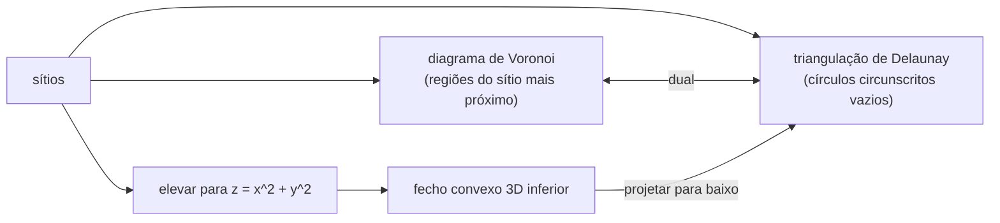

## Objetivos de Aprendizagem

- Definir o diagrama de Voronoi de um conjunto de sítios e descrever as suas células, arestas e vértices em termos de bissetrizes e circuncentros.
- Definir a triangulação de Delaunay como o dual do diagrama de Voronoi e enunciar a sua propriedade do círculo circunscrito vazio.
- Calcular o predicado incircle como um determinante $3 \times 3$ e usá-lo para decidir trocas de aresta, e explicar a ligação do mapa de elevação com fechos convexos.
- Explicar por que triangulações de Delaunay maximizam o menor ângulo, e por que as duas estruturas têm tamanho linear e construção em $O(n \log n)$.

## Contexto e Motivação

Qual hospital fica mais perto de cada casa de uma cidade? A qual torre de celular um telefone deve se conectar? Onde se encontram os territórios de cafeterias concorrentes? Todas essas são perguntas sobre o **diagrama de Voronoi**, que divide o plano em regiões mais próximas de cada um de um conjunto de sítios. O seu dual, a **triangulação de Delaunay**, liga sítios que compartilham uma fronteira de Voronoi, e é o jeito padrão de transformar pontos espalhados numa malha: modelos de terreno a partir de amostras de elevação, malhas de elementos finitos para simulação e interpolação de leituras de sensores dependem dela, porque ela evita triângulos longos e finos que causam problemas numéricos.

O conceito anterior introduziu o predicado de orientação e a linha de varredura; este acrescenta um segundo predicado, o teste incircle, e mostra uma ligação bonita: a triangulação de Delaunay de pontos no plano é um fecho convexo em três dimensões, pelo mesmo truque da parábola usado para provar o limite inferior da ordenação. As duas estruturas são capítulos centrais do livro de de Berg et al. e do 15-456 da CMU.

## Teoria Central

### O diagrama de Voronoi

Dados $n$ **sítios** $p_1, \dots, p_n$ no plano, a **célula de Voronoi** de $p_i$ é o conjunto dos pontos pelo menos tão próximos de $p_i$ quanto de qualquer outro sítio:

$$V(p_i) = \{\, x : \lVert x - p_i \rVert \leq \lVert x - p_j \rVert \ \text{para todo } j \,\}$$

Cada condição $\lVert x - p_i \rVert \leq \lVert x - p_j \rVert$ é um semiplano limitado pela mediatriz de $p_i p_j$, então toda célula é um polígono convexo, possivelmente ilimitado. As fronteiras entre células são as **arestas de Voronoi** (pontos equidistantes de dois sítios) e os **vértices de Voronoi** (pontos equidistantes de três ou mais sítios, os circuncentros desses sítios). O círculo de um vértice pelos seus sítios não contém nenhum outro sítio no interior, senão esse sítio estaria mais perto.

O diagrama tem tamanho linear: pela fórmula de Euler, para $n \geq 3$ sítios ele tem no máximo $2n - 5$ vértices e $3n - 6$ arestas. O algoritmo de linha de varredura de Fortune (1987) o constrói em $O(n \log n)$, o que é ótimo pela mesma redução a partir da ordenação.

### A triangulação de Delaunay

Ligue dois sítios por uma aresta sempre que as suas células de Voronoi compartilharem uma aresta. Para pontos em posição geral (nenhum quarteto num mesmo círculo), o resultado é uma triangulação, a **triangulação de Delaunay** $DT$, com um triângulo por vértice de Voronoi. A sua propriedade definidora:

**Círculo circunscrito vazio.** Um triângulo com vértices entre os sítios pertence a $DT$ se e somente se o seu círculo circunscrito não contém nenhum outro sítio no interior.

Consequências úteis: $DT$ contém o grafo de vizinhos mais próximos e a árvore geradora mínima euclidiana como subgrafos, então qualquer um deles pode ser calculado em $O(n \log n)$ construindo $DT$ primeiro e depois trabalhando sobre o seu número linear de arestas.

### O predicado incircle e as trocas de aresta

Para sítios $a, b, c$ em ordem anti-horária e um ponto de consulta $d$, o teste incircle é o sinal de

$$\mathrm{incircle}(a, b, c, d) = \det \begin{pmatrix} a_x - d_x & a_y - d_y & (a_x - d_x)^2 + (a_y - d_y)^2 \\ b_x - d_x & b_y - d_y & (b_x - d_x)^2 + (b_y - d_y)^2 \\ c_x - d_x & c_y - d_y & (c_x - d_x)^2 + (c_y - d_y)^2 \end{pmatrix}$$

Positivo significa que $d$ está dentro do círculo por $a, b, c$; negativo, fora; zero, sobre ele. Como a orientação, ele é um polinômio nas coordenadas e pode ser avaliado de forma exata.

O **algoritmo de trocas de Lawson** parte de qualquer triangulação. Uma aresta compartilhada pelos triângulos $abc$ e $acd$ é **ilegal** se $d$ está dentro do círculo circunscrito de $abc$; troque-a pela outra diagonal $bd$ (uma **troca**, ou flip). Cada troca melhora estritamente a sequência ordenada de ângulos da triangulação, então o processo termina, e quando não resta aresta ilegal a triangulação é de Delaunay. Combinado com a inserção incremental aleatorizada (adicionar os sítios em ordem aleatória, trocando localmente), isso dá tempo esperado $O(n \log n)$.

### Por que os triângulos de Delaunay são bem formados

Entre todas as triangulações de um conjunto de pontos, $DT$ maximiza o menor ângulo; mais precisamente, maximiza lexicograficamente o vetor ordenado de ângulos. O motivo é um fato clássico sobre círculos: num quadrilátero convexo, escolher a diagonal que torna a triangulação localmente Delaunay sempre dá o maior menor ângulo entre os seis ângulos. Triângulos finos criam grandes erros de interpolação e sistemas lineares mal condicionados em simulações, e é por isso que geradores de malha partem de triangulações de Delaunay.

### O mapa de elevação

Eleve todo sítio $(x, y)$ para $(x, y, x^2 + y^2)$ no paraboloide $z = x^2 + y^2$. Um círculo no plano se eleva para a interseção do paraboloide com um plano, e um ponto dentro do círculo se eleva para baixo desse plano. Portanto um triângulo tem círculo circunscrito vazio exatamente quando o seu triângulo elevado é uma face do **fecho convexo inferior** dos pontos elevados, e o determinante incircle é o teste de orientação 3D disfarçado. A triangulação de Delaunay no plano é igual a um fecho convexo no espaço, generalizando o argumento da parábola do conceito anterior.

## Exemplos Resolvidos

### Exemplo 1: decidindo uma troca com o teste incircle

**Problema:** Quatro sítios $A = (0,0)$, $B = (4,0)$, $C = (3,3)$, $D = (0,3)$ formam um quadrilátero convexo. Uma triangulação usa a diagonal $BD$ (triângulos $ABD$ e $BCD$). $BD$ é legal?

**Rastreamento:** Teste se $C$ está dentro do círculo circunscrito de $A, B, D$ (anti-horário: $\mathrm{orient}(A, B, D) = 4 \cdot 3 - 0 \cdot 0 = 12 > 0$). Linhas relativas a $C$: $A - C = (-3, -3, 18)$, $B - C = (1, -3, 10)$, $D - C = (-3, 0, 9)$. Determinante: $-3\,(-3 \cdot 9 - 10 \cdot 0) + 3\,(1 \cdot 9 - 10 \cdot (-3)) + 18\,(1 \cdot 0 - (-3)(-3)) = 81 + 117 - 162 = 36 > 0$. $C$ está dentro, então $BD$ é ilegal; troque para $AC$. Conferindo a nova configuração, $\mathrm{incircle}(A, B, C, D) = -36 < 0$: $D$ está fora do círculo circunscrito de $ABC$, então $AC$ é legal e a triangulação é de Delaunay. Geometricamente, o círculo circunscrito de $ABD$ tem centro $(2; 1{,}5)$ e raio 2,5, e $C$ fica a só cerca de 1,8 desse centro.

### Exemplo 2: comparando os menores ângulos

**Problema:** Para o mesmo quadrilátero, calcule o menor ângulo com a diagonal $BD$ e com a diagonal $AC$.

**Rastreamento:** Diagonal $BD$: o triângulo $ABD$ tem ângulo reto em $A$ e ângulos de cerca de $36{,}9°$ em $B$ e $53{,}1°$ em $D$; o triângulo $BCD$ tem cerca de $34{,}7°$ em $B$, $108{,}4°$ em $C$ e $36{,}9°$ em $D$. Mínimo: $34{,}7°$. Diagonal $AC$: o triângulo $ABC$ tem $45°$ em $A$, cerca de $71{,}6°$ em $B$, $63{,}4°$ em $C$; o triângulo $ACD$ tem $45°$ em $A$, $90°$ em $D$, $45°$ em $C$. Mínimo: $45°$. A troca escolhida pelo teste incircle elevou o menor ângulo de $34{,}7°$ para $45°$, exatamente como a propriedade de maximizar o menor ângulo promete.

## Equívocos Comuns e Armadilhas

- **"Delaunay significa ligar cada ponto aos seus vizinhos mais próximos."** As arestas de vizinho mais próximo estão contidas em $DT$, mas $DT$ tem muito mais arestas, e a sua propriedade definidora é sobre círculos vazios, não sobre distâncias a vizinhos individuais.
- **"A triangulação de Delaunay é sempre única."** Com quatro ou mais sítios cocirculares (os cantos de um retângulo, por exemplo), várias triangulações satisfazem a propriedade do círculo vazio; implementações precisam desempatar de forma consistente, muitas vezes por perturbação simbólica.
- **"Maximizar o menor ângulo significa nenhum triângulo fino."** A Delaunay maximiza o menor ângulo para os pontos dados, mas, se os próprios pontos estiverem mal distribuídos, triângulos finos podem continuar. Geradores de malha de qualidade (como o algoritmo de Ruppert) inserem pontos extras para garantir limites de ângulo.

## Resumo

O diagrama de Voronoi divide o plano em células convexas de pontos mais próximos de cada sítio, com arestas sobre mediatrizes e vértices nos circuncentros de círculos vazios; ele tem no máximo $2n - 5$ vértices e $3n - 6$ arestas e é construído em $O(n \log n)$. O seu dual, a triangulação de Delaunay, é formada exatamente pelos triângulos com círculos circunscritos vazios, contém o grafo de vizinhos mais próximos e a árvore geradora mínima e maximiza o menor ângulo entre todas as triangulações. O determinante incircle decide trocas de aresta de forma exata, e elevar os pontos a um paraboloide transforma a triangulação de Delaunay num fecho convexo 3D inferior. O capstone a seguir aplica todo o ferramental desta trilha a problemas realistas.

## Documentation Links

- [de Berg, Cheong, van Kreveld, Overmars: Computational Geometry: Algorithms and Applications (3rd ed., Springer)](https://link.springer.com/book/10.1007/978-3-540-77974-2): doc
- [CMU 15-456: Computational Geometry](https://www.cs.cmu.edu/afs/cs/academic/class/15456-s14/): doc
