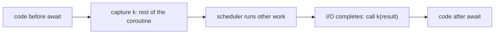

## Learning Objectives

- Define a continuation as "the rest of the computation" and write a function in continuation-passing style (CPS) by hand.
- Apply the call-by-value CPS transform to the lambda calculus and explain why every call in CPS code is a tail call.
- Explain `call/cc` and delimited continuations (`shift`/`reset`), and say how they differ from exceptions.
- Recognize CPS in disguise: callbacks, promise chains, `async`/`await`, generators, coroutines, and virtual threads.

## Context & Motivation

`software-distributed/programming-languages` built an interpreter in which a function call pushes a frame on an implicit call stack and a `return` pops it. That stack is a **continuation** the interpreter keeps for you: for each pending call, it records what remains to be done with the result. Most languages hide this object, so programmers can only use it through restricted forms such as `return`, `break`, and `throw`.

Continuation-passing style makes the hidden object an ordinary value. A function no longer returns; it receives an extra argument `k` and calls it with the result. This looks like an academic curiosity until you notice how often it is the real mechanism: Node.js callbacks are CPS written by hand, `async`/`await` is a compiler transformation into CPS (or a state machine equivalent to it), Kotlin's `suspend` functions are compiled to CPS with an explicit `Continuation` parameter, and the Java virtual threads of JEP 444 are built on a one-shot delimited continuation inside the JDK. Compilers use CPS too, as an intermediate form (Appel's *Compiling with Continuations* develops it), and SSA form, from `software-distributed/compilers`, is closely related to it.

## Core Theory

### Direct style and CPS

In **direct style** a function returns a value to its caller. In **CPS** it passes the value to a continuation:

```text
direct:   fact(n) = if n == 0 then 1 else n * fact(n - 1)
CPS:      fact(n, k) = if n == 0 then k(1)
                       else fact(n - 1, fun r -> k(n * r))
```

The recursive call is now the last thing `fact` does, so it is a tail call. The multiplication has not disappeared: it moved into the new continuation `fun r -> k(n * r)`, which is allocated on the heap instead of living in a stack frame. CPS trades the stack for closures.

### The CPS transform

For the call-by-value lambda calculus, the transform $[\![\cdot]\!]$ maps each term to a function that takes its continuation:

$$[\![x]\!] = \lambda k.\, k\ x \qquad [\![\lambda x.\, e]\!] = \lambda k.\, k\ (\lambda x.\, \lambda k'.\, [\![e]\!]\ k')$$

$$[\![e_1\ e_2]\!] = \lambda k.\, [\![e_1]\!]\ (\lambda f.\, [\![e_2]\!]\ (\lambda v.\, f\ v\ k))$$

The application rule fixes the evaluation order in the term itself: evaluate $e_1$, then $e_2$, then call. After the transform, the order of evaluation no longer depends on the language's semantics, which is why CPS is a convenient target for a compiler: all intermediate values are named, and all control flow is explicit.

### Capturing the continuation: `call/cc`

Scheme's `call/cc` gives the program its own current continuation as a function:

```text
(+ 1 (call/cc (lambda (k) (+ 10 (k 5)))))   ; evaluates to 6
```

Calling `k` with 5 abandons the pending `(+ 10 ...)` and resumes at `(+ 1 [])`. Used once and upward, this is an early exit, like `return` or `break`. But a captured `k` can be stored and called later, even after the original call finished, which re-enters a computation that has already run. That makes `call/cc` strictly more powerful than exceptions, and expressive enough to implement generators, coroutines, backtracking search, and cooperative threads as library code.

### Delimited continuations

`call/cc` captures the entire rest of the program, which is hard to reason about and awkward to implement efficiently. **Delimited continuations** capture only up to a marker. In Danvy and Filinski's `shift`/`reset`, `reset` marks a boundary and `shift k. body` captures the context up to the nearest `reset` as a function `k` that the program can call zero, one, or many times. A delimited continuation behaves like an ordinary function, so it composes. Generators, async/await, and algebraic effect handlers are all delimited-control patterns, and JEP 444 virtual threads work this way: a virtual thread yields by capturing its stack up to the scheduler boundary and later resumes by reinstating it.



## Worked Examples

### Example 1: CPS-converting a recursive function

**Problem:** Convert `sum(xs)`, which adds the elements of a list, to CPS, and trace `sum([1, 2])` with the initial continuation `id`.

**CPS version:**

```text
sum(xs, k) = if empty(xs) then k(0)
             else sum(tail(xs), fun r -> k(head(xs) + r))
```

**Trace:** `sum([1,2], id)` calls `sum([2], k1)` with `k1 = fun r -> id(1 + r)`. That calls `sum([], k2)` with `k2 = fun r -> k1(2 + r)`. The empty list calls `k2(0)`, which calls `k1(2)`, which calls `id(3)` and returns 3. The chain of continuations `k2 -> k1 -> id` holds exactly the information that the call stack held in the direct version: "add 2, then add 1, then stop".

### Example 2: early exit from a deep traversal

**Problem:** Search a tree for the first node satisfying a predicate, stopping immediately when found, without threading a flag through every recursive call.

**Solution:** Capture an escape continuation at the top and call it from the leaf: `call/cc (lambda (return) (visit root (lambda (n) (if (pred n) (return n)))))`. Reaching a match invokes `return` with the node, and all pending recursive frames are abandoned at once. Languages without `call/cc` use `break` with labels or an exception for the same effect; this example is the upward, one-shot case where the three coincide.

### Example 3: a callback pyramid is CPS

**Problem:** A function reads a file, parses it, and writes a result, each step asynchronous with a callback. Show that this is CPS and what `async`/`await` changes.

**Solution:** `readFile(path, (data) => parse(data, (ast) => write(ast, done)))` has the shape `f(args, k)`, with each continuation nested inside the previous one. The deep nesting is the textual form of "the rest of the computation". `async`/`await` writes the same program in direct style (`const ast = parse(await readFile(path))`), and the compiler or runtime performs the CPS transform: everything after an `await` becomes the continuation. Error handling shows the cost of hand-written CPS, since every callback needs its own error path, while direct style can use `try`/`catch`.

## Common Misconceptions & Pitfalls

- **"CPS is just callbacks."** Callbacks are CPS written by hand. The theory adds the guarantee that every call is a tail call, which a compiler can exploit, and the transform that applies uniformly to any program.
- **"Continuations are exceptions with extra steps."** An exception only unwinds to an enclosing handler. A reusable continuation can be called after its context has exited, and called more than once, which exceptions cannot do.
- **"CPS makes programs faster because there is no stack."** It moves the stack into heap-allocated closures, so it needs a garbage collector or region management and trades stack growth for allocation. Tail-call elimination is what makes it viable; without it, CPS code overflows the stack just as direct-style code does.
- **"Multi-shot continuations are free."** Resuming the same continuation twice requires copying or sharing mutable state it captured, which is why most mainstream runtimes (including the JDK's) provide only one-shot continuations.

## Summary

A continuation is the rest of a computation as a first-class function. CPS passes it explicitly, making every call a tail call and every intermediate value named, at the cost of heap-allocated closures; the call-by-value transform defines this precisely and fixes the evaluation order inside the term. `call/cc` exposes the whole continuation and is more powerful than exceptions because it can re-enter a finished computation, while delimited continuations capture only up to a marker and compose like functions. Callbacks, `async`/`await`, generators, Kotlin `suspend`, and Java virtual threads are all instances of the same idea. The next concept turns from control flow to the front end of a compiler, where the grammar of a language decides how its programs are parsed.

## Documentation Links

- [Flanagan, Sabry, Duba, Felleisen: The Essence of Compiling with Continuations (PLDI 1993)](https://dl.acm.org/doi/10.1145/155090.155113): doc
- [R7RS Scheme: call-with-current-continuation and dynamic-wind](https://small.r7rs.org/): doc
- [JEP 444: Virtual Threads](https://openjdk.org/jeps/444): doc
