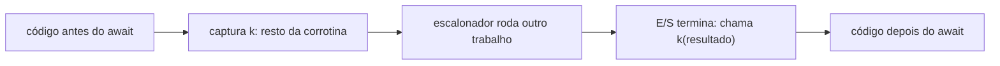

## Objetivos de Aprendizagem

- Definir uma continuação como "o resto da computação" e escrever à mão uma função em estilo de passagem de continuação (CPS).
- Aplicar a transformação CPS de chamada por valor ao cálculo lambda e explicar por que toda chamada em código CPS é uma chamada de cauda.
- Explicar `call/cc` e continuações delimitadas (`shift`/`reset`), e dizer em que diferem de exceções.
- Reconhecer CPS disfarçado: callbacks, cadeias de promises, `async`/`await`, geradores, corrotinas e threads virtuais.

## Contexto e Motivação

`software-distributed/programming-languages` construiu um interpretador em que uma chamada de função empilha um quadro numa pilha de chamadas implícita e um `return` o desempilha. Essa pilha é uma **continuação** que o interpretador guarda para você: para cada chamada pendente, registra o que falta fazer com o resultado. A maioria das linguagens esconde esse objeto, então o programador só o alcança por formas restritas como `return`, `break` e `throw`.

O estilo de passagem de continuação transforma o objeto escondido num valor comum. Uma função deixa de retornar: recebe um argumento extra `k` e o chama com o resultado. Isso parece curiosidade acadêmica até você notar quantas vezes é o mecanismo real: callbacks do Node.js são CPS escrito à mão, `async`/`await` é uma transformação do compilador para CPS (ou para uma máquina de estados equivalente), as funções `suspend` do Kotlin são compiladas para CPS com um parâmetro `Continuation` explícito, e as threads virtuais do Java (JEP 444) são construídas sobre uma continuação delimitada de uso único dentro do JDK. Compiladores também usam CPS como forma intermediária (o livro *Compiling with Continuations*, de Appel, a desenvolve), e a forma SSA, de `software-distributed/compilers`, é parente próxima dela.

## Teoria Central

### Estilo direto e CPS

No **estilo direto**, uma função devolve um valor ao chamador. Em **CPS**, ela passa o valor a uma continuação:

```text
direto:   fact(n) = if n == 0 then 1 else n * fact(n - 1)
CPS:      fact(n, k) = if n == 0 then k(1)
                       else fact(n - 1, fun r -> k(n * r))
```

A chamada recursiva agora é a última coisa que `fact` faz, portanto é uma chamada de cauda. A multiplicação não desapareceu: foi para a nova continuação `fun r -> k(n * r)`, que é alocada no heap em vez de viver num quadro de pilha. CPS troca a pilha por closures.

### A transformação CPS

Para o cálculo lambda com chamada por valor, a transformação $[\![\cdot]\!]$ leva cada termo a uma função que recebe a sua continuação:

$$[\![x]\!] = \lambda k.\, k\ x \qquad [\![\lambda x.\, e]\!] = \lambda k.\, k\ (\lambda x.\, \lambda k'.\, [\![e]\!]\ k')$$

$$[\![e_1\ e_2]\!] = \lambda k.\, [\![e_1]\!]\ (\lambda f.\, [\![e_2]\!]\ (\lambda v.\, f\ v\ k))$$

A regra da aplicação fixa a ordem de avaliação no próprio termo: avalie $e_1$, depois $e_2$, depois chame. Depois da transformação, a ordem de avaliação deixa de depender da semântica da linguagem, e é por isso que CPS é um alvo conveniente para um compilador: todos os valores intermediários têm nome e todo o fluxo de controle é explícito.

### Capturando a continuação: `call/cc`

O `call/cc` do Scheme entrega ao programa a sua própria continuação atual como função:

```text
(+ 1 (call/cc (lambda (k) (+ 10 (k 5)))))   ; avalia para 6
```

Chamar `k` com 5 abandona o `(+ 10 ...)` pendente e retoma em `(+ 1 [])`. Usado uma vez e para cima, isso é uma saída antecipada, como `return` ou `break`. Mas um `k` capturado pode ser guardado e chamado depois, até depois de a chamada original terminar, o que reentra numa computação que já rodou. Isso torna o `call/cc` estritamente mais poderoso do que exceções, e expressivo o bastante para implementar geradores, corrotinas, busca com retrocesso e threads cooperativas como código de biblioteca.

### Continuações delimitadas

O `call/cc` captura todo o resto do programa, o que é difícil de raciocinar e incômodo de implementar com eficiência. **Continuações delimitadas** capturam só até uma marca. Em `shift`/`reset`, de Danvy e Filinski, `reset` marca uma fronteira e `shift k. corpo` captura o contexto até o `reset` mais próximo como uma função `k` que o programa pode chamar zero, uma ou muitas vezes. Uma continuação delimitada se comporta como uma função comum, então compõe. Geradores, async/await e handlers de efeitos algébricos são todos padrões de controle delimitado, e as threads virtuais do JEP 444 funcionam assim: uma thread virtual cede capturando a sua pilha até a fronteira do escalonador e depois retoma reinstalando-a.



## Exemplos Resolvidos

### Exemplo 1: convertendo uma função recursiva para CPS

**Problema:** Converta `sum(xs)`, que soma os elementos de uma lista, para CPS e acompanhe `sum([1, 2])` com a continuação inicial `id`.

**Versão CPS:**

```text
sum(xs, k) = if empty(xs) then k(0)
             else sum(tail(xs), fun r -> k(head(xs) + r))
```

**Traço:** `sum([1,2], id)` chama `sum([2], k1)` com `k1 = fun r -> id(1 + r)`. Isso chama `sum([], k2)` com `k2 = fun r -> k1(2 + r)`. A lista vazia chama `k2(0)`, que chama `k1(2)`, que chama `id(3)` e devolve 3. A cadeia de continuações `k2 -> k1 -> id` guarda exatamente a informação que a pilha de chamadas guardava na versão direta: "some 2, depois some 1, depois pare".

### Exemplo 2: saída antecipada de uma travessia profunda

**Problema:** Procurar numa árvore o primeiro nó que satisfaz um predicado, parando assim que o achar, sem passar uma flag por todas as chamadas recursivas.

**Solução:** Capture uma continuação de escape no topo e chame-a na folha: `call/cc (lambda (return) (visit root (lambda (n) (if (pred n) (return n)))))`. Ao achar um nó, `return` é chamada com ele e todos os quadros recursivos pendentes são abandonados de uma vez. Linguagens sem `call/cc` usam `break` com rótulo ou uma exceção para o mesmo efeito; este exemplo é o caso para cima e de uso único, em que os três coincidem.

### Exemplo 3: a pirâmide de callbacks é CPS

**Problema:** Uma função lê um arquivo, faz o parse e escreve um resultado, cada passo assíncrono com um callback. Mostre que isso é CPS e o que `async`/`await` muda.

**Solução:** `readFile(path, (data) => parse(data, (ast) => write(ast, done)))` tem a forma `f(args, k)`, com cada continuação aninhada dentro da anterior. O aninhamento profundo é a forma textual de "o resto da computação". `async`/`await` escreve o mesmo programa em estilo direto (`const ast = parse(await readFile(path))`), e o compilador ou o runtime faz a transformação CPS: tudo que vem depois de um `await` vira a continuação. O tratamento de erro mostra o custo do CPS escrito à mão, pois cada callback precisa do seu próprio caminho de erro, enquanto o estilo direto pode usar `try`/`catch`.

## Equívocos Comuns e Armadilhas

- **"CPS é só callback."** Callbacks são CPS escrito à mão. A teoria acrescenta a garantia de que toda chamada é de cauda, que um compilador pode explorar, e uma transformação que se aplica uniformemente a qualquer programa.
- **"Continuações são exceções com passos a mais."** Uma exceção só desenrola até um handler que a envolve. Uma continuação reutilizável pode ser chamada depois que o seu contexto já saiu, e mais de uma vez, o que exceções não fazem.
- **"CPS deixa o programa mais rápido porque não há pilha."** Ele move a pilha para closures alocadas no heap, então precisa de coletor de lixo ou gerência de regiões e troca crescimento de pilha por alocação. A eliminação de chamadas de cauda é o que o torna viável; sem ela, código CPS estoura a pilha como o código em estilo direto.
- **"Continuações de múltiplos usos são de graça."** Retomar a mesma continuação duas vezes exige copiar ou compartilhar o estado mutável que ela capturou, e por isso a maioria dos runtimes (incluindo o do JDK) oferece só continuações de uso único.

## Resumo

Uma continuação é o resto de uma computação como função de primeira classe. CPS a passa explicitamente, tornando toda chamada uma chamada de cauda e todo valor intermediário nomeado, ao custo de closures alocadas no heap; a transformação de chamada por valor define isso com precisão e fixa a ordem de avaliação dentro do termo. O `call/cc` expõe a continuação inteira e é mais poderoso do que exceções porque pode reentrar numa computação terminada, enquanto continuações delimitadas capturam só até uma marca e compõem como funções. Callbacks, `async`/`await`, geradores, `suspend` do Kotlin e threads virtuais do Java são instâncias da mesma ideia. O próximo conceito passa do fluxo de controle para o front end de um compilador, onde a gramática da linguagem decide como os programas são analisados.

## Documentation Links

- [Flanagan, Sabry, Duba, Felleisen: The Essence of Compiling with Continuations (PLDI 1993)](https://dl.acm.org/doi/10.1145/155090.155113): doc
- [R7RS Scheme: call-with-current-continuation and dynamic-wind](https://small.r7rs.org/): doc
- [JEP 444: Virtual Threads](https://openjdk.org/jeps/444): doc
