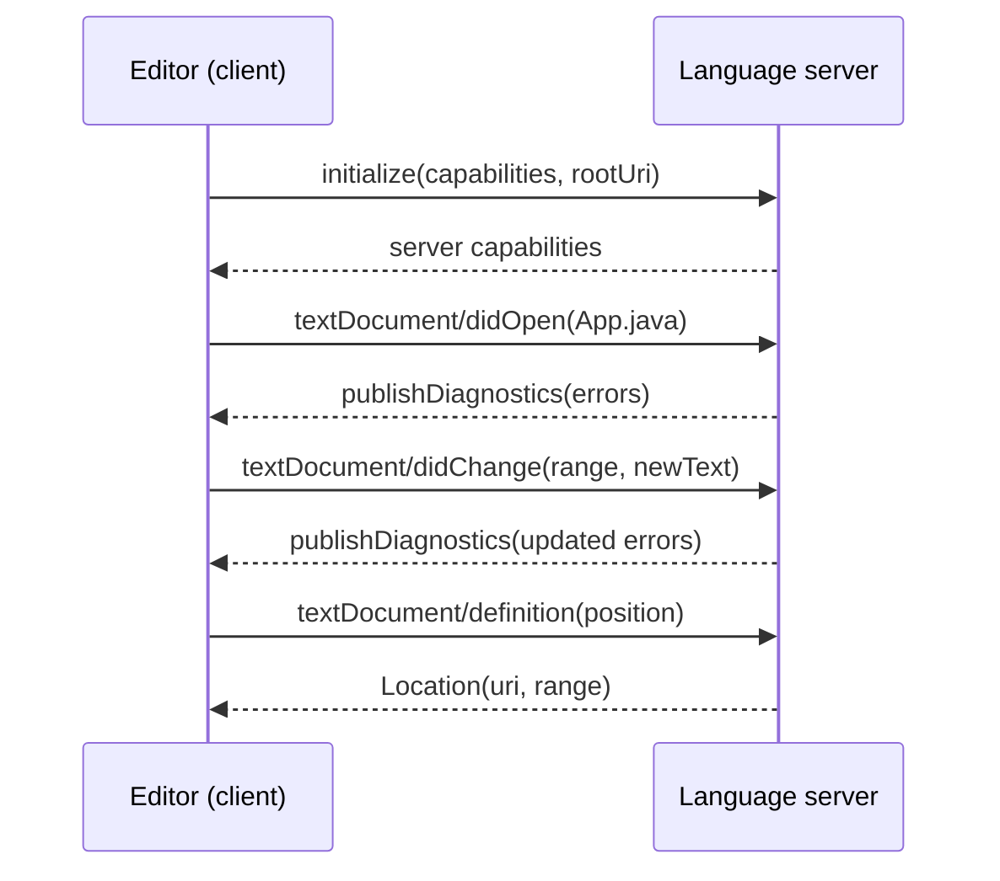

## Learning Objectives

- Explain the editors-times-languages integration problem and how the Language Server Protocol (LSP) reduces it to editors plus languages.
- Describe an LSP session: JSON-RPC transport, capability negotiation, document synchronization, requests such as `definition` and `completion`, and server-pushed diagnostics.
- Explain why IDE analysis differs from batch compilation (invalid code, latency, small edits) and what error-tolerant parsing provides.
- Describe demand-driven, memoized queries with dependency tracking and early cutoff, and relate them to build systems such as Make, Shake, Bazel, and Gradle.

## Context & Motivation

`software-distributed/programming-languages` built a parser that turns well-formed source into a tree, and `software-distributed/software-engineering` showed continuous integration running builds on every change. The tool a developer actually lives in, though, is the editor, which must answer "what does this name refer to?" and "what can I type here?" on every keystroke, in a file that is half-written and syntactically invalid, in a project with millions of lines.

Before 2016 each editor needed a custom plugin for each language: Eclipse's JDT for Java, Visual Studio's Roslyn for C#, and so on. $M$ editors and $N$ languages meant $M \times N$ integrations. Microsoft's **Language Server Protocol** (LSP), introduced with Visual Studio Code, defines a small JSON-RPC protocol between an editor (the *client*) and a language-aware process (the *server*). A language implements one server, an editor implements one client, and the integration cost becomes $M + N$ (the same trick as the shared IR in the LLVM concept). Eclipse JDT Language Server provides Java support in VS Code and other editors this way, rust-analyzer does for Rust, and `gopls` for Go. The harder half of the problem, making analysis fast enough to run continuously, is covered by **incremental computation**, which is also what makes modern build systems work.

## Core Theory

### The protocol

LSP messages are JSON-RPC 2.0 over standard input and output (or a socket). There are **requests** (with an `id` and a response), **responses**, and one-way **notifications**. A session starts with the client's `initialize` request, which carries its capabilities and the workspace root; the server answers with its own capabilities (which features it supports), and the client sends `initialized`. Then:

- **Document synchronization**: `textDocument/didOpen` sends the text, and `textDocument/didChange` sends either the full text or, with incremental sync, only the changed ranges. The server's copy of an open file is the editor's buffer, not the file on disk.
- **Queries** the editor sends on demand: `textDocument/completion`, `hover`, `definition`, `references`, `rename`, `codeAction`, `formatting`, `documentSymbol`, `semanticTokens`.
- **Diagnostics**: the server *pushes* errors and warnings with `textDocument/publishDiagnostics` after it re-analyzes.

Positions are a zero-based line and a character offset, counted in UTF-16 code units by default. The protocol carries no analysis itself: all knowledge of the language lives in the server, and the editor stays generic. The sibling Debug Adapter Protocol does the same for debuggers.



### Why editor analysis is not a compiler run

Three constraints distinguish it from batch compilation:

1. **Code is mostly invalid.** While typing, braces are unbalanced and expressions are incomplete. A compiler may stop at the first syntax error; an IDE must still offer completions inside the broken code. Parsers for tools are **error-tolerant**: they recover and produce a full tree with error nodes. Tree-sitter, Roslyn, and rust-analyzer's syntax trees are also *lossless* (they keep whitespace and comments), so tools can reformat and refactor without destroying the user's text.
2. **Latency matters.** Completion that takes a second is useless, so the budget is tens of milliseconds for interactive features.
3. **Edits are tiny.** One keystroke changes one function in a project of thousands of files. Re-analyzing everything is wasteful, so the server must recompute only what depends on the edit.

### Incremental computation with queries

The architecture that meets these constraints models the analysis as a set of **pure queries**: functions from inputs to values, for example `file_text(f)`, `parse(f)`, `item_signatures(f)`, `resolve(name)`, `type_of(fn)`, `diagnostics(f)`. Each query may call others. The engine (Salsa in rust-analyzer, the query system in `rustc`, and comparable caching designs in other compiler services) provides three things:

- **Memoization with recorded dependencies**: it remembers each result and which queries and inputs were read while computing it.
- **Demand-driven evaluation**: nothing is computed until something asks. The editor asks for diagnostics of the open file, which pulls in only the queries it needs, not the whole project.
- **Early cutoff**: when an input changes, the engine revalidates the dependents. If a query is recomputed and yields the *same value* as before, the queries that depend on it are not recomputed. A change that does not alter a query's result stops propagating there.

Correctness means the result must always equal what a from-scratch computation would give; incrementality is purely an optimization that must be invisible.

### The same idea in build systems

Mokhov, Mitchell, and Peyton Jones (*Build Systems à la Carte*, ICFP 2018) show that a build system consists of a **scheduler** (in which order to build) and a **rebuilder** (when a task must be rerun). Make orders targets topologically and rebuilds when a file's modification time is newer, which cannot do early cutoff and is fooled by `touch`. Shake and Bazel record content hashes or traces of inputs, so a task whose inputs are identical to a previous run is skipped, and Bazel can fetch the result from a shared **remote cache** (a *constructive* trace). Gradle's up-to-date checks and build cache work the same way. A CI pipeline that downloads cached outputs is applying the same principle that makes the editor's red squiggles update in milliseconds.

## Worked Examples

### Example 1: what travels over the wire

**Problem:** The user's cursor is on a method call in `App.java` at line 41, column 16, and they press "go to definition". What does the editor send and receive?

**Request:**

```text
{"jsonrpc":"2.0","id":7,"method":"textDocument/definition",
 "params":{"textDocument":{"uri":"file:///work/src/App.java"},
           "position":{"line":41,"character":16}}}
```

**Response:**

```text
{"jsonrpc":"2.0","id":7,
 "result":[{"uri":"file:///work/src/Util.java",
            "range":{"start":{"line":12,"character":14},"end":{"line":12,"character":22}}}]}
```

**Solution:** The editor then opens `Util.java` and selects the range. The editor never parsed or resolved anything: it translated a click into a standard request, and all name resolution happened in the server using its copy of the open buffers (possibly with unsaved edits). The `id` lets the client match the response to the request when several are in flight, and it may cancel a stale one with `$/cancelRequest` as the user keeps typing.

### Example 2: early cutoff on a one-line edit

**Problem:** `B.java` calls `A.f()` in 1000 places. The query graph is `text(A) -> parse(A) -> signature(A.f)` and `parse(A) -> body_check(A.f)`, while each caller's `diagnostics(B)` depends on `signature(A.f)`. What is recomputed after each of these edits to `A.java`?

**Solution:**

1. *Change `return 1;` to `return 2;`.* `text(A)` and `parse(A)` change, so `signature(A.f)` and `body_check(A.f)` are revalidated. `signature(A.f)` recomputes to the same value (`int f()`), so **cutoff**: none of the 1000 dependents of the signature are rerun. Only `body_check(A.f)` is recomputed: a handful of queries instead of thousands.
2. *Add a comment or change whitespace.* With a lossless syntax tree `parse(A)` changes, but the item-level summary computed from it is identical, and the cutoff happens one step later.
3. *Change `int f()` to `long f()`.* `signature(A.f)` gets a new value, and all callers' diagnostics are invalidated and recomputed on demand (only for files the user has open, because of demand-driven evaluation; the rest remain lazily invalid).

### Example 3: Make versus a content-hashing build

**Problem:** A developer runs `touch util.c` (content unchanged) and then rebuilds a project with 500 object files that include `util.h`. How do Make and a Bazel-like system differ?

**Solution:** Make compares timestamps: `util.c` is newer than `util.o`, so it recompiles `util.c`, then relinks the program. A system that hashes inputs sees the same content hash and skips the compile entirely. If instead the developer *edits only a comment* in `util.c`, the content hash changes, so it recompiles `util.o`; the new object file is byte-identical to the old one, so with early cutoff on output hashes the link step, which depends only on `util.o`, is skipped. Make has no such rule and relinks. The first difference is about correctness of the rebuilder, the second is early cutoff, and both are the build-system version of what the language server does with `signature(A.f)`.

## Common Misconceptions & Pitfalls

- **"The language server compiles the project."** It maintains a model of the project sufficient to answer queries. It need not produce binaries, and it handles code that would not compile.
- **"LSP replaces IDE-specific tooling."** LSP standardizes the common features. Deeply integrated IDEs (IntelliJ with its PSI trees and indexes) offer richer refactorings and inspections because their analysis is not restricted to what the protocol can express.
- **"Incremental analysis means diffing the text."** Diffing text does not tell you which semantic results are still valid. The dependency graph of queries does, and early cutoff only works because results are compared by value.
- **"Caching risks stale results."** It does if dependencies are tracked incompletely, such as a query that reads an environment variable or the clock without declaring it. The discipline is *purity*: a query's value must depend only on declared inputs, or the cache cannot be trusted.

## Summary

The Language Server Protocol turns $M \times N$ editor-language integrations into $M + N$ by moving language knowledge behind a JSON-RPC interface with capability negotiation, document synchronization, on-demand queries, and pushed diagnostics. Editor analysis differs from compilation in tolerating invalid code, needing millisecond latency, and handling tiny edits. It is built on demand-driven, memoized queries with dependency tracking and early cutoff, which recompute only what an edit invalidates, and the same scheduler-and-rebuilder structure explains Make, Shake, Bazel, and Gradle. Purity of the queries is what makes the shortcut safe. The final concept brings together the analysis techniques of this track: choosing among types, abstract interpretation, separation logic, symbolic execution, and fuzzing for a real codebase.

## Documentation Links

- [Language Server Protocol: overview and specification](https://microsoft.github.io/language-server-protocol/): doc
- [Mokhov, Mitchell, Peyton Jones: Build Systems a la Carte (ICFP 2018)](https://www.microsoft.com/en-us/research/uploads/prod/2018/03/build-systems.pdf): doc
- [Salsa: a framework for on-demand, incrementalized computation](https://salsa-rs.github.io/salsa/): doc
- [rust-analyzer book: Architecture](https://rust-analyzer.github.io/book/contributing/architecture.html): doc
