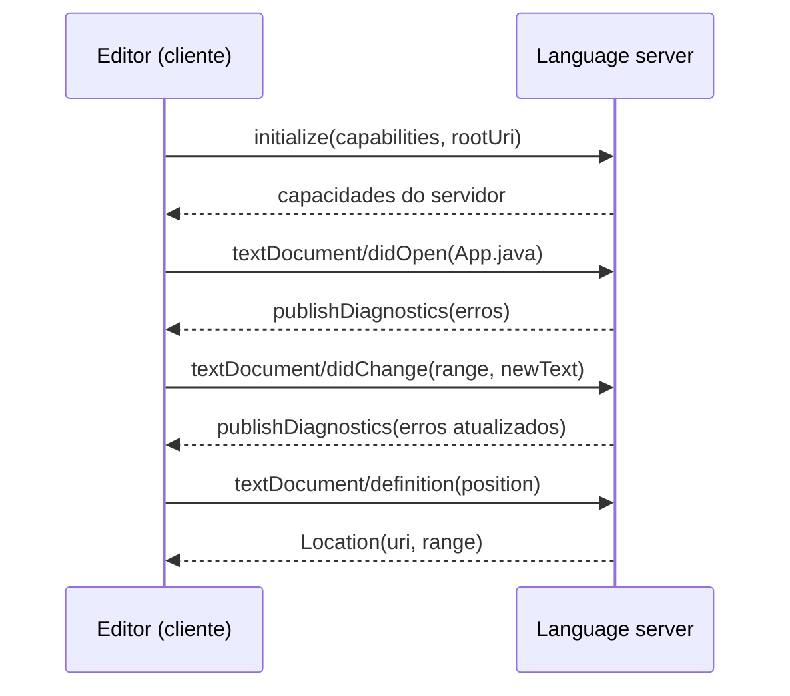

## Objetivos de Aprendizagem

- Explicar o problema de integração editores vezes linguagens e como o Language Server Protocol (LSP) o reduz a editores mais linguagens.
- Descrever uma sessão LSP: transporte JSON-RPC, negociação de capacidades, sincronização de documentos, requisições como `definition` e `completion` e diagnósticos enviados pelo servidor.
- Explicar por que a análise de IDE difere da compilação em lote (código inválido, latência, edições pequenas) e o que o parsing tolerante a erros oferece.
- Descrever consultas memoizadas guiadas por demanda, com rastreamento de dependências e corte antecipado (early cutoff), e relacioná-las a sistemas de build como Make, Shake, Bazel e Gradle.

## Contexto e Motivação

`software-distributed/programming-languages` construiu um parser que transforma código bem formado em árvore, e `software-distributed/software-engineering` mostrou a integração contínua rodando builds a cada mudança. A ferramenta em que o desenvolvedor realmente vive, porém, é o editor, que precisa responder "a que este nome se refere?" e "o que posso digitar aqui?" a cada tecla, num arquivo meio escrito e sintaticamente inválido, num projeto com milhões de linhas.

Antes de 2016, cada editor precisava de um plugin sob medida para cada linguagem: o JDT do Eclipse para Java, o Roslyn do Visual Studio para C# e assim por diante. $M$ editores e $N$ linguagens significavam $M \times N$ integrações. O **Language Server Protocol** (LSP) da Microsoft, introduzido com o Visual Studio Code, define um pequeno protocolo JSON-RPC entre um editor (o *cliente*) e um processo que entende a linguagem (o *servidor*). Uma linguagem implementa um servidor, um editor implementa um cliente, e o custo de integração vira $M + N$ (o mesmo truque da IR compartilhada no conceito sobre LLVM). O Eclipse JDT Language Server dá suporte a Java no VS Code e em outros editores dessa forma, o rust-analyzer faz o mesmo para Rust e o `gopls` para Go. A metade mais difícil do problema, deixar a análise rápida o bastante para rodar continuamente, é coberta pela **computação incremental**, que também é o que faz os sistemas de build modernos funcionarem.

## Teoria Central

### O protocolo

As mensagens LSP são JSON-RPC 2.0 sobre entrada e saída padrão (ou um socket). Existem **requisições** (com um `id` e uma resposta), **respostas** e **notificações** de mão única. Uma sessão começa com a requisição `initialize` do cliente, que carrega as suas capacidades e a raiz do workspace; o servidor responde com as suas próprias capacidades (que recursos suporta) e o cliente envia `initialized`. Depois:

- **Sincronização de documentos**: `textDocument/didOpen` envia o texto, e `textDocument/didChange` envia o texto inteiro ou, com sincronização incremental, só os trechos alterados. A cópia do servidor de um arquivo aberto é o buffer do editor, não o arquivo em disco.
- **Consultas** que o editor envia sob demanda: `textDocument/completion`, `hover`, `definition`, `references`, `rename`, `codeAction`, `formatting`, `documentSymbol`, `semanticTokens`.
- **Diagnósticos**: o servidor *empurra* erros e avisos com `textDocument/publishDiagnostics` depois de reanalisar.

As posições são uma linha começando em zero e um deslocamento de caractere, contado em unidades de código UTF-16 por padrão. O protocolo não carrega análise nenhuma: todo o conhecimento da linguagem vive no servidor, e o editor permanece genérico. O Debug Adapter Protocol, irmão dele, faz o mesmo para depuradores.



### Por que a análise do editor não é uma execução de compilador

Três restrições a distinguem da compilação em lote:

1. **O código quase sempre é inválido.** Enquanto se digita, chaves estão desbalanceadas e expressões incompletas. Um compilador pode parar no primeiro erro de sintaxe; uma IDE ainda precisa oferecer completar dentro do código quebrado. Parsers para ferramentas são **tolerantes a erros**: se recuperam e produzem uma árvore completa com nós de erro. As árvores sintáticas do Tree-sitter, do Roslyn e do rust-analyzer também são *sem perdas* (guardam espaços e comentários), de modo que as ferramentas podem reformatar e refatorar sem destruir o texto do usuário.
2. **A latência importa.** Um completar que leva um segundo é inútil, então o orçamento é de dezenas de milissegundos para recursos interativos.
3. **As edições são minúsculas.** Uma tecla muda uma função num projeto de milhares de arquivos. Reanalisar tudo é desperdício, então o servidor deve recalcular só o que depende da edição.

### Computação incremental com consultas

A arquitetura que atende a essas restrições modela a análise como um conjunto de **consultas puras**: funções de entradas para valores, por exemplo `file_text(f)`, `parse(f)`, `item_signatures(f)`, `resolve(name)`, `type_of(fn)`, `diagnostics(f)`. Cada consulta pode chamar outras. O motor (o Salsa no rust-analyzer, o sistema de consultas no `rustc` e projetos de cache comparáveis em outros serviços de compilador) oferece três coisas:

- **Memoização com dependências registradas**: lembra cada resultado e quais consultas e entradas foram lidas ao calculá-lo.
- **Avaliação guiada por demanda**: nada é calculado até que algo peça. O editor pede os diagnósticos do arquivo aberto, o que puxa só as consultas de que ele precisa, não o projeto inteiro.
- **Corte antecipado (early cutoff)**: quando uma entrada muda, o motor revalida os dependentes. Se uma consulta é recalculada e resulta no *mesmo valor* de antes, as consultas que dependem dela não são recalculadas. Uma mudança que não altera o resultado de uma consulta para de se propagar ali.

Correção significa que o resultado precisa sempre ser igual ao que um cálculo do zero daria; a incrementalidade é apenas uma otimização que deve ser invisível.

### A mesma ideia em sistemas de build

Mokhov, Mitchell e Peyton Jones (*Build Systems à la Carte*, ICFP 2018) mostram que um sistema de build consiste em um **escalonador** (em que ordem construir) e um **reconstrutor** (quando uma tarefa precisa rodar de novo). O Make ordena os alvos topologicamente e reconstrói quando o horário de modificação de um arquivo é mais novo, o que não consegue fazer corte antecipado e é enganado por `touch`. Shake e Bazel registram hashes de conteúdo ou rastros das entradas, então uma tarefa cujas entradas são idênticas às de uma execução anterior é pulada, e o Bazel pode buscar o resultado em um **cache remoto** compartilhado (um rastro *construtivo*). As verificações de up-to-date e o cache de build do Gradle funcionam da mesma forma. Um pipeline de CI que baixa saídas em cache aplica o mesmo princípio que faz os rabiscos vermelhos do editor se atualizarem em milissegundos.

## Exemplos Resolvidos

### Exemplo 1: o que trafega pelo fio

**Problema:** O cursor do usuário está sobre uma chamada de método em `App.java`, linha 41, coluna 16, e ele pressiona "ir para a definição". O que o editor envia e recebe?

**Requisição:**

```text
{"jsonrpc":"2.0","id":7,"method":"textDocument/definition",
 "params":{"textDocument":{"uri":"file:///work/src/App.java"},
           "position":{"line":41,"character":16}}}
```

**Resposta:**

```text
{"jsonrpc":"2.0","id":7,
 "result":[{"uri":"file:///work/src/Util.java",
            "range":{"start":{"line":12,"character":14},"end":{"line":12,"character":22}}}]}
```

**Solução:** O editor então abre `Util.java` e seleciona o trecho. O editor nunca fez parsing nem resolveu nada: traduziu um clique numa requisição padrão, e toda a resolução de nomes aconteceu no servidor, usando a sua cópia dos buffers abertos (possivelmente com edições não salvas). O `id` permite ao cliente casar a resposta com a requisição quando várias estão em andamento, e ele pode cancelar uma desatualizada com `$/cancelRequest` enquanto o usuário continua digitando.

### Exemplo 2: corte antecipado numa edição de uma linha

**Problema:** `B.java` chama `A.f()` em 1000 lugares. O grafo de consultas é `text(A) -> parse(A) -> signature(A.f)` e `parse(A) -> body_check(A.f)`, enquanto o `diagnostics(B)` de cada chamador depende de `signature(A.f)`. O que é recalculado depois de cada uma destas edições em `A.java`?

**Solução:**

1. *Trocar `return 1;` por `return 2;`.* `text(A)` e `parse(A)` mudam, então `signature(A.f)` e `body_check(A.f)` são revalidadas. `signature(A.f)` recalcula para o mesmo valor (`int f()`), então há **corte**: nenhum dos 1000 dependentes da assinatura é executado de novo. Só `body_check(A.f)` é recalculada: um punhado de consultas em vez de milhares.
2. *Adicionar um comentário ou mudar espaços.* Com uma árvore sintática sem perdas, `parse(A)` muda, mas o resumo em nível de itens calculado a partir dela é idêntico, e o corte acontece um passo depois.
3. *Trocar `int f()` por `long f()`.* `signature(A.f)` recebe um novo valor, e os diagnósticos de todos os chamadores são invalidados e recalculados sob demanda (só para os arquivos que o usuário tem abertos, por causa da avaliação guiada por demanda; o resto continua preguiçosamente inválido).

### Exemplo 3: Make contra um build com hash de conteúdo

**Problema:** Um desenvolvedor roda `touch util.c` (conteúdo inalterado) e depois reconstrói um projeto com 500 arquivos objeto que incluem `util.h`. Como o Make e um sistema no estilo do Bazel diferem?

**Solução:** O Make compara horários: `util.c` é mais novo que `util.o`, então recompila `util.c` e depois religa o programa. Um sistema que calcula o hash das entradas vê o mesmo hash de conteúdo e pula a compilação inteira. Se em vez disso o desenvolvedor *editar só um comentário* em `util.c`, o hash de conteúdo muda, então ele recompila `util.o`; o novo arquivo objeto é idêntico byte a byte ao antigo, então com corte antecipado sobre os hashes de saída a etapa de ligação, que depende só de `util.o`, é pulada. O Make não tem essa regra e religa. A primeira diferença é sobre a correção do reconstrutor, a segunda é o corte antecipado, e ambas são a versão em sistema de build do que o language server faz com `signature(A.f)`.

## Equívocos Comuns e Armadilhas

- **"O language server compila o projeto."** Ele mantém um modelo do projeto suficiente para responder consultas. Não precisa produzir binários, e lida com código que não compilaria.
- **"O LSP substitui o ferramental específico de IDE."** O LSP padroniza os recursos comuns. IDEs profundamente integradas (o IntelliJ com suas árvores PSI e índices) oferecem refatorações e inspeções mais ricas porque a análise delas não se restringe ao que o protocolo consegue expressar.
- **"Análise incremental significa comparar o texto."** Comparar texto não diz quais resultados semânticos continuam válidos. O grafo de dependências das consultas diz, e o corte antecipado só funciona porque os resultados são comparados por valor.
- **"Cache arrisca resultados obsoletos."** Arrisca se as dependências forem rastreadas de forma incompleta, como uma consulta que lê uma variável de ambiente ou o relógio sem declarar. A disciplina é a *pureza*: o valor de uma consulta deve depender só de entradas declaradas, ou o cache não é confiável.

## Resumo

O Language Server Protocol transforma $M \times N$ integrações editor-linguagem em $M + N$ ao mover o conhecimento da linguagem para trás de uma interface JSON-RPC com negociação de capacidades, sincronização de documentos, consultas sob demanda e diagnósticos empurrados. A análise do editor difere da compilação por tolerar código inválido, exigir latência de milissegundos e lidar com edições minúsculas. Ela se constrói sobre consultas memoizadas guiadas por demanda com rastreamento de dependências e corte antecipado, que recalculam só o que uma edição invalida, e a mesma estrutura de escalonador e reconstrutor explica Make, Shake, Bazel e Gradle. A pureza das consultas é o que torna o atalho seguro. O conceito final reúne as técnicas de análise desta trilha: escolher entre tipos, interpretação abstrata, lógica de separação, execução simbólica e fuzzing para uma base de código real.

## Documentation Links

- [Language Server Protocol: overview and specification](https://microsoft.github.io/language-server-protocol/): doc
- [Mokhov, Mitchell, Peyton Jones: Build Systems a la Carte (ICFP 2018)](https://www.microsoft.com/en-us/research/uploads/prod/2018/03/build-systems.pdf): doc
- [Salsa: a framework for on-demand, incrementalized computation](https://salsa-rs.github.io/salsa/): doc
- [rust-analyzer book: Architecture](https://rust-analyzer.github.io/book/contributing/architecture.html): doc
