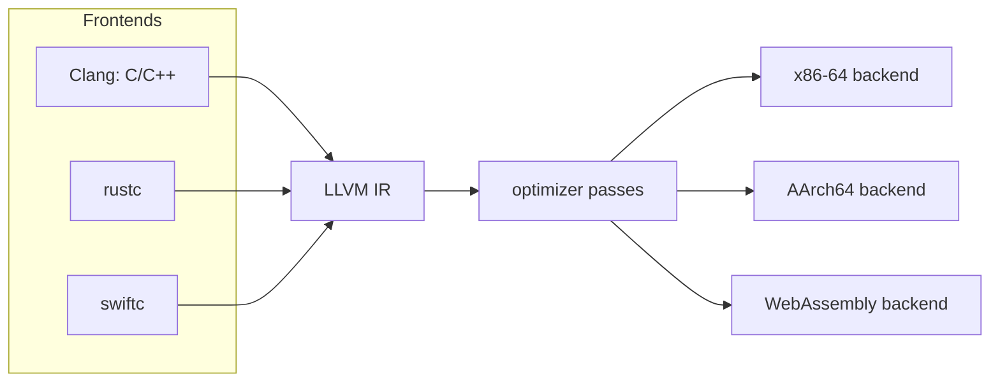

## Learning Objectives

- Explain how a three-phase compiler design with a shared intermediate representation reduces the work of supporting $M$ languages on $N$ targets from $M \times N$ to $M + N$.
- Read LLVM IR: typed values, virtual registers, basic blocks with terminators, `phi` nodes, `alloca`/`load`/`store`, and flags such as `nsw`.
- Describe how a frontend emits memory-based IR and how `mem2reg` promotes it to SSA form.
- Distinguish analysis passes from transformation passes, and explain how undefined behavior in the source language becomes optimization freedom in the IR.

## Context & Motivation

`software-distributed/compilers` followed one expression from AST to x86-64 by hand: three-address code, a control-flow graph, SSA, data-flow analyses, optimizations, instruction selection, and register allocation. Real compilers must do all of that for many languages and many CPUs. Written separately, $M$ languages targeting $N$ architectures need $M \times N$ compilers. The classic answer, used by GCC and made central by LLVM, is to split the work into three phases around one shared **intermediate representation**: a frontend per language translates source to IR, a language-independent optimizer improves the IR, and a backend per target turns the IR into machine code. Now supporting a new language costs one frontend and supporting a new CPU costs one backend, $M + N$ pieces in total.

LLVM (Lattner and Adve, CGO 2004) is that design as a library. Clang compiles C, C++, and Objective-C onto it, `rustc`, Swift, Julia, and Zig emit LLVM IR, and projects as different as the Kaleidoscope tutorial language and the GPU compilers in graphics drivers reuse the same optimizer and code generators. Knowing what LLVM IR looks like and what its passes assume is the most practical way to see why compilers behave the way they do, including why undefined behavior in C can delete your bounds check.

## Core Theory

### The shape of LLVM IR

LLVM IR is a typed, low-level language in **SSA form** with an unlimited supply of virtual registers. A function is a list of **basic blocks**; each block is a straight-line sequence of instructions ending in exactly one **terminator** (`br`, `ret`, `switch`, `unreachable`). There is no implicit fall-through. Values are named `%x` or numbered `%0`, each is assigned once, and each instruction states the types of its operands: `add i32 %a, %b`, `icmp slt i32 %a, 0`, `load i32, ptr %p`. A `phi` node at the top of a block selects a value according to which predecessor block was just executed. Since LLVM 15 pointers are **opaque** (`ptr`), without a pointee type.

The same program has three equivalent forms: human-readable text (`.ll`), a compact binary **bitcode** (`.bc`), and an in-memory data structure that the passes manipulate. `clang -S -emit-llvm` prints the text form.

### Frontends emit memory, `mem2reg` builds SSA

Constructing SSA directly in a frontend means computing dominance frontiers and inserting `phi` nodes, a distraction for someone writing a new language. LLVM's convention is that a frontend stores every local variable in an `alloca` (a stack slot) and uses `load` and `store` for every read and write. The **`mem2reg`** pass (and its more general successor SROA) then promotes slots whose address does not escape into SSA registers, inserting `phi` nodes where control flow merges. The frontend stays simple, and a single well-tested pass owns SSA construction.

### Passes: analysis and transformation

An optimization pipeline is a sequence of **passes** run by the pass manager. An **analysis pass** computes facts and changes nothing (dominator tree, loop info, alias analysis, scalar evolution). A **transformation pass** rewrites the IR using those facts: `instcombine` (local algebraic simplification), `gvn` (global value numbering, which subsumes common subexpression elimination), `licm` (loop-invariant code motion), `inline`, `simplifycfg`, `sroa`. The levels `-O1`, `-O2`, `-O3` are named pipelines of these passes, and `opt -passes='mem2reg,instcombine' in.ll -S` runs a chosen pipeline on a single file. Transformation passes invalidate analyses they change; the manager recomputes them on demand.

### Undefined behavior as optimization freedom

C says signed integer overflow is undefined behavior, so Clang emits `add nsw` ("no signed wrap") for `int` addition. LLVM defines the result of an `nsw` add that does overflow as **poison**, a deferred form of undefined behavior. Passes may assume poison is never observed, which licenses transformations such as turning `x + 1 > x` into `true`. The IR also records pointer provenance, alignment, and `noalias` information that the frontend knows and the optimizer cannot rediscover. Optimization quality depends on the frontend telling the truth about what the source language guarantees.

### The backend

The backend lowers IR to a target's instructions in stages. **Instruction selection** (SelectionDAG, or GlobalISel in newer targets) chooses machine instructions for IR operations using patterns described in the target's TableGen files, as in the tree-pattern-matching approach from `software-distributed/compilers`. Then come **instruction scheduling**, **register allocation**, and code emission, as an object file or assembly. Because the target description is data, adding a new CPU mostly means writing descriptions, not code.



## Worked Examples

### Example 1: a loop with `phi` nodes

**Problem:** Write LLVM IR for `int sum(int n) { int acc = 0; for (int i = 0; i < n; i++) acc += i; return acc; }`.

**Solution:**

```text
define i32 @sum(i32 %n) {
entry:
  br label %header
header:
  %i   = phi i32 [ 0, %entry ], [ %i.next, %body ]
  %acc = phi i32 [ 0, %entry ], [ %acc.next, %body ]
  %cond = icmp slt i32 %i, %n
  br i1 %cond, label %body, label %exit
body:
  %acc.next = add i32 %acc, %i
  %i.next   = add i32 %i, 1
  br label %header
exit:
  ret i32 %acc
}
```

Each `phi` lists a value per predecessor: the first time through the header, `%i` is 0 because control came from `%entry`; on later iterations it is `%i.next` from `%body`. Loop variables that were mutable in C become SSA values with a `phi` at the loop header, which is exactly the representation the loop optimizations in `software-distributed/compilers` assume.

### Example 2: `mem2reg` on a conditional

**Problem:** Show what `mem2reg` does to the unoptimized IR of `int abs(int x) { if (x < 0) x = -x; return x; }`.

**Before** (frontend output, abbreviated): the parameter is copied into `%x.addr = alloca i32`. The entry block stores `%x` there, loads it, compares to 0, and branches. The `then` block loads, negates, and stores back. The `end` block loads and returns.

**After `mem2reg`:**

```text
define i32 @abs(i32 %x) {
entry:
  %cmp = icmp slt i32 %x, 0
  br i1 %cmp, label %then, label %end
then:
  %sub = sub nsw i32 0, %x
  br label %end
end:
  %r = phi i32 [ %sub, %then ], [ %x, %entry ]
  ret i32 %r
}
```

The `alloca`, all loads, and all stores are gone. The two values that the variable `x` held at the join, the negated one and the original, meet in a `phi`. Later passes can now see through the code: `instcombine` and `simplifycfg` can turn the diamond into a `select` or the `llvm.abs` intrinsic, which a backend maps to branch-free machine code.

### Example 3: why `x + 1 > x` becomes `true`

**Problem:** A C function `int f(int x) { return x + 1 > x; }` compiles at `-O2` to `return 1`. Explain how that is a correct transformation.

**Solution:** The frontend emits `%add = add nsw i32 %x, 1` and `icmp sgt i32 %add, %x`. When `x` is `INT_MAX`, the `nsw` add overflows and yields poison, so that input has no defined behavior in C. For every other `x`, the comparison is true. The optimizer is therefore entitled to fold it to `true` for all inputs it must preserve. Compiling with `-fwrapv`, which makes signed overflow defined, drops the `nsw` flag and the fold disappears. The same reasoning is why the compiler can remove an overflow check written as `if (x + 1 < x)`.

## Common Misconceptions & Pitfalls

- **"LLVM IR is portable bytecode, like the JVM's."** It is target-aware: the frontend has already chosen type sizes, struct layouts, and calling-convention details for a specific target triple and data layout. The same C source compiles to different IR for different targets.
- **"The frontend must produce SSA."** It need not, and most do not. Emitting `alloca`-based code and letting `mem2reg` or SROA build SSA is the intended workflow.
- **"Optimizations only make code faster."** They also exploit undefined behavior, so a program with latent overflow, out-of-bounds, or aliasing bugs can behave differently at `-O0` and `-O2`. The bug is in the program, and the sanitizers (`-fsanitize=undefined,address`) are the tool to find it.
- **"A better IR means better code on its own."** A shared IR works only if frontends preserve source-level knowledge in it (flags, types, metadata). A frontend that omits `noalias` or `nsw` loses optimizations the source language would have allowed.

## Summary

A shared intermediate representation turns $M \times N$ compilers into $M + N$ components: frontends produce IR, language-independent passes improve it, and backends emit target code. LLVM IR is typed SSA organized into basic blocks with explicit terminators and `phi` nodes. Frontends emit stack slots and let `mem2reg` construct SSA, analysis and transformation passes are scheduled by a pass manager, and flags like `nsw` carry the source language's undefined behavior as freedom the optimizer may use. The backend selects instructions from declarative target descriptions, schedules, and allocates registers. The next concepts turn from how compilers are built to the type systems that they check, starting with parametric polymorphism.

## Documentation Links

- [LLVM Language Reference Manual](https://llvm.org/docs/LangRef.html): doc
- [Lattner, Adve: LLVM: A Compilation Framework for Lifelong Program Analysis & Transformation (CGO 2004)](https://llvm.org/pubs/2004-01-30-CGO-LLVM.html): doc
- [LLVM Tutorial: My First Language Frontend with LLVM (Kaleidoscope)](https://llvm.org/docs/tutorial/MyFirstLanguageFrontend/index.html): doc
