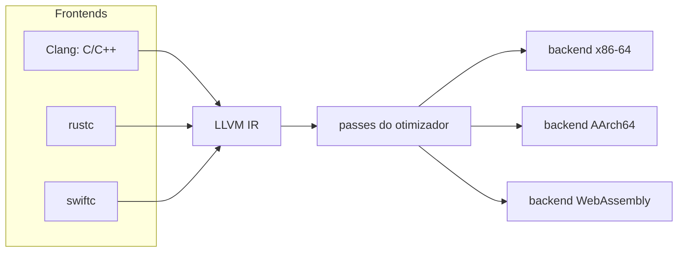

## Objetivos de Aprendizagem

- Explicar como um compilador em três fases com uma representação intermediária compartilhada reduz o trabalho de suportar $M$ linguagens em $N$ alvos de $M \times N$ para $M + N$.
- Ler LLVM IR: valores tipados, registradores virtuais, blocos básicos com terminadores, nós `phi`, `alloca`/`load`/`store` e flags como `nsw`.
- Descrever como um frontend emite IR baseada em memória e como o `mem2reg` a promove à forma SSA.
- Distinguir passes de análise de passes de transformação, e explicar como o comportamento indefinido da linguagem fonte vira liberdade de otimização na IR.

## Contexto e Motivação

`software-distributed/compilers` seguiu à mão uma expressão da AST até x86-64: código de três endereços, grafo de fluxo de controle, SSA, análises de fluxo de dados, otimizações, seleção de instruções e alocação de registradores. Compiladores reais precisam fazer tudo isso para muitas linguagens e muitas CPUs. Escritos separadamente, $M$ linguagens para $N$ arquiteturas exigem $M \times N$ compiladores. A resposta clássica, usada pelo GCC e tornada central pelo LLVM, é dividir o trabalho em três fases em torno de uma **representação intermediária** compartilhada: um frontend por linguagem traduz o código-fonte para IR, um otimizador independente de linguagem melhora a IR, e um backend por alvo transforma a IR em código de máquina. Agora suportar uma linguagem nova custa um frontend e suportar uma CPU nova custa um backend, $M + N$ peças no total.

O LLVM (Lattner e Adve, CGO 2004) é esse projeto como biblioteca. O Clang compila C, C++ e Objective-C sobre ele, `rustc`, Swift, Julia e Zig emitem LLVM IR, e projetos tão diferentes quanto a linguagem do tutorial Kaleidoscope e os compiladores de GPU em drivers gráficos reaproveitam o mesmo otimizador e os mesmos geradores de código. Saber como a LLVM IR se parece e o que os seus passes assumem é a forma mais prática de ver por que compiladores se comportam como se comportam, inclusive por que o comportamento indefinido em C pode apagar a sua checagem de limites.

## Teoria Central

### A forma da LLVM IR

A LLVM IR é uma linguagem tipada e de baixo nível em **forma SSA** com um suprimento ilimitado de registradores virtuais. Uma função é uma lista de **blocos básicos**; cada bloco é uma sequência linear de instruções que termina em exatamente um **terminador** (`br`, `ret`, `switch`, `unreachable`). Não há queda implícita para o bloco seguinte. Os valores se chamam `%x` ou são numerados `%0`, cada um é atribuído uma vez, e cada instrução declara os tipos dos seus operandos: `add i32 %a, %b`, `icmp slt i32 %a, 0`, `load i32, ptr %p`. Um nó `phi` no início de um bloco seleciona um valor conforme o bloco predecessor que acabou de executar. Desde o LLVM 15 os ponteiros são **opacos** (`ptr`), sem tipo apontado.

O mesmo programa tem três formas equivalentes: texto legível (`.ll`), um **bitcode** binário compacto (`.bc`) e uma estrutura de dados em memória que os passes manipulam. `clang -S -emit-llvm` imprime a forma textual.

### Frontends emitem memória, o `mem2reg` constrói SSA

Construir SSA diretamente num frontend significa calcular fronteiras de dominância e inserir nós `phi`, uma distração para quem escreve uma linguagem nova. A convenção do LLVM é que o frontend guarda toda variável local num `alloca` (um slot de pilha) e usa `load` e `store` em toda leitura e escrita. O passe **`mem2reg`** (e seu sucessor mais geral, o SROA) então promove os slots cujo endereço não escapa para registradores SSA, inserindo nós `phi` onde o fluxo de controle se junta. O frontend continua simples, e um único passe bem testado é dono da construção de SSA.

### Passes: análise e transformação

Um pipeline de otimização é uma sequência de **passes** executados pelo gerenciador de passes. Um **passe de análise** calcula fatos e não muda nada (árvore de dominância, informação de laços, análise de alias, evolução escalar). Um **passe de transformação** reescreve a IR usando esses fatos: `instcombine` (simplificação algébrica local), `gvn` (numeração global de valores, que engloba a eliminação de subexpressões comuns), `licm` (movimentação de código invariante de laço), `inline`, `simplifycfg`, `sroa`. Os níveis `-O1`, `-O2`, `-O3` são pipelines nomeados desses passes, e `opt -passes='mem2reg,instcombine' in.ll -S` roda um pipeline escolhido sobre um arquivo. Passes de transformação invalidam as análises que alteram; o gerenciador as recalcula sob demanda.

### Comportamento indefinido como liberdade de otimização

C diz que o overflow de inteiro com sinal é comportamento indefinido, então o Clang emite `add nsw` ("no signed wrap") para somas de `int`. O LLVM define o resultado de uma soma `nsw` que estoura como **poison**, uma forma adiada de comportamento indefinido. Os passes podem assumir que poison nunca é observado, o que autoriza transformações como trocar `x + 1 > x` por `true`. A IR também registra proveniência de ponteiros, alinhamento e informação de `noalias` que o frontend conhece e o otimizador não consegue redescobrir. A qualidade da otimização depende de o frontend dizer a verdade sobre o que a linguagem fonte garante.

### O backend

O backend reduz a IR às instruções de um alvo em etapas. A **seleção de instruções** (SelectionDAG, ou GlobalISel em alvos mais novos) escolhe instruções de máquina para as operações da IR usando padrões descritos nos arquivos TableGen do alvo, como na abordagem de casamento de padrões em árvores de `software-distributed/compilers`. Depois vêm o **escalonamento de instruções**, a **alocação de registradores** e a emissão de código, como arquivo objeto ou assembly. Como a descrição do alvo é dado, adicionar uma CPU nova é sobretudo escrever descrições, não código.



## Exemplos Resolvidos

### Exemplo 1: um laço com nós `phi`

**Problema:** Escrever a LLVM IR de `int sum(int n) { int acc = 0; for (int i = 0; i < n; i++) acc += i; return acc; }`.

**Solução:**

```text
define i32 @sum(i32 %n) {
entry:
  br label %header
header:
  %i   = phi i32 [ 0, %entry ], [ %i.next, %body ]
  %acc = phi i32 [ 0, %entry ], [ %acc.next, %body ]
  %cond = icmp slt i32 %i, %n
  br i1 %cond, label %body, label %exit
body:
  %acc.next = add i32 %acc, %i
  %i.next   = add i32 %i, 1
  br label %header
exit:
  ret i32 %acc
}
```

Cada `phi` lista um valor por predecessor: na primeira passagem pelo cabeçalho, `%i` vale 0 porque o controle veio de `%entry`; nas iterações seguintes vale `%i.next`, vindo de `%body`. As variáveis de laço que eram mutáveis em C viram valores SSA com um `phi` no cabeçalho, exatamente a representação que as otimizações de laço de `software-distributed/compilers` assumem.

### Exemplo 2: `mem2reg` num condicional

**Problema:** Mostrar o que o `mem2reg` faz com a IR sem otimização de `int abs(int x) { if (x < 0) x = -x; return x; }`.

**Antes** (saída do frontend, abreviada): o parâmetro é copiado para `%x.addr = alloca i32`. O bloco de entrada guarda `%x` ali, o carrega, compara com 0 e desvia. O bloco `then` carrega, nega e guarda de volta. O bloco `end` carrega e retorna.

**Depois do `mem2reg`:**

```text
define i32 @abs(i32 %x) {
entry:
  %cmp = icmp slt i32 %x, 0
  br i1 %cmp, label %then, label %end
then:
  %sub = sub nsw i32 0, %x
  br label %end
end:
  %r = phi i32 [ %sub, %then ], [ %x, %entry ]
  ret i32 %r
}
```

O `alloca`, todos os `load` e todos os `store` sumiram. Os dois valores que a variável `x` tinha na junção, o negado e o original, se encontram num `phi`. Passes posteriores agora enxergam através do código: `instcombine` e `simplifycfg` podem transformar o losango num `select` ou no intrínseco `llvm.abs`, que um backend mapeia para código de máquina sem desvios.

### Exemplo 3: por que `x + 1 > x` vira `true`

**Problema:** Uma função C `int f(int x) { return x + 1 > x; }` compila em `-O2` para `return 1`. Explique como isso é uma transformação correta.

**Solução:** O frontend emite `%add = add nsw i32 %x, 1` e `icmp sgt i32 %add, %x`. Quando `x` é `INT_MAX`, a soma `nsw` estoura e resulta em poison, então essa entrada não tem comportamento definido em C. Para todo outro `x`, a comparação é verdadeira. O otimizador tem portanto o direito de reduzi-la a `true` para todas as entradas que precisa preservar. Compilar com `-fwrapv`, que torna o overflow com sinal definido, remove a flag `nsw` e a redução desaparece. O mesmo raciocínio explica por que o compilador pode remover uma checagem de overflow escrita como `if (x + 1 < x)`.

## Equívocos Comuns e Armadilhas

- **"LLVM IR é bytecode portável, como o da JVM."** Ela é consciente do alvo: o frontend já escolheu tamanhos de tipos, layouts de structs e detalhes de convenção de chamada para uma tripla de alvo e um data layout específicos. O mesmo código C compila para IR diferente em alvos diferentes.
- **"O frontend precisa produzir SSA."** Não precisa, e a maioria não produz. Emitir código baseado em `alloca` e deixar o `mem2reg` ou o SROA construir o SSA é o fluxo pretendido.
- **"Otimizações só deixam o código mais rápido."** Elas também exploram comportamento indefinido, então um programa com bugs latentes de overflow, acesso fora dos limites ou aliasing pode se comportar diferente em `-O0` e `-O2`. O bug está no programa, e os sanitizers (`-fsanitize=undefined,address`) são a ferramenta para achá-lo.
- **"Uma IR melhor dá código melhor por si só."** Uma IR compartilhada só funciona se os frontends preservarem nela o conhecimento do nível da fonte (flags, tipos, metadados). Um frontend que omite `noalias` ou `nsw` perde otimizações que a linguagem fonte permitiria.

## Resumo

Uma representação intermediária compartilhada transforma $M \times N$ compiladores em $M + N$ componentes: frontends produzem IR, passes independentes de linguagem a melhoram e backends emitem código do alvo. A LLVM IR é SSA tipada organizada em blocos básicos com terminadores explícitos e nós `phi`. Frontends emitem slots de pilha e deixam o `mem2reg` construir o SSA, passes de análise e de transformação são escalonados por um gerenciador de passes, e flags como `nsw` carregam o comportamento indefinido da linguagem fonte como liberdade que o otimizador pode usar. O backend seleciona instruções a partir de descrições declarativas do alvo, escalona e aloca registradores. Os próximos conceitos passam de como compiladores são construídos para os sistemas de tipos que eles verificam, começando pelo polimorfismo paramétrico.

## Documentation Links

- [LLVM Language Reference Manual](https://llvm.org/docs/LangRef.html): doc
- [Lattner, Adve: LLVM: A Compilation Framework for Lifelong Program Analysis & Transformation (CGO 2004)](https://llvm.org/pubs/2004-01-30-CGO-LLVM.html): doc
- [LLVM Tutorial: My First Language Frontend with LLVM (Kaleidoscope)](https://llvm.org/docs/tutorial/MyFirstLanguageFrontend/index.html): doc
