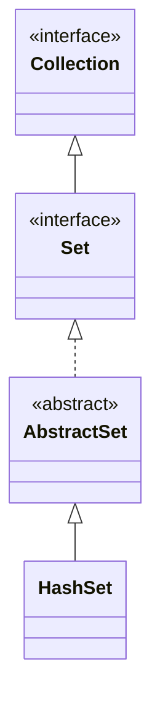

## Objective

Understand `HashSet`, the default `Set` implementation: elements are stored in a hash table, giving average constant-time `add`/`remove`/`contains` at the cost of any guaranteed iteration order.

## Use Cases

- Fast membership testing (`contains`) when order genuinely doesn't matter.
- Deduplicating a collection of values quickly.
- Pre-sizing the table via the capacity/fill-ratio constructor when the eventual element count is roughly known, to avoid rehashing during a large batch of inserts.

## Deep Dive

### HashSet extends AbstractSet

```java
class HashSet<E>
```

`HashSet` implements `Set<E>` and defines no additional methods beyond what `AbstractSet`/`Set`/`Collection` already provide — its contribution is entirely in *how* elements are stored, not in new API surface. Four constructors:

```java
HashSet<String> a = new HashSet<>();                        // default capacity 16, load factor 0.75
HashSet<String> b = new HashSet<>(List.of("x", "y"));        // initialized from a collection
HashSet<String> c = new HashSet<>(64);                       // initial capacity 64
HashSet<String> d = new HashSet<>(64, 0.5f);                  // capacity 64, load factor 0.5
```

The {{load factor}}[^collisions] (also called fill ratio) controls how full the table can get, as a fraction of capacity, before it's resized upward — 0.75 by default, meaning the table roughly doubles once it's three-quarters full.



### Lookup relies on hashCode() and equals()

An element's hash code determines which bucket it lands in; `equals()` then distinguishes elements that share a bucket. Both must be correct and consistent with each other for `add`/`contains`/`remove` to behave correctly — this is the same `Object` contract every hash-based structure in the JDK depends on.

[^collisions]: A collision happens when two different elements land in the *same bucket* — their hash codes don't need to be equal, just map to the same index after Java spreads and reduces the hash modulo the table's capacity:

```java
HashSet<String> hs = new HashSet<>(16);
hs.add("Apple");   // hashCode spreads to bucket 2
hs.add("Orange");  // hashCode spreads to bucket 2 as well — collision
```

`HashSet` doesn't drop either element — the bucket just holds both, and `equals()` (see above) is what tells them apart on a later lookup:

```
bucket 2 -> [Apple, Orange]
```

Since Java 8, a bucket that keeps growing doesn't stay a simple chain forever: once it passes 8 elements (`TREEIFY_THRESHOLD`), it's converted from a linked list into a small red-black tree, taking worst-case lookup inside that bucket from O(n) down to O(log n) — and it converts back to a list if a later resize shrinks it below 6 elements (`UNTREEIFY_THRESHOLD`). This is also what the load factor above is tuning: resizing sooner keeps buckets close to one element, at the cost of more allocated (mostly empty) buckets.

### Watch it happen: add() spreading elements across buckets

Each `add(element)` computes `element.hashCode()`, spreads its bits, and masks it against `capacity - 1` to pick a bucket — the same mechanism `HashMap` uses, since `HashSet` is a thin wrapper around one:

```viz
type: formula
capacity = nextPow2(count)
slot = (capacity - 1) & spread(hash(item))
---
Beta
Alpha
Eta
Gamma
Epsilon
Omega
```

### Iteration order is unspecified

```java
HashSet<String> hs = new HashSet<>();
hs.add("Beta"); hs.add("Alpha"); hs.add("Eta");
hs.add("Gamma"); hs.add("Epsilon"); hs.add("Omega");
System.out.println(hs); // [Gamma, Eta, Alpha, Epsilon, Omega, Beta] — order is table-layout dependent, not insertion order
```

The exact order depends on each element's hash code and the table's current capacity, not the order elements were added.

## Trade-offs

- **No iteration-order guarantee, and it can change between runs or after resizing** — if a stable order matters, use `LinkedHashSet` (insertion order); if a sorted order matters, use `TreeSet`.
- **Mutating a field involved in an element's `hashCode()` after it's already in the set breaks lookups silently** — the element sits in the bucket its *old* hash code pointed to, so `contains()`/`remove()` with an equal-looking object can return `false`/no-op instead of finding it:

  ```java
  class Point { int x; /* hashCode() based on x */ }
  Point p = new Point(1);
  HashSet<Point> set = new HashSet<>();
  set.add(p);
  p.x = 2;              // mutated after insertion
  set.contains(p);      // may return false — p is now in the wrong bucket
  ```
- **Average O(1) operations assume a reasonably distributed `hashCode()`** — a poor hash function that collides heavily degrades `add`/`contains`/`remove` toward O(n), since every colliding element has to be checked with `equals()`.
- **`HashSet` is not synchronized** — same caveat as `ArrayList`/`LinkedList` for concurrent or in-loop structural modification.

## Lab

In this lab you get the `TagIndex` class, which keeps an item's tags in a `HashSet<String>`, and you implement set algebra on top of it: intersection, difference and, in the challenge, union. The core idea is to do these operations with `retainAll()`, `removeAll()` and `addAll()` on defensive COPIES, so that asking something about two sets never changes either of them.

**The scenario**

An item (an article, a photo, a bookmark) has tags, and tags are case-insensitive: `"Java"` and `"java"` are the same tag.

- `TagIndex.java`: holds `tags` (a `Set<String>` backed by a `HashSet`). `size()` is already written. You implement adding, checking and comparing with another index.

Those set methods (`retainAll`, `removeAll`, `addAll`) MODIFY the set they are called on. Calling them directly on `tags` would corrupt the index, and the tests check precisely that neither index changes.

**What you will do, step by step**

1. **Add with normalization (TODO-00).** In `addTag()`, convert the tag to lower case, add it to the set and return `true` if it was new or `false` if it was already there. The return value of `Set.add()` already answers that.
2. **Check ignoring case (TODO-01).** In `hasTag()`, convert to lower case and check for presence.
3. **Intersection (TODO-02).** In `commonTagsWith()`, copy this index's tags into a new `HashSet` and apply `retainAll()` with the other's tags. The result is a NEW set with the tags present in both.
4. **Difference (TODO-03).** In `tagsOnlyInThis()`, copy this index's tags and apply `removeAll()` with the other's, leaving only what exists here and not there.

**How you know you are done**

`mvn test` is all green. You should be able to explain what would happen to the original index if `retainAll()` were called directly on `tags`, and why the copy fixes it.

**Optional challenges**

- **TODO-04:** implement `allTagsCombined()` (the union) with `addAll()` on a copy, again without mutating either index.

**Prerequisites:** basic Java syntax and familiarity with the `Set` interface.

**How to run it:** clone the repository, go into `java-concepts/hash-set` and run `mvn test` (or, from the root, `mvn -pl java-concepts/hash-set test`). The pending methods throw `UnsupportedOperationException("Not implemented yet.")` with a `TODO-NN` comment, so the red tests are your checklist.

## Documentation Links

- *Java: The Complete Reference*, 12th Edition (Herbert Schildt) — Chapter 20, pp. 590–591 — book
- [HashSet — Java SE 25 API](https://docs.oracle.com/en/java/javase/25/docs/api/java.base/java/util/HashSet.html) — doc
- [Set — Java SE 25 API](https://docs.oracle.com/en/java/javase/25/docs/api/java.base/java/util/Set.html) — doc
