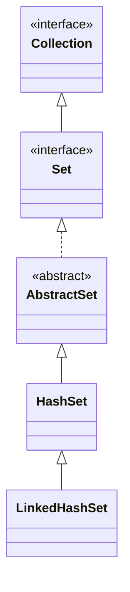

## Objective

Understand `LinkedHashSet`, a `HashSet` subclass that adds no new members of its own but threads a linked list through the hash table's entries, so iteration visits elements in the order they were inserted instead of hash-bucket order.

## Use Cases

- Needing `Set` uniqueness plus a predictable, reproducible iteration order — for stable test output, logs, or UI lists.
- Wanting `HashSet`-level lookup performance without giving up a meaningful iteration order.
- Building an ordered "seen values" cache where insertion order (not access order) is what matters.

## Deep Dive

### LinkedHashSet extends HashSet, adds nothing new

```java
class LinkedHashSet<E>
```

Its constructors parallel `HashSet`'s exactly (no-arg, from a `Collection`, with a capacity, with a capacity and load factor) — the type adds behavior, not API surface.



### Insertion-order iteration

```java
LinkedHashSet<String> lhs = new LinkedHashSet<>();
lhs.add("Beta"); lhs.add("Alpha"); lhs.add("Eta");
lhs.add("Gamma"); lhs.add("Epsilon"); lhs.add("Omega");
System.out.println(lhs); // [Beta, Alpha, Eta, Gamma, Epsilon, Omega] — insertion order, every time
```

Compare this to the same sequence of `add()` calls on a plain `HashSet` — the elements are identical, but the order printed is not. This is also the order `toString()` produces and the order an `Iterator` walks.

### Watch it happen: same elements, insertion-order slots instead of a scattered bucket layout

Same six elements as the `HashSet` viz, same arrival order — but here the extra linked list threaded through the table means iteration walks them back out in arrival order, not scattered by hash:

```viz
type: formula
capacity = count
slot = index
---
Beta
Alpha
Eta
Gamma
Epsilon
Omega
```

The lookup underneath (`add`/`contains`/`remove`) still goes through the same hash-bucket layout `HashSet` uses — only the *iteration* order shown here is different.

### Same hash-based lookup underneath

The extra linked list only changes *iteration* order — `add`/`contains`/`remove` still go through the same hash-table lookup `HashSet` uses, so their average-case cost is unaffected by the ordering bookkeeping.

## Trade-offs

- **Order reflects first insertion, not most-recent activity** — re-adding an element that's already present is a no-op (`Set` semantics: `add()` returns `false`), so it does not move to the end of the iteration order the way an LRU structure would:

  ```java
  LinkedHashSet<String> lhs = new LinkedHashSet<>(List.of("a", "b", "c"));
  lhs.add("a"); // no-op, already present
  System.out.println(lhs); // [a, b, c] — "a" did not move
  ```
- **The linked-list bookkeeping costs a small amount of extra memory per entry** compared to a plain `HashSet`, in exchange for the ordering guarantee — pay it only when the order is actually used.
- **Still no sorted order** — `LinkedHashSet` preserves insertion order, not ascending order; use `TreeSet` when the elements themselves need to dictate the order.

## Lab

In this lab you get the `RecentSearches` class and you implement a capped, deduplicated, insertion-ordered search history using `LinkedHashSet`. The central point is evicting the oldest entry manually through the `Iterator`, the classic technique that works on any JDK version, and noticing that re-adding an element already in a `Set` does nothing, not even change its position.

**The scenario**

A search box keeps the last queries typed, up to a limit. Each query appears at most once, and the history reads from oldest to newest.

- `RecentSearches.java`: holds `searches` (a `LinkedHashSet<String>`) and the `capacity` given to the constructor. You implement recording, listing and checking.

Two rules drive the behavior:

- **Re-searching an already recorded query does NOT move it.** `Set.add()` on an element that is already there is a no-op: it does not re-insert or reorder. The query keeps the position of its first time.
- **A genuinely new query at full capacity evicts the oldest one.** The `LinkedHashSet` iterator walks from oldest to newest, so its first element is always the eviction candidate.

**What you will do, step by step**

1. **Record with a cap (TODO-00).** In `record()`, if the query is already present, do nothing. If it is new and adding it would exceed `capacity`, first get the iterator, advance it once and call `Iterator.remove()` to evict the oldest. Then add the new one.
2. **List in order (TODO-01).** In `history()`, return the searches in insertion order, oldest first, as a new `List`.
3. **Check (TODO-02).** In `hasSearched()`, return whether the query is recorded and has not been evicted.

**How you know you are done**

`mvn test` is all green. You should be able to explain why repeating a search does not "refresh" it in this history and why the iterator's first element is the right one to evict.

**Optional challenges**

- **TODO-03:** implement `mostRecent()`, returning the most recently added search still present, or `null` when nothing has been recorded.

**Prerequisites:** basic Java syntax, the `Set` interface and `Iterator`.

**How to run it:** clone the repository, go into `java-concepts/linked-hash-set` and run `mvn test` (or, from the root, `mvn -pl java-concepts/linked-hash-set test`). The pending methods throw `UnsupportedOperationException("Not implemented yet.")` with a `TODO-NN` comment, so the red tests are your checklist.

## Documentation Links

- *Java: The Complete Reference*, 12th Edition (Herbert Schildt) — Chapter 20, pp. 591–592 — book
- [LinkedHashSet — Java SE 25 API](https://docs.oracle.com/en/java/javase/25/docs/api/java.base/java/util/LinkedHashSet.html) — doc
- [HashSet — Java SE 25 API](https://docs.oracle.com/en/java/javase/25/docs/api/java.base/java/util/HashSet.html) — doc
